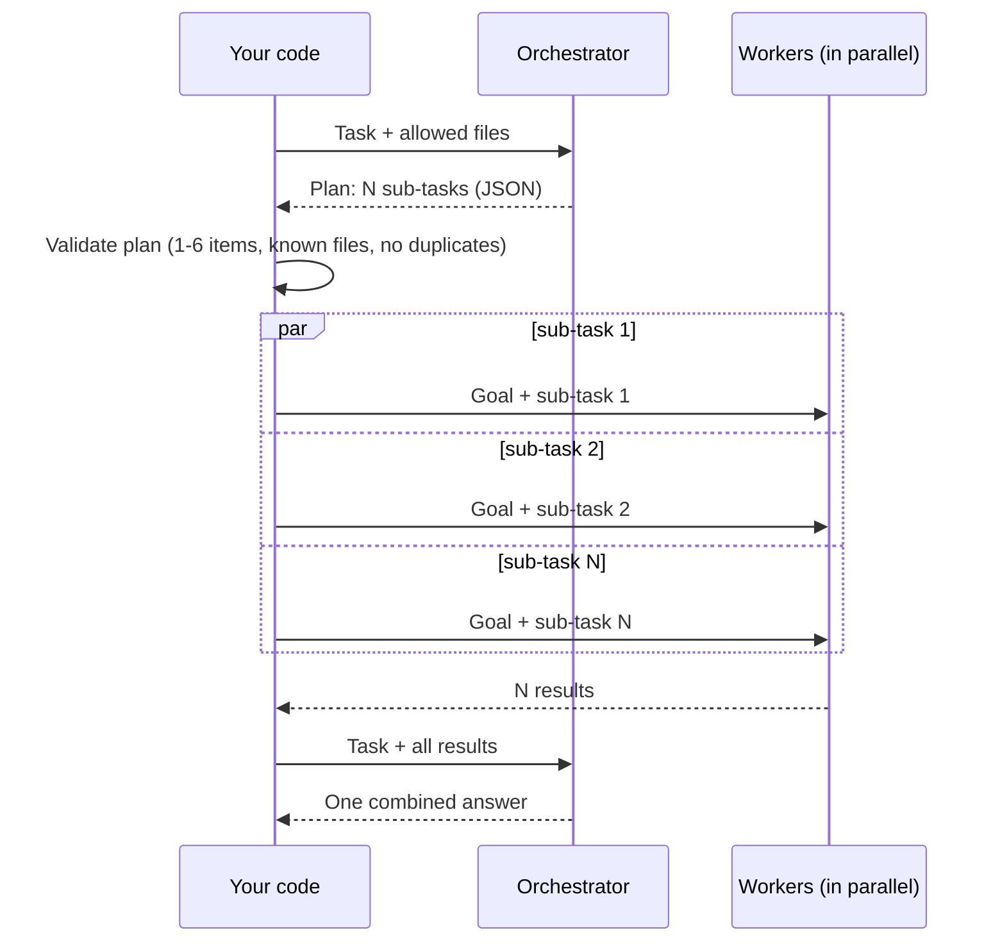

🏠 [Home](../../README.md) › [09 · Agent Design Patterns](./README.md) › 9.4 Orchestrator–workers

# 9.4 Orchestrator–workers

> **Difficulty:** 🟡 Intermediate · **Reading time:** ~10 min · **Prerequisites:** [9.3 Parallelisation](./09.3-parallelisation.md), [7.3 Task decomposition](../07-planning-and-reasoning/07.3-task-decomposition.md)

**In one sentence:** In orchestrator–workers, a lead model looks at the task and decides at run time what the sub-tasks are, worker calls do one sub-task each, and the lead combines their results into one answer.

📑 **On this page**

- [Why does this matter?](#-why-does-this-matter)
- [The idea, in plain words](#-the-idea-in-plain-words)
- [Picture it](#-picture-it)
- [How it works, step by step](#-how-it-works-step-by-step)
- [Worked example](#-worked-example)
- [Code](#-code)
- [Common mistakes & gotchas](#-common-mistakes--gotchas)
- [Key takeaways](#-key-takeaways)
- [Try it yourself](#-try-it-yourself)
- [Further reading](#-further-reading)

## 🤔 Why does this matter?

Sectioning ([9.3](./09.3-parallelisation.md)) works when you know the parts in advance: security, performance, readability, every time. But many tasks don't come with a fixed split. "Fix the typo in the README" touches one file. "Record when users last logged in and show it on the admin page" touches the model, a migration, the login code, a template and the tests. You can't hard-code that list; it depends on the request.

Orchestrator–workers handles this. A lead model reads the task and writes the plan; your code runs a worker per item in that plan; the lead pulls the results together. It is how many coding and research systems handle open-ended requests.

## 🧠 The idea, in plain words

Think of a general contractor renovating a kitchen. They look at the job and decide which trades are needed: an electrician, a plumber, a tiler. A different job needs a different crew. Each trade does its own part without needing to know every detail of the others. At the end, the contractor checks the work fits together and hands over one finished kitchen.

In [orchestrator–workers](../../GLOSSARY.md#orchestrator-workers):

- The **orchestrator** is an [LLM](../../GLOSSARY.md#large-language-model-llm) call that breaks the task into sub-tasks and returns them as a structured plan.
- **Workers** are LLM calls (often with [tools](../../GLOSSARY.md#tool)) that each handle one sub-task, given the overall goal plus their own piece.
- **Synthesis** is a final orchestrator call that reads every worker's output and produces one answer.

Anthropic's [Building effective agents](https://www.anthropic.com/engineering/building-effective-agents) puts the key difference from parallelisation clearly: the shape looks the same, but the sub-tasks are **not predefined**. The orchestrator decides them based on the specific input. The post's examples are coding products that make complex changes across many files, and search tasks that gather and analyse information from several sources.

This pattern sits between [workflows](../../GLOSSARY.md#workflow) and [agents](../../GLOSSARY.md#agent) on the [autonomy spectrum](../../GLOSSARY.md#autonomy-spectrum): the model decides *what* the sub-tasks are, but your code still owns the overall flow (plan → work → combine). When workers become full agents that talk to each other, you are in [multi-agent](../10-multi-agent-systems/README.md) territory.

## 👀 Picture it



*N is decided by the orchestrator, not by you. Your code checks the plan before any worker runs, so a bad plan costs one call, not N+2.*

## 🔍 How it works, step by step

1. **Plan in a structured format.** Ask the orchestrator for JSON: a list of sub-tasks, each with a target (a file, a source, a question) and an instruction. Tell it what it may target, such as a list of repository files or allowed tools.
2. **Validate the plan in code.** At least one sub-task, at most a cap (say 6); only allowed targets; no two workers on the same file (they would overwrite each other). Reject or re-ask on failure.
3. **Brief each worker narrowly.** The overall goal, its own sub-task, and only the context it needs. Workers don't need the whole plan, and a smaller input is cheaper.
4. **Run workers concurrently** if their sub-tasks are independent, with a concurrency cap ([9.3](./09.3-parallelisation.md)). If some depend on others, run them in order of dependency, or ask the orchestrator to mark dependencies.
5. **Synthesise.** Give the orchestrator the task and every worker's output; ask for one combined result. This is also where it can spot conflicts ("the template expects `last_seen`, the model defines `last_login`").
6. **Optionally loop.** For research-style tasks, the orchestrator may read the results and plan another round. Put a cap on rounds, as with any loop.
7. **Choose models per role.** The orchestrator's planning and synthesis usually benefit from a capable model; well-scoped worker tasks can often use a smaller one.

## 💡 Worked example

Two tasks through the *same* code, with scripted replies:

```text
Task: Record when each user last logged in, and show it on the admin users page.
  orchestrator planned 5 sub-task(s):
    - app/models/user.py: Add a nullable last_login timestamp field.
    - migrations/: Add a migration that creates the last_login column.
    - app/auth/login.py: Set last_login to the current UTC time on success.
    - app/admin/templates/users.html: Add a 'Last login' column.
    - tests/test_login.py: Test that a successful login sets last_login.
  summary:
    This change touches 5 files:
    - app/models/user.py: Added `last_login = Column(DateTime(timezone=True), nullable=True)` to User.
    - migrations/: New migration 0042_add_last_login adds a nullable last_login column to users.
    - app/auth/login.py: After a successful password check, set `user.last_login = datetime.now(UTC)` and save.
    - app/admin/templates/users.html: Added a 'Last login' column showing the date, or 'never' if empty.
    - tests/test_login.py: Added test_successful_login_sets_last_login and test_failed_login_leaves_it_unchanged.

Task: Fix the typo 'recieve' in the README.
  orchestrator planned 1 sub-task(s):
    - README.md: Replace 'recieve' with 'receive'.
  summary:
    This change touches 1 file:
    - README.md: Changed 'recieve' to 'receive' in the Notifications section.
```

Same code, different shapes: seven model calls for the feature (plan, five workers, synthesis) and three for the typo. With sectioning, you'd have had to decide the split in advance and would have run five workers on the typo too. (In this demo, workers only *describe* their change. A real coding agent would give each worker file-editing tools and run the tests afterwards.)

## 💻 Code

The whole pattern in about 20 lines. `orchestrator` and `worker` are chat-model clients whose `.chat(messages, system=...)` returns a reply with `.text`, and `user()` builds a user message dict:

```python
def orchestrate(task: str, orchestrator, worker, *, max_workers: int = 4) -> OrchestratorResult:
    # 1. Plan: the orchestrator decides the sub-tasks for THIS input, as JSON.
    plan = parse_plan(orchestrator.chat([user(task)], system=ORCHESTRATOR_SYSTEM).text)  # validated

    # 2. Work: each worker gets the overall goal plus only its own sub-task.
    def do(sub: Subtask) -> str:
        prompt = f"Overall goal: {task}\nYour file: {sub.file}\nYour sub-task: {sub.instruction}"
        return worker.chat([user(prompt)], system=WORKER_SYSTEM).text.strip()

    with ThreadPoolExecutor(max_workers=max_workers) as pool:
        outputs = list(pool.map(do, plan))             # keeps the plan's order

    # 3. Synthesise: the orchestrator sees every result and writes one answer.
    report = "\n".join(f"- {s.file}: {out}" for s, out in zip(plan, outputs))
    summary = orchestrator.chat([user(f"Task: {task}\n\nChanges made:\n{report}")], system=SYNTH_SYSTEM).text
    return OrchestratorResult(plan, outputs, summary)
```

`parse_plan` is where the safety lives: it rejects non-JSON, empty or oversized plans, files outside `REPO_FILES`, and two sub-tasks on the same file, all before a single worker call. `orchestrator` and `worker` are separate clients, so you can give workers a cheaper model. Anthropic's [orchestrator–workers cookbook notebook](https://github.com/anthropics/claude-cookbooks/tree/main/patterns/agents) shows the same shape with the raw SDK.

## 🚨 Common mistakes & gotchas

- **Using it when the split is fixed.** If every request needs the same three parts, a planning call adds cost and unpredictability for nothing. **Fix:** use sectioning ([9.3](./09.3-parallelisation.md)) or a chain ([9.1](./09.1-prompt-chaining.md)).
- **Trusting the plan.** The orchestrator can invent files, plan 40 sub-tasks, or send two workers to the same file. **Fix:** validate in code against an allow-list and a cap, before any worker runs.
- **Workers that overlap or conflict.** Two workers editing shared code produce changes that don't fit. **Fix:** one owner per file or resource; let synthesis check consistency; run tests after.
- **Starving workers of context.** A worker that only sees "Add a 'Last login' column" doesn't know the field is called `last_login`. **Fix:** always include the overall goal, and any shared decisions (names, interfaces) from the plan.
- **Flooding the synthesiser.** Ten workers each returning 5,000 [tokens](../../GLOSSARY.md#token) can overflow the orchestrator's [context window](../../GLOSSARY.md#context-window). **Fix:** ask workers for concise, structured results.
- **Unbounded re-planning.** "Plan again after reading the results" can loop forever. **Fix:** a maximum number of rounds and a token budget ([16.5](../16-cost-and-performance/16.5-budget-limits-per-run.md)).

## ✅ Key takeaways

- The orchestrator decides the sub-tasks at run time; that is what separates this from sectioning.
- Plan as JSON, validate it in code (cap, allow-list, no overlaps), and only then run workers.
- Workers get the overall goal plus their own piece; they often run in parallel and can use a cheaper model.
- A final synthesis call combines the results and can catch conflicts.
- Use it when you can't predict the sub-tasks; otherwise a fixed chain or split is simpler.

## 🧪 Try it yourself

1. Suppose the orchestrator returns a plan that puts `README.md` in two sub-tasks. What happens, and why is that rule there?
2. For the feature task, how many model calls are made, and which of them could reasonably use a smaller model?
3. A research assistant gets "Compare the refund policies of our three competitors." Would you use sectioning or orchestrator–workers? What about "Research whatever is needed to answer this customer's question"?

<details>
<summary>Show answer</summary>

1. `parse_plan` raises `PlanError("two sub-tasks change the same file; workers would conflict")` and no worker runs. Two workers editing the same file in parallel would each produce a change without seeing the other's, and one would overwrite or contradict the other.
2. Seven: one plan, five workers, one synthesis. The five worker calls are narrow, well-specified tasks and are the natural place for a smaller model. Planning and synthesis need the most judgement, so keep the capable model there.
3. The first has a fixed, known split (three competitors, one call each): sectioning. The second can't be predicted (it may need one search or ten), so orchestrator–workers, or a full agent with a search tool ([chapter 10](../10-multi-agent-systems/README.md)).

</details>

## 📚 Further reading

- [Building effective agents](https://www.anthropic.com/engineering/building-effective-agents) (Anthropic). Orchestrator–workers and how it differs from parallelisation.
- [How we built our multi-agent research system](https://www.anthropic.com/engineering/multi-agent-research-system) (Anthropic). A lead agent planning and delegating to parallel sub-agents in production.
- [Agent patterns cookbook](https://github.com/anthropics/claude-cookbooks/tree/main/patterns/agents) (Anthropic). Includes an `orchestrator_workers` notebook.

<!-- FOOTER -->

---

⬅️ **Previous:** [9.3 Parallelisation (sectioning & voting)](./09.3-parallelisation.md) ·
🏠 [Chapter home](./README.md) ·
➡️ **Next:** [9.5 Evaluator–optimizer](./09.5-evaluator-optimizer.md)
