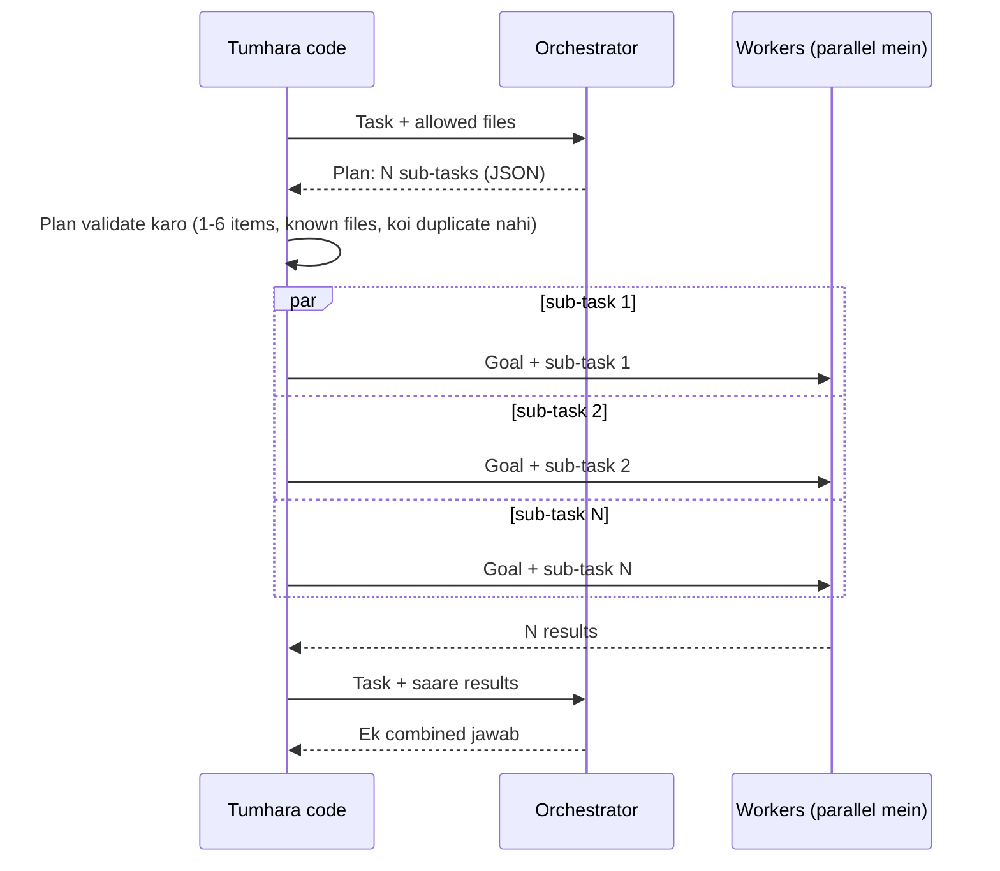

🏠 [Home](../../README.md) › [09 · Agent Design Patterns](./README.md) › 9.4 Orchestrator–workers

# 9.4 Orchestrator–workers

> **Level:** 🟡 Intermediate · **Padhne ka time:** ~10 min · **Pehle padho:** [9.3 Parallelisation (sectioning aur voting)](./09.3-parallelisation.md), [7.3 Task decomposition](../07-planning-and-reasoning/07.3-task-decomposition.md)

**Ek line mein:** Orchestrator–workers mein ek lead model task dekhta hai aur run time par decide karta hai ki sub-tasks kya hain. Worker calls ek-ek sub-task karti hain, aur lead unke results ko jod ke ek jawab banata hai.

📑 **Is page par**

- [Yeh kyun zaroori hai?](#-yeh-kyun-zaroori-hai)
- [Idea, simple words mein](#-idea-simple-words-mein)
- [Diagram se samjho](#-diagram-se-samjho)
- [Kaise kaam karta hai, step by step](#-kaise-kaam-karta-hai-step-by-step)
- [Example se samjho](#-example-se-samjho)
- [Code](#-code)
- [Aam galtiyan aur dhyan dene wali baatein](#-aam-galtiyan-aur-dhyan-dene-wali-baatein)
- [Yaad rakhne wali baatein](#-yaad-rakhne-wali-baatein)
- [Khud try karo](#-khud-try-karo)
- [Aur padhne ke liye](#-aur-padhne-ke-liye)

## 🤔 Yeh kyun zaroori hai?

Sectioning ([9.3](./09.3-parallelisation.md)) tab kaam karta hai jab tumhe hisse pehle se pata hon: security, performance, readability, har baar. Lekin bahut saare tasks ka koi fixed split nahi hota. "Fix the typo in the README" sirf ek file chhoota hai. "Record when users last logged in and show it on the admin page" model, ek migration, login code, ek template aur tests, sab chhoota hai. Tum yeh list hard-code nahi kar sakte. Yeh request par depend karti hai.

Orchestrator–workers yahi handle karta hai. Ek lead model task padhta hai aur plan likhta hai. Tumhara code plan ke har item ke liye ek worker chalata hai. Lead saare results ko jod deta hai. Bahut saare coding aur research systems open-ended requests aise hi handle karte hain.

## 🧠 Idea, simple words mein

Ek contractor socho jo kitchen renovate kar raha hai. Woh kaam dekh ke decide karta hai ki kaun-kaun chahiye: electrician, plumber, tiles wala. Alag kaam ke liye alag team. Har kaarigar apna hissa karta hai, use baaki sabki har detail jaanne ki zaroorat nahi. Aakhir mein contractor check karta hai ki sab theek se fit hua, aur ek finished kitchen handover karta hai.

Shaadi ke function wala example bhi le sakte ho. Ghar ka bada (orchestrator) dekhta hai is baar kya chahiye: tent wala, halwai, DJ, photographer. Chhoti pooja ho toh sirf halwai. Har vendor apna kaam karta hai, aur bada aakhir mein dekhta hai ki sab milke ek function bana.

[Orchestrator–workers](../../GLOSSARY.md#orchestrator-workers) mein:

- **Orchestrator** ek [LLM](../../GLOSSARY.md#large-language-model-llm) call hai jo task ko sub-tasks mein todti hai aur unhe ek structured plan ke roop mein return karti hai.
- **Workers** LLM calls hain (aksar [tools](../../GLOSSARY.md#tool) ke saath). Har ek ek sub-task handle karta hai. Use overall goal aur apna hissa diya jata hai.
- **Synthesis** ek final orchestrator call hai jo har worker ka output padhti hai aur ek jawab banati hai.

Anthropic ka [Building effective agents](https://www.anthropic.com/engineering/building-effective-agents) parallelisation se main fark saaf batata hai. Shape same dikhti hai, lekin sub-tasks **pehle se defined nahi** hote. Orchestrator unhe specific input dekh ke decide karta hai. Post ke examples hain: coding products jo kai files mein complex changes karte hain, aur search tasks jo kai sources se information ikattha karke analyse karte hain.

Yeh pattern [autonomy spectrum](../../GLOSSARY.md#autonomy-spectrum) par [workflows](../../GLOSSARY.md#workflow) aur [agents](../../GLOSSARY.md#agent) ke beech baitha hai. Model decide karta hai ki sub-tasks *kya* hain, lekin overall flow (plan → work → combine) abhi bhi tumhara code control karta hai. Jab workers full agents ban jaate hain jo aapas mein baat karte hain, tab tum [multi-agent](../10-multi-agent-systems/README.md) wale area mein ho.

## 👀 Diagram se samjho



*N orchestrator decide karta hai, tum nahi. Tumhara code kisi bhi worker ke chalne se pehle plan check karta hai. Isliye kharab plan ka kharcha ek call hai, N+2 nahi.*

## 🔍 Kaise kaam karta hai, step by step

1. **Structured format mein plan karo.** Orchestrator se JSON maango: sub-tasks ki list, har ek mein ek target (file, source, sawal) aur ek instruction. Use batao ki woh kya target kar sakta hai, jaise repository files ki list ya allowed tools.
2. **Plan ko code mein validate karo.** Kam se kam ek sub-task, zyada se zyada ek cap (maan lo 6). Sirf allowed targets. Ek file par do workers nahi (woh ek doosre ka kaam overwrite kar denge). Fail ho toh reject karo ya dobara poocho.
3. **Har worker ko narrow brief do.** Overall goal, uska apna sub-task, aur sirf utna context jitna use chahiye. Workers ko poora plan nahi chahiye, aur chhota input sasta hai.
4. **Workers ek saath chalao** agar unke sub-tasks independent hain, concurrency cap ke saath ([9.3](./09.3-parallelisation.md)). Agar kuch doosron par depend karte hain, toh unhe dependency ke order mein chalao, ya orchestrator se dependencies mark karwao.
5. **Synthesise karo.** Orchestrator ko task aur har worker ka output do, aur ek combined result maango. Yahi woh jagah bhi hai jahan woh conflicts pakad sakta hai ("the template expects `last_seen`, the model defines `last_login`").
6. **Chaaho toh loop karo.** Research jaise tasks ke liye, orchestrator results padh ke ek aur round plan kar sakta hai. Kisi bhi loop ki tarah, rounds par cap lagao.
7. **Har role ke liye model chuno.** Orchestrator ki planning aur synthesis ko aksar capable model se fayda hota hai. Achhe se scoped worker tasks aksar chhote model se chal jaate hain.

## 💡 Example se samjho

*Wahi* code, do tasks, scripted replies ke saath:

```text
Task: Record when each user last logged in, and show it on the admin users page.
  orchestrator planned 5 sub-task(s):
    - app/models/user.py: Add a nullable last_login timestamp field.
    - migrations/: Add a migration that creates the last_login column.
    - app/auth/login.py: Set last_login to the current UTC time on success.
    - app/admin/templates/users.html: Add a 'Last login' column.
    - tests/test_login.py: Test that a successful login sets last_login.
  summary:
    This change touches 5 files:
    - app/models/user.py: Added `last_login = Column(DateTime(timezone=True), nullable=True)` to User.
    - migrations/: New migration 0042_add_last_login adds a nullable last_login column to users.
    - app/auth/login.py: After a successful password check, set `user.last_login = datetime.now(UTC)` and save.
    - app/admin/templates/users.html: Added a 'Last login' column showing the date, or 'never' if empty.
    - tests/test_login.py: Added test_successful_login_sets_last_login and test_failed_login_leaves_it_unchanged.

Task: Fix the typo 'recieve' in the README.
  orchestrator planned 1 sub-task(s):
    - README.md: Replace 'recieve' with 'receive'.
  summary:
    This change touches 1 file:
    - README.md: Changed 'recieve' to 'receive' in the Notifications section.
```

Code same, shape alag. Feature ke liye saat model calls (plan, paanch workers, synthesis), aur typo ke liye teen. Sectioning mein tumhe split pehle se decide karna padta, aur typo par bhi paanch workers chalte. (Is demo mein workers apna change sirf *describe* karte hain. Ek asli coding agent har worker ko file-editing tools deta aur baad mein tests chalata.)

## 💻 Code

Poora pattern lagbhag 20 lines mein. `orchestrator` aur `worker` chat-model clients hain jinka `.chat(messages, system=...)` ek reply return karta hai jismein `.text` ho, aur `user()` ek user message dict banata hai:

```python
def orchestrate(task: str, orchestrator, worker, *, max_workers: int = 4) -> OrchestratorResult:
    # 1. Plan: orchestrator IS input ke liye sub-tasks decide karta hai, JSON mein.
    plan = parse_plan(orchestrator.chat([user(task)], system=ORCHESTRATOR_SYSTEM).text)  # validated

    # 2. Work: har worker ko overall goal aur sirf apna sub-task milta hai.
    def do(sub: Subtask) -> str:
        prompt = f"Overall goal: {task}\nYour file: {sub.file}\nYour sub-task: {sub.instruction}"
        return worker.chat([user(prompt)], system=WORKER_SYSTEM).text.strip()

    with ThreadPoolExecutor(max_workers=max_workers) as pool:
        outputs = list(pool.map(do, plan))             # plan ka order bana rehta hai

    # 3. Synthesise: orchestrator har result dekhta hai aur ek jawab likhta hai.
    report = "\n".join(f"- {s.file}: {out}" for s, out in zip(plan, outputs))
    summary = orchestrator.chat([user(f"Task: {task}\n\nChanges made:\n{report}")], system=SYNTH_SYSTEM).text
    return OrchestratorResult(plan, outputs, summary)
```

Safety `parse_plan` mein rehti hai. Yeh non-JSON, khaali ya bahut bade plans, `REPO_FILES` ke bahar ki files, aur ek hi file par do sub-tasks, sabko reject karta hai, aur yeh sab ek bhi worker call se pehle. `orchestrator` aur `worker` alag clients hain, isliye tum workers ko sasta model de sakte ho. Anthropic ka [orchestrator–workers cookbook notebook](https://github.com/anthropics/claude-cookbooks/tree/main/patterns/agents) raw SDK ke saath yahi shape dikhata hai.

## 🚨 Aam galtiyan aur dhyan dene wali baatein

- **Fixed split hone par bhi ise use karna.** Agar har request ko wahi teen hisse chahiye, toh planning call bekaar mein cost aur unpredictability badhati hai. **Fix:** sectioning ([9.3](./09.3-parallelisation.md)) ya chain ([9.1](./09.1-prompt-chaining.md)) use karo.
- **Plan par aankh band karke bharosa.** Orchestrator files invent kar sakta hai, 40 sub-tasks plan kar sakta hai, ya ek file par do workers bhej sakta hai. **Fix:** kisi bhi worker ke chalne se pehle, code mein allow-list aur cap ke against validate karo.
- **Workers jo overlap ya conflict karte hain.** Shared code edit karne wale do workers aise changes banate hain jo fit nahi hote. **Fix:** har file ya resource ka ek owner. Synthesis ko consistency check karne do. Baad mein tests chalao.
- **Workers ko context ke liye tarsaana.** Jo worker sirf "Add a 'Last login' column" dekhta hai, use nahi pata ki field ka naam `last_login` hai. **Fix:** hamesha overall goal include karo, aur plan ke shared decisions (names, interfaces) bhi.
- **Synthesiser ko flood karna.** Das workers har ek 5,000 [tokens](../../GLOSSARY.md#token) return karein, toh orchestrator ki [context window](../../GLOSSARY.md#context-window) overflow ho sakti hai. **Fix:** workers se concise, structured results maango.
- **Bina limit ke re-planning.** "Plan again after reading the results" hamesha ke liye loop kar sakta hai. **Fix:** rounds ki maximum sankhya aur ek token budget ([16.5](../16-cost-and-performance/16.5-budget-limits-per-run.md)).

## ✅ Yaad rakhne wali baatein

- Orchestrator sub-tasks run time par decide karta hai. Yahi ise sectioning se alag karta hai.
- Plan JSON mein banao, code mein validate karo (cap, allow-list, koi overlap nahi), aur tabhi workers chalao.
- Workers ko overall goal aur apna hissa milta hai. Woh aksar parallel mein chalte hain aur sasta model use kar sakte hain.
- Ek final synthesis call results jodti hai aur conflicts pakad sakti hai.
- Ise tab use karo jab sub-tasks predict na ho sakein. Warna fixed chain ya split simple hai.

## 🧪 Khud try karo

1. Maan lo orchestrator aisa plan return karta hai jismein `README.md` do sub-tasks mein hai. Kya hoga, aur yeh rule kyun hai?
2. Feature task ke liye kitni model calls hoti hain, aur unmein se kaunsi reasonably chhota model use kar sakti hain?
3. Ek research assistant ko milta hai "Compare the refund policies of our three competitors." Tum sectioning use karoge ya orchestrator–workers? Aur "Research whatever is needed to answer this customer's question" ke liye?

<details>
<summary>Answer dekho</summary>

1. `parse_plan` `PlanError("two sub-tasks change the same file; workers would conflict")` raise karta hai aur koi worker nahi chalta. Ek hi file ko parallel mein edit karne wale do workers ek doosre ka change dekhe bina apna change banate. Ek doosre ko overwrite kar deta ya usse contradict karta.
2. Saat: ek plan, paanch workers, ek synthesis. Paanch worker calls narrow, achhe se defined tasks hain, aur chhote model ke liye sabse natural jagah hain. Planning aur synthesis mein sabse zyada judgement chahiye, isliye wahan capable model rakho.
3. Pehle ka split fixed aur pata hai (teen competitors, har ek ki ek call): sectioning. Doosra predict nahi ho sakta (ek search lag sakti hai ya das), isliye orchestrator–workers, ya search tool wala full agent ([chapter 10](../10-multi-agent-systems/README.md)).

</details>

## 📚 Aur padhne ke liye

- [Building effective agents](https://www.anthropic.com/engineering/building-effective-agents) (Anthropic). Orchestrator–workers, aur yeh parallelisation se kaise alag hai.
- [How we built our multi-agent research system](https://www.anthropic.com/engineering/multi-agent-research-system) (Anthropic). Production mein ek lead agent jo plan karta hai aur parallel sub-agents ko kaam deta hai.
- [Agent patterns cookbook](https://github.com/anthropics/claude-cookbooks/tree/main/patterns/agents) (Anthropic). Isme ek `orchestrator_workers` notebook hai.

<!-- FOOTER -->

---

⬅️ **Pichla:** [9.3 Parallelisation (sectioning aur voting)](./09.3-parallelisation.md) ·
🏠 [Chapter home](./README.md) ·
➡️ **Agla:** [9.5 Evaluator–optimizer](./09.5-evaluator-optimizer.md)
