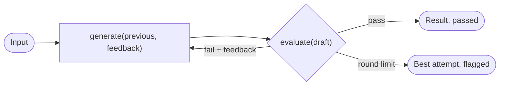

🏠 [Home](../../README.md) › [09 · Agent Design Patterns](./README.md) › 9.5 Evaluator–optimizer

# 9.5 Evaluator–optimizer

> **Difficulty:** 🟡 Intermediate · **Reading time:** ~6 min · **Prerequisites:** [8.2 The evaluator–optimizer loop](../08-reflection-and-self-correction/08.2-evaluator-optimizer-loop.md)

**In one sentence:** Evaluator–optimizer is the generate-grade-revise loop packaged as a reusable building block: give it a `generate` function and an `evaluate` function, and it loops until a result passes or a round limit is reached.

📑 **On this page**

- [Why does this matter?](#-why-does-this-matter)
- [The idea, in plain words](#-the-idea-in-plain-words)
- [Picture it](#-picture-it)
- [How it works, step by step](#-how-it-works-step-by-step)
- [Worked example](#-worked-example)
- [Code](#-code)
- [Common mistakes & gotchas](#-common-mistakes--gotchas)
- [Key takeaways](#-key-takeaways)
- [Try it yourself](#-try-it-yourself)
- [Further reading](#-further-reading)

## 🤔 Why does this matter?

Chapter 8 covered the evaluator–optimizer loop in depth: rubrics, hard checks, structured verdicts, and the limits of self-correction ([8.2](../08-reflection-and-self-correction/08.2-evaluator-optimizer-loop.md), [8.4](../08-reflection-and-self-correction/08.4-limits-of-self-correction.md)). This page looks at it as one of the composable [workflow](../../GLOSSARY.md#workflow) patterns from Anthropic's [Building effective agents](https://www.anthropic.com/engineering/building-effective-agents): a block you can drop inside the other patterns. One step in a chain needs polishing; a worker's output needs checking before synthesis; a routed handler needs a quality bar. The same small loop serves all of them.

## 🧠 The idea, in plain words

It is a quality-control station you can install anywhere on the assembly line. Whatever arrives is checked; if it fails, it goes back with a note; it leaves only when it passes, or when the station gives up and flags it.

The [evaluator–optimizer](../../GLOSSARY.md#evaluator-optimizer) block needs only two things from you:

- **`generate(previous, feedback)`:** produce a draft; on later rounds, improve the previous draft using the feedback.
- **`evaluate(draft)`:** return a verdict: passed or not, a score, and feedback. It can be code, a model with a rubric, a test run, or a mix.

Anthropic's post names two signs of a good fit: a human's feedback would clearly improve the output, and a model (or a check) can give that feedback. Its examples include literary translation, where an evaluator can catch nuances the translator missed, and multi-round search, where the evaluator decides whether more searching is needed.

## 👀 Picture it



*The block has one input and two possible outputs. Either can feed the next step of a larger pattern; the "flagged" output is a natural place to bring in a human ([9.6](./09.6-human-in-the-loop.md)).*

## 🔍 How it works, step by step

1. **Decide where quality matters.** Put the block around the one step whose output most often fails, not around everything.
2. **Write `evaluate` first.** Prefer exact checks in code and real signals (tests, schemas); use a model with a rubric for judgement ([8.2](../08-reflection-and-self-correction/08.2-evaluator-optimizer-loop.md)).
3. **Write `generate`** so it uses the feedback when it's given.
4. **Set `max_rounds`** (usually 2 or 3) and decide what the caller does with a flagged result: ship it, retry later, or send it to a person.
5. **Compose.** Call the block from inside a chain step, a worker, or a routed handler, exactly like any other function.

## 💡 Worked example

The [`examples/08-evaluator-optimizer`](../../examples/08-evaluator-optimizer/README.md) run, seen as a building block:

```text
--- round 1: 64 words -> FAIL (score 0)
feedback: Too long: 64 words, the limit is 50.
Must mention the order number A-1042.
--- round 2: 29 words -> FAIL (score 60)
feedback: Criterion 3 unmet: offer the code SORRY10 and say it gives 10% off.
--- round 3: 40 words -> PASS (score 95)

Result: passed after 3 round(s).
```

(Drafts omitted; see [8.2](../08-reflection-and-self-correction/08.2-evaluator-optimizer-loop.md#-worked-example) for the full trace.) The caller only sees `OptimizeResult(best=..., passed=True, rounds=[...])`. If this were step 2 of the prompt chain in [9.1](./09.1-prompt-chaining.md), step 3 (translation) would receive `best` and carry on.

## 💻 Code

The block is one function with no knowledge of models, from [`examples/08-evaluator-optimizer/main.py`](../../examples/08-evaluator-optimizer/main.py):

```python
def optimize(generate, evaluate, *, max_rounds: int = 3) -> OptimizeResult:
    rounds, draft, feedback = [], None, None
    for _ in range(max_rounds):
        draft = generate(draft, feedback)
        verdict = evaluate(draft)
        rounds.append(Round(draft, verdict))
        if verdict.passed:
            return OptimizeResult(best=draft, passed=True, rounds=rounds)
        feedback = verdict.feedback
    best = max(rounds, key=lambda r: r.verdict.score)
    return OptimizeResult(best=best.draft, passed=False, rounds=rounds)
```

Reusing it somewhere else means writing two small functions. For example, a product title for the shop, with a code-only evaluator:

```python
def generate_title(previous: str | None, feedback: str | None) -> str:
    prompt = f"Write a product title for: {product}."
    if previous:
        prompt += f"\nPrevious title: {previous}\nFix this: {feedback}"
    return llm.chat([user(prompt)]).text.strip()

def evaluate_title(title: str) -> Verdict:
    problems = []
    if len(title) > 60:
        problems.append(f"{len(title)} characters; the limit is 60.")
    if "!" in title:
        problems.append("No exclamation marks.")
    return Verdict(passed=not problems, score=100 - 25 * len(problems), feedback=" ".join(problems))

result = optimize(generate_title, evaluate_title, max_rounds=2)
```

Here the evaluator is pure code: no second model, no extra cost per round beyond the generator.

## 🚨 Common mistakes & gotchas

- **Wrapping every step.** Each round costs at least one more call and adds latency. **Fix:** use it only where you've measured that first attempts fail and feedback fixes them.
- **An evaluator that can't really evaluate.** If the check is "ask the same model if it's good", see [8.4](../08-reflection-and-self-correction/08.4-limits-of-self-correction.md). **Fix:** code checks, real signals, or a separate evaluator with a rubric.
- **Ignoring `passed=False`.** Treating the best attempt as a success ships known-bad output. **Fix:** the caller must handle the flag explicitly.
- **Nesting loops inside loops.** An evaluator–optimizer inside each of five workers inside a re-planning orchestrator can multiply calls fast. **Fix:** count the worst case (rounds × workers × re-plans) and set a run budget ([16.5](../16-cost-and-performance/16.5-budget-limits-per-run.md)).

## ✅ Key takeaways

- Evaluator–optimizer is a small, reusable loop: `generate`, `evaluate`, stop on pass or after N rounds.
- It composes with every other pattern: inside a chain step, a worker or a routed handler.
- The evaluator can be code, tests, a rubric-driven model, or a mix; code is cheapest and most reliable.
- Always handle the "did not pass" outcome on purpose.

## 🧪 Try it yourself

1. In the product-title example, what does `optimize` return if both rounds produce a 70-character title with an exclamation mark?
2. Where would you put an evaluator–optimizer in the orchestrator–workers example from [9.4](./09.4-orchestrator-workers.md)?

<details>
<summary>Show answer</summary>

1. `OptimizeResult(best=<the first title>, passed=False, rounds=[...])`. Both rounds score 50 (two problems), and `max` returns the first of equal scores. The caller should treat it as a failure: show it for review, or fall back to a template.
2. Around each worker, with the tests for that file as the evaluator, so a worker's change is fixed before synthesis. Or around the synthesis step, with a rubric ("mentions every changed file", "flags conflicts"). Pick the one where failures actually happen, and watch the total call count.

</details>

## 📚 Further reading

- [Building effective agents](https://www.anthropic.com/engineering/building-effective-agents) (Anthropic). The evaluator–optimizer workflow and the signs it is a good fit.
- [Agent patterns cookbook](https://github.com/anthropics/claude-cookbooks/tree/main/patterns/agents) (Anthropic). Includes an `evaluator_optimizer` notebook.
- [8.2 The evaluator–optimizer loop](../08-reflection-and-self-correction/08.2-evaluator-optimizer-loop.md). The in-depth page: rubrics, hard checks, structured verdicts.

<!-- FOOTER -->

---

⬅️ **Previous:** [9.4 Orchestrator–workers](./09.4-orchestrator-workers.md) ·
🏠 [Chapter home](./README.md) ·
➡️ **Next:** [9.6 Human-in-the-loop](./09.6-human-in-the-loop.md)
