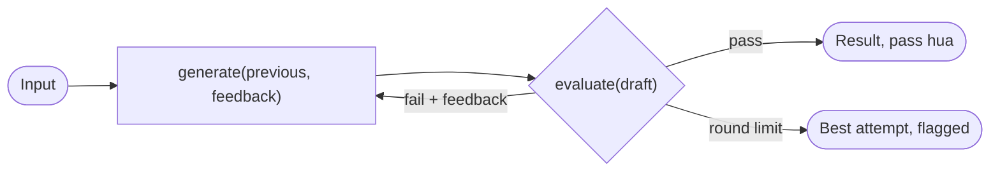

🏠 [Home](../../README.md) › [09 · Agent Design Patterns](./README.md) › 9.5 Evaluator–optimizer

# 9.5 Evaluator–optimizer

> **Level:** 🟡 Intermediate · **Padhne ka time:** ~6 min · **Pehle padho:** [8.2 Evaluator–optimizer loop](../08-reflection-and-self-correction/08.2-evaluator-optimizer-loop.md)

**Ek line mein:** Evaluator–optimizer generate-grade-revise loop ko ek reusable building block mein pack kar deta hai. Tum use ek `generate` function aur ek `evaluate` function do, aur woh tab tak loop karta hai jab tak result pass na ho jaye ya round limit na aa jaye.

📑 **Is page par**

- [Yeh kyun zaroori hai?](#-yeh-kyun-zaroori-hai)
- [Idea, simple words mein](#-idea-simple-words-mein)
- [Diagram se samjho](#-diagram-se-samjho)
- [Kaise kaam karta hai, step by step](#-kaise-kaam-karta-hai-step-by-step)
- [Example se samjho](#-example-se-samjho)
- [Code](#-code)
- [Aam galtiyan aur dhyan dene wali baatein](#-aam-galtiyan-aur-dhyan-dene-wali-baatein)
- [Yaad rakhne wali baatein](#-yaad-rakhne-wali-baatein)
- [Khud try karo](#-khud-try-karo)
- [Aur padhne ke liye](#-aur-padhne-ke-liye)

## 🤔 Yeh kyun zaroori hai?

Chapter 8 ne evaluator–optimizer loop ko detail mein dekha tha: rubrics, hard checks, structured verdicts, aur self-correction ki limits ([8.2](../08-reflection-and-self-correction/08.2-evaluator-optimizer-loop.md), [8.4](../08-reflection-and-self-correction/08.4-limits-of-self-correction.md)). Yeh page use Anthropic ke [Building effective agents](https://www.anthropic.com/engineering/building-effective-agents) ke composable [workflow](../../GLOSSARY.md#workflow) patterns mein se ek ki tarah dekhta hai. Yaani ek block jo tum baaki patterns ke andar fit kar sakte ho.

Chain ke kisi ek step ko polish chahiye. Synthesis se pehle kisi worker ka output check hona chahiye. Kisi routed handler ko quality bar chahiye. Yahi chhota loop in sabke kaam aata hai.

## 🧠 Idea, simple words mein

Yeh ek quality-control station hai jo tum assembly line par kahin bhi laga sakte ho. Jo bhi aata hai, check hota hai. Fail ho toh ek note ke saath wapas jata hai. Bahar tabhi jata hai jab pass ho, ya jab station haar maan ke use flag kar de.

Exam ki taiyari jaisa socho. Tum answer likhte ho, teacher check karke galtiyan batata hai, tum sudhaar ke dobara likhte ho. Do-teen round ke baad bhi na sudhre, toh teacher use alag se mark kar deta hai.

[Evaluator–optimizer](../../GLOSSARY.md#evaluator-optimizer) block ko tumse sirf do cheezein chahiye:

- **`generate(previous, feedback)`:** ek draft banao. Baad ke rounds mein, feedback use karke pichhla draft improve karo.
- **`evaluate(draft)`:** ek verdict return karo: pass hua ya nahi, ek score, aur feedback. Yeh code ho sakta hai, rubric wala model, test run, ya inka mix.

Anthropic ka post achhe fit ke do signs batata hai. Pehla: insaan ka feedback output ko clearly behtar banata. Doosra: koi model (ya check) woh feedback de sakta hai. Uske examples mein literary translation hai, jahan evaluator woh nuances pakad sakta hai jo translator se chhoot gaye. Aur multi-round search, jahan evaluator decide karta hai ki aur search chahiye ya nahi.

## 👀 Diagram se samjho



*Block ka ek input hai aur do possible outputs. Dono mein se koi bhi bade pattern ke agle step ko feed kar sakta hai. "Flagged" output insaan ko laane ki natural jagah hai ([9.6](./09.6-human-in-the-loop.md)).*

## 🔍 Kaise kaam karta hai, step by step

1. **Decide karo ki quality kahan matter karti hai.** Block ko us ek step ke around lagao jiska output sabse zyada fail hota hai, har cheez ke around nahi.
2. **Pehle `evaluate` likho.** Code mein exact checks aur real signals (tests, schemas) ko pehle rakho. Judgement ke liye rubric wala model use karo ([8.2](../08-reflection-and-self-correction/08.2-evaluator-optimizer-loop.md)).
3. **`generate` likho** aise ki jab feedback mile, woh use use kare.
4. **`max_rounds` set karo** (aam taur par 2 ya 3), aur decide karo ki caller flagged result ke saath kya karega: ship karega, baad mein retry karega, ya kisi insaan ko bhejega.
5. **Compose karo.** Block ko chain step, worker, ya routed handler ke andar se call karo, bilkul kisi aur function ki tarah.

## 💡 Example se samjho

[8.2](../08-reflection-and-self-correction/08.2-evaluator-optimizer-loop.md#-example-se-samjho) wala run, building block ki nazar se:

```text
--- round 1: 64 words -> FAIL (score 0)
feedback: Too long: 64 words, the limit is 50.
Must mention the order number A-1042.
--- round 2: 29 words -> FAIL (score 60)
feedback: Criterion 3 unmet: offer the code SORRY10 and say it gives 10% off.
--- round 3: 40 words -> PASS (score 95)

Result: passed after 3 round(s).
```

(Drafts hata diye gaye hain. Poora trace [8.2](../08-reflection-and-self-correction/08.2-evaluator-optimizer-loop.md#-example-se-samjho) mein dekho.) Caller ko sirf `OptimizeResult(best=..., passed=True, rounds=[...])` dikhta hai. Agar yeh [9.1](./09.1-prompt-chaining.md) wali prompt chain ka step 2 hota, toh step 3 (translation) ko `best` milta aur woh aage chal padta.

## 💻 Code

Block ek function hai jise models ke baare mein kuch nahi pata (wahi jo [8.2](../08-reflection-and-self-correction/08.2-evaluator-optimizer-loop.md#-code) mein hai):

```python
def optimize(generate, evaluate, *, max_rounds: int = 3) -> OptimizeResult:
    rounds, draft, feedback = [], None, None
    for _ in range(max_rounds):
        draft = generate(draft, feedback)
        verdict = evaluate(draft)
        rounds.append(Round(draft, verdict))
        if verdict.passed:
            return OptimizeResult(best=draft, passed=True, rounds=rounds)
        feedback = verdict.feedback
    best = max(rounds, key=lambda r: r.verdict.score)
    return OptimizeResult(best=best.draft, passed=False, rounds=rounds)
```

Ise kahin aur reuse karne ka matlab hai do chhote functions likhna. Example: shop ke liye product title, code-only evaluator ke saath (`llm` koi bhi chat-model client hai, jaise [9.1](./09.1-prompt-chaining.md#-code) mein):

```python
def generate_title(previous: str | None, feedback: str | None) -> str:
    prompt = f"Write a product title for: {product}."
    if previous:
        prompt += f"\nPrevious title: {previous}\nFix this: {feedback}"
    return llm.chat([user(prompt)]).text.strip()

def evaluate_title(title: str) -> Verdict:
    problems = []
    if len(title) > 60:
        problems.append(f"{len(title)} characters; the limit is 60.")
    if "!" in title:
        problems.append("No exclamation marks.")
    return Verdict(passed=not problems, score=100 - 25 * len(problems), feedback=" ".join(problems))

result = optimize(generate_title, evaluate_title, max_rounds=2)
```

Yahan evaluator pura code hai. Koi doosra model nahi, aur har round mein generator ke alawa koi extra cost nahi.

## 🚨 Aam galtiyan aur dhyan dene wali baatein

- **Har step ko wrap karna.** Har round mein kam se kam ek call aur lagti hai aur latency badhti hai. **Fix:** ise sirf wahan use karo jahan tumne measure kiya hai ki pehli koshish fail hoti hai aur feedback se theek ho jaati hai.
- **Aisa evaluator jo sach mein evaluate nahi kar sakta.** Agar check hai "same model se poocho ki achha hai ya nahi", toh [8.4](../08-reflection-and-self-correction/08.4-limits-of-self-correction.md) dekho. **Fix:** code checks, real signals, ya rubric ke saath alag evaluator.
- **`passed=False` ko ignore karna.** Best attempt ko success maan lena matlab jaana-pehchaana kharab output ship karna. **Fix:** caller ko flag explicitly handle karna hoga.
- **Loops ke andar loops.** Re-planning orchestrator ke andar paanch workers, aur har worker ke andar evaluator–optimizer: calls bahut tezi se multiply ho sakti hain. **Fix:** worst case gino (rounds × workers × re-plans) aur run budget set karo ([16.5](../16-cost-and-performance/16.5-budget-limits-per-run.md)).

## ✅ Yaad rakhne wali baatein

- Evaluator–optimizer ek chhota, reusable loop hai: `generate`, `evaluate`, pass hone par ya N rounds ke baad ruko.
- Yeh har doosre pattern ke saath jud jata hai: chain step, worker ya routed handler ke andar.
- Evaluator code, tests, rubric-driven model, ya mix ho sakta hai. Code sabse sasta aur sabse reliable hai.
- "Pass nahi hua" wala outcome hamesha soch-samajh ke handle karo.

## 🧪 Khud try karo

1. Product-title example mein, agar dono rounds mein exclamation mark wala 70-character title bane, toh `optimize` kya return karega?
2. [9.4](./09.4-orchestrator-workers.md) ke orchestrator–workers example mein tum evaluator–optimizer kahan lagaoge?

<details>
<summary>Answer dekho</summary>

1. `OptimizeResult(best=<the first title>, passed=False, rounds=[...])`. Dono rounds ka score 50 hai (do problems), aur barabar scores mein `max` pehla return karta hai. Caller ko ise failure maanna chahiye: review ke liye dikhao, ya template par fallback karo.
2. Har worker ke around, us file ke tests ko evaluator banake, taaki synthesis se pehle worker ka change theek ho jaye. Ya synthesis step ke around, ek rubric ke saath ("mentions every changed file", "flags conflicts"). Woh jagah chuno jahan failures sach mein hoti hain, aur total call count par nazar rakho.

</details>

## 📚 Aur padhne ke liye

- [Building effective agents](https://www.anthropic.com/engineering/building-effective-agents) (Anthropic). Evaluator–optimizer workflow, aur woh signs jo batate hain ki yeh achha fit hai.
- [Agent patterns cookbook](https://github.com/anthropics/claude-cookbooks/tree/main/patterns/agents) (Anthropic). Isme ek `evaluator_optimizer` notebook hai.
- [8.2 Evaluator–optimizer loop](../08-reflection-and-self-correction/08.2-evaluator-optimizer-loop.md). Detail wala page: rubrics, hard checks, structured verdicts.

<!-- FOOTER -->

---

⬅️ **Pichla:** [9.4 Orchestrator–workers](./09.4-orchestrator-workers.md) ·
🏠 [Chapter home](./README.md) ·
➡️ **Agla:** [9.6 Human-in-the-loop](./09.6-human-in-the-loop.md)
