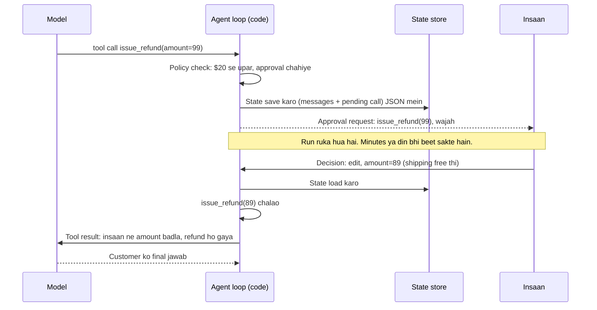

🏠 [Home](../../README.md) › [09 · Agent Design Patterns](./README.md) › 9.6 Human-in-the-loop

# 9.6 Human-in-the-loop

> **Level:** 🟡 Intermediate · **Padhne ka time:** ~8 min · **Pehle padho:** [3.3 Function calling kaise kaam karta hai](../03-tools-and-function-calling/03.3-how-function-calling-works.md), [2.3 50 lines mein agent, bilkul zero se](../02-the-agent-loop/02.3-a-50-line-agent-from-scratch.md)

**Ek line mein:** Human-in-the-loop ka matlab hai ki agent kuch chuni hui jagahon par rukta hai, taaki koi insaan action ko approve, edit ya reject kar sake, ya poora case khud le le. Phir run us decision ke saath aage chalta hai.

📑 **Is page par**

- [Yeh kyun zaroori hai?](#-yeh-kyun-zaroori-hai)
- [Idea, simple words mein](#-idea-simple-words-mein)
- [Diagram se samjho](#-diagram-se-samjho)
- [Kaise kaam karta hai, step by step](#-kaise-kaam-karta-hai-step-by-step)
- [Example se samjho](#-example-se-samjho)
- [Code](#-code)
- [Aam galtiyan aur dhyan dene wali baatein](#-aam-galtiyan-aur-dhyan-dene-wali-baatein)
- [Yaad rakhne wali baatein](#-yaad-rakhne-wali-baatein)
- [Khud try karo](#-khud-try-karo)
- [Aur padhne ke liye](#-aur-padhne-ke-liye)

## 🤔 Yeh kyun zaroori hai?

Tumhara support [agent](../../GLOSSARY.md#agent) orders dekh sakta hai aur refunds de sakta hai. Ek customer kehta hai ki uska $89 ka blender toota hua aaya. Agent order dekhta hai aur **$99** ke liye `issue_refund` call kar deta hai. Usne shipping jod di, jabki shipping free thi. Agar refund turant chal jaye, toh tumhare $10 gaye. Aur usse bura, tumhe pata chala ki agent apni marzi se paisa kharch karta hai.

Zyada tar real agents ke paas aise kuch actions hote hain: refunds, customers ko emails, data delete karna, code deploy karna. Inhe bina check ke chalana bahut risky hai, lekin hatana bhi nuksaan hai kyunki yeh bahut kaam ke hain. Jawab yeh hai ki theek unhi jagahon par ek insaan ko loop mein rakho, aur kahin nahi.

## 🧠 Idea, simple words mein

Ek junior employee socho jiske paas company card hai. Woh office ka saman freely khareed sakta hai. $20 se upar ki kisi bhi cheez ke liye manager ka signature chahiye. Manager sign kar sakta hai, amount badal sakta hai, ya mana karke wajah bata sakta hai. Agar junior ko samajh hi na aaye ki kya karna hai, toh woh case manager ko de deta hai.

Ghar mein bhi yahi hota hai. Bachche ko sabzi lene ke paise diye, woh khud le aata hai. Lekin naya phone lena ho toh papa se poochna padega. Papa haan bol sakte hain, model badal sakte hain, ya mana kar sakte hain.

[Human-in-the-loop](../../GLOSSARY.md#human-in-the-loop-hitl) (HITL) agent ko yahi rules deta hai, chaar moves ke saath:

| Move | Kaun shuru karta hai | Kya hota hai |
| --- | --- | --- |
| **Approve** | Code, approval gate par | Action bilkul waise chalta hai jaise model ne maanga |
| **Edit** | Code, approval gate par | Action insaan ke sahi kiye hue arguments ke saath chalta hai, aur model ko bataya jata hai ki kya badla |
| **Reject** | Code, approval gate par | Action nahi chalta. Model ko wajah ke saath error result milta hai aur use adjust karna padta hai |
| **Escalate** | Model, ek [tool](../../GLOSSARY.md#tool) ke through | Model poora case summary ke saath ek insaan ko de deta hai |

Approval **policy code mein rehti hai**, prompt mein nahi. "Refunds over $20 need approval" ek `if` hai, isliye model baatein bana ke isse bach nahi sakta. Anthropic ka [Building effective agents](https://www.anthropic.com/engineering/building-effective-agents) aise agents batata hai jo checkpoints par ya rukawat aane par human feedback ke liye rukte hain. Yeh page dikhata hai ki woh pauses kaise banate hain. Safety wala hissa (kaunse actions ko approval chahiye aur kyun) [13.5](../13-safety-and-guardrails/13.5-human-approval-for-risky-actions.md) mein hai.

## 👀 Diagram se samjho



*Jab tak decision nahi hota, tool kabhi nahi chalta. Kyunki state save hoti hai, isliye jo process run ko resume karta hai, use wahi process hona zaroori nahi jisne use roka tha.*

## 🔍 Kaise kaam karta hai, step by step

1. **Gated actions chuno.** Jo wapas nahi ho sakte, mehenge hain, ya bahar ki duniya ko chhoote hain: paisa, customers ko messages, deletes, deploys. Read-only tools ko aam taur par gate nahi chahiye.
2. **Policy code mein likho.** Ek function jaise `needs_approval(call) -> reason | None` jo tool ka naam aur arguments (amount, recipient, environment) check kare. Thresholds config mein rakho.
3. **Tool chalne se pehle beech mein roko.** Agent loop mein, har tool call ko *execute karne se pehle* policy ke against check karo.
4. **Insaan se poocho, do mein se ek tarike se:**
   - **Callback:** `approver(request)` call karo aur `Decision` ka wait karo. Simple hai. CLIs, chat bots aur tests ke liye theek hai, jahan koi seconds mein jawab de deta hai.
   - **Pause aur resume:** ek "paused" result return karo jismein serialisable state ho (ab tak ki conversation aur pending calls). Ise database ya queue mein store karo. Jab insaan decide kare, shayad din baad aur kisi aur process mein, toh ise load karo aur `resume(state, decision)` call karo.
5. **Insaan ko exact action dikhao.** Tool ka naam, arguments, kyun roka gaya, aur relevant context (customer ka message, order). Jo request sirf "Approve refund?" kehti hai, woh bina soche approve karne ko nyota deti hai.
6. **Decision ko tool result mein badlo.** Approve → chalao. Edit → naye arguments ke saath chalao, aur result mein yeh batao. Reject → mat chalao. Wajah ke saath error result bhejo (Anthropic par `is_error: true`; OpenAI mein aisa flag nahi hai, isliye text mein "Error:" likho). Har tool call ko phir bhi exactly ek result milna chahiye, warna agli API call fail hoti hai.
7. **Model ko escalation tool do.** `escalate_to_human(summary)` se woh tab handoff kar sakta hai jab woh unsure ya atka hua ho, guess karne ke bajaye.
8. **Har decision log karo.** Kisne kya approve kiya, kab, aur kin arguments ke saath. Yeh tumhara audit trail hai, aur policy tune karne ka sabse achha data bhi.

## 💡 Example se samjho

Scripted replies ke saath ek run aisa dikhta hai:

```text
Goal: Order 1234: the customer says the blender arrived broken and wants their money back.

PART 1: pause, save state, a human edits the refund, resume
  status: paused; waiting on issue_refund({'order_id': '1234', 'amount': 99.0, 'reason': 'arrived broken'})
  saved state: 762 bytes of JSON
  tool: get_order({'order_id': '1234'}) -> {"order_id": "1234", "item": "Blender", "price": 89.0, "shipping": 0.0, "status": "delivered"}
  paused: issue_refund({'order_id': '1234', 'amount': 99.0, 'reason': 'arrived broken'}) needs approval (refund over $20)
  human: edit -> {'order_id': '1234', 'amount': 89.0, 'reason': 'arrived broken'} (Shipping was free, so refund the item price only.)
  tool: issue_refund({'order_id': '1234', 'amount': 89.0, 'reason': 'arrived broken'}) -> Refunded $89.00 for order 1234 (ref R-7781).
  status: done
  answer: I've refunded $89.00 for the broken blender on order 1234 (ref R-7781). The customer should see it in 3-5 working days.

PART 2: an approval callback rejects the refund, the agent escalates
  tool: get_order({'order_id': '1234'}) -> {"order_id": "1234", "item": "Blender", "price": 89.0, "shipping": 0.0, "status": "delivered"}
  human: reject (Ask the customer for photos of the damage first.)
  tool: issue_refund NOT run (rejected)
  escalated: Refund for broken blender (order 1234) was rejected pending photos. Please contact the customer.
  status: escalated

Refunds actually issued: [{'order_id': '1234', 'amount': 89.0, 'reason': 'arrived broken'}]
```

- **Part 1:** `get_order` bina rok-tok chala. $99 ka refund policy se takraya aur run ruk gaya, 762 bytes JSON save karke. Ek *naye* agent object ne us JSON se resume kiya, jaise restart ke baad hota. Model ke agle turn ne padha: *"A human reviewer changed the arguments to {... 'amount': 89.0 ...}. Shipping was free, so refund the item price only. Result: Refunded $89.00 ..."*. Isliye uske jawab mein sahi amount aaya.
- **Part 2:** callback ne refund reject kar diya. Model ko wajah ke saath error result mila. Usne retry nahi kiya, aur summary ke saath escalate kar diya.
- **Aakhri line** dikhati hai ki sirf approved $89 wala refund hi kabhi chala.

## 💻 Code

Asli cheez ek check hai, "model ne maanga" aur "tool chala" ke beech. Simplified version. `call` model ke reply ki ek tool call hai (`.id`, `.name` aur dict ke roop mein `.arguments` ke saath):

```python
def needs_approval(call: ToolCall) -> str | None:
    """Policy, code mein. Model ek if-statement se behas nahi kar sakta."""
    if call.name == "issue_refund" and float(call.arguments.get("amount", 0)) > AUTO_APPROVE_LIMIT:
        return f"refund over ${AUTO_APPROVE_LIMIT:.0f}"
    return None

# agent loop ke andar, model ki har tool call ke liye:
reason = needs_approval(call)
if reason is None:
    messages.append(run_tool(call, call.arguments))
elif approver is None:                                   # abhi poochne ke liye koi nahi: pause karo
    state = {"messages": to_json(messages), "pending_calls": [call_to_dict(c) for c in [call, *queued]]}
    return RunResult("paused", pending=ApprovalRequest(call.name, call.arguments, reason), state=state)
else:                                                    # abhi poocho, aur wait karo
    messages.append(apply(call, approver(ApprovalRequest(call.name, call.arguments, reason))))
```

Decision apply karna, taaki model ko har call ka hamesha ek result mile:

```python
def apply(call: ToolCall, decision: Decision) -> Message:
    if decision.action == "approve":
        return run_tool(call, call.arguments)
    if decision.action == "edit":
        msg = run_tool(call, decision.arguments)
        msg["content"] = f"A human reviewer changed the arguments to {decision.arguments}. {decision.note} Result: {msg['content']}"
        return msg
    return tool_result(call.id, f"A human reviewer rejected this action. Reason: {decision.note}", is_error=True)
```

**Real provider ke saath state save karna.** State matlab message list aur pending calls. Anthropic ke saath, ek assistant turn mein thinking blocks ho sakte hain jinhe bina badle wapas bhejna zaroori hai. Un content blocks ko plain dicts ke roop mein store karo (`block.model_dump(mode="json", exclude_none=True)`), taaki paused state valid JSON rahe. Chapter 15 durable storage aur crash ke baad resume karna cover karta hai ([15.4](../15-production-and-deployment/15.4-state-persistence-and-resumability.md)).

**Frameworks mein** in ideas ke naam hain. LangGraph `interrupt()` se graph pause karta hai, checkpointer se state save karta hai, aur `Command` se resume karta hai ([docs](https://docs.langchain.com/oss/python/langgraph/interrupts)). OpenAI Agents SDK mein ek tool `needs_approval` declare kar sakta hai, pending approvals interruptions ke roop mein dikhte hain, aur paused run `RunState` ke roop mein serialise hota hai ([docs](https://openai.github.io/openai-agents-python/human_in_the_loop/)).

## 🚨 Aam galtiyan aur dhyan dene wali baatein

- **Policy prompt mein.** [System prompt](../../GLOSSARY.md#system-prompt) mein "Always ask before refunds over $20" ek request hai, control nahi. Confused ya manipulated model ise skip kar sakta hai ([prompt injection](../../GLOSSARY.md#prompt-injection)). **Fix:** ise code mein, tool chalne se pehle, enforce karo.
- **Sab kuch approve karwana.** Agar har step par click chahiye, toh log padhna band kar dete hain aur autopilot par "approve" dabaate hain. **Fix:** sirf risky actions gate karo. Baaki auto-approve karo. Approval rate review karte raho.
- **Bina context ke approval requests.** "Approve `issue_refund`?" reviewer ko judge karne ke liye kuch nahi deta. **Fix:** arguments, gate ki wajah aur relevant conversation dikhao.
- **Tool call ko bina result ke chhod dena.** Call ko chupchaap drop karke reject karna agli API request tod deta hai, kyunki har tool call ko matching result chahiye. **Fix:** rejected call ko bhi result milta hai, error mark karke, wajah ke saath.
- **Wait karte waqt state memory mein rakhna.** Jo process din bhar jawab ka wait kare, woh usse bahut pehle restart ho jayega. **Fix:** pause karo, state persist karo, aur jis process ko decision mile usmein resume karo.
- **Resume par do baar action.** Agar koi tool pause se pehle chal chuka tha aur tum purane checkpoint se replay karo, toh woh dobara chal sakta hai. **Fix:** har tool result ke *baad* state save karo, aur risky tools ko idempotent banao (jaise order aur reason se keyed refund) ([15.3](../15-production-and-deployment/15.3-queues-retries-and-idempotency.md)).
- **Edits jinke baare mein model ko pata hi nahi.** Agar tum arguments chupchaap badal do, toh customer ko model ka reply $99 hi bolega. **Fix:** tool result mein batao ki insaan ne kya badla.

## ✅ Yaad rakhne wali baatein

- Insaan ko un kuch jagahon par rakho jahan galti mehengi padti hai: approve, edit, reject, ya case le lena.
- Approval policy code hai jo tool se pehle chalta hai, prompt ki sirf ek line nahi.
- Jaldi, interactive jawabon ke liye callback use karo. Dheere wale jawabon ke liye saved JSON state ke saath pause aur resume.
- Har tool call ko phir bhi ek result milta hai: asli output, edited arguments ke saath output, ya wajah ke saath error.
- Model ko escalation tool do, aur har human decision log karo.

## 🧪 Khud try karo

1. Worked example mein, maan lo `AUTO_APPROVE_LIMIT` 100 hota. Part 1 mein kya hota, aur customer ko kya milta?
2. Command line ke liye ek approver likho jo request dikhaye aur `approve / edit / reject` pooche. Woh kya return karega?
3. Tumhara agent marketing emails bhejta hai. Kaunse actions gate karoge, kaunse auto-approve, aur reviewer ko kya dikhaoge?

<details>
<summary>Answer dekho</summary>

1. $99 ka refund limit se neeche hai, isliye woh kisi se pooche bina chal jata hai. Customer ko $99 milte hain, $10 zyada, aur kisi ko pata bhi nahi chalta. Isi liye limits is hisaab se set karni chahiye ki galti ka kitna kharcha hoga. Aur isi liye tool khud bhi amount ko order price ke against check kar sakta hai.
2. Ek version:

    ```python
    def cli_approver(request: ApprovalRequest) -> Decision:
        print(f"{request.tool}({request.arguments}) needs approval: {request.reason}")
        choice = input("approve / edit / reject? ").strip().lower()
        if choice == "edit":
            amount = float(input("new amount: "))
            return Decision("edit", {**request.arguments, "amount": amount}, note="Amount changed by reviewer.")
        if choice == "reject":
            return Decision("reject", note=input("reason: "))
        return Decision("approve")
    ```

3. Ek reasonable jawab: kisi list ko ya N se zyada recipients ko bhejna gate karo, aur koi bhi email jismein discount ya legal claim ho. Drafting, previews aur internal addresses par test sends auto-approve karo. Reviewer ko rendered email, recipient count aur segment, aur gate kis wajah se laga, yeh dikhao.

</details>

## 📚 Aur padhne ke liye

- [Building effective agents](https://www.anthropic.com/engineering/building-effective-agents) (Anthropic). Agents jo checkpoints aur rukawaton par human feedback ke liye rukte hain.
- [Human-in-the-loop](https://openai.github.io/openai-agents-python/human_in_the_loop/) (OpenAI Agents SDK docs). Approval flags, interruptions aur resumable run state.
- [Interrupts](https://docs.langchain.com/oss/python/langgraph/interrupts) (LangGraph docs). Human input ke liye graph pause karna aur checkpoint se resume karna.

<!-- FOOTER -->

---

⬅️ **Pichla:** [9.5 Evaluator–optimizer](./09.5-evaluator-optimizer.md) ·
🏠 [Chapter home](./README.md) ·
➡️ **Agla:** [9.7 Sahi pattern kaise chuno](./09.7-choosing-a-pattern.md)
