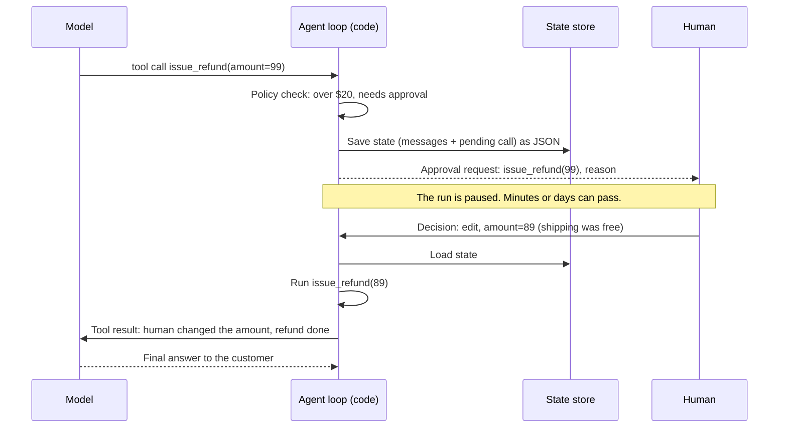

🏠 [Home](../../README.md) › [09 · Agent Design Patterns](./README.md) › 9.6 Human-in-the-loop

# 9.6 Human-in-the-loop

> **Difficulty:** 🟡 Intermediate · **Reading time:** ~8 min · **Prerequisites:** [3.3 How function calling works](../03-tools-and-function-calling/03.3-how-function-calling-works.md), [2.3 A 50-line agent from scratch](../02-the-agent-loop/02.3-a-50-line-agent-from-scratch.md)

**In one sentence:** Human-in-the-loop means the agent stops at chosen points so a person can approve, edit or reject an action, or take over the case, and then the run carries on with that decision.

📑 **On this page**

- [Why does this matter?](#-why-does-this-matter)
- [The idea, in plain words](#-the-idea-in-plain-words)
- [Picture it](#-picture-it)
- [How it works, step by step](#-how-it-works-step-by-step)
- [Worked example](#-worked-example)
- [Code](#-code)
- [Common mistakes & gotchas](#-common-mistakes--gotchas)
- [Key takeaways](#-key-takeaways)
- [Try it yourself](#-try-it-yourself)
- [Further reading](#-further-reading)

## 🤔 Why does this matter?

Your support [agent](../../GLOSSARY.md#agent) can look up orders and issue refunds. A customer says their $89 blender arrived broken. The agent looks up the order and calls `issue_refund` for **$99**: it added shipping, but shipping was free. If the refund runs immediately, you've lost $10 and, worse, you've learned that the agent spends money on its own judgement.

Most real agents have a few actions like this: refunds, emails to customers, deleting data, deploying code. They're too risky to run unchecked but too useful to remove. The answer is to keep a person in the loop at exactly those points, and nowhere else.

## 🧠 The idea, in plain words

Think of a junior employee with a company card. They can buy office supplies freely. Anything over $20 needs a manager's signature. The manager can sign, change the amount, or say no and explain why. If the junior isn't sure what to do at all, they hand the case to the manager.

[Human-in-the-loop](../../GLOSSARY.md#human-in-the-loop-hitl) (HITL) gives an agent the same rules, with four moves:

| Move | Who starts it | What happens |
| --- | --- | --- |
| **Approve** | Code, at an approval gate | The action runs exactly as the model asked |
| **Edit** | Code, at an approval gate | The action runs with the human's corrected arguments, and the model is told what changed |
| **Reject** | Code, at an approval gate | The action does not run; the model gets an error result with the reason and must adapt |
| **Escalate** | The model, via a [tool](../../GLOSSARY.md#tool) | The model hands the whole case to a person, with a summary |

The approval **policy lives in code**, not in the prompt: "refunds over $20 need approval" is an `if`, so the model can't talk its way past it. Anthropic's [Building effective agents](https://www.anthropic.com/engineering/building-effective-agents) describes agents that pause for human feedback at checkpoints or when they hit blockers; this page shows how to build those pauses. The safety side (which actions need approval and why) is in [13.5](../13-safety-and-guardrails/13.5-human-approval-for-risky-actions.md).

## 👀 Picture it



*The tool never runs until a decision exists. Because the state is saved, the process that resumes the run doesn't have to be the one that paused it.*

## 🔍 How it works, step by step

1. **Pick the gated actions.** Irreversible, costly or external-facing ones: money, messages to customers, deletes, deploys. Read-only tools usually need no gate.
2. **Write the policy as code.** A function like `needs_approval(call) -> reason | None` that checks the tool name and arguments (amount, recipient, environment). Keep the thresholds in config.
3. **Intercept before running the tool.** In the agent loop, check every tool call against the policy *before* executing it.
4. **Ask the human, one of two ways:**
   - **Callback:** call `approver(request)` and wait for a `Decision`. Simple; fine for CLIs, chat bots and tests, where someone answers within seconds.
   - **Pause and resume:** return a "paused" result with a serialisable state (the conversation so far plus the pending calls). Store it in a database or queue. When the human decides, possibly days later and in another process, load it and call `resume(state, decision)`.
5. **Show the human the exact action.** Tool name, arguments, the reason it was stopped, and the relevant context (the customer's message, the order). A request saying only "Approve refund?" invites rubber-stamping.
6. **Turn the decision into a tool result.** Approve → run it. Edit → run it with the new arguments, and say so in the result. Reject → don't run it; send an error result (`is_error: true` on Anthropic; OpenAI has no such flag, so say "Error:" in the text) with the reason. Every tool call must still get exactly one result, or the next API call fails.
7. **Give the model an escalation tool.** `escalate_to_human(summary)` lets it hand off when it's unsure or blocked, instead of guessing.
8. **Log every decision.** Who approved what, when, and with which arguments. It is your audit trail and your best data for tuning the policy.

## 💡 Worked example

A run with scripted replies looks like this:

```text
Goal: Order 1234: the customer says the blender arrived broken and wants their money back.

PART 1: pause, save state, a human edits the refund, resume
  status: paused; waiting on issue_refund({'order_id': '1234', 'amount': 99.0, 'reason': 'arrived broken'})
  saved state: 762 bytes of JSON
  tool: get_order({'order_id': '1234'}) -> {"order_id": "1234", "item": "Blender", "price": 89.0, "shipping": 0.0, "status": "delivered"}
  paused: issue_refund({'order_id': '1234', 'amount': 99.0, 'reason': 'arrived broken'}) needs approval (refund over $20)
  human: edit -> {'order_id': '1234', 'amount': 89.0, 'reason': 'arrived broken'} (Shipping was free, so refund the item price only.)
  tool: issue_refund({'order_id': '1234', 'amount': 89.0, 'reason': 'arrived broken'}) -> Refunded $89.00 for order 1234 (ref R-7781).
  status: done
  answer: I've refunded $89.00 for the broken blender on order 1234 (ref R-7781). The customer should see it in 3-5 working days.

PART 2: an approval callback rejects the refund, the agent escalates
  tool: get_order({'order_id': '1234'}) -> {"order_id": "1234", "item": "Blender", "price": 89.0, "shipping": 0.0, "status": "delivered"}
  human: reject (Ask the customer for photos of the damage first.)
  tool: issue_refund NOT run (rejected)
  escalated: Refund for broken blender (order 1234) was rejected pending photos. Please contact the customer.
  status: escalated

Refunds actually issued: [{'order_id': '1234', 'amount': 89.0, 'reason': 'arrived broken'}]
```

- **Part 1:** `get_order` ran freely. The $99 refund hit the policy and the run paused, saving 762 bytes of JSON. A *new* agent object resumed from that JSON, as it would after a restart. The model's next turn read: *"A human reviewer changed the arguments to {... 'amount': 89.0 ...}. Shipping was free, so refund the item price only. Result: Refunded $89.00 ..."*, so its answer used the right amount.
- **Part 2:** the callback rejected the refund. The model got an error result with the reason, didn't retry, and escalated with a summary.
- **The last line** shows that only the approved $89 refund ever ran.

## 💻 Code

The heart of it is a check between "the model asked" and "the tool runs". Simplified; `call` is one tool call from the model's reply (with `.id`, `.name` and `.arguments` as a dict):

```python
def needs_approval(call: ToolCall) -> str | None:
    """The policy, in code. The model can't argue with an if-statement."""
    if call.name == "issue_refund" and float(call.arguments.get("amount", 0)) > AUTO_APPROVE_LIMIT:
        return f"refund over ${AUTO_APPROVE_LIMIT:.0f}"
    return None

# inside the agent loop, for each tool call the model made:
reason = needs_approval(call)
if reason is None:
    messages.append(run_tool(call, call.arguments))
elif approver is None:                                   # nobody to ask now: pause
    state = {"messages": to_json(messages), "pending_calls": [call_to_dict(c) for c in [call, *queued]]}
    return RunResult("paused", pending=ApprovalRequest(call.name, call.arguments, reason), state=state)
else:                                                    # ask now, and wait
    messages.append(apply(call, approver(ApprovalRequest(call.name, call.arguments, reason))))
```

Applying the decision, so the model always gets one result per call:

```python
def apply(call: ToolCall, decision: Decision) -> Message:
    if decision.action == "approve":
        return run_tool(call, call.arguments)
    if decision.action == "edit":
        msg = run_tool(call, decision.arguments)
        msg["content"] = f"A human reviewer changed the arguments to {decision.arguments}. {decision.note} Result: {msg['content']}"
        return msg
    return tool_result(call.id, f"A human reviewer rejected this action. Reason: {decision.note}", is_error=True)
```

**Saving state with a real provider.** The state is the message list plus the pending calls. With Anthropic, an assistant turn can contain thinking blocks that must be sent back unchanged; store those content blocks as plain dicts (`block.model_dump(mode="json", exclude_none=True)`) so the paused state stays valid JSON. Chapter 15 covers durable storage and resuming after crashes ([15.4](../15-production-and-deployment/15.4-state-persistence-and-resumability.md)).

**In frameworks**, the same ideas have names. LangGraph pauses a graph with `interrupt()`, saves state with a checkpointer, and resumes with a `Command` ([docs](https://docs.langchain.com/oss/python/langgraph/interrupts)). The OpenAI Agents SDK lets a tool declare `needs_approval`, surfaces pending approvals as interruptions, and serialises a paused run as a `RunState` ([docs](https://openai.github.io/openai-agents-python/human_in_the_loop/)).

## 🚨 Common mistakes & gotchas

- **The policy in the prompt.** "Always ask before refunds over $20" in the [system prompt](../../GLOSSARY.md#system-prompt) is a request, not a control; a confused or manipulated model can skip it ([prompt injection](../../GLOSSARY.md#prompt-injection)). **Fix:** enforce it in code, before the tool runs.
- **Approving everything.** If every step needs a click, people stop reading and click "approve" on autopilot. **Fix:** gate only risky actions; auto-approve the rest; review the approval rate.
- **Approval requests without context.** "Approve `issue_refund`?" gives the reviewer nothing to judge. **Fix:** show arguments, the reason for the gate and the relevant conversation.
- **Leaving a tool call without a result.** Rejecting by silently dropping the call breaks the next API request, because every tool call needs a matching result. **Fix:** a rejected call still gets a result, marked as an error, with the reason.
- **Holding state in memory while waiting.** A process waiting days for an answer will be restarted long before then. **Fix:** pause, persist the state, and resume in whichever process gets the decision.
- **Acting twice on resume.** If a tool ran before the pause and you replay from an older checkpoint, it may run again. **Fix:** save state *after* each tool result, and make risky tools idempotent (for example, a refund keyed by order and reason) ([15.3](../15-production-and-deployment/15.3-queues-retries-and-idempotency.md)).
- **Edits the model never hears about.** If you change the arguments silently, the model's reply to the customer says $99. **Fix:** say what the human changed in the tool result.

## ✅ Key takeaways

- Put people at the few points where mistakes are costly: approve, edit, reject, or take over.
- The approval policy is code that runs before the tool, never just a line in the prompt.
- Use a callback for quick, interactive answers; pause and resume with saved JSON state for slow ones.
- Every tool call still gets one result: the real output, the output with edited arguments, or an error with the reason.
- Give the model an escalation tool, and log every human decision.

## 🧪 Try it yourself

1. In the worked example, suppose `AUTO_APPROVE_LIMIT` were 100. What happens in part 1, and what does the customer get?
2. Write an approver for the command line that shows the request and asks `approve / edit / reject`. What does it return?
3. Your agent sends marketing emails. Which actions would you gate, which would you auto-approve, and what would you show the reviewer?

<details>
<summary>Show answer</summary>

1. The $99 refund is under the limit, so it runs without asking anyone. The customer gets $99, $10 too much, and nobody sees it happen. This is why limits should be set from what a mistake would cost, and why the tool itself could also check the amount against the order price.
2. One version:

    ```python
    def cli_approver(request: ApprovalRequest) -> Decision:
        print(f"{request.tool}({request.arguments}) needs approval: {request.reason}")
        choice = input("approve / edit / reject? ").strip().lower()
        if choice == "edit":
            amount = float(input("new amount: "))
            return Decision("edit", {**request.arguments, "amount": amount}, note="Amount changed by reviewer.")
        if choice == "reject":
            return Decision("reject", note=input("reason: "))
        return Decision("approve")
    ```

3. One reasonable answer: gate sending to a list or to more than N recipients, and any email with a discount or legal claim; auto-approve drafting, previews and test sends to internal addresses. Show the reviewer the rendered email, the recipient count and segment, and what triggered the gate.

</details>

## 📚 Further reading

- [Building effective agents](https://www.anthropic.com/engineering/building-effective-agents) (Anthropic). Agents that pause for human feedback at checkpoints and blockers.
- [Human-in-the-loop](https://openai.github.io/openai-agents-python/human_in_the_loop/) (OpenAI Agents SDK docs). Approval flags, interruptions and resumable run state.
- [Interrupts](https://docs.langchain.com/oss/python/langgraph/interrupts) (LangGraph docs). Pausing a graph for human input and resuming from a checkpoint.

<!-- FOOTER -->

---

⬅️ **Previous:** [9.5 Evaluator–optimizer](./09.5-evaluator-optimizer.md) ·
🏠 [Chapter home](./README.md) ·
➡️ **Next:** [9.7 Choosing a pattern](./09.7-choosing-a-pattern.md)
