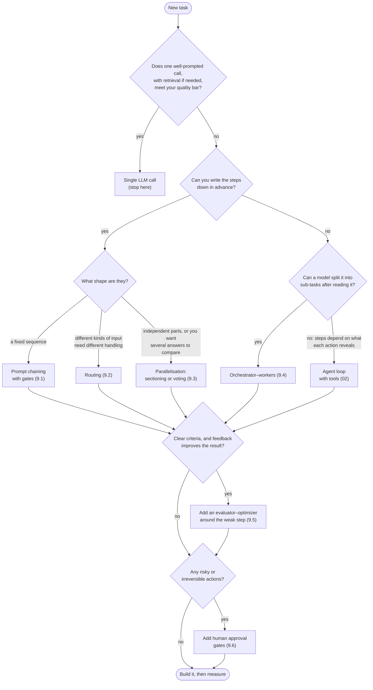

🏠 [Home](../../README.md) › [09 · Agent Design Patterns](./README.md) › 9.7 Choosing a pattern

# 9.7 Choosing a pattern

> **Difficulty:** 🟡 Intermediate · **Reading time:** ~8 min · **Prerequisites:** [9.1](./09.1-prompt-chaining.md) to [9.6](./09.6-human-in-the-loop.md), [1.6 When NOT to use an agent](../01-foundations/01.6-when-not-to-use-an-agent.md)

**In one sentence:** Start with a single well-prompted LLM call, and move to a chain, router, parallel calls, orchestrator, evaluator loop or full agent only when the simpler option measurably falls short.

📑 **On this page**

- [Why does this matter?](#-why-does-this-matter)
- [The idea, in plain words](#-the-idea-in-plain-words)
- [Picture it](#-picture-it)
- [How it works, step by step](#-how-it-works-step-by-step)
- [Worked example](#-worked-example)
- [Code](#-code)
- [Common mistakes & gotchas](#-common-mistakes--gotchas)
- [Key takeaways](#-key-takeaways)
- [Try it yourself](#-try-it-yourself)
- [Further reading](#-further-reading)

## 🤔 Why does this matter?

A team builds a "multi-agent research system" to answer questions about their product docs. It has a planner, five workers, a critic and a synthesiser. It costs a dollar a question, takes forty seconds, and gives different answers each time. A single [LLM](../../GLOSSARY.md#large-language-model-llm) call with good retrieval ([chapter 06](../06-rag-for-agents/README.md)) would have answered 90% of the questions in two seconds for a cent.

Patterns are means, not goals. Anthropic's [Building effective agents](https://www.anthropic.com/engineering/building-effective-agents) puts it plainly: find the simplest solution possible and add complexity only when needed, which might mean not building an agentic system at all. Agentic systems usually trade latency and cost for better task performance; make that trade on purpose.

## 🧠 The idea, in plain words

Think of getting across town. You walk if it's close. You take a bike if it's further. You take the bus if it's a fixed route, a taxi if the route is unusual, and you hire a driver for the day only if you don't know where you'll need to go. Nobody hires a driver to get the newspaper.

The patterns line up the same way, from most predictable and cheapest to most flexible and expensive:

1. **A single call**, improved with a better prompt, examples, retrieval, and perhaps a [tool](../../GLOSSARY.md#tool) or two.
2. **[Workflows](../../GLOSSARY.md#workflow):** your code fixes the flow. [Prompt chaining](./09.1-prompt-chaining.md), [routing](./09.2-routing.md), [parallelisation](./09.3-parallelisation.md).
3. **Model-shaped workflows:** the model decides part of the structure. [Orchestrator–workers](./09.4-orchestrator-workers.md) (the model decides the sub-tasks) and [evaluator–optimizer](./09.5-evaluator-optimizer.md) (feedback decides how many rounds).
4. **An [agent](../../GLOSSARY.md#agent):** the model decides every step, in a loop with tools ([chapter 02](../02-the-agent-loop/README.md)).

[Human-in-the-loop](./09.6-human-in-the-loop.md) is not a rung on this ladder. It is a safety layer you add at any level where an action is risky.

## 👀 Picture it



*Read it top to bottom and stop at the first box that fits. The last two questions apply to whatever you chose: patterns compose, and quality loops and human gates are layers on top.*

## 🔍 How it works, step by step

1. **Write down the task and a quality bar.** Ten to fifty real examples with what a good answer looks like. Without this, you can't tell whether a more complex pattern is better ([12.4](../12-evaluation/12.4-building-an-eval-dataset.md)).
2. **Try one call first.** Improve the prompt, add examples, add retrieval or one or two tools. Measure.
3. **Find where it fails.** Wrong kinds of inputs mixed together → routing. One prompt doing too many jobs → chaining or sectioning. Inconsistent yes/no decisions → voting. Unknown structure → orchestrator–workers or an agent.
4. **Pick the simplest pattern that addresses that failure,** using the flowchart.
5. **Compare on the same examples,** with cost and latency next to quality. Keep the change only if it wins clearly.
6. **Add layers only where needed:** an evaluator–optimizer around the weakest step, human gates on risky actions.
7. **Revisit as models improve.** A chain you needed last year may be one call today.

### The patterns compared

| Pattern | Use it when | Cost (calls per request) | Latency | Predictability |
| --- | --- | --- | --- | --- |
| Single call | One prompt meets the bar | 1 | Lowest | High |
| [Prompt chaining](./09.1-prompt-chaining.md) | The task splits into fixed, ordered steps | One per step | Sum of the steps | High: fixed steps, gates between |
| [Routing](./09.2-routing.md) | Distinct kinds of input need different prompts, tools or models | 1 classifier + 1 handler (can be *cheaper* overall with small models) | Classifier + handler | High, if the classifier is accurate |
| [Parallelisation](./09.3-parallelisation.md) | Independent parts (sectioning) or several answers to compare (voting) | *n* parallel calls (+ maybe 1 to combine) | About the slowest call | High for sectioning; voting adds confidence |
| [Orchestrator–workers](./09.4-orchestrator-workers.md) | Sub-tasks can't be known until the input is read | 1 plan + *n* workers + 1 synthesis; *n* varies | Plan + slowest worker + synthesis | Medium: the plan varies by input |
| [Evaluator–optimizer](./09.5-evaluator-optimizer.md) | Clear criteria exist, and feedback improves results | 2 per round × 1 to *N* rounds | Grows with rounds | Medium: round count varies |
| Agent ([chapter 02](../02-the-agent-loop/README.md)) | Open-ended; the steps depend on what each action reveals | Many; unbounded without limits | Highest, variable | Lowest: the model chooses every step |
| + [Human-in-the-loop](./09.6-human-in-the-loop.md) | Some actions are risky or irreversible | No extra model calls | Adds human wait time | Raises safety, not determinism |

*Costs are in model calls. Real cost also depends on [tokens](../../GLOSSARY.md#token) per call and which models you use ([16.1](../16-cost-and-performance/16.1-token-cost-maths.md)).*

## 💡 Worked example

Three requests from the same budgeting-app company, run through the flowchart:

| Request | Walk through the flowchart | Choice |
| --- | --- | --- |
| "Summarise this support ticket in one line for the dashboard." | One call meets the bar. | **Single call** |
| "Answer incoming support tickets." Billing, technical and general tickets need different tone and tools; most are easy. | One call: tuning for billing hurts technical answers. Steps known in advance? Yes: classify, then answer. Shape: different kinds of input. Refunds are risky. | **Routing** ([9.2](./09.2-routing.md)), easy tickets on a small model, **plus human approval** for refunds over $20 ([9.6](./09.6-human-in-the-loop.md)) |
| "Implement this feature request in our codebase." | Steps not known in advance. Can a model plan sub-tasks after reading it? Often, yes: one per file. Clear criteria? The tests. | **Orchestrator–workers** ([9.4](./09.4-orchestrator-workers.md)), with **tests as the evaluator** around each worker ([8.3](../08-reflection-and-self-correction/08.3-self-critique-with-tests.md)). If each change reveals new work, move up to a coding **agent**. |

Notice that two of the three are combinations. Real systems are usually one main pattern with one or two layers.

## 💻 Code

Patterns compose because each one is just a function. A sketch combining routing ([9.2](./09.2-routing.md)), an evaluator–optimizer ([9.5](./09.5-evaluator-optimizer.md)) and a human fallback ([9.6](./09.6-human-in-the-loop.md)), using the functions from this chapter's pages:

```python
def answer_ticket(ticket: str) -> str:
    route = parse_route(classifier.chat([user(ticket)], system=CLASSIFIER_SYSTEM).text)   # routing
    model = models[DIFFICULTIES[route.difficulty]]

    def generate(previous: str | None, feedback: str | None) -> str:                       # the handler
        prompt = ticket if previous is None else f"{ticket}\n\nYour draft:\n{previous}\n\nFix: {feedback}"
        return model.chat([user(prompt)], system=CATEGORIES[route.category]).text

    result = optimize(generate, support_reply_evaluator, max_rounds=2)                      # quality loop
    if not result.passed:
        return queue_for_human_review(ticket, result.best)                                  # human fallback
    return result.best
```

`support_reply_evaluator` and `queue_for_human_review` are yours to write: hard checks plus a rubric, and a call to your ticketing system. No framework is needed to compose patterns. Frameworks ([chapter 11](../11-frameworks/README.md)) can help with persistence, tracing and parallelism, but read their code first: Anthropic's post notes that wrong assumptions about what a framework does underneath are a common source of errors.

## 🚨 Common mistakes & gotchas

- **Starting with an agent.** It's the most flexible option and the hardest to test, debug and budget. **Fix:** climb the ladder one rung at a time, measuring at each step.
- **Choosing by architecture diagram.** A pattern that looks impressive isn't evidence that it works better. **Fix:** compare against the simpler option on the same examples, with cost and latency.
- **Multiplying costs by stacking.** An evaluator loop (×3) around each of five workers (×5), re-planned twice (×2), is 30 times the work of one pass. **Fix:** work out the worst-case call count before you build, and set a per-run budget ([16.5](../16-cost-and-performance/16.5-budget-limits-per-run.md)).
- **Confusing sectioning with orchestrator–workers.** If the split is the same for every input, you don't need a planning call. **Fix:** fixed split → sectioning; input-dependent split → orchestrator.
- **Treating human approval as a fix for a bad design.** If people reject 40% of actions, the agent is wrong, not the gate. **Fix:** use approval data to improve prompts, tools or the pattern itself.
- **Never revisiting.** Models improve fast. **Fix:** re-run your evaluation set when you change models, and remove steps that no longer earn their cost.

## ✅ Key takeaways

- Start with one well-prompted call; add complexity only when it measurably improves results.
- Fixed steps → workflow patterns (chain, route, parallel). Unknown sub-tasks → orchestrator–workers. Unknown steps → agent.
- Evaluator–optimizer and human-in-the-loop are layers you add where they're needed, at any level.
- Compare patterns on the same examples with quality, cost and latency side by side.
- Most production systems are one main pattern plus a layer or two, composed as plain functions.

## 🧪 Try it yourself

1. Which pattern would you pick for: (a) extracting invoice fields into JSON, (b) translating a 30-page manual chapter by chapter, (c) deciding whether a forum post breaks any of six community rules?
2. Your orchestrator–workers system always plans exactly the same four sub-tasks. What would you change?
3. A teammate wants to add an evaluator–optimizer to a single-call summariser "to be safe". What would you ask before agreeing?

<details>
<summary>Show answer</summary>

1. (a) A single call with structured output and schema validation; maybe an evaluator–optimizer with the schema as the check if it often fails. (b) Sectioning: chapters are independent, so translate them in parallel (with a shared glossary in every prompt for consistency); optionally an evaluator–optimizer per chapter for quality. (c) Sectioning (one focused check per rule, run in parallel, flag if any says yes), or voting on borderline rules where false positives are costly.
2. Replace it with sectioning: four fixed parallel calls. You save the planning call, remove a source of variation, and make it easier to test.
3. What does it fail at today, and how often, on real examples? Is there a clear criterion an evaluator can check? What would the extra calls cost per day, and how much latency do users accept? If there are no measured failures, or no checkable criterion, don't add it.

</details>

## 📚 Further reading

- [Building effective agents](https://www.anthropic.com/engineering/building-effective-agents) (Anthropic). The source of these patterns and the "simplest solution first" advice.
- [How we built our multi-agent research system](https://www.anthropic.com/engineering/multi-agent-research-system) (Anthropic). What it takes when the complex end of the ladder is justified.
- [1.6 When NOT to use an agent](../01-foundations/01.6-when-not-to-use-an-agent.md). The checklist for staying at the simple end.

<!-- FOOTER -->

---

⬅️ **Previous:** [9.6 Human-in-the-loop](./09.6-human-in-the-loop.md) ·
🏠 [Chapter home](./README.md) ·
➡️ **Next:** [10 · Multi-Agent Systems → 10.1 Why multiple agents?](../10-multi-agent-systems/10.1-why-multiple-agents.md)
