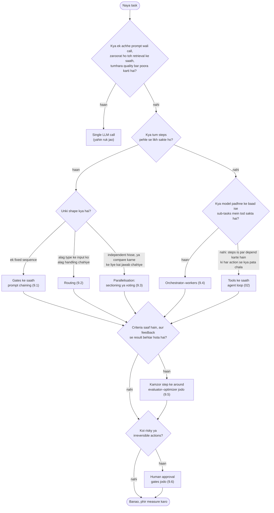

🏠 [Home](../../README.md) › [09 · Agent Design Patterns](./README.md) › 9.7 Sahi pattern kaise chuno

# 9.7 Sahi pattern kaise chuno

> **Level:** 🟡 Intermediate · **Padhne ka time:** ~8 min · **Pehle padho:** [9.1](./09.1-prompt-chaining.md) se [9.6](./09.6-human-in-the-loop.md) tak, [1.6 Agent kab use NAHI karna chahiye](../01-foundations/01.6-when-not-to-use-an-agent.md)

**Ek line mein:** Ek achhe prompt wali single LLM call se shuru karo. Chain, router, parallel calls, orchestrator, evaluator loop ya full agent par tabhi jao jab simple option measurably kam pad jaye.

📑 **Is page par**

- [Yeh kyun zaroori hai?](#-yeh-kyun-zaroori-hai)
- [Idea, simple words mein](#-idea-simple-words-mein)
- [Diagram se samjho](#-diagram-se-samjho)
- [Kaise kaam karta hai, step by step](#-kaise-kaam-karta-hai-step-by-step)
- [Example se samjho](#-example-se-samjho)
- [Code](#-code)
- [Aam galtiyan aur dhyan dene wali baatein](#-aam-galtiyan-aur-dhyan-dene-wali-baatein)
- [Yaad rakhne wali baatein](#-yaad-rakhne-wali-baatein)
- [Khud try karo](#-khud-try-karo)
- [Aur padhne ke liye](#-aur-padhne-ke-liye)

## 🤔 Yeh kyun zaroori hai?

Ek team apne product docs ke sawalon ke jawab dene ke liye ek "multi-agent research system" banati hai. Usmein ek planner hai, paanch workers, ek critic aur ek synthesiser. Har sawal par ek dollar lagta hai, chaalis second lagte hain, aur har baar alag jawab aata hai. Achhi retrieval ([chapter 06](../06-rag-for-agents/README.md)) ke saath ek single [LLM](../../GLOSSARY.md#large-language-model-llm) call 90% sawalon ka jawab do second mein, ek cent mein de deti.

Patterns sirf zariya hain, manzil nahi. Anthropic ka [Building effective agents](https://www.anthropic.com/engineering/building-effective-agents) saaf kehta hai: sabse simple solution dhundo, aur complexity tabhi jodo jab zaroorat ho. Iska matlab yeh bhi ho sakta hai ki agentic system banana hi nahi. Agentic systems aam taur par behtar task performance ke badle latency aur cost dete hain. Yeh sauda soch-samajh ke karo.

## 🧠 Idea, simple words mein

Shehar mein ek jagah se doosri jagah jaana socho. Paas hai toh paidal chalo. Thoda door hai toh bike lo. Fixed route hai toh bus lo, ajeeb route hai toh auto ya taxi, aur poore din ke liye driver tabhi rakho jab pata hi na ho ki kahan-kahan jaana padega. Gali ki dukaan se doodh lene ke liye koi driver nahi rakhta.

Patterns bhi aise hi line mein lagte hain, sabse predictable aur saste se lekar sabse flexible aur mehenge tak:

1. **Ek single call**, jise behtar prompt, examples, retrieval, aur shayad ek-do [tool](../../GLOSSARY.md#tool) se improve kiya gaya ho.
2. **[Workflows](../../GLOSSARY.md#workflow):** flow tumhara code fix karta hai. [Prompt chaining](./09.1-prompt-chaining.md), [routing](./09.2-routing.md), [parallelisation](./09.3-parallelisation.md).
3. **Model-shaped workflows:** structure ka kuch hissa model decide karta hai. [Orchestrator–workers](./09.4-orchestrator-workers.md) (model sub-tasks decide karta hai) aur [evaluator–optimizer](./09.5-evaluator-optimizer.md) (feedback decide karta hai ki kitne rounds).
4. **Ek [agent](../../GLOSSARY.md#agent):** model har step decide karta hai, tools ke saath ek loop mein ([chapter 02](../02-the-agent-loop/README.md)).

[Human-in-the-loop](./09.6-human-in-the-loop.md) is ladder ka koi step nahi hai. Yeh ek safety layer hai jo tum kisi bhi level par jod sakte ho jahan action risky ho.

## 👀 Diagram se samjho



*Upar se neeche padho aur pehle fit hone wale box par ruk jao. Aakhri do sawal tumhari har choice par lagte hain. Patterns jud sakte hain, aur quality loops aur human gates upar ki layers hain.*

## 🔍 Kaise kaam karta hai, step by step

1. **Task aur quality bar likh lo.** Das se pachaas real examples, saath mein yeh ki achha jawab kaisa dikhta hai. Iske bina tum bata hi nahi sakte ki zyada complex pattern behtar hai ya nahi ([12.4](../12-evaluation/12.4-building-an-eval-dataset.md)).
2. **Pehle ek call try karo.** Prompt improve karo, examples jodo, retrieval ya ek-do tools jodo. Measure karo.
3. **Dhundo ki kahan fail hota hai.** Alag type ke inputs mix ho rahe hain → routing. Ek prompt bahut saare kaam kar raha hai → chaining ya sectioning. Yes/no decisions inconsistent hain → voting. Structure pata nahi → orchestrator–workers ya agent.
4. **Woh sabse simple pattern chuno jo us failure ko theek kare,** flowchart ki madad se.
5. **Same examples par compare karo,** quality ke saath cost aur latency bhi dekho. Change tabhi rakho jab woh saaf jeete.
6. **Layers sirf wahan jodo jahan zaroorat ho:** sabse kamzor step ke around evaluator–optimizer, risky actions par human gates.
7. **Models behtar hone par dobara dekho.** Jo chain pichhle saal chahiye thi, woh aaj ek call ho sakti hai.

### Patterns ka comparison

| Pattern | Kab use karo | Cost (har request par calls) | Latency | Predictability |
| --- | --- | --- | --- | --- |
| Single call | Ek prompt bar poora kar deta hai | 1 | Sabse kam | High |
| [Prompt chaining](./09.1-prompt-chaining.md) | Task fixed, ordered steps mein toot jata hai | Har step ki ek | Saare steps ka jod | High: fixed steps, beech mein gates |
| [Routing](./09.2-routing.md) | Alag type ke inputs ko alag prompts, tools ya models chahiye | 1 classifier + 1 handler (chhote models ke saath overall *sasta* bhi ho sakta hai) | Classifier + handler | High, agar classifier accurate hai |
| [Parallelisation](./09.3-parallelisation.md) | Independent hisse (sectioning) ya compare karne ke liye kai jawab (voting) | *n* parallel calls (+ shayad 1 combine karne ke liye) | Lagbhag sabse slow call jitni | Sectioning ke liye high; voting confidence badhata hai |
| [Orchestrator–workers](./09.4-orchestrator-workers.md) | Input padhne se pehle sub-tasks pata nahi chal sakte | 1 plan + *n* workers + 1 synthesis; *n* badalta hai | Plan + sabse slow worker + synthesis | Medium: plan input ke hisaab se badalta hai |
| [Evaluator–optimizer](./09.5-evaluator-optimizer.md) | Saaf criteria hain, aur feedback se results behtar hote hain | Har round 2 × 1 se *N* rounds | Rounds ke saath badhti hai | Medium: round count badalta hai |
| Agent ([chapter 02](../02-the-agent-loop/README.md)) | Open-ended; steps is par depend karte hain ki har action se kya pata chala | Bahut saari; limits ke bina koi hadd nahi | Sabse zyada, badalti rehti hai | Sabse kam: model har step chunta hai |
| + [Human-in-the-loop](./09.6-human-in-the-loop.md) | Kuch actions risky ya irreversible hain | Koi extra model call nahi | Insaan ka wait time judta hai | Safety badhata hai, determinism nahi |

*Costs model calls mein hain. Asli cost har call ke [tokens](../../GLOSSARY.md#token) aur kaunse models use kar rahe ho, us par bhi depend karti hai ([16.1](../16-cost-and-performance/16.1-token-cost-maths.md)).*

## 💡 Example se samjho

Ek hi budgeting-app company ki teen requests, flowchart se guzaari gayi:

| Request | Flowchart se guzro | Choice |
| --- | --- | --- |
| "Summarise this support ticket in one line for the dashboard." | Ek call bar poora kar deti hai. | **Single call** |
| "Answer incoming support tickets." Billing, technical aur general tickets ko alag tone aur tools chahiye; zyada tar aasaan hain. | Ek call: billing ke liye tune karo toh technical jawab bigadte hain. Steps pehle se pata hain? Haan: classify, phir jawab. Shape: alag type ke inputs. Refunds risky hain. | **Routing** ([9.2](./09.2-routing.md)), aasaan tickets chhote model par, **saath mein human approval** $20 se upar ke refunds ke liye ([9.6](./09.6-human-in-the-loop.md)) |
| "Implement this feature request in our codebase." | Steps pehle se pata nahi. Kya model padhne ke baad sub-tasks plan kar sakta hai? Aksar haan: har file ka ek. Saaf criteria? Tests. | **Orchestrator–workers** ([9.4](./09.4-orchestrator-workers.md)), har worker ke around **tests ko evaluator** banake ([8.3](../08-reflection-and-self-correction/08.3-self-critique-with-tests.md)). Agar har change naya kaam dikhata hai, toh coding **agent** par jao. |

Dhyan do ki teen mein se do combinations hain. Real systems aam taur par ek main pattern aur ek-do layers hote hain.

## 💻 Code

Patterns isliye jud jaate hain kyunki har ek bas ek function hai. Ek sketch jo routing ([9.2](./09.2-routing.md)), evaluator–optimizer ([9.5](./09.5-evaluator-optimizer.md)) aur human fallback ([9.6](./09.6-human-in-the-loop.md)) ko jodta hai, is chapter ke pages ke functions use karke:

```python
def answer_ticket(ticket: str) -> str:
    route = parse_route(classifier.chat([user(ticket)], system=CLASSIFIER_SYSTEM).text)   # routing
    model = models[DIFFICULTIES[route.difficulty]]

    def generate(previous: str | None, feedback: str | None) -> str:                       # handler
        prompt = ticket if previous is None else f"{ticket}\n\nYour draft:\n{previous}\n\nFix: {feedback}"
        return model.chat([user(prompt)], system=CATEGORIES[route.category]).text

    result = optimize(generate, support_reply_evaluator, max_rounds=2)                      # quality loop
    if not result.passed:
        return queue_for_human_review(ticket, result.best)                                  # human fallback
    return result.best
```

`support_reply_evaluator` aur `queue_for_human_review` tumhe likhne hain: hard checks plus ek rubric, aur tumhare ticketing system ki ek call. Patterns jodne ke liye kisi framework ki zaroorat nahi. Frameworks ([chapter 11](../11-frameworks/README.md)) persistence, tracing aur parallelism mein madad kar sakte hain, lekin pehle unka code padho. Anthropic ka post kehta hai ki framework andar kya karta hai, iske baare mein galat assumptions errors ki ek common wajah hain.

## 🚨 Aam galtiyan aur dhyan dene wali baatein

- **Agent se shuru karna.** Yeh sabse flexible option hai, aur test, debug aur budget karne mein sabse mushkil. **Fix:** ladder par ek-ek step chadho, har step par measure karte hue.
- **Architecture diagram dekh ke chunna.** Impressive dikhne wala pattern is baat ka saboot nahi ki woh behtar kaam karta hai. **Fix:** same examples par simple option se compare karo, cost aur latency ke saath.
- **Stack karke cost multiply karna.** Paanch workers (×5) mein se har ek ke around evaluator loop (×3), do baar re-plan (×2): yeh ek pass ka 30 guna kaam hai. **Fix:** banane se pehle worst-case call count nikaalo, aur per-run budget set karo ([16.5](../16-cost-and-performance/16.5-budget-limits-per-run.md)).
- **Sectioning aur orchestrator–workers mein confusion.** Agar har input ke liye split same hai, toh planning call ki zaroorat nahi. **Fix:** fixed split → sectioning; input par depend karne wala split → orchestrator.
- **Human approval ko kharab design ka ilaaj samajhna.** Agar log 40% actions reject karte hain, toh agent galat hai, gate nahi. **Fix:** approval data se prompts, tools ya pattern khud improve karo.
- **Kabhi dobara na dekhna.** Models bahut tezi se behtar hote hain. **Fix:** model badlo toh evaluation set dobara chalao, aur woh steps hata do jo ab apna cost justify nahi karte.

## ✅ Yaad rakhne wali baatein

- Ek achhe prompt wali call se shuru karo. Complexity tabhi jodo jab woh measurably results behtar kare.
- Fixed steps → workflow patterns (chain, route, parallel). Pata nahi sub-tasks kya hain → orchestrator–workers. Pata nahi steps kya hain → agent.
- Evaluator–optimizer aur human-in-the-loop layers hain, jo kisi bhi level par wahan jodo jahan zaroorat ho.
- Patterns ko same examples par compare karo, quality, cost aur latency saath-saath rakh ke.
- Zyada tar production systems ek main pattern plus ek-do layers hote hain, plain functions ki tarah jude hue.

## 🧪 Khud try karo

1. Inke liye kaunsa pattern chunoge: (a) invoice fields ko JSON mein extract karna, (b) 30-page manual ko chapter by chapter translate karna, (c) decide karna ki forum post chhe community rules mein se koi todta hai ya nahi?
2. Tumhara orchestrator–workers system hamesha exactly wahi chaar sub-tasks plan karta hai. Kya badloge?
3. Ek teammate single-call summariser mein "to be safe" evaluator–optimizer jodna chahta hai. Haan bolne se pehle tum kya poochoge?

<details>
<summary>Answer dekho</summary>

1. (a) Structured output aur schema validation ke saath single call. Agar aksar fail hoti hai, toh shayad schema ko check banake evaluator–optimizer. (b) Sectioning: chapters independent hain, isliye unhe parallel mein translate karo (consistency ke liye har prompt mein shared glossary ke saath). Quality ke liye chaaho toh har chapter par evaluator–optimizer. (c) Sectioning (har rule ka ek focused check, parallel mein, koi bhi yes kahe toh flag), ya borderline rules par voting jahan false positives mehenge padte hain.
2. Ise sectioning se replace karo: chaar fixed parallel calls. Planning call bachti hai, variation ka ek source hat jata hai, aur test karna aasaan ho jata hai.
3. Aaj yeh real examples par kahan fail hota hai, aur kitni baar? Kya koi saaf criterion hai jo evaluator check kar sake? Extra calls ka roz ka kharcha kitna hoga, aur users kitni latency accept karte hain? Agar koi measured failures nahi hain, ya koi checkable criterion nahi hai, toh mat jodo.

</details>

## 📚 Aur padhne ke liye

- [Building effective agents](https://www.anthropic.com/engineering/building-effective-agents) (Anthropic). In patterns ka source, aur "simplest solution first" wali salah.
- [How we built our multi-agent research system](https://www.anthropic.com/engineering/multi-agent-research-system) (Anthropic). Jab ladder ka complex end justified ho, tab kya lagta hai.
- [1.6 Agent kab use NAHI karna chahiye](../01-foundations/01.6-when-not-to-use-an-agent.md). Simple end par tike rehne ki checklist.

<!-- FOOTER -->

---

⬅️ **Pichla:** [9.6 Human-in-the-loop](./09.6-human-in-the-loop.md) ·
🏠 [Chapter home](./README.md) ·
➡️ **Agla:** [10 · Multi-Agent Systems → 10.1 Multiple agents kyun?](../10-multi-agent-systems/10.1-why-multiple-agents.md)
