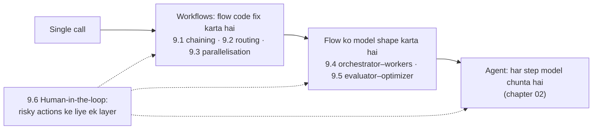

🏠 [Home](../../README.md) › 09 · Agent Design Patterns

# 09 · Agent Design Patterns

> **Padhne ka time:** ~54 min · **Level:** 🟢 Beginner se 🟡 Intermediate · **Pehle padho:** [01 · Foundations](../01-foundations/README.md), [02 · The Agent Loop](../02-the-agent-loop/README.md)

Zyada tar kaam ke [LLM](../../GLOSSARY.md#large-language-model-llm) systems khule ghoomne wale [agents](../../GLOSSARY.md#agent) nahi hote. Woh kuch simple patterns hote hain jo aapas mein jud sakte hain: chains, routers, parallel calls, orchestrators, evaluator loops aur human checkpoints. Yeh chapter har ek ko plain Python mein banata hai, Anthropic ke [Building effective agents](https://www.anthropic.com/engineering/building-effective-agents) mein bataye patterns ko follow karte hue. Aakhir mein ek flowchart hai jo sabse simple kaam karne wala pattern chunne mein madad karta hai.

## 🎯 Is chapter mein kya seekhoge

- Prompt chaining: fixed steps, beech mein code ke gates
- Routing: classify karo, label validate karo, dispatch karo, aur aasaan inputs saste models ko bhejo
- Parallelisation: `ThreadPoolExecutor` ke saath sectioning aur voting, aur results kaise combine karein
- Orchestrator–workers: model ko run time par sub-tasks decide karne do, aur uska plan validate karo
- Evaluator–optimizer ek reusable building block ki tarah, jise tum kisi bhi doosre pattern mein daal sakte ho
- Human-in-the-loop: approval gates, edits, rejection, escalation, aur run ko pause aur resume karna
- Patterns ko kaise chuno, compare karo aur jodo, sabse simple se shuru karke

## 📋 Pehle se kya aana chahiye

- [1.2 Chatbot, workflow aur agent mein farak](../01-foundations/01.2-chatbot-vs-workflow-vs-agent.md) aur [1.6 Agent kab use NAHI karna chahiye](../01-foundations/01.6-when-not-to-use-an-agent.md)
- [2.3 50 lines mein agent, bilkul zero se](../02-the-agent-loop/02.3-a-50-line-agent-from-scratch.md) aur [3.3 Function calling kaise kaam karta hai](../03-tools-and-function-calling/03.3-how-function-calling-works.md), 9.6 ke liye
- [8.2 Evaluator–optimizer loop](../08-reflection-and-self-correction/08.2-evaluator-optimizer-loop.md), 9.5 ke liye

## 👀 Chapter ek nazar mein

*Left se right: zyada flexibility, zyada cost, kam predictability. Page 9.7 dikhata hai ki right ki taraf sirf tab jao jab zaroori ho. Human-in-the-loop har level par lagta hai.*

## 📄 Is chapter ke pages

<!-- PAGES:START -->
| # | Page | Level | Time |
| --- | --- | --- | --- |
| 9.1 | [Prompt chaining](./09.1-prompt-chaining.md) — Task ko fixed steps mein todo, har step ek LLM call. | 🟢 Beginner | ~7 min |
| 9.2 | [Routing](./09.2-routing.md) — Input classify karo, phir use sahi handler ke paas bhejo. | 🟢 Beginner | ~7 min |
| 9.3 | [Parallelisation (sectioning aur voting)](./09.3-parallelisation.md) — LLM calls ek saath chalao aur results combine karo. | 🟡 Intermediate | ~8 min |
| 9.4 | [Orchestrator–workers](./09.4-orchestrator-workers.md) — Ek lead model kaam baant ke workers ko deta hai. | 🟡 Intermediate | ~10 min |
| 9.5 | [Evaluator–optimizer](./09.5-evaluator-optimizer.md) — Generate-and-grade pattern ek reusable building block ki tarah. | 🟡 Intermediate | ~6 min |
| 9.6 | [Human-in-the-loop](./09.6-human-in-the-loop.md) — Ruko, taaki koi insaan approve, correct ya decide kar sake. | 🟡 Intermediate | ~8 min |
| 9.7 | [Sahi pattern kaise chuno](./09.7-choosing-a-pattern.md) — Sabse simple kaam karne wala pattern chunne ke liye ek decision flowchart. | 🟡 Intermediate | ~8 min |
<!-- PAGES:END -->

<!-- FOOTER -->

---

⬅️ **Pichla chapter:** [08 · Reflection & Self-Correction](../08-reflection-and-self-correction/README.md) ·
▶️ **Padhna shuru karo:** [9.1 Prompt chaining](./09.1-prompt-chaining.md) ·
➡️ **Agla chapter:** [10 · Multi-Agent Systems](../10-multi-agent-systems/README.md)
