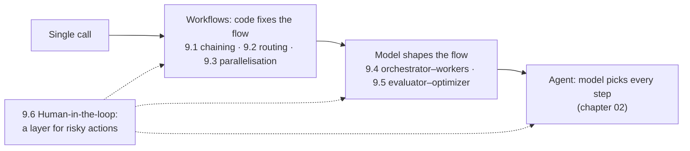

🏠 [Home](../../README.md) › 09 · Agent Design Patterns

# 09 · Agent Design Patterns

> **Estimated reading time:** ~54 min · **Difficulty:** 🟢 Beginner to 🟡 Intermediate · **Prerequisites:** [01 · Foundations](../01-foundations/README.md), [02 · The Agent Loop](../02-the-agent-loop/README.md)

Most useful [LLM](../../GLOSSARY.md#large-language-model-llm) systems are not free-roaming [agents](../../GLOSSARY.md#agent). They are a handful of simple, composable patterns: chains, routers, parallel calls, orchestrators, evaluator loops and human checkpoints. This chapter builds each one in plain Python, following the patterns described in Anthropic's [Building effective agents](https://www.anthropic.com/engineering/building-effective-agents), and ends with a flowchart for choosing the simplest one that works.

## 🎯 What you'll learn

- Prompt chaining: fixed steps with code gates between them
- Routing: classify, validate the label, dispatch, and send easy inputs to cheaper models
- Parallelisation: sectioning and voting with `ThreadPoolExecutor`, and how to combine the results
- Orchestrator–workers: letting a model decide the sub-tasks at run time, and validating its plan
- Evaluator–optimizer as a reusable building block you can drop into any other pattern
- Human-in-the-loop: approval gates, edits, rejection, escalation, and pausing and resuming a run
- How to choose, compare and combine patterns, starting from the simplest

## 📋 Prerequisites

- [1.2 Chatbot vs workflow vs agent](../01-foundations/01.2-chatbot-vs-workflow-vs-agent.md) and [1.6 When NOT to use an agent](../01-foundations/01.6-when-not-to-use-an-agent.md)
- [2.3 A 50-line agent from scratch](../02-the-agent-loop/02.3-a-50-line-agent-from-scratch.md) and [3.3 How function calling works](../03-tools-and-function-calling/03.3-how-function-calling-works.md), for 9.6
- [8.2 The evaluator–optimizer loop](../08-reflection-and-self-correction/08.2-evaluator-optimizer-loop.md), for 9.5

## 👀 Chapter overview

*Left to right: more flexibility, more cost, less predictability. Page 9.7 shows how to move right only when you must. Human-in-the-loop applies at every level.*

## 📄 Pages in this chapter

<!-- PAGES:START -->
| # | Page | Level | Time |
| --- | --- | --- | --- |
| 9.1 | [Prompt chaining](./09.1-prompt-chaining.md) — Split a task into fixed steps, one LLM call each. | 🟢 Beginner | ~7 min |
| 9.2 | [Routing](./09.2-routing.md) — Classify the input, then send it to the right handler. | 🟢 Beginner | ~7 min |
| 9.3 | [Parallelisation (sectioning & voting)](./09.3-parallelisation.md) — Run LLM calls side by side and combine the results. | 🟡 Intermediate | ~8 min |
| 9.4 | [Orchestrator–workers](./09.4-orchestrator-workers.md) — A lead model splits the work and hands it to workers. | 🟡 Intermediate | ~10 min |
| 9.5 | [Evaluator–optimizer](./09.5-evaluator-optimizer.md) — The generate-and-grade pattern as a reusable building block. | 🟡 Intermediate | ~6 min |
| 9.6 | [Human-in-the-loop](./09.6-human-in-the-loop.md) — Pause for a person to approve, correct or decide. | 🟡 Intermediate | ~8 min |
| 9.7 | [Choosing a pattern](./09.7-choosing-a-pattern.md) — A decision flowchart for picking the simplest pattern that works. | 🟡 Intermediate | ~8 min |
<!-- PAGES:END -->

<!-- FOOTER -->

---

⬅️ **Previous chapter:** [08 · Reflection & Self-Correction](../08-reflection-and-self-correction/README.md) ·
▶️ **Start reading:** [9.1 Prompt chaining](./09.1-prompt-chaining.md) ·
➡️ **Next chapter:** [10 · Multi-Agent Systems](../10-multi-agent-systems/README.md)
