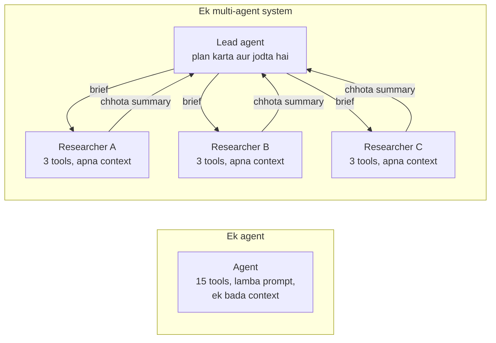

🏠 [Home](../../README.md) › [10 · Multi-Agent Systems](./README.md) › 10.1 Multiple agents kyun?

# 10.1 Multiple agents kyun?

> **Level:** 🟡 Intermediate · **Padhne ka time:** ~8 min · **Pehle padho:** [1.5 Agent ke andar kya-kya hota hai](../01-foundations/01.5-anatomy-of-an-agent.md), [9.4 Orchestrator–workers](../09-agent-design-patterns/09.4-orchestrator-workers.md)

**Ek line mein:** Kaam ko kai agents mein baantne se tumhe separation of concerns, parallel exploration, har sub-task ke liye saaf context aur specialised prompts aur tools milte hain. Lekin iski keemat hai: zyada tokens, zyada latency aur coordination ki problem.

📑 **Is page par**

- [Yeh kyun zaroori hai?](#-yeh-kyun-zaroori-hai)
- [Idea, simple words mein](#-idea-simple-words-mein)
- [Diagram se samjho](#-diagram-se-samjho)
- [Kaise kaam karta hai, step by step](#-kaise-kaam-karta-hai-step-by-step)
- [Example se samjho](#-example-se-samjho)
- [Code](#-code)
- [Aam galtiyan aur dhyan dene wali baatein](#-aam-galtiyan-aur-dhyan-dene-wali-baatein)
- [Yaad rakhne wali baatein](#-yaad-rakhne-wali-baatein)
- [Khud try karo](#-khud-try-karo)
- [Aur padhne ke liye](#-aur-padhne-ke-liye)

## 🤔 Yeh kyun zaroori hai?

Socho tumne ek research [agent](../../GLOSSARY.md#agent) banaya. Uske paas pandrah [tools](../../GLOSSARY.md#tool) hain aur do page ka [system prompt](../../GLOSSARY.md#system-prompt). Simple sawalon par woh sahi chala. Phir tumne usse teen cloud providers ko price, security aur support par compare karne ko bola. Aadhe raste mein uska [context window](../../GLOSSARY.md#context-window) provider A ke raw search results se bhar gaya. Ab woh bhoolne laga ki provider B ke baare mein kya mila tha. Woh galat tool bhi zyada baar choose karne laga, kyunki pandrah tools mein se chunna aasaan nahi hai.

Ek aam fix hai kaam ko baant dena. Ek agent plan karta hai, aur teen agents ek-ek provider par research karte hain, parallel mein, apne-apne saaf context ke saath. Isi ko [multi-agent system](../../GLOSSARY.md#multi-agent-system) kehte hain. Yeh bahut better ho sakta hai. Lekin yeh bahut bura bhi ho sakta hai: slow, mehenga aur debug karne mein mushkil. Yeh chapter isi ke baare mein hai ki kab kaunsa case hai, yeh pehchano.

## 🧠 Idea, simple words mein

Ek newspaper socho. Ek hi reporter poora edition research kar sakta hai, likh sakta hai, fact-check kar sakta hai aur layout bhi bana sakta hai. Lekin yeh slow hoga aur woh confuse ho jayega. Isliye editor stories baant deta hai. Kai reporters ek saath kaam karte hain, aur har ek ko sirf woh notes milte hain jo use chahiye. Aakhir mein editor sab jod deta hai.

Multi-agent system bhi yahi idea hai. Har agent ek normal agent hai, jaisa [1.5](../01-foundations/01.5-anatomy-of-an-agent.md) mein dekha: ek model, instructions, tools, memory aur ek loop. Naya sirf yeh hai ki agents ek dusre se baat karte hain. Baantne se tumhe chaar cheezein milti hain:

| Fayda | Matlab kya hai | Example |
| --- | --- | --- |
| **Separation of concerns** | Har agent ka ek kaam, ek chhota prompt aur kuch hi tools | Billing agent ko refund policy pata hai. Tech agent ko status page pata hai. Kisi ko dusre ke rules ki zaroorat nahi |
| **Parallel exploration** | Independent sub-tasks ek hi time par chalte hain | Teen researchers ek saath teen providers dekhte hain |
| **[Context isolation](../../GLOSSARY.md#context-isolation)** | Har sub-task ko fresh, focused context milta hai, aur wapas sirf chhota result aata hai | Ek sub-agent 40 pages padhta hai aur ek paragraph lautata hai |
| **Specialised tools aur prompts** | Har agent ke liye alag model, tools aur permissions | Ek sasta, read-only model search karta hai; ek strong model decide karta hai; sirf ek agent write kar sakta hai |

Aur iski teen keematein hain, jinhe [10.6](./10.6-when-multi-agent-makes-things-worse.md) detail mein cover karta hai: **zyada tokens** (har agent apna context padhta hai), **zyada latency** jab agents ek ke baad ek chalte hain, aur **coordination failures** (agents ek dusre ko galat samajhte hain, same kaam dobara karte hain ya ulte decisions lete hain).

## 👀 Diagram se samjho



*Left side par sab kuch ek hi context share karta hai. Right side par har researcher ka raw kaam uske apne context mein rehta hai. Boundary ke paar sirf neeche jaate briefs aur upar aate summaries jaate hain. Yahi iski taakat hai (saaf contexts, parallel kaam) aur yahi risk bhi (jo brief mein nahi hai, woh kho jaata hai).*

## 🔍 Kaise kaam karta hai, step by step

Har multi-agent design in chaar sawalon ka jawab deta hai. Baaki chapter inhe ek-ek karke dekhta hai.

1. **Aage kya hoga, yeh kaun decide karta hai?** Ya to ek central agent kaam delegate karta hai aur control apne paas rakhta hai (*supervisor*, [10.2](./10.2-supervisor-and-hierarchical.md)), ya control ek agent se dusre agent ke paas jaata hai (*handoffs*, [10.3](./10.3-peer-to-peer-and-handoffs.md)).
2. **Har agent kya dekhta hai?** Sirf brief wala fresh context, poori conversation, ya ek filtered view. Yeh sabse bada design decision hai, aur bugs ka sabse bada source bhi ([10.4](./10.4-shared-state-and-communication.md)).
3. **Agents information kaise exchange karte hain?** Messages pass karke (brief neeche, result upar), ya shared state jaise "blackboard" ko padh aur likh ke ([10.4](./10.4-shared-state-and-communication.md)). Company ya team ki boundary ke paar tumhe A2A jaisa protocol chahiye ([10.5](./10.5-agent-to-agent-protocols.md)).
4. **Isse control mein kaise rakhoge?** Agents, steps, tokens aur handoffs ki limits lagao, aur tracing rakho taaki dikhe kisne kya kiya ([10.6](./10.6-when-multi-agent-makes-things-worse.md), [14.1](../14-observability-and-debugging/14.1-tracing-agent-runs.md)).

Sabse achhe se documented public example Anthropic ka research feature hai. Unke engineering write-up mein ek lead agent research plan karta hai aur subagents start karta hai jo parallel mein search karte hain. Phir ek alag step citations jodta hai. Unhone report kiya ki is multi-agent set-up ne unke internal research eval par single agent ko 90.2% se beat kiya. Unhone yeh bhi report kiya ki agents ne chat se lagbhag 4× zyada tokens use kiye, aur multi-agent systems ne lagbhag 15× zyada. Dono numbers zaroori hain: fayda asli hai, aur bill bhi asli hai.

## 💡 Example se samjho

Ek hi request ko do tarike se handle karte hain: *"Plan a weekend in Lisbon from London, 12-14 March 2027, budget 400 EUR for flights and hotel."*

**Ek agent, do tools.** Agent `search_flights` call karta hai, phir `search_hotels`, aur dono raw results uske context mein aa jaate hain. Yeh bilkul theek hai: do tool calls aur chhota sa result. **Is task ke liye ek agent hi sahi jawab hai.**

**Ek supervisor aur do specialists.** Ek run aisa dikhta hai:

```text
[supervisor] step 1: ask_flights_agent({"task": "Find the cheapest return flight London to Lisbon, out 202...)
    [flights] step 1: search_flights({"origin": "London", "destination": "Lisbon", "depart": "2027-03-12...)
    [flights] answer: Cheapest: TagusAir, out 09:25, back 21:05, 148 EUR return.
[supervisor] step 1: ask_hotels_agent({"task": "Find a hotel in Lisbon for 2 nights from 2027-03-12, at m...)
    [hotels] step 1: search_hotels({"city": "Lisbon", "check_in": "2027-03-12", "nights": 2, "max_pric...)
    [hotels] answer: Casa Alfama: 75 EUR per night, rated 8.7, 150 EUR for 2 nights.
[supervisor] answer: Fly TagusAir (out 09:25 Friday, back 21:05 Sunday) for 148 EUR and ...

Tokens (estimated):
  supervisor   385
  flights      234
  hotels       215
  total        834
```

Jawab same, lekin teen agents, teen ki jagah paanch model calls, aur token bill teen agents mein bata hua. Split tabhi faydemand hai jab har specialist ka kaam bada ho: darjanon searches, lambe documents, ya aisa tool set jo ek agent ko confuse kar de. Khud se poochho: *kya ek sub-task ka raw kaam single context mein baaki sab ko dhakka de ke bahar kar dega?* Agar nahi, to ek hi agent rakho.

Socho ghar mein chai banani hai. Iske liye teen log lagao (ek doodh laaye, ek patti, ek gas jalaye) to bas time aur baat-cheet badhegi. Lekin shaadi ka khana banana ho, to alag-alag kaam alag logon ko dena samajh mein aata hai.

## 💻 Code

Zyadatar multi-agent systems ke peeche ka core trick chhota sa hai. Ek agent ko aise wrap karo ki dusra agent use tool ki tarah call kar sake. Andar sirf brief jaata hai aur bahar sirf answer aata hai:

```python
def as_tool(agent: Agent, name: str, description: str) -> tuple[Callable[..., str], ToolSpec]:
    """Dusre agent ko `agent` ko kisi bhi normal tool ki tarah call karne do."""

    def call_agent(task: str) -> str:
        return agent.run(task)            # ek fresh conversation jisme sirf `task` hai

    spec = {
        "name": name,
        "description": description,
        "input_schema": {
            "type": "object",
            "properties": {"task": {"type": "string",
                                    "description": "A complete, self-contained brief. The specialist sees nothing else."}},
            "required": ["task"],
        },
    }
    return call_agent, spec
```

Multi-agent ke "multi" ke liye bas itna hi chahiye. Model, loop aur tools wahi hain jo [chapter 02](../02-the-agent-loop/README.md) mein the. Frameworks isi idea ko package karte hain: OpenAI Agents SDK mein `Agent.as_tool()` hai ([11.5](../11-frameworks/11.5-openai-agents-sdk.md)), aur Claude Agent SDK main agent ko apne `Agent` tool se *subagents* start karne deta hai ([11.6](../11-frameworks/11.6-claude-agent-sdk.md)).

## 🚨 Aam galtiyan aur dhyan dene wali baatein

- **Context ke hisaab se nahi, job title ke hisaab se baantna.** "Planner, researcher, writer, critic" sunne mein saaf lagta hai. Lekin agar har step ko woh sab chahiye jo pichle step ne dekha, to tumhare paas ek hi task chaar contexts mein hai. **Fix:** wahan baanto jahan kaam independent ho aur wapas aane wala result chhota ho sake.
- **Shuru hi multi-agent se karna.** **Fix:** pehle ek agent banao, measure karo ki woh kahan fail hota hai ([chapter 12](../12-evaluation/README.md)), aur sirf woh hissa baanto jo overloaded hai.
- **Yeh maan lena ki parallel matlab sasta.** Parallel agents *time* bachate hain, tokens nahi. Har agent apna prompt, tools aur context padhta hai. **Fix:** total ke hisaab se budget banao ([16.5](../16-cost-and-performance/16.5-budget-limits-per-run.md)).
- **Vague briefs.** Sub-agent sirf apne brief ke saath start karta hai, isliye "look into flights" bologe to tumhe ek guess milega. **Fix:** brief mein goal, facts, output format aur limits likho ([10.2](./10.2-supervisor-and-hierarchical.md)).
- **Agents ke paar koi trace nahi.** Jab answer galat ho, tumhe pata hona chahiye ki kis agent ne galti ki. **Fix:** poore run ke liye ek trace ID, aur har agent ke liye ek span ([14.1](../14-observability-and-debugging/14.1-tracing-agent-runs.md)).

## ✅ Yaad rakhne wali baatein

- Multi-agent system kai normal agents hain jo ek dusre ko kaam delegate karte hain ya hand over karte hain.
- Isse separation of concerns, parallel exploration, context isolation aur specialised prompts aur tools milte hain.
- Iski keemat hai tokens, latency aur coordination. Anthropic ke hisaab se multi-agent research ne chat se lagbhag 15× tokens use kiye.
- Main design sawal hain: kaun decide karta hai, har agent kya dekhta hai, woh information kaise exchange karte hain, aur tum ise bounded kaise rakhte ho.
- Ek agent se shuru karo. Sirf woh hisse baanto jinka raw kaam baaki sab ko bahar dhakel de.

## 🧪 Khud try karo

1. Har task ke liye bolo "ek agent" ya "multi-agent", aur kyun: (a) ek order ke baare mein sawal ka jawab dena; (b) 6 review sites par 12 laptops compare karna; (c) ek function refactor karna aur uske tests update karna.
2. Upar wale supervisor run mein, dono specialists ke jawab ke baad supervisor ek dusra model call karta hai. `as_tool` snippet use karke socho ki us call ke liye uske messages mein kaunse tool results hain, aur kaunse woh kabhi nahi dekhta.

<details>
<summary>Answer dekho</summary>

1. (a) Ek agent: ek ya do tool calls, chhota sa context. (b) Multi-agent theek fit hai: reviews independent hain, aur har sub-agent bahut padh ke ek chhoti comparison row lauta sakta hai. (c) Ek agent: edit aur tests same details par depend karte hain, isliye baantne se context kho jayega. Yeh Anthropic ki us baat se match karta hai ki zyadatar coding tasks mein research ke mukable kam truly parallel hisse hote hain.
2. Woh sirf specialists ke do one-line answers dekhta hai ("Cheapest: TagusAir…" aur "Casa Alfama…"). Woh raw `search_flights` aur `search_hotels` results kabhi nahi dekhta, jaise 58 EUR wala hostel jo hotels agent ne reject kiya. Yahi context isolation hai, aur iska test likhna worth hai: assert karo ki supervisor ke messages mein specialists ke answers hain, lekin unke raw tool results bilkul nahi.

</details>

## 📚 Aur padhne ke liye

- [How we built our multi-agent research system](https://www.anthropic.com/engineering/multi-agent-research-system) (Anthropic). Ek lead agent aur parallel subagents, saath mein woh token aur quality numbers jo is page par quote kiye gaye hain.
- [Don't Build Multi-Agents](https://cognition.com/blog/dont-build-multi-agents) (Cognition). Ulta nazariya: bahut se tasks ke liye shared context parallelism se zyada zaroori kyun hai.
- [Building effective agents](https://www.anthropic.com/engineering/building-effective-agents) (Anthropic). Orchestrator-workers aur simple se shuru karne ki salah.
- [Agent orchestration](https://openai.github.io/openai-agents-python/multi_agent/) (OpenAI Agents SDK docs). LLM-driven vs code-driven orchestration, aur agents-as-tools vs handoffs.

<!-- FOOTER -->

---

⬅️ **Pichla:** [9.7 Sahi pattern kaise chuno](../09-agent-design-patterns/09.7-choosing-a-pattern.md) ·
🏠 [Chapter home](./README.md) ·
➡️ **Agla:** [10.2 Supervisor aur hierarchical](./10.2-supervisor-and-hierarchical.md)
