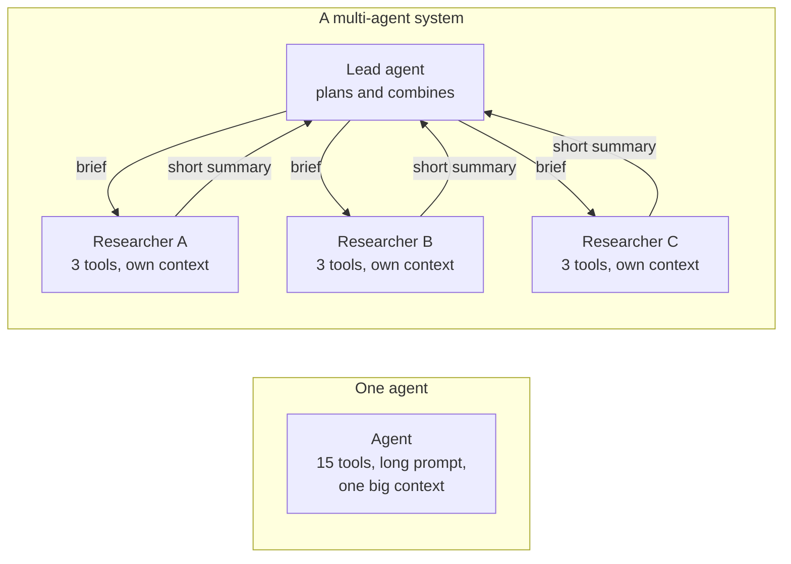

🏠 [Home](../../README.md) › [10 · Multi-Agent Systems](./README.md) › 10.1 Why multiple agents?

# 10.1 Why multiple agents?

> **Difficulty:** 🟡 Intermediate · **Reading time:** ~8 min · **Prerequisites:** [1.5 Anatomy of an agent](../01-foundations/01.5-anatomy-of-an-agent.md), [9.4 Orchestrator-workers](../09-agent-design-patterns/09.4-orchestrator-workers.md)

**In one sentence:** Splitting work across several agents buys you separation of concerns, parallel exploration, a clean context for each sub-task and specialised prompts and tools, and it costs you tokens, latency and coordination.

📑 **On this page**

- [Why does this matter?](#-why-does-this-matter)
- [The idea, in plain words](#-the-idea-in-plain-words)
- [Picture it](#-picture-it)
- [How it works, step by step](#-how-it-works-step-by-step)
- [Worked example](#-worked-example)
- [Code](#-code)
- [Common mistakes & gotchas](#-common-mistakes--gotchas)
- [Key takeaways](#-key-takeaways)
- [Try it yourself](#-try-it-yourself)
- [Further reading](#-further-reading)

## 🤔 Why does this matter?

You built a research [agent](../../GLOSSARY.md#agent) with fifteen [tools](../../GLOSSARY.md#tool) and a two-page [system prompt](../../GLOSSARY.md#system-prompt). It worked for simple questions. Then you asked it to compare three cloud providers on price, security and support. Halfway through, its [context window](../../GLOSSARY.md#context-window) was full of raw search results about provider A, and it started to forget what it had found about provider B. It also picked the wrong tool more often, because fifteen tools is a lot to choose from.

A common fix is to split the job: one agent plans and three agents research one provider each, in parallel, with their own clean context. That is a [multi-agent system](../../GLOSSARY.md#multi-agent-system). It can be much better. It can also be much worse: slower, more expensive and harder to debug. This chapter is about knowing which.

## 🧠 The idea, in plain words

Think of a newspaper. One reporter could research, write, fact-check and lay out a whole edition, but it would be slow and they would get muddled. Instead, an editor hands out stories, several reporters work at the same time, and each gets only the notes they need. The editor puts it all together.

A multi-agent system is the same idea. Each agent is a normal agent from [1.5](../01-foundations/01.5-anatomy-of-an-agent.md): a model, instructions, tools, memory and a loop. What's new is that agents talk to each other. Splitting buys you four things:

| Benefit | What it means | Example |
| --- | --- | --- |
| **Separation of concerns** | Each agent has one job, one short prompt and a few tools | A billing agent knows refund policy. A tech agent knows the status page. Neither needs the other's rules |
| **Parallel exploration** | Independent sub-tasks run at the same time | Three researchers look at three providers at once |
| **[Context isolation](../../GLOSSARY.md#context-isolation)** | Each sub-task gets a fresh, focused context, and only a short result flows back | A sub-agent reads 40 pages and returns one paragraph |
| **Specialised tools and prompts** | Different models, tools and permissions per agent | A cheap, read-only model searches; a stronger model decides; only one agent can write |

And it costs you three things, which [10.6](./10.6-when-multi-agent-makes-things-worse.md) covers in depth: **more tokens** (every agent reads its own context), **more latency** when agents run in sequence, and **coordination failures** (agents misunderstand each other, duplicate work or make conflicting choices).

## 👀 Picture it



*On the left, everything shares one context. On the right, each researcher's raw work stays in its own context. Only the briefs going down and the summaries coming back cross the boundaries, which is both the strength (clean contexts, parallel work) and the risk (whatever is not in the brief is lost).*

## 🔍 How it works, step by step

Every multi-agent design answers the same four questions. The rest of the chapter takes them one at a time.

1. **Who decides what happens next?** Either a central agent delegates and stays in control (a *supervisor*, [10.2](./10.2-supervisor-and-hierarchical.md)), or control moves from agent to agent (*handoffs*, [10.3](./10.3-peer-to-peer-and-handoffs.md)).
2. **What does each agent see?** A fresh context with only a brief, the full conversation, or a filtered view. This is the biggest design decision, and the biggest source of bugs ([10.4](./10.4-shared-state-and-communication.md)).
3. **How do agents exchange information?** By passing messages (a brief down, a result up), or by reading and writing shared state such as a "blackboard" ([10.4](./10.4-shared-state-and-communication.md)). Across company or team boundaries you need a protocol such as A2A ([10.5](./10.5-agent-to-agent-protocols.md)).
4. **How do you keep it under control?** Limits on the number of agents, steps, tokens and handoffs, plus tracing so you can see who did what ([10.6](./10.6-when-multi-agent-makes-things-worse.md), [14.1](../14-observability-and-debugging/14.1-tracing-agent-runs.md)).

The best-documented public example is Anthropic's research feature. In their engineering write-up, a lead agent plans the research and starts subagents that search in parallel, then a separate step adds citations. They report that this multi-agent set-up beat a single agent by 90.2% on their internal research eval. They also report that agents used about 4× more tokens than chat, and multi-agent systems about 15× more. Both numbers matter: the gain is real, and so is the bill.

## 💡 Worked example

Here is the same request handled two ways: *"Plan a weekend in Lisbon from London, 12-14 March 2027, budget 400 EUR for flights and hotel."*

**One agent, two tools.** The agent calls `search_flights`, then `search_hotels`, and both raw results land in its context. That's fine: two tool calls and a small result. **For this task, one agent is the right answer.**

**A supervisor and two specialists**, from [`examples/10-supervisor`](../../examples/10-supervisor/README.md):

```text
[supervisor] step 1: ask_flights_agent({"task": "Find the cheapest return flight London to Lisbon, out 202...)
    [flights] step 1: search_flights({"origin": "London", "destination": "Lisbon", "depart": "2027-03-12...)
    [flights] answer: Cheapest: TagusAir, out 09:25, back 21:05, 148 EUR return.
[supervisor] step 1: ask_hotels_agent({"task": "Find a hotel in Lisbon for 2 nights from 2027-03-12, at m...)
    [hotels] step 1: search_hotels({"city": "Lisbon", "check_in": "2027-03-12", "nights": 2, "max_pric...)
    [hotels] answer: Casa Alfama: 75 EUR per night, rated 8.7, 150 EUR for 2 nights.
[supervisor] answer: Fly TagusAir (out 09:25 Friday, back 21:05 Sunday) for 148 EUR and ...

Tokens (estimated by MockLLM unless you use a real provider):
  supervisor   385
  flights      234
  hotels       215
  total        834
```

Same answer, three agents, five model calls instead of three, and the token bill spread across three agents. The split only pays off when each specialist's work is big: dozens of searches, long documents, or a tool set that would confuse a single agent. Ask: *would the raw work of one sub-task crowd out the others in a single context?* If not, keep one agent.

## 💻 Code

The core trick behind most multi-agent systems is small. Wrap an agent so that another agent can call it like a tool. Only the brief goes in and only the answer comes out:

```python
def as_tool(agent: Agent, name: str, description: str) -> tuple[Callable[..., str], ToolSpec]:
    """Let another agent call `agent` like any other tool."""

    def call_agent(task: str) -> str:
        return agent.run(task)            # a fresh conversation containing only `task`

    spec = {
        "name": name,
        "description": description,
        "input_schema": {
            "type": "object",
            "properties": {"task": {"type": "string",
                                    "description": "A complete, self-contained brief. The specialist sees nothing else."}},
            "required": ["task"],
        },
    }
    return call_agent, spec
```

That is all the "multi" in multi-agent needs: the model, the loop and the tools are the same as in [chapter 02](../02-the-agent-loop/README.md). Full version with tests: [`examples/10-supervisor/main.py`](../../examples/10-supervisor/main.py). Frameworks package the same idea: the OpenAI Agents SDK has `Agent.as_tool()` ([11.5](../11-frameworks/11.5-openai-agents-sdk.md)), and the Claude Agent SDK lets the main agent start *subagents* through its `Agent` tool ([11.6](../11-frameworks/11.6-claude-agent-sdk.md)).

## 🚨 Common mistakes & gotchas

- **Splitting by job title instead of by context.** "Planner, researcher, writer, critic" sounds tidy, but if each step needs everything the previous one saw, you have one task in four contexts. **Fix:** split where the work is independent and the hand-back can be short.
- **Starting multi-agent.** **Fix:** build one agent first, measure where it fails ([chapter 12](../12-evaluation/README.md)), and split only the part that is overloaded.
- **Assuming parallel means cheaper.** Parallel agents save *time*, not tokens. Each one reads its own prompt, tools and context. **Fix:** budget for the total ([16.5](../16-cost-and-performance/16.5-budget-limits-per-run.md)).
- **Vague briefs.** A sub-agent starts with only its brief, so "look into flights" gets you a guess. **Fix:** the brief states the goal, the facts, the output format and the limits ([10.2](./10.2-supervisor-and-hierarchical.md)).
- **No trace across agents.** When the answer is wrong, you need to know which agent got it wrong. **Fix:** one trace ID for the whole run, with a span per agent ([14.1](../14-observability-and-debugging/14.1-tracing-agent-runs.md)).

## ✅ Key takeaways

- A multi-agent system is several ordinary agents that delegate to or hand over to each other.
- It buys separation of concerns, parallel exploration, context isolation and specialised prompts and tools.
- It costs tokens, latency and coordination. Anthropic reports multi-agent research used about 15× the tokens of chat.
- The key design questions are who decides, what each agent sees, how they exchange information and how you keep it bounded.
- Start with one agent. Split only the parts whose raw work would crowd out everything else.

## 🧪 Try it yourself

1. For each task, say "one agent" or "multi-agent", and why: (a) answer a question about one order; (b) compare 12 laptops across 6 review sites; (c) refactor one function and update its tests.
2. In `examples/10-supervisor`, look at `llms["supervisor"].calls[1]["messages"]` in a test. Which tool results does the supervisor see, and which does it never see?

<details>
<summary>Show answer</summary>

1. (a) One agent: one or two tool calls, tiny context. (b) Multi-agent is a reasonable fit: the reviews are independent, and each sub-agent can read a lot and return a short comparison row. (c) One agent: the edit and the tests depend on the same details, so splitting them would lose context. That matches Anthropic's remark that most coding tasks have fewer truly parallel parts than research.
2. It sees only the two one-line answers from the specialists ("Cheapest: TagusAir…" and "Casa Alfama…"). It never sees the raw `search_flights` and `search_hotels` results, such as the 58 EUR hostel the hotels agent rejected. That is context isolation, and the test `test_specialist_tool_traffic_stays_out_of_supervisor_context` checks it.

</details>

## 📚 Further reading

- [How we built our multi-agent research system](https://www.anthropic.com/engineering/multi-agent-research-system) (Anthropic). A lead agent with parallel subagents, with the token and quality numbers quoted on this page.
- [Don't Build Multi-Agents](https://cognition.com/blog/dont-build-multi-agents) (Cognition). The opposite view: why shared context matters more than parallelism for many tasks.
- [Building effective agents](https://www.anthropic.com/engineering/building-effective-agents) (Anthropic). Orchestrator-workers and the advice to start simple.
- [Agent orchestration](https://openai.github.io/openai-agents-python/multi_agent/) (OpenAI Agents SDK docs). LLM-driven vs code-driven orchestration, and agents-as-tools vs handoffs.

<!-- FOOTER -->

---

⬅️ **Previous:** [9.7 Choosing a pattern](../09-agent-design-patterns/09.7-choosing-a-pattern.md) ·
🏠 [Chapter home](./README.md) ·
➡️ **Next:** [10.2 Supervisor & hierarchical](./10.2-supervisor-and-hierarchical.md)
