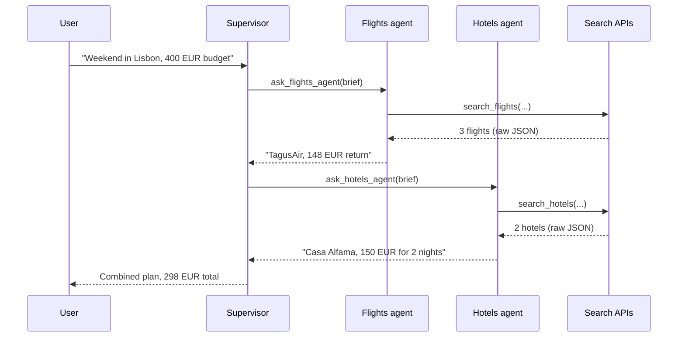

🏠 [Home](../../README.md) › [10 · Multi-Agent Systems](./README.md) › 10.2 Supervisor & hierarchical

# 10.2 Supervisor & hierarchical

> **Difficulty:** 🟡 Intermediate · **Reading time:** ~10 min · **Prerequisites:** [10.1 Why multiple agents?](./10.1-why-multiple-agents.md), [3.3 How function calling works](../03-tools-and-function-calling/03.3-how-function-calling-works.md)
>
> Last verified: November 2026 with openai-agents==0.24.0 and claude-agent-sdk==0.2.180 (framework snippets only; the main code uses plain Python).

**In one sentence:** A [supervisor agent](../../GLOSSARY.md#supervisor-agent) keeps control of the task and delegates pieces of it to specialist agents, which it calls like tools and which hand back short results.

📑 **On this page**

- [Why does this matter?](#-why-does-this-matter)
- [The idea, in plain words](#-the-idea-in-plain-words)
- [Picture it](#-picture-it)
- [How it works, step by step](#-how-it-works-step-by-step)
- [Worked example](#-worked-example)
- [Code](#-code)
- [Common mistakes & gotchas](#-common-mistakes--gotchas)
- [Key takeaways](#-key-takeaways)
- [Try it yourself](#-try-it-yourself)
- [Further reading](#-further-reading)

## 🤔 Why does this matter?

Most multi-agent systems in production are supervisors. A user asks for something that has several independent parts: plan a trip, research a market, review a pull request for style, security and tests. One agent should own the result, and that agent should be able to say "you do flights, you do hotels" and then check that the pieces fit together.

Done well, the supervisor's [context window](../../GLOSSARY.md#context-window) stays small and focused on decisions, while the [subagents](../../GLOSSARY.md#subagent) do the heavy reading. Done badly, the supervisor writes vague briefs, the specialists guess, and you pay for three agents to produce one confused answer.

## 🧠 The idea, in plain words

A supervisor is a project manager. It doesn't do the specialist work itself. It writes a clear brief for each specialist, waits for their reports, and combines them into one deliverable. It stays responsible for the final answer.

In code, this is the [orchestrator-workers](../09-agent-design-patterns/09.4-orchestrator-workers.md) pattern from chapter 09, with one twist: each worker is a full agent with its own loop and tools, not a single model call. The supervisor calls each specialist through an ordinary [tool](../../GLOSSARY.md#tool) whose only argument is the brief. This is often called **agents as tools**.

A **hierarchy** is the same idea, nested: a supervisor's specialist can itself be a supervisor with its own team. A "build a market report" agent might delegate to a "research" supervisor, which delegates to three search agents.

| Term | Meaning |
| --- | --- |
| **Supervisor** (also *lead*, *orchestrator*, *manager*) | Plans, delegates, combines, owns the final answer |
| **Specialist** (also *worker*, *subagent*) | Does one sub-task in its own context and returns a result |
| **Brief** | The only input a specialist gets: goal, facts, output format, limits |
| **Hierarchy** | Specialists that are themselves supervisors. Each level adds cost and latency |

## 👀 Picture it



*The raw API results stop at the specialists. The supervisor only ever sees briefs going out and one-line reports coming back, and the user only ever talks to the supervisor.*

## 🔍 How it works, step by step

1. **Define each specialist as a normal agent**: its own short system prompt, its own few tools, optionally its own (often cheaper) model.
2. **Wrap each specialist as a tool** for the supervisor. The tool description says *when* to use it. The single `task` argument says *what to do*.
3. **The supervisor plans and delegates.** It can call several specialists in one turn ([parallel tool calls](../03-tools-and-function-calling/03.5-parallel-tool-calls.md)), and your code may run them at the same time.
4. **Each specialist runs its own loop** in a fresh conversation containing only the brief, and returns its final answer as the tool result.
5. **The supervisor combines, checks and decides**: answer, ask a specialist for more, or delegate a follow-up.

### Writing a good brief

The brief is the whole interface. Anthropic's write-up on its research system says each subagent needs *"an objective, an output format, guidance on the tools and sources to use, and clear task boundaries"*. Without detailed briefs, their subagents duplicated work or misread the task. The same post gives scaling rules they put in the lead agent's prompt: simple fact-finding needs 1 agent with 3-10 tool calls, direct comparisons 2-4 subagents with 10-15 calls each, and complex research more than 10 subagents with clearly divided jobs.

| Weak brief | Strong brief |
| --- | --- |
| "Find flights to Lisbon." | "Find the cheapest return flight London to Lisbon, out 2027-03-12, back 2027-03-14. Return airline, times and total price in EUR." |

### Supervisor or hierarchy?

In practice, we recommend **one level** of supervision until you have evidence you need more. Every level re-summarises information (losing detail), adds a round of model calls (adding latency), and adds an agent whose mistakes look plausible to the level above.

## 💡 Worked example

The supervisor's first reply asks for both specialists in one turn:

```text
tool_calls:
  ask_flights_agent(task="Find the cheapest return flight London to Lisbon, out 2027-03-12,
                          back 2027-03-14. Return airline, times and total price in EUR.")
  ask_hotels_agent(task="Find a hotel in Lisbon for 2 nights from 2027-03-12, at most 80 EUR per night,
                         guest rating 8 or more. Return name, nightly price and total in EUR.")
```

The flights agent's **entire** first request is the brief, with its own system prompt:

```text
system:   You find flights. Use search_flights. Reply with the single best option that fits the brief, in one sentence.
messages: [user: "Find the cheapest return flight London to Lisbon, out 2027-03-12, ..."]
tools:    [search_flights]
```

It calls `search_flights`, gets three options, and answers in one sentence. The hotels agent does the same. The supervisor's second request contains just two short tool results:

```text
tool_result (ask_flights_agent): Cheapest: TagusAir, out 09:25, back 21:05, 148 EUR return.
tool_result (ask_hotels_agent):  Casa Alfama: 75 EUR per night, rated 8.7, 150 EUR for 2 nights.
```

and it replies: *"Fly TagusAir … for 148 EUR and stay two nights at Casa Alfama (rated 8.7) for 150 EUR. Total: 298 EUR, which leaves 102 EUR of your 400 EUR budget."* Notice that the supervisor never saw the 58 EUR hostel the hotels agent rejected for its low rating. That is good for focus and bad if you wanted to know about cheap options: you get what the brief asked for.

## 💻 Code

The specialists and the supervisor, in plain Python:

```python
llm = ...  # any chat model client

flights = Agent("flights", llm, FLIGHTS_PROMPT, {"search_flights": (search_flights, SEARCH_FLIGHTS_SPEC)})
hotels = Agent("hotels", llm, HOTELS_PROMPT, {"search_hotels": (search_hotels, SEARCH_HOTELS_SPEC)})

supervisor = Agent(
    "supervisor",
    llm,
    "You plan trips. You cannot search yourself: delegate to the specialists. Give each one a complete "
    "brief, because they cannot see this conversation. Then combine their answers and check the budget.",
    {
        "ask_flights_agent": as_tool(flights, "ask_flights_agent", "Delegate a flight search to the flights specialist."),
        "ask_hotels_agent": as_tool(hotels, "ask_hotels_agent", "Delegate a hotel search to the hotels specialist."),
    },
)
print(supervisor.run("Plan a weekend in Lisbon from London, 12-14 March 2027. Budget: 400 EUR."))
```

`Agent.run` is the loop from [chapter 02](../02-the-agent-loop/02.3-a-50-line-agent-from-scratch.md), and `as_tool` is the 15-line wrapper shown in [10.1](./10.1-why-multiple-agents.md#-code).

**The same pattern in the OpenAI Agents SDK** (`pip install openai-agents`, needs `OPENAI_API_KEY`):

```python
from agents import Agent, Runner

flights = Agent(name="Flights agent", instructions="You find flights...", tools=[search_flights])
hotels = Agent(name="Hotels agent", instructions="You find hotels...", tools=[search_hotels])

supervisor = Agent(
    name="Trip planner",
    instructions="Delegate to the specialists with complete briefs, then combine their answers.",
    tools=[
        flights.as_tool(tool_name="ask_flights_agent", tool_description="Delegate a flight search."),
        hotels.as_tool(tool_name="ask_hotels_agent", tool_description="Delegate a hotel search."),
    ],
)
result = Runner.run_sync(supervisor, "Plan a weekend in Lisbon from London, 12-14 March 2027.")
print(result.final_output)
```

(`search_flights` and `search_hotels` would be decorated with `@function_tool`.)

**In the Claude Agent SDK**, specialists are `AgentDefinition`s, and the main agent delegates through its built-in `Agent` tool (`pip install claude-agent-sdk`, needs `ANTHROPIC_API_KEY`):

```python
from claude_agent_sdk import AgentDefinition, ClaudeAgentOptions, query

options = ClaudeAgentOptions(
    allowed_tools=["Read", "Grep", "Glob", "Agent"],
    agents={
        "code-reviewer": AgentDefinition(
            description="Code review specialist. Use for quality and security reviews.",
            prompt="You review code for security and maintainability. Be concise.",
            tools=["Read", "Grep", "Glob"],  # read-only: this specialist cannot edit
        ),
    },
)
# async for message in query(prompt="Review the auth module", options=options): ...
```

See [11.5](../11-frameworks/11.5-openai-agents-sdk.md) and [11.6](../11-frameworks/11.6-claude-agent-sdk.md) for these SDKs in depth.

## 🚨 Common mistakes & gotchas

- **Briefs that assume shared context.** "Now do the hotel part" means nothing to an agent that never saw the conversation. **Fix:** tell the supervisor, in its prompt, that specialists see only the brief. Test it: assert the specialist's first message contains the dates and budget.
- **The supervisor doing the work itself.** If the supervisor also has the raw search tools, it often skips delegation. **Fix:** give the supervisor only the agent-tools, or very few direct tools.
- **Specialists returning everything.** A specialist that pastes 5,000 tokens of raw results defeats the point. **Fix:** fix the output format in the brief ("one sentence", "a table with these columns", "at most 200 words").
- **Unbounded fan-out.** Some models delegate eagerly, and a hierarchy can grow into a tree of agents. **Fix:** cap depth, concurrency and spend in code. The Claude Agent SDK, for example, has environment variables for subagent depth and concurrency and a `max_budget_usd` option. See also [16.5](../16-cost-and-performance/16.5-budget-limits-per-run.md).
- **Swallowed specialist failures.** If a specialist hits its step limit, return that clearly as the tool result (and `is_error` where possible) so the supervisor can retry or tell the user, instead of treating "I could not finish" as data.

## ✅ Key takeaways

- A supervisor delegates, combines and owns the answer. Specialists do focused work in their own context.
- The usual mechanism is **agents as tools**: one tool per specialist, with a `task` brief as its only argument.
- The brief is the whole interface: objective, facts, output format, tools or sources to use, and boundaries.
- Hierarchies are supervisors of supervisors. Add a level only when one level clearly isn't enough.
- Bound everything: number of specialists, depth, steps and tokens.

## 🧪 Try it yourself

1. Rewrite this weak brief so a specialist with no context could do it: *"Check if the hotel is OK."*
2. Using the team from the Code section, with a scripted fake model so the run is repeatable, write a test that fails if the supervisor's brief to the hotels agent does not mention the number of nights.
3. When would you give the supervisor one direct tool of its own as well as the agent-tools?

<details>
<summary>Show answer</summary>

1. For example: *"Check Casa Alfama in Lisbon for 2 nights from 2027-03-12: is it available, is the total at most 160 EUR, and is the guest rating at least 8? Reply with yes or no for each, plus the total price in EUR."*
2. For example:

   ```python
   def test_hotel_brief_mentions_nights() -> None:
       briefs = []
       call_hotels, spec = supervisor.tools["ask_hotels_agent"]

       def recording_call(task: str) -> str:
           briefs.append(task)               # the brief is the specialist's only input
           return call_hotels(task)

       supervisor.tools["ask_hotels_agent"] = (recording_call, spec)
       supervisor.run("Plan a weekend in Lisbon from London, 12-14 March 2027. Budget: 400 EUR.")
       assert briefs and "2 nights" in briefs[0]
   ```

3. When the tool is cheap, quick and needed for the supervisor's own decisions, such as a `calculator` to check the budget or a `get_user_preferences` lookup. Delegating a one-call job to a whole agent adds a model call and a brief that can go wrong, for no benefit.

</details>

## 📚 Further reading

- [How we built our multi-agent research system](https://www.anthropic.com/engineering/multi-agent-research-system) (Anthropic). How the lead agent writes briefs and scales effort to the query.
- [Agent orchestration](https://openai.github.io/openai-agents-python/multi_agent/) (OpenAI Agents SDK docs). When to use a manager with agents as tools, and when to use handoffs.
- [Subagents in the SDK](https://code.claude.com/docs/en/agent-sdk/subagents) (Claude Agent SDK docs). Context isolation, tool restrictions, and limits on depth, concurrency and spend.
- [Building effective agents](https://www.anthropic.com/engineering/building-effective-agents) (Anthropic). The orchestrator-workers workflow this pattern grows from.

<!-- FOOTER -->

---

⬅️ **Previous:** [10.1 Why multiple agents?](./10.1-why-multiple-agents.md) ·
🏠 [Chapter home](./README.md) ·
➡️ **Next:** [10.3 Peer-to-peer & handoffs](./10.3-peer-to-peer-and-handoffs.md)
