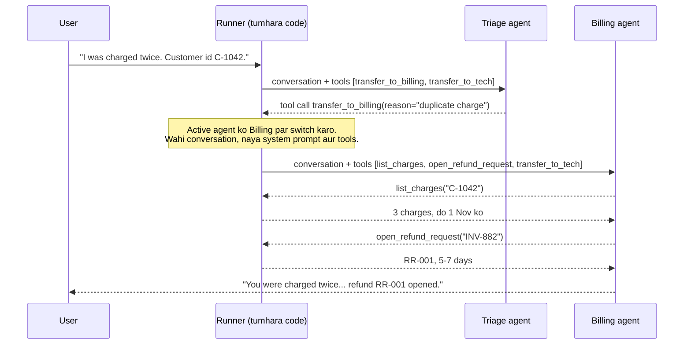
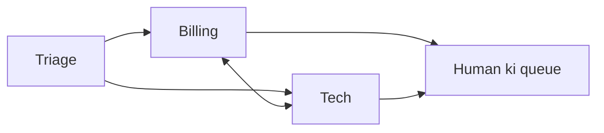

🏠 [Home](../../README.md) › [10 · Multi-Agent Systems](./README.md) › 10.3 Peer-to-peer aur handoffs

# 10.3 Peer-to-peer aur handoffs

> **Level:** 🟡 Intermediate · **Padhne ka time:** ~10 min · **Pehle padho:** [10.2 Supervisor aur hierarchical](./10.2-supervisor-and-hierarchical.md), [9.2 Routing](../09-agent-design-patterns/09.2-routing.md)
>
> Last verified: November 2026 with openai-agents==0.24.0 (sirf framework snippet ke liye; main code plain Python use karta hai).

**Ek line mein:** [Handoff](../../GLOSSARY.md#handoff) mein ek agent conversation ka control dusre agent ko de deta hai. Phir naya agent apne instructions aur tools ke saath seedha user se baat karta hai, supervisor ko report karne ki jagah.

📑 **Is page par**

- [Yeh kyun zaroori hai?](#-yeh-kyun-zaroori-hai)
- [Idea, simple words mein](#-idea-simple-words-mein)
- [Diagram se samjho](#-diagram-se-samjho)
- [Kaise kaam karta hai, step by step](#-kaise-kaam-karta-hai-step-by-step)
- [Example se samjho](#-example-se-samjho)
- [Code](#-code)
- [Aam galtiyan aur dhyan dene wali baatein](#-aam-galtiyan-aur-dhyan-dene-wali-baatein)
- [Yaad rakhne wali baatein](#-yaad-rakhne-wali-baatein)
- [Khud try karo](#-khud-try-karo)
- [Aur padhne ke liye](#-aur-padhne-ke-liye)

## 🤔 Yeh kyun zaroori hai?

Ek customer tumhare help desk ko likhta hai: *"I was charged twice this month."* Phir: *"Also, the app won't sync."* Supervisor [agent](../../GLOSSARY.md#agent) har message ko apne through relay karega, aur har baar ek model call aur ek summary step jodega. Tumhe asal mein woh chahiye jo ek achha call centre karta hai. Front desk samajhta hai ki kaun help karega aur **call transfer kar deta hai**. Billing specialist seedha customer se baat karta hai. Agar problem technical nikli, to billing call tech ko transfer kar deta hai.

Yahi handoff hai. Aisi conversations ke liye yeh natural shape hai jahan reply ka owner ek specialist hona chahiye. OpenAI Agents SDK jaise frameworks customer-service type systems ko aise hi model karte hain.

## 🧠 Idea, simple words mein

Ek hospital socho. Reception tumhara ilaaj nahi karta. Woh tumhare aur doctor ke beech khada hoke tumhari har baat dohrata bhi nahi. Woh tumhe sahi department bhej deta hai, aur uske baad tum seedha doctor se baat karte ho. Doctor tumhe aage kisi aur specialist ke paas bhej sakta hai. Kisi ko bhi tumhara "in charge" bane rehne ki zaroorat nahi.

| | Supervisor ([10.2](./10.2-supervisor-and-hierarchical.md)) | Handoff (yeh page) |
| --- | --- | --- |
| User se baat kaun karta hai? | Hamesha supervisor | Jo bhi agent us waqt active hai |
| Kya control wapas aata hai? | Haan, har sub-task ke baad | Nahi, jab tak koi wapas hand na kare |
| Receiver kya dekhta hai? | Sirf ek brief | Aam taur par poori conversation |
| Kiske liye achha | Parallel hisson mein bante tasks | Sahi expert tak route hone wali conversations |
| Sabse bada risk | Briefs mein detail kho jaana | Agents user ko idhar-udhar ghumaate hain, "big picture" kho jaata hai |

**Peer-to-peer** ka matlab hai koi agent boss nahi hai. Koi bhi agent kisi bhi aise agent ko hand kar sakta hai jis tak pahunchne ki use permission hai. Practice mein tum allowed handoffs ko ek graph ki tarah draw karte ho aur use chhota rakhte ho.

## 👀 Diagram se samjho



*Triage sirf ek baar call hota hai aur reply kabhi nahi dekhta. Switching runner karta hai, yaani tumhara code. Handoff bas ek tool call hai jise tumhara loop khaas tarike se handle karta hai.*

## 🔍 Kaise kaam karta hai, step by step

1. **Har handoff model ko ek [tool](../../GLOSSARY.md#tool) ki tarah offer hota hai.** OpenAI Agents SDK inke naam `transfer_to_<agent_name>` rakhta hai, to "Refund Agent" ka handoff `transfer_to_refund_agent` ki tarah dikhta hai. Tool description batata hai ki ise kab use karna hai. `reason` jaisa chhota argument logging mein help karta hai.
2. **Model transfer tool ko call karta hai**, bilkul kisi aur tool ki tarah.
3. **Tumhara runner active agent switch karta hai.** Woh ek tool result jodta hai ("Transferred to billing.") taaki conversation valid rahe. Phir woh *naye* agent ke [system prompt](../../GLOSSARY.md#system-prompt) aur tools ke saath model ko dobara call karta hai.
4. **Decide karo ki naya agent kya dekhega.** OpenAI Agents SDK mein default se receiver poori pichli conversation dekhta hai. Ek *input filter* ise badal sakta hai, jaise pichle tool calls hata ke ya sirf user ke messages rakh ke.
5. **Naya agent user ko jawab deta hai**, apne tools use karta hai, ya phir se hand off karta hai.
6. **Ise bound karo.** Handoffs gino aur ek run mein kuch se zyada mana kar do, taaki do agents customer ke saath ping-pong na khel sakein.

### Kaunsa agent kis tak pahunch sake?

Ise draw karo. Har arrow ek tool hai jise model choose kar sakta hai, aur galat choose karne ka ek mauka bhi. Ek hub (triage) aur "topic badle to specialists ek dusre tak pahunch sakein", aam taur par itna kaafi hai. Hamesha ek raasta human tak bhi jodo ([9.6](../09-agent-design-patterns/09.6-human-in-the-loop.md), [17.2](../17-case-studies/17.2-customer-support-agent.md)).



*Ek chhota, saaf handoff graph. Yahan triage ko kabhi handoff wapas nahi milta. Woh arrow tabhi jodo jab tumhare paas koi wajah ho.*

## 💡 Example se samjho

Ek run aisa dikhta hai:

```text
User: Hi, I was charged twice for my Pro plan this month. My customer id is C-1042.

[triage] handoff -> billing (reason: Possible duplicate charge on the Pro plan.)
[billing] list_charges({'customer_id': 'C-1042'}) -> [{"invoice_id": "INV-881", "date": "2026-11-01", "amount_...
[billing] open_refund_request({'invoice_id': 'INV-882', 'reason': 'Duplicate charge on 2026-11-01'}) -> {"refund_request": "RR-001", "invoice_id": "INV-882", "et...
[billing] answer: You're right: you were charged 20 EUR twice on 1 November (INV-881 and INV-882). I've opened refund request RR-001 for INV-882. The money should be back in 5-7 days.

Answered by: billing
```

Billing ko apni pehli call par yeh mila:

```text
system:   You are the billing specialist. Use list_charges to check the facts before you answer. ...
tools:    list_charges, open_refund_request, transfer_to_tech
messages: user:      "Hi, I was charged twice ... C-1042."
          assistant: tool call transfer_to_billing(reason="Possible duplicate charge on the Pro plan.")
          tool:      "Transferred to billing."
```

Billing ne customer ke apne words dekhe, isliye use customer id dobara poochhni nahi padi. Poori history pass karne ka yahi sabse bada fayda hai. Agar triage wali conversation lambi aur messy hoti, to handoff par ek filter billing ko sirf aakhri user message de sakta tha.

Bank branch socho. Enquiry counter tumhe loan wale desk par bhejta hai, aur tumhari file bhi saath bhejta hai. Loan officer ko tumse sab kuch dobara nahi poochhna padta. File na ho, to tumhe phir se poori kahani sunani padti.

## 💻 Code

Runner ka dil: ek transfer tool call `active` ko switch karta hai, aur loop usi `messages` ke saath aage chalta hai:

```python
for _ in range(self.max_turns):
    transfers = {h.tool_name: h for h in active.handoffs}          # jaise "transfer_to_billing"
    specs = [s for _, s in active.tools.values()] + [h.tool_spec() for h in active.handoffs]
    reply = active.llm.chat(messages, system=active.instructions, tools=specs)  # koi bhi chat client: .text, .tool_calls
    messages.append(reply.to_message())
    if not reply.tool_calls:
        return reply.text, active.name                              # active agent user ko jawab deta hai

    chosen = None
    for call in reply.tool_calls:
        if call.name in transfers and chosen is None and handoffs_done < self.max_handoffs:
            chosen = transfers[call.name]
            messages.append(tool_result(call.id, f"Transferred to {chosen.target}."))
        elif call.name in active.tools:
            fn, _ = active.tools[call.name]
            messages.append(tool_result(call.id, fn(**call.arguments)))
        else:                                                       # extra transfer, limit ke upar, ya unknown
            messages.append(tool_result(call.id, "Not allowed here.", is_error=True))

    if chosen:                                                      # control naye agent ke paas jaata hai
        handoffs_done += 1
        active = self.agents[chosen.target]
        if chosen.input_filter:
            messages[:] = chosen.input_filter(messages)
```

`max_handoffs` hi ping-pong rokta hai: limit poori hone ke baad transfer call ko agent switch karne ki jagah error result milta hai.

**Yahi cheez OpenAI Agents SDK mein** (`pip install openai-agents`, `OPENAI_API_KEY` chahiye). Wahan handoffs ek built-in concept hain:

```python
from agents import Agent, Runner, handoff
from agents.extensions.handoff_prompt import RECOMMENDED_PROMPT_PREFIX

billing = Agent(name="Billing agent", handoff_description="Charges, invoices and refunds.",
                instructions=f"{RECOMMENDED_PROMPT_PREFIX}\nYou are the billing specialist...", tools=[list_charges])
tech = Agent(name="Tech agent", handoff_description="Outages, errors and bugs.",
             instructions=f"{RECOMMENDED_PROMPT_PREFIX}\nYou are the tech specialist...")

triage = Agent(
    name="Triage agent",
    instructions=f"{RECOMMENDED_PROMPT_PREFIX}\nDecide who should help and hand off.",
    handoffs=[billing, handoff(tech)],          # plain agents ya handoff(...) objects
)
result = Runner.run_sync(triage, "I was charged twice. Customer id C-1042.")
print(result.last_agent.name, "->", result.final_output)
```

`handoff()` yeh bhi leta hai: `tool_name_override`, `on_handoff` (ek callback, jaise data load karna shuru karne ke liye), `input_type` (reason jaise chhote arguments ke liye ek schema) aur `input_filter` (agle agent ko milne wali history badalne ke liye). SDK docs `RECOMMENDED_PROMPT_PREFIX` recommend karte hain taaki models handoffs samjhein. [11.5](../11-frameworks/11.5-openai-agents-sdk.md) dekho.

## 🚨 Aam galtiyan aur dhyan dene wali baatein

- **Ping-pong.** Billing ko lagta hai yeh technical hai, tech ko lagta hai yeh billing hai, aur customer idhar-udhar transfer hota rehta hai. **Fix:** code mein handoff limit, aur har prompt mein ek rule: "if you were just handed this, try to help before handing it on".
- **Jahan supervisor chahiye tha wahan handoff karna.** Agar jawab ke liye billing *aur* tech dono ke facts chahiye, to ek handoff aadha hissa kho deta hai. **Fix:** multi-part requests ke liye supervisor use karo ([10.2](./10.2-supervisor-and-hierarchical.md)) ya specialist ko triage par wapas hand karne do.
- **Handoff arguments par bharosa karna.** Hand off karte waqt model jo `reason` ya `priority` likhta hai, woh model ka output hai. OpenAI Agents SDK docs warn karte hain ki `is_enabled` argument values ko authorise nahi kar sakta, aur kehte hain ki unhe `on_handoff` ki shuruaat mein check karo. **Fix:** authorise code mein karo, kabhi sirf isliye nahi ki model ne maanga.
- **History leak karna.** Default se agla agent sab kuch dekhta hai, woh tool results bhi jo use nahi dekhne chahiye (personal data, internal notes). Filters tumhare liye sensitive content redact nahi karte. **Fix:** soch-samajh ke filter ya redact karo ([13.6](../13-safety-and-guardrails/13.6-secrets-and-pii.md)).
- **Bahut zyada handoff tools.** Har ek model ke liye ek aur choice hai. **Fix:** ek chhota, saaf graph. Test karo ki har type ka message sahi agent tak pahunchta hai ([12.2](../12-evaluation/12.2-task-trajectory-and-tool-metrics.md)).

## ✅ Yaad rakhne wali baatein

- Handoff control pass karta hai: receive karne wala agent hi ab user se baat karta hai.
- Yeh bas ek tool call hai (`transfer_to_<agent>`) jise tumhara runner system prompt aur tools switch karke handle karta hai.
- Soch-samajh ke decide karo ki receiver kya dekhega: poori history (aam default) ya filtered version.
- Ek run mein handoffs ki sankhya limit karo, aur hamesha human tak jaane ka raasta do.
- Conversations route karne ke liye handoffs use karo, aur tasks baantne ke liye supervisors.

## 🧪 Khud try karo

1. Ek user likhta hai "I was charged for a month the app was down." Kaunsa design ise better handle karega, handoffs ya supervisor? Kyun?
2. Maan lo billing wale transfer par ek `input_filter` hai (snippet dekho) jo sirf aakhri user message rakhta hai. Billing ki pehli request mein kya hoga? Kya kho jayega?

<details>
<summary>Answer dekho</summary>

1. Supervisor, ya aisa handoff design jahan billing tech se pooch ke aage badh sake. Request ko tech se ek fact chahiye (kya outage tha, aur kab?) *aur* billing se ek action (refund). One-way handoff mein jo bhi agent sambhalta hai, uske paas sirf aadhe tools hote hain. Supervisor ke saath ek agent dono specialists se pooch ke jawab jod sakta hai.
2. Sirf user ka aakhri message: `[user("Hi, I was charged twice ... C-1042.")]`. Triage ki transfer call aur uska reason chale gaye. Yahan yeh theek hai. Lekin agar triage ne koi clarifying sawal poocha hota aur user ne jawab diya hota, to filter sawal hata deta aur sirf jawab rakhta, jiska akele mein shayad koi matlab hi na bane.

</details>

## 📚 Aur padhne ke liye

- [Handoffs](https://openai.github.io/openai-agents-python/handoffs/) (OpenAI Agents SDK docs). Transfer tools, `handoff()` parameters, input filters aur recommended prompt prefix.
- [Agent orchestration](https://openai.github.io/openai-agents-python/multi_agent/) (OpenAI Agents SDK docs). Handoffs ka agents as tools se comparison.
- [Building effective agents](https://www.anthropic.com/engineering/building-effective-agents) (Anthropic). Routing, woh workflow jisse handoffs nikle hain.

<!-- FOOTER -->

---

⬅️ **Pichla:** [10.2 Supervisor aur hierarchical](./10.2-supervisor-and-hierarchical.md) ·
🏠 [Chapter home](./README.md) ·
➡️ **Agla:** [10.4 Shared state aur communication](./10.4-shared-state-and-communication.md)
