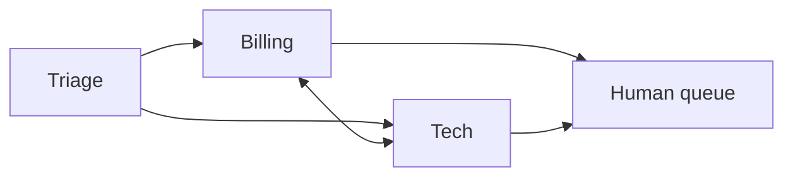

🏠 [Home](../../README.md) › [10 · Multi-Agent Systems](./README.md) › 10.3 Peer-to-peer & handoffs

# 10.3 Peer-to-peer & handoffs

> **Difficulty:** 🟡 Intermediate · **Reading time:** ~10 min · **Prerequisites:** [10.2 Supervisor & hierarchical](./10.2-supervisor-and-hierarchical.md), [9.2 Routing](../09-agent-design-patterns/09.2-routing.md)
>
> Last verified: November 2026 with openai-agents==0.24.0 (framework snippet only; the main code uses plain Python).

**In one sentence:** In a [handoff](../../GLOSSARY.md#handoff), one agent passes control of the conversation to another, which then talks to the user directly with its own instructions and tools, instead of reporting back to a supervisor.

📑 **On this page**

- [Why does this matter?](#-why-does-this-matter)
- [The idea, in plain words](#-the-idea-in-plain-words)
- [Picture it](#-picture-it)
- [How it works, step by step](#-how-it-works-step-by-step)
- [Worked example](#-worked-example)
- [Code](#-code)
- [Common mistakes & gotchas](#-common-mistakes--gotchas)
- [Key takeaways](#-key-takeaways)
- [Try it yourself](#-try-it-yourself)
- [Further reading](#-further-reading)

## 🤔 Why does this matter?

A customer writes to your help desk: *"I was charged twice this month."* Then: *"Also, the app won't sync."* A supervisor [agent](../../GLOSSARY.md#agent) would relay every message through itself, adding a model call and a summary step each time. What you really want is what a good call centre does: the front desk works out who should help and **transfers the call**. The billing specialist talks to the customer directly, and if the problem turns out to be technical, billing transfers to tech.

That is a handoff. It is the natural shape for conversations where a specialist should own the reply, and it is how frameworks such as the OpenAI Agents SDK model customer-service style systems.

## 🧠 The idea, in plain words

Think of a hospital. Reception doesn't treat you, and it doesn't stand between you and the doctor repeating everything you say. It sends you to the right department, and from then on you talk to the doctor. The doctor can send you on to another specialist. Nobody has to stay "in charge" of you.

| | Supervisor ([10.2](./10.2-supervisor-and-hierarchical.md)) | Handoff (this page) |
| --- | --- | --- |
| Who talks to the user? | Always the supervisor | Whichever agent is active |
| Does control come back? | Yes, after every sub-task | No, unless someone hands back |
| What does the receiver see? | Only a brief | Usually the whole conversation |
| Good for | Tasks split into parallel parts | Conversations routed to the right expert |
| Main risk | Lossy briefs | Agents bouncing the user around, lost "big picture" |

**Peer-to-peer** means no agent is the boss: any agent may hand to any agent it has been allowed to reach. In practice you draw the allowed handoffs as a graph and keep it small.

## 👀 Picture it


*Triage is called once and never sees the reply. The runner, your code, does the switching: a handoff is just a tool call that your loop treats specially.*

## 🔍 How it works, step by step

1. **Each handoff is offered to the model as a [tool](../../GLOSSARY.md#tool).** The OpenAI Agents SDK names them `transfer_to_<agent_name>`, so a handoff to "Refund Agent" shows up as `transfer_to_refund_agent`. The tool description says when to use it. A small argument such as `reason` helps with logging.
2. **The model calls the transfer tool** like any other tool.
3. **Your runner switches the active agent.** It adds a tool result ("Transferred to billing.") so the conversation stays valid, then calls the model again with the *new* agent's [system prompt](../../GLOSSARY.md#system-prompt) and tools.
4. **Decide what the new agent sees.** By default in the OpenAI Agents SDK the receiver sees the entire prior conversation. An *input filter* can change that, for example by removing earlier tool calls or keeping only the user's messages.
5. **The new agent answers the user**, uses its tools, or hands off again.
6. **Bound it.** Count handoffs and refuse more than a few per run, so two agents can't play ping-pong with a customer.

### Which agent should be able to reach which?

Draw it. Every arrow is a tool the model can choose, and a chance to choose wrongly. A hub (triage) plus "specialists can reach each other when the topic changes" is usually enough. Always add one exit to a human ([9.6](../09-agent-design-patterns/09.6-human-in-the-loop.md), [17.2](../17-case-studies/17.2-customer-support-agent.md)).



*A small, explicit handoff graph. Triage never receives handoffs back here. Add that arrow only if you have a reason.*

## 💡 Worked example

A run looks like this:

```text
User: Hi, I was charged twice for my Pro plan this month. My customer id is C-1042.

[triage] handoff -> billing (reason: Possible duplicate charge on the Pro plan.)
[billing] list_charges({'customer_id': 'C-1042'}) -> [{"invoice_id": "INV-881", "date": "2026-11-01", "amount_...
[billing] open_refund_request({'invoice_id': 'INV-882', 'reason': 'Duplicate charge on 2026-11-01'}) -> {"refund_request": "RR-001", "invoice_id": "INV-882", "et...
[billing] answer: You're right: you were charged 20 EUR twice on 1 November (INV-881 and INV-882). I've opened refund request RR-001 for INV-882. The money should be back in 5-7 days.

Answered by: billing
```

What billing received on its first call:

```text
system:   You are the billing specialist. Use list_charges to check the facts before you answer. ...
tools:    list_charges, open_refund_request, transfer_to_tech
messages: user:      "Hi, I was charged twice ... C-1042."
          assistant: tool call transfer_to_billing(reason="Possible duplicate charge on the Pro plan.")
          tool:      "Transferred to billing."
```

Billing saw the customer's own words, so it did not need to ask for the customer id again. That is the main advantage of passing the full history. If the triage conversation had been long and messy, a filter on the handoff could give billing just the last user message instead.

## 💻 Code

The heart of the runner: a transfer tool call switches `active`, and the loop carries on with the same `messages`:

```python
for _ in range(self.max_turns):
    transfers = {h.tool_name: h for h in active.handoffs}          # e.g. "transfer_to_billing"
    specs = [s for _, s in active.tools.values()] + [h.tool_spec() for h in active.handoffs]
    reply = active.llm.chat(messages, system=active.instructions, tools=specs)  # any chat client: .text, .tool_calls
    messages.append(reply.to_message())
    if not reply.tool_calls:
        return reply.text, active.name                              # the active agent answers the user

    chosen = None
    for call in reply.tool_calls:
        if call.name in transfers and chosen is None and handoffs_done < self.max_handoffs:
            chosen = transfers[call.name]
            messages.append(tool_result(call.id, f"Transferred to {chosen.target}."))
        elif call.name in active.tools:
            fn, _ = active.tools[call.name]
            messages.append(tool_result(call.id, fn(**call.arguments)))
        else:                                                       # extra transfer, over the limit, or unknown
            messages.append(tool_result(call.id, "Not allowed here.", is_error=True))

    if chosen:                                                      # control passes to the new agent
        handoffs_done += 1
        active = self.agents[chosen.target]
        if chosen.input_filter:
            messages[:] = chosen.input_filter(messages)
```

`max_handoffs` is what stops ping-pong: once the limit is reached, a transfer call gets an error result instead of switching agents.

**The same in the OpenAI Agents SDK** (`pip install openai-agents`, needs `OPENAI_API_KEY`). Handoffs are a built-in concept:

```python
from agents import Agent, Runner, handoff
from agents.extensions.handoff_prompt import RECOMMENDED_PROMPT_PREFIX

billing = Agent(name="Billing agent", handoff_description="Charges, invoices and refunds.",
                instructions=f"{RECOMMENDED_PROMPT_PREFIX}\nYou are the billing specialist...", tools=[list_charges])
tech = Agent(name="Tech agent", handoff_description="Outages, errors and bugs.",
             instructions=f"{RECOMMENDED_PROMPT_PREFIX}\nYou are the tech specialist...")

triage = Agent(
    name="Triage agent",
    instructions=f"{RECOMMENDED_PROMPT_PREFIX}\nDecide who should help and hand off.",
    handoffs=[billing, handoff(tech)],          # plain agents or handoff(...) objects
)
result = Runner.run_sync(triage, "I was charged twice. Customer id C-1042.")
print(result.last_agent.name, "->", result.final_output)
```

`handoff()` also takes `tool_name_override`, `on_handoff` (a callback, for example to start loading data), `input_type` (a schema for small arguments such as a reason) and `input_filter` (to change the history the next agent receives). The SDK docs recommend `RECOMMENDED_PROMPT_PREFIX` so models understand handoffs. See [11.5](../11-frameworks/11.5-openai-agents-sdk.md).

## 🚨 Common mistakes & gotchas

- **Ping-pong.** Billing thinks it's technical, tech thinks it's billing, and the customer is transferred back and forth. **Fix:** a handoff limit in code, plus a rule in each prompt: "if you were just handed this, try to help before handing it on".
- **Handing off when a supervisor was needed.** If the answer needs *both* billing and tech facts, a single handoff loses half of it. **Fix:** for multi-part requests, use a supervisor ([10.2](./10.2-supervisor-and-hierarchical.md)) or let the specialist hand back to triage.
- **Trusting handoff arguments.** The `reason` or `priority` the model writes when it hands off is model output. The OpenAI Agents SDK docs warn that `is_enabled` cannot authorise argument values, and say to check them at the start of `on_handoff`. **Fix:** authorise in code, never because the model asked.
- **Leaking history.** By default the next agent sees everything, including tool results it shouldn't (personal data, internal notes). Filters don't redact sensitive content for you. **Fix:** filter or redact on purpose ([13.6](../13-safety-and-guardrails/13.6-secrets-and-pii.md)).
- **Too many handoff tools.** Each one is another choice for the model. **Fix:** a small, explicit graph. Test that each message type lands on the right agent ([12.2](../12-evaluation/12.2-task-trajectory-and-tool-metrics.md)).

## ✅ Key takeaways

- A handoff passes control: the receiving agent becomes the one talking to the user.
- It is just a tool call (`transfer_to_<agent>`) that your runner handles by switching system prompt and tools.
- Decide on purpose what the receiver sees: the full history (the usual default) or a filtered version.
- Limit the number of handoffs per run, and always provide a way out to a human.
- Use handoffs for routing conversations, and supervisors for splitting tasks.

## 🧪 Try it yourself

1. A user writes "I was charged for a month the app was down." Which design handles this better, handoffs or a supervisor? Why?
2. Suppose the transfer to billing has an `input_filter` (see the snippet) that keeps only the last user message. What does billing's first request contain? What is lost?

<details>
<summary>Show answer</summary>

1. A supervisor, or a handoff design where billing can ask tech and then continue. The request needs a fact from tech (was there an outage, and when?) *and* an action from billing (a refund). With a one-way handoff, whichever agent takes over only has half the tools. With a supervisor, one agent can ask both specialists and combine the answers.
2. Only the user's last message: `[user("Hi, I was charged twice ... C-1042.")]`. Triage's transfer call and its reason are gone. That's fine here, but if triage had asked a clarifying question and the user had answered, the filter would drop the question and keep only the answer, which may make no sense on its own.

</details>

## 📚 Further reading

- [Handoffs](https://openai.github.io/openai-agents-python/handoffs/) (OpenAI Agents SDK docs). Transfer tools, `handoff()` parameters, input filters and the recommended prompt prefix.
- [Agent orchestration](https://openai.github.io/openai-agents-python/multi_agent/) (OpenAI Agents SDK docs). Handoffs compared with agents as tools.
- [Building effective agents](https://www.anthropic.com/engineering/building-effective-agents) (Anthropic). Routing, the workflow that handoffs grow from.

<!-- FOOTER -->

---

⬅️ **Previous:** [10.2 Supervisor & hierarchical](./10.2-supervisor-and-hierarchical.md) ·
🏠 [Chapter home](./README.md) ·
➡️ **Next:** [10.4 Shared state & communication](./10.4-shared-state-and-communication.md)
