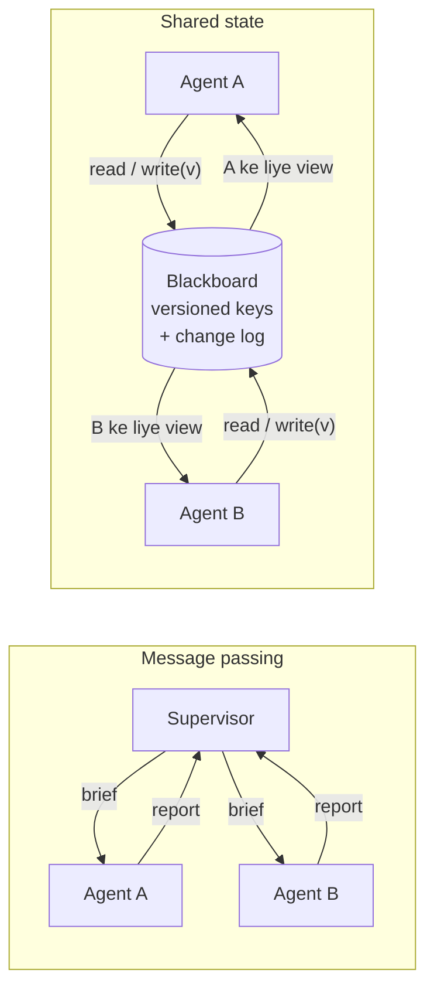

🏠 [Home](../../README.md) › [10 · Multi-Agent Systems](./README.md) › 10.4 Shared state aur communication

# 10.4 Shared state aur communication

> **Level:** 🔴 Advanced · **Padhne ka time:** ~10 min · **Pehle padho:** [10.2 Supervisor aur hierarchical](./10.2-supervisor-and-hierarchical.md), [10.3 Peer-to-peer aur handoffs](./10.3-peer-to-peer-and-handoffs.md), [5.1 Short-term vs long-term memory](../05-memory/05.1-short-term-vs-long-term-memory.md)

**Ek line mein:** Agents jo jaante hain woh do tarike se share karte hain: messages pass karke, ya ek shared store (ek [blackboard](../../GLOSSARY.md#blackboard)) ko padh aur likh ke. Dono hi case mein tumhe decide karna hai ki har agent kya dekhega, aur takraane wale writes kaise pakde jayenge.

📑 **Is page par**

- [Yeh kyun zaroori hai?](#-yeh-kyun-zaroori-hai)
- [Idea, simple words mein](#-idea-simple-words-mein)
- [Diagram se samjho](#-diagram-se-samjho)
- [Kaise kaam karta hai, step by step](#-kaise-kaam-karta-hai-step-by-step)
- [Example se samjho](#-example-se-samjho)
- [Code](#-code)
- [Aam galtiyan aur dhyan dene wali baatein](#-aam-galtiyan-aur-dhyan-dene-wali-baatein)
- [Yaad rakhne wali baatein](#-yaad-rakhne-wali-baatein)
- [Khud try karo](#-khud-try-karo)
- [Aur padhne ke liye](#-aur-padhne-ke-liye)

## 🤔 Yeh kyun zaroori hai?

Do [agents](../../GLOSSARY.md#agent) ek team offsite ke liye venues research kar rahe hain. Dono shortlist padhte hain, jo khaali hai. Dono apna best venue jodte hain aur save karte hain. Dusra save chupchaap pehle wale ko replace kar deta hai, aur Lisbon wala venue gayab ho jaata hai. Kisi ko pata nahi chalta, jab tak final report sirf Porto recommend nahi karti.

Isse *lost update* kehte hain. Yeh bug utna hi purana hai jitne databases. Agents iska ek aur subtle version bhi laate hain. Cognition ka essay *Don't Build Multi-Agents* ek example deta hai jahan "build a Flappy Bird clone" ko do subagents mein baanta gaya. Ek ne kisi dusre game ki style mein background banaya, aur dusre ne aisi bird banayi jo match hi nahi karti thi. Dono ne apni jagah theek choices li, lekin ek ki choice dusre ko dikh nahi rahi thi. Unka principle: *"actions carry implicit decisions, and conflicting decisions carry bad results."* Matlab har action mein chhupe hue decisions hote hain, aur takraate decisions bura result dete hain. Agents information kaise share karte hain, yahi decide karta hai ki woh team ki tarah kaam karenge ya ajnabiyon ki tarah.

## 🧠 Idea, simple words mein

Team ke paas information share karne ke do tarike hain:

- **Message passing** email jaisa hai. Tum colleague ko ek brief bhejte ho, woh report wapas bhejta hai. Har kisi ke apne notes hain. Jab tak koi message nahi bhejta, kuch nahi badalta. Supervisor ka `task` argument aur specialist ka answer ([10.2](./10.2-supervisor-and-hierarchical.md)) messages hain.
- **Shared state** office ke whiteboard jaisa hai. Koi bhi aake use padh sakta hai aur us par likh sakta hai. Yeh fast hai aur sabko same cheez dikhti hai, lekin do log ek dusre ka likha mita sakte hain. Agent systems mein ise *blackboard* kehte hain: ek store (dict, database, files) jise kai agents tools ke through padhte aur likhte hain.

Ghar ka family WhatsApp group socho jahan sabko "ghar ka saaman list" update karni hai. Mummy ne list copy karke "doodh" joda, papa ne bhi purani list copy karke "atta" joda. Jo baad mein bheja, uski list mein doodh hai hi nahi. Yahi lost update hai.

| | Message passing | Shared state (blackboard) |
| --- | --- | --- |
| Agent kya dekhta hai | Sirf jo use bheja gaya | Jo bhi store use padhne de |
| Conflicts | Kam (har agent ke apne notes), lekin information purani pad jaati hai | Aam hain, isliye ek saath hone wale writes ke rules chahiye |
| Kiske liye achha | Delegation, agents ke beech privacy, saaf ownership | Kai agents milke ek artefact banana, lambe chalne wala kaam, reference se hand-off |
| Typical failure | "Telephone game" (chinese whispers): har summary detail khoti hai | Lost updates aur ulte-seedhe edits |

Zyadatar real systems dono ko mix karte hain. Anthropic ka research system briefs aur results ko messages ki tarah pass karta hai. Woh lead agent ka plan memory mein bhi likhta hai, taaki agar context 200,000 tokens se upar jaake truncate ho jaye to bhi plan bacha rahe. Aur woh subagents se unka kaam external systems mein store karwata hai aur *"pass lightweight references back to the coordinator"*, yaani coordinator ko sirf halke references wapas bhejte hain.

## 👀 Diagram se samjho



*Message passing mein information sirf unhi arrows par chalti hai jo tumne draw kiye. Blackboard ke saath har agent same data tak pahunch sakta hai, isliye store ko khud enforce karna padta hai ki kaun kya dekhega, aur do writes takraayein to kya hoga.*

## 🔍 Kaise kaam karta hai, step by step

### 1. Decide karo ki har agent kya dekhega

Kisi bhi multi-agent system mein yeh sabse zaroori decision hai. Teen aam choices:

| Agent dekhta hai | Fayde | Nuksaan |
| --- | --- | --- |
| **Sirf ek brief** (fresh context) | Chhota, focused, sasta, private | Jo brief mein likhna bhool gaye, woh miss ho jaata hai |
| **Poori conversation ya trace** | Koi context nahi khota (Cognition ka pehla principle hai *"share context, and share full agent traces, not just individual messages"*) | Bade contexts, zyada cost, agents ke beech data leak |
| **Shared state ka filtered view** | Har agent ko utna hi dikhta hai jitna chahiye | Filter tumhe design aur test karna padta hai |

### 2. Decide karo ki kaun kya likh sakta hai

- **Har key ka ek writer** sabse simple rule hai: Lisbon scout `shortlist_lisbon` ka owner hai, Porto scout `shortlist_porto` ka, aur sirf planner `decision` likhta hai. Koi conflict ho hi nahi sakta.
- **Append-only logs** (har agent entries jodta hai, koi edit nahi karta) bhi conflicts se bachate hain aur history free mein dete hain.
- **Shared, editable keys** ko concurrency control chahiye. Standard trick hai **optimistic concurrency** (compare-and-set): har value ka ek version hota hai. Write kehta hai "maine version 3 padha tha". Agar key ab version 3 par nahi hai, to write mana ho jaata hai aur agent ko dobara padh ke merge karna padta hai.

### 3. Conflicts ko model ke liye visible banao

Mana hua write tabhi kaam ka hai jab agent use samjhe. Ek error [tool](../../GLOSSARY.md#tool) result lautao (`is_error: true`) jo batata hai ki kya badla, kisne badla, aur ab kya karna hai: *"Version conflict: you read v0 but it is now v1, written by scout_a: 'Casa Alfama…'. Read the board again and merge; do not drop their work."*

### 4. Badi cheezein reference se share karo

30 page ka draft teen agents ke contexts se mat guzaaro. Use ek file ya store mein likho, aur path ya ID pass karo. Jis agent ko chahiye, woh seedha padh le. Isse summary ki summary ki summary se bach jaate ho.

### 5. Log rakho

Har write ka append-only record (kisne, kya, kaunsa version) hi woh cheez hai jisse tum baad mein debug karoge ki "Lisbon wala venue kahan gaya?". [14.2](../14-observability-and-debugging/14.2-logging-tool-calls.md) dekho.

## 💡 Example se samjho

Do scouts ek saath chalte hain (scheduler unke steps ko aage-peeche mix karta hai), aur dono `shortlist` key par likh rahe hain:

```text
-- round 1
[scout_a] read_board -> brief v1
[scout_b] read_board -> brief v1
-- round 2
[scout_a] write_board('shortlist', v0) -> Saved 'shortlist' as v1.
[scout_b] write_board('shortlist', v0) -> Version conflict on 'shortlist'
-- round 3
[scout_a] done: Added Casa Alfama to the shortlist.
[scout_b] read_board -> brief v1, shortlist v1
-- round 4
[scout_b] write_board('shortlist', v1) -> Saved 'shortlist' as v2.
-- round 5
[scout_b] done: Merged Quinta do Rio into the shortlist, keeping Casa Alfama.

Change log:
  WRITE    scout_a -> shortlist v1: Casa Alfama, Lisbon: 40 people, 3200 EUR
  CONFLICT scout_b -> shortlist (expected v0, found v1)
  WRITE    scout_b -> shortlist v2: Casa Alfama, Lisbon: 40 people, 3200 EUR | Quinta do Rio, Porto: 45 people, 2900 EUR
```

Teen cheezein dhyan se dekho:

1. **Round 1 race set karta hai.** Dono scouts kisi ke likhne se pehle padh lete hain. Versions ke bina round 2 mein scout_b ka write chupchaap Casa Alfama ko mita deta.
2. **Conflict message model ko sikhata hai ki kya karna hai.** scout_b dobara padhta hai aur `expected_version: 1` ke saath merged value likhta hai.
3. **Views.** Board mein `budget_notes` bhi hai ("Finance only: we may stretch to 3800 EUR"), lekin kisi bhi scout ka `read_board` use nahi lautata. Iska test likhna worth hai ki "3800" kabhi bhi scout ke model ko bheji gayi kisi cheez mein na aaye.

## 💻 Code

Poora blackboard ek dictionary aur do rules hai, jo code mein enforce hote hain jahan model unse behes nahi kar sakta:

```python
@dataclass
class Entry:
    value: str
    version: int
    author: str


@dataclass
class Blackboard:
    entries: dict[str, Entry] = field(default_factory=dict)
    can_read: dict[str, set[str]] = field(default_factory=dict)   # agent -> keys jo woh padh sakta hai
    can_write: dict[str, set[str]] = field(default_factory=dict)  # agent -> keys jo woh likh sakta hai
    log: list[str] = field(default_factory=list)

    def read(self, agent: str) -> dict[str, dict]:
        """Agent ka view: sirf woh keys jo use dekhne ki permission hai."""
        allowed = self.can_read.get(agent, set())
        return {k: vars(e) for k, e in self.entries.items() if k in allowed}

    def write(self, agent: str, key: str, value: str, expected_version: int) -> tuple[bool, str]:
        """Compare-and-set: tabhi succeed karo jab key abhi bhi usi version par ho jo agent ne padha tha."""
        if key not in self.can_write.get(agent, set()):
            return False, f"Permission denied: {agent} may not write {key!r}."
        current = self.entries.get(key)
        current_version = current.version if current else 0
        if current_version != expected_version:
            self.log.append(f"CONFLICT {agent} -> {key}")
            return False, (f"Version conflict on {key!r}: you read v{expected_version}, it is now "
                           f"v{current_version} by {getattr(current, 'author', '?')}. Re-read and merge.")
        self.entries[key] = Entry(value, current_version + 1, agent)
        self.log.append(f"WRITE {agent} -> {key} v{current_version + 1}")
        return True, f"Saved {key!r} as v{current_version + 1}."
```

Agents ise do tools se use karte hain, `read_board()` aur `write_board(key, value, expected_version)`, aur har mana hua write error tool result ki tarah wapas jaata hai. Production mein board ek database hoga, aur compare-and-set ban jaata hai `UPDATE … WHERE key = ? AND version = ?`, saath mein check ki ek row badli. [15.4](../15-production-and-deployment/15.4-state-persistence-and-resumability.md) dekho.

## 🚨 Aam galtiyan aur dhyan dene wali baatein

- **Last write wins.** Ek plain `dict` ya file jise koi bhi agent overwrite kar sake, do agents ke parallel chalte hi kaam kho degi. **Fix:** har key ka ek writer, append-only entries, ya versioned writes.
- **Har agent ko sab kuch de dena.** Poora board ya poora trace har agent ke saath share karne se contexts bhar jaate hain aur data leak hota hai (scout ko finance notes ki zaroorat nahi). **Fix:** har agent ka apna view, tested.
- **Summaries ki summaries.** Supervisor se guzarne wala har hop detail khota hai. **Fix:** bade outputs ek baar store karo aur references pass karo. Specialists se prose ki jagah structured output (fields, tables) maango.
- **Chhupe hue decisions.** Do agents jo apni-apni style, schema ya assumption chunte hain, baad mein takraayenge, perfect concurrency control ke saath bhi. **Fix:** shared choices pehle decide karo aur ek aisi key mein likho jo har agent ko padhni hi hai (`brief`, `style_guide`), ya tightly coupled kaam ek hi agent mein rakho ([10.6](./10.6-when-multi-agent-makes-things-worse.md)).
- **Board par likhi cheez par bharosa karna.** Ek agent ka likha content, ya usne web se jo laaya, agle agent ke liye untrusted input hai, aur [prompt injection](../../GLOSSARY.md#prompt-injection) ke failne ka raasta bhi. **Fix:** shared state ko tool output ki tarah treat karo ([13.2](../13-safety-and-guardrails/13.2-prompt-injection.md)).

## ✅ Yaad rakhne wali baatein

- Agents **message passing** (briefs aur reports) ya **shared state** (ek blackboard jise woh tools se padhte aur likhte hain) se communicate karte hain.
- Saaf-saaf decide karo ki har agent kya dekhega: ek brief, poora trace, ya filtered view.
- Lost updates rokne ke liye: har key ka ek writer, append-only logs, ya optimistic concurrency (versions aur compare-and-set).
- Conflicts ko saaf error tool results ki tarah lautao, taaki model dobara padhe aur merge kare.
- Bade artefacts reference se share karo, aur har write log karo.

## 🧪 Khud try karo

1. Upar wala `Blackboard` snippet lo aur `write` se version check hata do (hamesha accept). Example dobara chalao: scout_b ke pehle write ka kya hota hai, aur uske baad shortlist mein kya hai?
2. Offsite example ko aise redesign karo ki kisi concurrency control ki zaroorat hi na pade.

<details>
<summary>Answer dekho</summary>

1. scout_b ka pehla write succeed ho jaata hai aur shortlist ko sirf Quinta do Rio se replace kar deta hai, version 2 par. Casa Alfama gayab, aur koi conflict log nahi hota. scout_b ko "Saved" mila, to ek real model wahin ruk jayega. Ek scripted test jo phir bhi aage chalta rahe (dobara padhe, merged value likhe) kismat se dono venues wapas bhi la sakta hai. Isiliye tests ko check karna chahiye ki purana (stale) write reject hua, sirf final state nahi.
2. Har scout ko apni key do (`shortlist_lisbon`, `shortlist_porto`), jise sirf wahi scout likh sake. Ek planner agent (ya plain code) dono padhe aur `decision` likhe. Har key ka ek writer hai, to koi write takra hi nahi sakta. Dusra option hai ek append-only `proposals` list jisme scouts entries jodte hain aur kabhi edit nahi karte.

</details>

## 📚 Aur padhne ke liye

- [Don't Build Multi-Agents](https://cognition.com/blog/dont-build-multi-agents) (Cognition). Context share karne aur chhupe decisions wale do principles, Flappy Bird example ke saath.
- [How we built our multi-agent research system](https://www.anthropic.com/engineering/multi-agent-research-system) (Anthropic). Plan ke liye memory, aur subagent outputs jo conversation ke bahar store hote hain aur reference se pass hote hain.
- [Why Do Multi-Agent LLM Systems Fail?](https://arxiv.org/abs/2503.13657) (Cemri et al.). Failures ki ek taxonomy, jisme inter-agent misalignment bhi hai.
- [Effective context engineering for AI agents](https://www.anthropic.com/engineering/effective-context-engineering-for-ai-agents) (Anthropic). Kaise decide karein ki har agent ke context mein kya jaye.

<!-- FOOTER -->

---

⬅️ **Pichla:** [10.3 Peer-to-peer aur handoffs](./10.3-peer-to-peer-and-handoffs.md) ·
🏠 [Chapter home](./README.md) ·
➡️ **Agla:** [10.5 Agent-to-agent protocols](./10.5-agent-to-agent-protocols.md)
