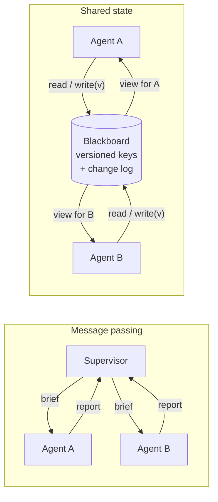

🏠 [Home](../../README.md) › [10 · Multi-Agent Systems](./README.md) › 10.4 Shared state & communication

# 10.4 Shared state & communication

> **Difficulty:** 🔴 Advanced · **Reading time:** ~10 min · **Prerequisites:** [10.2 Supervisor & hierarchical](./10.2-supervisor-and-hierarchical.md), [10.3 Peer-to-peer & handoffs](./10.3-peer-to-peer-and-handoffs.md), [5.1 Short-term vs long-term memory](../05-memory/05.1-short-term-vs-long-term-memory.md)

**In one sentence:** Agents share what they know either by passing messages or by reading and writing a shared store (a [blackboard](../../GLOSSARY.md#blackboard)), and either way you must decide what each agent sees and how conflicting writes are caught.

📑 **On this page**

- [Why does this matter?](#-why-does-this-matter)
- [The idea, in plain words](#-the-idea-in-plain-words)
- [Picture it](#-picture-it)
- [How it works, step by step](#-how-it-works-step-by-step)
- [Worked example](#-worked-example)
- [Code](#-code)
- [Common mistakes & gotchas](#-common-mistakes--gotchas)
- [Key takeaways](#-key-takeaways)
- [Try it yourself](#-try-it-yourself)
- [Further reading](#-further-reading)

## 🤔 Why does this matter?

Two [agents](../../GLOSSARY.md#agent) are researching venues for a team offsite. Both read the shortlist, which is empty. Both add their best venue and save. The second save silently replaces the first, and the Lisbon venue is gone. Nobody notices until the final report recommends only Porto.

That is a *lost update*, a bug as old as databases. Agents bring a subtler version too. Cognition's essay *Don't Build Multi-Agents* describes splitting "build a Flappy Bird clone" between two subagents. One built a background in a different game's style, and the other built a bird that didn't match. Each made reasonable choices the other couldn't see. Their principle: *"actions carry implicit decisions, and conflicting decisions carry bad results."* How agents share information decides whether they work as a team or as strangers.

## 🧠 The idea, in plain words

There are two ways for a team to share information:

- **Message passing** is like email. You send a colleague a brief, they send back a report. Each person has their own notes. Nothing changes unless someone sends a message. A supervisor's `task` argument and a specialist's answer ([10.2](./10.2-supervisor-and-hierarchical.md)) are messages.
- **Shared state** is like a whiteboard in the office. Anyone can walk up, read it and write on it. It's quick and everyone sees the same thing, but two people can rub out each other's work. In agent systems this is called a *blackboard*: a store (a dict, a database, files) that several agents read and write through tools.

| | Message passing | Shared state (blackboard) |
| --- | --- | --- |
| What an agent sees | Only what was sent to it | Whatever the store lets it read |
| Conflicts | Rare (each agent owns its notes), but information goes stale | Common, so you need rules for concurrent writes |
| Good for | Delegation, privacy between agents, clear ownership | Many agents building one artefact, long-running work, hand-off by reference |
| Typical failure | The "telephone game": every summary loses detail | Lost updates and contradictory edits |

Most real systems mix the two. Anthropic's research system passes briefs and results as messages. It also writes the lead agent's plan to memory, so the plan survives if the context passes 200,000 tokens and is truncated, and it has subagents store their work in external systems and *"pass lightweight references back to the coordinator"*.

## 👀 Picture it



*With message passing, information only moves along the arrows you drew. With a blackboard, every agent can reach the same data, so the store itself must enforce who sees what and what happens when two writes collide.*

## 🔍 How it works, step by step

### 1. Decide what each agent sees

This is the most important decision in any multi-agent system. Three common choices:

| Agent sees | Pros | Cons |
| --- | --- | --- |
| **A brief only** (fresh context) | Small, focused, cheap, private | Misses anything the brief forgot |
| **The full conversation or trace** | No lost context (Cognition's first principle is *"share context, and share full agent traces, not just individual messages"*) | Big contexts, more cost, leaks data between agents |
| **A filtered view** of shared state | Each agent sees what it needs and no more | You must design and test the filter |

### 2. Decide who may write what

- **One writer per key** is the simplest rule: the Lisbon scout owns `shortlist_lisbon`, the Porto scout owns `shortlist_porto`, and only the planner writes `decision`. No conflicts are possible.
- **Append-only logs** (each agent adds entries, nobody edits) also avoid conflicts and give you a history for free.
- **Shared, editable keys** need concurrency control. The standard trick is **optimistic concurrency** (compare-and-set): every value has a version. A write says "I read version 3". If the key is no longer at version 3, the write is refused and the agent must re-read and merge.

### 3. Make conflicts visible to the model

A refused write is only useful if the agent understands it. Return an error [tool](../../GLOSSARY.md#tool) result (`is_error: true`) that says what changed and who changed it, and what to do: *"Version conflict: you read v0 but it is now v1, written by scout_a: 'Casa Alfama…'. Read the board again and merge; do not drop their work."*

### 4. Share by reference for big things

Don't pass a 30-page draft through three agents' contexts. Write it to a file or store, and pass the path or ID. Every agent that needs it reads it directly. This avoids a summary of a summary of a summary.

### 5. Keep a log

An append-only record of every write (who, what, which version) is how you debug "where did the Lisbon venue go?" later. See [14.2](../14-observability-and-debugging/14.2-logging-tool-calls.md).

## 💡 Worked example

Two scouts run at the same time (the scheduler interleaves their steps), both writing to the `shortlist` key:

```text
-- round 1
[scout_a] read_board -> brief v1
[scout_b] read_board -> brief v1
-- round 2
[scout_a] write_board('shortlist', v0) -> Saved 'shortlist' as v1.
[scout_b] write_board('shortlist', v0) -> Version conflict on 'shortlist'
-- round 3
[scout_a] done: Added Casa Alfama to the shortlist.
[scout_b] read_board -> brief v1, shortlist v1
-- round 4
[scout_b] write_board('shortlist', v1) -> Saved 'shortlist' as v2.
-- round 5
[scout_b] done: Merged Quinta do Rio into the shortlist, keeping Casa Alfama.

Change log:
  WRITE    scout_a -> shortlist v1: Casa Alfama, Lisbon: 40 people, 3200 EUR
  CONFLICT scout_b -> shortlist (expected v0, found v1)
  WRITE    scout_b -> shortlist v2: Casa Alfama, Lisbon: 40 people, 3200 EUR | Quinta do Rio, Porto: 45 people, 2900 EUR
```

Three things to notice:

1. **Round 1 sets up the race.** Both scouts read before either writes. Without versions, scout_b's write in round 2 would silently erase Casa Alfama.
2. **The conflict message teaches the model what to do.** scout_b re-reads and writes a merged value with `expected_version: 1`.
3. **Views.** The board also holds `budget_notes` ("Finance only: we may stretch to 3800 EUR"), but neither scout's `read_board` returns it. It is worth a test that "3800" never appears in anything sent to a scout's model.

## 💻 Code

The whole blackboard is a dictionary plus two rules, enforced in code where the model can't argue with them:

```python
@dataclass
class Entry:
    value: str
    version: int
    author: str


@dataclass
class Blackboard:
    entries: dict[str, Entry] = field(default_factory=dict)
    can_read: dict[str, set[str]] = field(default_factory=dict)   # agent -> keys it may read
    can_write: dict[str, set[str]] = field(default_factory=dict)  # agent -> keys it may write
    log: list[str] = field(default_factory=list)

    def read(self, agent: str) -> dict[str, dict]:
        """The agent's view: only the keys it is allowed to see."""
        allowed = self.can_read.get(agent, set())
        return {k: vars(e) for k, e in self.entries.items() if k in allowed}

    def write(self, agent: str, key: str, value: str, expected_version: int) -> tuple[bool, str]:
        """Compare-and-set: succeed only if the key is still at the version the agent read."""
        if key not in self.can_write.get(agent, set()):
            return False, f"Permission denied: {agent} may not write {key!r}."
        current = self.entries.get(key)
        current_version = current.version if current else 0
        if current_version != expected_version:
            self.log.append(f"CONFLICT {agent} -> {key}")
            return False, (f"Version conflict on {key!r}: you read v{expected_version}, it is now "
                           f"v{current_version} by {getattr(current, 'author', '?')}. Re-read and merge.")
        self.entries[key] = Entry(value, current_version + 1, agent)
        self.log.append(f"WRITE {agent} -> {key} v{current_version + 1}")
        return True, f"Saved {key!r} as v{current_version + 1}."
```

The agents reach it through two tools, `read_board()` and `write_board(key, value, expected_version)`, and every refused write goes back as an error tool result. In production the board would be a database, and compare-and-set becomes `UPDATE … WHERE key = ? AND version = ?`, checking that one row changed. See [15.4](../15-production-and-deployment/15.4-state-persistence-and-resumability.md).

## 🚨 Common mistakes & gotchas

- **Last write wins.** A plain `dict` or file that any agent can overwrite will lose work as soon as two agents run in parallel. **Fix:** one writer per key, append-only entries, or versioned writes.
- **Giving every agent everything.** Sharing the whole board or the whole trace with every agent fills contexts and leaks data (a scout doesn't need finance notes). **Fix:** per-agent views, tested.
- **Summaries of summaries.** Each hop through a supervisor loses detail. **Fix:** store big outputs once and pass references. Ask specialists for structured output (fields, tables) rather than prose.
- **Hidden decisions.** Two agents that each pick a style, a schema or an assumption will clash later, even with perfect concurrency control. **Fix:** decide shared choices first and write them to a key every agent must read (`brief`, `style_guide`), or keep tightly coupled work in one agent ([10.6](./10.6-when-multi-agent-makes-things-worse.md)).
- **Trusting what's on the board.** Content written by one agent, or fetched from the web by it, is untrusted input for the next agent, and a path for [prompt injection](../../GLOSSARY.md#prompt-injection) to spread. **Fix:** treat shared state like tool output ([13.2](../13-safety-and-guardrails/13.2-prompt-injection.md)).

## ✅ Key takeaways

- Agents communicate by **message passing** (briefs and reports) or **shared state** (a blackboard they read and write through tools).
- Decide explicitly what each agent sees: a brief, the full trace, or a filtered view.
- Prevent lost updates with one writer per key, append-only logs, or optimistic concurrency (versions and compare-and-set).
- Return conflicts as clear error tool results, so the model re-reads and merges.
- Share big artefacts by reference, and log every write.

## 🧪 Try it yourself

1. Take the `Blackboard` snippet above and remove the version check from `write` (always accept). Replay the worked example: what happens to scout_b's first write, and what does the shortlist contain afterwards?
2. Redesign the offsite example so no concurrency control is needed at all.

<details>
<summary>Show answer</summary>

1. scout_b's first write succeeds and replaces the shortlist with only Quinta do Rio, at version 2. Casa Alfama is gone, and no conflict is logged. scout_b got "Saved", so a real model would stop there. A scripted test that carries on regardless (re-read, write a merged value) could even restore both venues by luck, which is why tests should check that the stale write is rejected, not only the final state.
2. Give each scout its own key (`shortlist_lisbon`, `shortlist_porto`), writable only by that scout, and have a planner agent (or plain code) read both and write `decision`. Each key has one writer, so no write can clash. Another option is an append-only `proposals` list where scouts add entries and never edit.

</details>

## 📚 Further reading

- [Don't Build Multi-Agents](https://cognition.com/blog/dont-build-multi-agents) (Cognition). The two principles about sharing context and implicit decisions, with the Flappy Bird example.
- [How we built our multi-agent research system](https://www.anthropic.com/engineering/multi-agent-research-system) (Anthropic). Memory for the plan, and subagent outputs stored outside the conversation and passed by reference.
- [Why Do Multi-Agent LLM Systems Fail?](https://arxiv.org/abs/2503.13657) (Cemri et al.). A taxonomy of failures that includes inter-agent misalignment.
- [Effective context engineering for AI agents](https://www.anthropic.com/engineering/effective-context-engineering-for-ai-agents) (Anthropic). How to decide what goes into each agent's context.

<!-- FOOTER -->

---

⬅️ **Previous:** [10.3 Peer-to-peer & handoffs](./10.3-peer-to-peer-and-handoffs.md) ·
🏠 [Chapter home](./README.md) ·
➡️ **Next:** [10.5 Agent-to-agent protocols](./10.5-agent-to-agent-protocols.md)
