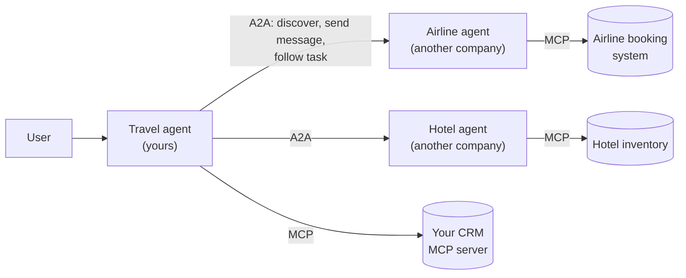
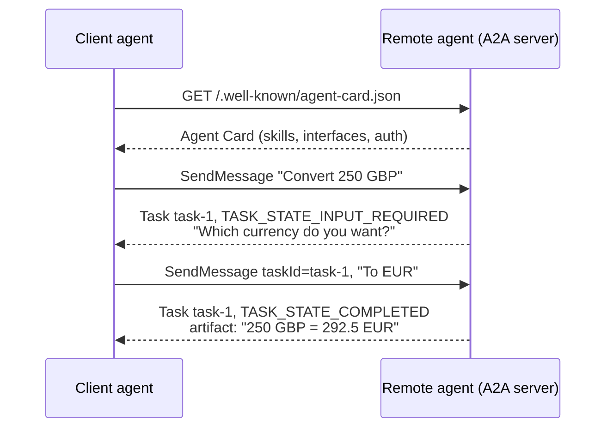

🏠 [Home](../../README.md) › [10 · Multi-Agent Systems](./README.md) › 10.5 Agent-to-agent protocols

# 10.5 Agent-to-agent protocols

> **Difficulty:** 🔴 Advanced · **Reading time:** ~8 min · **Prerequisites:** [10.3 Peer-to-peer & handoffs](./10.3-peer-to-peer-and-handoffs.md), [4.1 Why MCP exists](../04-model-context-protocol/04.1-why-mcp-exists.md)
>
> Last verified: November 2026 against the A2A specification v1.0.0 at a2a-protocol.org.

**In one sentence:** The [Agent2Agent protocol (A2A)](../../GLOSSARY.md#agent2agent-protocol-a2a) is an open standard that lets independent agents, built by different teams on different frameworks, discover each other, send each other messages and track shared tasks, while [MCP](../../GLOSSARY.md#model-context-protocol-mcp) connects an agent to its tools and data.

📑 **On this page**

- [Why does this matter?](#-why-does-this-matter)
- [The idea, in plain words](#-the-idea-in-plain-words)
- [Picture it](#-picture-it)
- [How it works, step by step](#-how-it-works-step-by-step)
- [Worked example](#-worked-example)
- [Code](#-code)
- [Common mistakes & gotchas](#-common-mistakes--gotchas)
- [Key takeaways](#-key-takeaways)
- [Try it yourself](#-try-it-yourself)
- [Further reading](#-further-reading)

## 🤔 Why does this matter?

Everything so far in this chapter happened inside one program: you wrote all the [agents](../../GLOSSARY.md#agent), they shared a process, and "calling another agent" was a Python function call. Now suppose your travel agent should book through an airline's agent, and the airline built theirs in a different framework, runs it on their own servers, and will never show you its prompt or tools. You need an agreed way to find that agent, learn what it can do, ask it for something, wait for a long job, and get a result back. Writing a custom integration for every partner doesn't scale.

That is the problem agent-to-agent protocols solve. This page covers A2A, an open protocol run under neutral, vendor-independent governance.

## 🧠 The idea, in plain words

Think of two companies working together. Each publishes a business card that says who they are, what services they offer and how to contact them. When you hire them for a job, they open a ticket. You can check the ticket's status, add information when they ask for it, and in the end receive the deliverables. You never see how they work inside.

A2A works the same way:

| Everyday idea | A2A concept | What it is |
| --- | --- | --- |
| Business card | **[Agent Card](../../GLOSSARY.md#agent-card)** | A JSON document describing the agent: name, description, skills, endpoints, supported features and how to authenticate |
| A ticket | **Task** | A unit of work with an id, a status (submitted, working, input required, completed, failed…) and results |
| Emails on the ticket | **Message** | One turn from the user side (`ROLE_USER`) or the agent (`ROLE_AGENT`), made of parts |
| Attachments | **Part** | A piece of content: `text`, `raw` bytes, a `url` to a file, or structured `data` (JSON) |
| Deliverables | **Artifact** | An output the agent produced for the task, also made of parts |

The key design choice is that agents are **opaque**: they collaborate without sharing their memory, tools or prompts. The A2A site describes the split with MCP this way: MCP connects an agent to tools, APIs and data; A2A connects it to other agents. In the spec's words, MCP is about an agent *using* a capability, and A2A is about agents *partnering* on tasks.

**Governance.** A2A was contributed by Google and is an open-source project under the Linux Foundation, licensed under Apache 2.0. In August 2026 it was accepted as a Growth Stage project of the Linux Foundation-directed Agentic AI Foundation (AAIF), alongside MCP. The current specification version is 1.0.

## 👀 Picture it



*A2A runs between agents (horizontal arrows across company lines). MCP runs between each agent and its own tools (down to the data stores). The travel agent never sees how the airline agent uses its tools.*



*One task, two messages. The task id ties the turns together, and the remote agent decides when it needs more input.*

## 🔍 How it works, step by step

1. **Discover.** The client fetches the Agent Card, usually from `https://{domain}/.well-known/agent-card.json`. Registries or direct configuration also work. The card lists `supportedInterfaces` (URL, binding and protocol version) in the server's order of preference, plus `skills` (id, name, description, tags, examples), `capabilities` (such as `streaming` and `pushNotifications`) and `securitySchemes`. Cards may be signed (JWS) so clients can check they haven't been tampered with.
2. **Authenticate.** The card says which schemes the agent accepts (for example OAuth 2.0 or OpenID Connect). The client gets credentials out of band and sends them with every request, over HTTPS. A2A treats agents like any other enterprise web service.
3. **Send a message.** The core operation is **SendMessage**. The server answers with either a direct Message (quick replies) or a **Task** (anything that takes work). There is also **SendStreamingMessage** for live updates over Server-Sent Events.
4. **Follow the task.** Tasks move through states: `TASK_STATE_SUBMITTED`, `TASK_STATE_WORKING`, then a terminal state (`TASK_STATE_COMPLETED`, `TASK_STATE_FAILED`, `TASK_STATE_CANCELED`, `TASK_STATE_REJECTED`) or an interrupted one (`TASK_STATE_INPUT_REQUIRED`, `TASK_STATE_AUTH_REQUIRED`). The client can poll (**GetTask**, **ListTasks**), stream (**SubscribeToTask**), register a webhook for **push notifications**, or **CancelTask**.
5. **Continue or finish.** If the task needs input, the client sends another message with the same `taskId`. When it completes, results come as **artifacts**.
6. **Pick a binding.** The same operations are defined over three bindings: **JSON-RPC 2.0** (methods named `SendMessage`, `GetTask`…), **gRPC**, and **HTTP+JSON/REST** (`POST /message:send`, `GET /tasks/{id}`…). Clients send an `A2A-Version` header (for example `1.0`) on every request.

### A2A or MCP?

| Question | Use |
| --- | --- |
| My agent needs to call a function, query a database or read files | **MCP** ([chapter 04](../04-model-context-protocol/README.md)) |
| My agent needs to delegate a task to another *agent* that plans, asks questions and works over time | **A2A** |
| The other agent is mine, in the same codebase | Neither: call it as a tool or a handoff ([10.2](./10.2-supervisor-and-hierarchical.md), [10.3](./10.3-peer-to-peer-and-handoffs.md)) |

The A2A docs note that a well-defined, stateless skill can also be exposed as an MCP-style tool. A2A earns its keep for stateful, multi-turn collaboration.

## 💡 Worked example

A teaching subset of the HTTP+JSON binding, with a small currency agent as the remote server. The remote currency agent's card says:

```json
{
  "name": "Currency Agent",
  "description": "Converts amounts between currencies using today's reference rates.",
  "supportedInterfaces": [{"url": "https://currency-agent.example.com/a2a", "protocolBinding": "HTTP+JSON", "protocolVersion": "1.0"}],
  "capabilities": {"streaming": false, "pushNotifications": false},
  "skills": [{"id": "convert", "name": "Convert currency", "tags": ["finance", "currency"],
              "description": "Convert an amount from one currency to another.", "examples": ["How much is 250 GBP in EUR?"]}]
}
```

The run:

```text
Discovered: Currency Agent v0.1.0 - skills: ['convert']
Endpoint:   /a2a (HTTP+JSON, A2A 1.0)

-> SendMessage 'Please convert 250 GBP.'
<- task task-1 state=TASK_STATE_INPUT_REQUIRED
   agent asks: Please tell me the currency you want to convert to.
-> SendMessage 'To EUR.' (taskId=task-1)
<- state=TASK_STATE_COMPLETED
   artifact 'conversion': 250 GBP = 292.5 EUR  data={'amount': 250, 'from': 'GBP', 'to': 'EUR', 'rate': 1.17, 'converted': 292.5}
```

The second request body on the wire:

```json
{"message": {"taskId": "task-1", "role": "ROLE_USER", "messageId": "…", "parts": [{"text": "To EUR."}]}}
```

Notice what the caller **never** sees: the remote agent's system prompt, its model, or its rate table. That is worth a test too.

## 💻 Code

A raw A2A client in a few lines of `httpx`, using the HTTP+JSON binding. Point it at any A2A v1.0 server that offers that binding (add an `Authorization` header if its card asks for one):

```python
import uuid

import httpx

domain = "https://agent.example.com"                           # the remote agent's domain
card = httpx.get(f"{domain}/.well-known/agent-card.json").json()
iface = next(i for i in card["supportedInterfaces"] if i["protocolBinding"] == "HTTP+JSON")
print(card["name"], [s["id"] for s in card["skills"]])

headers = {"A2A-Version": "1.0", "Content-Type": "application/a2a+json"}
body = {"message": {"role": "ROLE_USER", "messageId": str(uuid.uuid4()),
                    "parts": [{"text": "How much is 250 GBP in EUR?"}]}}
reply = httpx.post(f"{iface['url']}/message:send", json=body, headers=headers).json()

task = reply.get("task")                                       # or reply["message"] for a direct answer
if task:
    print(task["status"]["state"])                            # e.g. TASK_STATE_COMPLETED
    for artifact in task.get("artifacts", []):
        print([p.get("text") or p.get("data") for p in artifact["parts"]])
```

For real systems, use an official SDK: the A2A project lists SDKs for Python (`a2a-sdk`), Go, Java, JavaScript, .NET and Rust.

## 🚨 Common mistakes & gotchas

- **Using A2A inside one program.** If you own both agents and they run together, a protocol adds latency, serialisation and failure modes for nothing. **Fix:** agents as tools or handoffs. Use A2A at team, service or company boundaries.
- **Treating the remote agent as trusted.** Its messages and artifacts are input from another organisation's model. They can be wrong, or carry [prompt injection](../../GLOSSARY.md#prompt-injection). **Fix:** validate artifacts (prefer `data` parts with a schema), and apply the same guardrails as for tool output ([13.2](../13-safety-and-guardrails/13.2-prompt-injection.md)).
- **Forgetting interrupted states.** A client that only handles `COMPLETED` will hang or crash on `INPUT_REQUIRED` or `AUTH_REQUIRED`. **Fix:** handle every state, and set timeouts.
- **Passing credentials along a chain.** If agent A calls B, which calls C, a token passed in-band can be exposed to each agent. The spec recommends receiving credentials out of band, and binding any in-band credentials to the agent that asked for them. **Fix:** least privilege, per-hop credentials ([13.3](../13-safety-and-guardrails/13.3-least-privilege-and-sandboxing.md)).
- **Assuming older tutorials still apply.** Version 1.0 has breaking changes from 0.3: task states and roles became `TASK_STATE_*` and `ROLE_*`, the three part types were merged into one `Part`, the card's endpoint fields were merged into `supportedInterfaces`, and JSON-RPC methods were renamed (for example `message/send` became `SendMessage`). **Fix:** check the protocol version your partner's card declares, and send the `A2A-Version` header.

## ✅ Key takeaways

- A2A is an open protocol for agents to collaborate across frameworks and organisations, without exposing their internals.
- Its core objects are the Agent Card (discovery), Task (stateful work), Message and Part (content), and Artifact (results).
- It defines operations such as SendMessage, GetTask, CancelTask and SubscribeToTask over JSON-RPC, gRPC and HTTP+JSON, with streaming over SSE and push notifications.
- MCP is agent-to-tools; A2A is agent-to-agent. Many systems use both.
- Treat remote agents as untrusted services: authenticate, validate and handle every task state.

## 🧪 Try it yourself

1. Your support agent needs (a) to look up orders in your database and (b) to ask a logistics partner's agent to re-route a parcel, which can take hours and may need extra details. Which protocol fits each?
2. In the worked example, what would a client that only checks for `TASK_STATE_COMPLETED` print for the first message? How would you fix it?

<details>
<summary>Show answer</summary>

1. (a) MCP, or a plain tool: it is a stateless data lookup in your own system. (b) A2A: it is another organisation's opaque agent, the work is long-running (use push notifications or streaming, not a blocking call), and it may come back with `TASK_STATE_INPUT_REQUIRED`.
2. It would see `TASK_STATE_INPUT_REQUIRED`, find no artifacts, and either print nothing or wrongly report failure. The fix is to branch on the state: for `INPUT_REQUIRED`, show `task["status"]["message"]` to the user (or let the calling agent answer it), then send a follow-up message with the same `taskId`. That is what the client in the worked example does.

</details>

## 📚 Further reading

- [A2A Protocol Specification](https://a2a-protocol.org/latest/specification/) (a2a-protocol.org). The authoritative definition of the Agent Card, tasks, messages, operations and bindings.
- [A2A and MCP](https://a2a-protocol.org/latest/topics/a2a-and-mcp/) (a2a-protocol.org). How the two protocols fit together, with a worked analogy.
- [A2A on GitHub](https://github.com/a2aproject/A2A) (a2aproject). The specification source, governance and links to the official SDKs.
- [What's New in v1.0](https://a2a-protocol.org/latest/whats-new-v1/) (a2a-protocol.org). The breaking changes from 0.3, useful when reading older tutorials.
- [A new chapter for A2A: joining the Agentic AI Foundation](https://a2a-protocol.org/latest/blog/2026/08/27/a-new-chapter-for-a2a-joining-the-agentic-ai-foundation/) (A2A blog). The governance announcement.
- [Model Context Protocol](https://modelcontextprotocol.io) (official site). The agent-to-tools side of the picture.

<!-- FOOTER -->

---

⬅️ **Previous:** [10.4 Shared state & communication](./10.4-shared-state-and-communication.md) ·
🏠 [Chapter home](./README.md) ·
➡️ **Next:** [10.6 When multi-agent makes things worse](./10.6-when-multi-agent-makes-things-worse.md)
