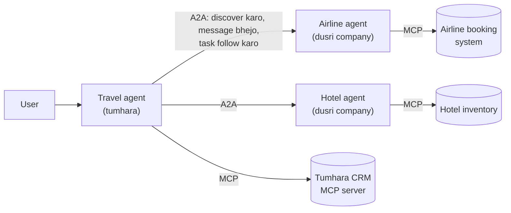
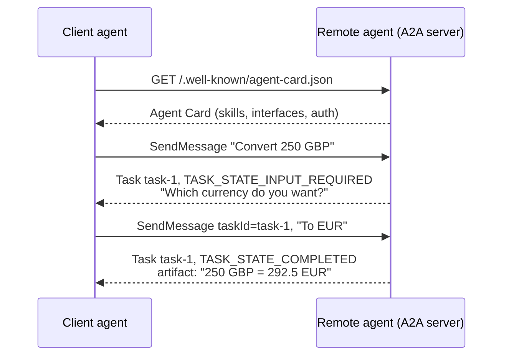

🏠 [Home](../../README.md) › [10 · Multi-Agent Systems](./README.md) › 10.5 Agent-to-agent protocols

# 10.5 Agent-to-agent protocols

> **Level:** 🔴 Advanced · **Padhne ka time:** ~8 min · **Pehle padho:** [10.3 Peer-to-peer aur handoffs](./10.3-peer-to-peer-and-handoffs.md), [4.1 MCP kyun bana?](../04-model-context-protocol/04.1-why-mcp-exists.md)
>
> Last verified: November 2026 against the A2A specification v1.0.0 at a2a-protocol.org.

**Ek line mein:** [Agent2Agent protocol (A2A)](../../GLOSSARY.md#agent2agent-protocol-a2a) ek open standard hai jisse alag teams ke, alag frameworks par bane independent agents ek dusre ko dhoondh sakte hain, messages bhej sakte hain aur shared tasks track kar sakte hain. Wahin [MCP](../../GLOSSARY.md#model-context-protocol-mcp) ek agent ko uske tools aur data se jodta hai.

📑 **Is page par**

- [Yeh kyun zaroori hai?](#-yeh-kyun-zaroori-hai)
- [Idea, simple words mein](#-idea-simple-words-mein)
- [Diagram se samjho](#-diagram-se-samjho)
- [Kaise kaam karta hai, step by step](#-kaise-kaam-karta-hai-step-by-step)
- [Example se samjho](#-example-se-samjho)
- [Code](#-code)
- [Aam galtiyan aur dhyan dene wali baatein](#-aam-galtiyan-aur-dhyan-dene-wali-baatein)
- [Yaad rakhne wali baatein](#-yaad-rakhne-wali-baatein)
- [Khud try karo](#-khud-try-karo)
- [Aur padhne ke liye](#-aur-padhne-ke-liye)

## 🤔 Yeh kyun zaroori hai?

Is chapter mein ab tak sab kuch ek hi program ke andar hua. Saare [agents](../../GLOSSARY.md#agent) tumne likhe, woh ek hi process mein chale, aur "dusre agent ko call karna" bas ek Python function call tha. Ab maan lo tumhare travel agent ko ek airline ke agent ke through booking karni hai. Airline ne apna agent alag framework mein banaya hai, apne servers par chalate hain, aur tumhe uska prompt ya tools kabhi nahi dikhayenge. Tumhe ek agreed tarika chahiye: us agent ko dhoondhna, yeh jaanna ki woh kya kar sakta hai, usse kuch maangna, lambe kaam ka wait karna, aur result wapas paana. Har partner ke liye custom integration likhna scale nahi karta.

Agent-to-agent protocols yahi problem solve karte hain. Yeh page A2A cover karta hai, jo ek open protocol hai aur neutral, vendor-independent governance ke under chalta hai.

## 🧠 Idea, simple words mein

Do companies socho jo saath kaam karti hain. Har ek ek business card publish karti hai jisme likha hai ki woh kaun hain, kya services deti hain aur unse kaise contact karein. Jab tum unhe koi kaam dete ho, woh ek ticket kholte hain. Tum ticket ka status check kar sakte ho, jab woh maangein tab extra information de sakte ho, aur aakhir mein deliverables paate ho. Andar woh kaise kaam karte hain, yeh tum kabhi nahi dekhte.

Jaise tumne food delivery app par order kiya. Tumhe order ID milti hai, status dikhta hai ("preparing", "out for delivery"), restaurant kabhi poochh leta hai "spicy kitna chahiye?". Lekin restaurant ki kitchen ke andar kya ho raha hai, tumhe nahi dikhta.

A2A bhi aise hi kaam karta hai:

| Rozmarra ka idea | A2A concept | Yeh kya hai |
| --- | --- | --- |
| Business card | **[Agent Card](../../GLOSSARY.md#agent-card)** | Agent ko describe karne wala ek JSON document: name, description, skills, endpoints, supported features aur authenticate kaise karna hai |
| Ticket | **Task** | Kaam ki ek unit, jiska ek id, ek status (submitted, working, input required, completed, failed…) aur results hote hain |
| Ticket par emails | **Message** | User side (`ROLE_USER`) ya agent (`ROLE_AGENT`) ka ek turn, jo parts se bana hota hai |
| Attachments | **Part** | Content ka ek tukda: `text`, `raw` bytes, kisi file ka `url`, ya structured `data` (JSON) |
| Deliverables | **Artifact** | Task ke liye agent ka banaya output, yeh bhi parts se bana hota hai |

Sabse khaas design choice yeh hai ki agents **opaque** hain: woh apni memory, tools ya prompts share kiye bina collaborate karte hain. A2A site MCP ke saath batwara aise batati hai: MCP ek agent ko tools, APIs aur data se jodta hai; A2A use dusre agents se jodta hai. Spec ke shabdon mein, MCP ek agent ke capability *use* karne ke baare mein hai, aur A2A agents ke tasks par *partner* banne ke baare mein.

**Governance.** A2A Google ne contribute kiya tha aur yeh Linux Foundation ke under ek open-source project hai, Apache 2.0 license ke saath. August 2026 mein ise Linux Foundation-directed Agentic AI Foundation (AAIF) ka Growth Stage project accept kiya gaya, MCP ke saath. Current specification version 1.0 hai.

## 👀 Diagram se samjho



*A2A agents ke beech chalta hai (company ki boundary ke paar horizontal arrows). MCP har agent aur uske apne tools ke beech chalta hai (neeche data stores tak). Travel agent kabhi nahi dekhta ki airline agent apne tools kaise use karta hai.*



*Ek task, do messages. Task id turns ko aapas mein jodta hai, aur remote agent decide karta hai ki use kab aur input chahiye.*

## 🔍 Kaise kaam karta hai, step by step

1. **Discover.** Client Agent Card fetch karta hai, aam taur par `https://{domain}/.well-known/agent-card.json` se. Registries ya direct configuration bhi chalti hai. Card mein `supportedInterfaces` (URL, binding aur protocol version) server ki pasand ke order mein hote hain, saath mein `skills` (id, name, description, tags, examples), `capabilities` (jaise `streaming` aur `pushNotifications`) aur `securitySchemes`. Cards sign (JWS) bhi ho sakte hain taaki clients check kar sakein ki unse chhed-chhaad nahi hui.
2. **Authenticate.** Card batata hai ki agent kaunsi schemes accept karta hai (jaise OAuth 2.0 ya OpenID Connect). Client credentials out of band leta hai aur har request ke saath HTTPS par bhejta hai. A2A agents ko kisi bhi aur enterprise web service ki tarah treat karta hai.
3. **Message bhejo.** Core operation hai **SendMessage**. Server ya to direct Message se jawab deta hai (jaldi wale replies) ya ek **Task** se (jisme bhi kaam lagta hai). Live updates ke liye Server-Sent Events par **SendStreamingMessage** bhi hai.
4. **Task follow karo.** Tasks states se guzarte hain: `TASK_STATE_SUBMITTED`, `TASK_STATE_WORKING`, phir ek terminal state (`TASK_STATE_COMPLETED`, `TASK_STATE_FAILED`, `TASK_STATE_CANCELED`, `TASK_STATE_REJECTED`) ya ek interrupted state (`TASK_STATE_INPUT_REQUIRED`, `TASK_STATE_AUTH_REQUIRED`). Client poll kar sakta hai (**GetTask**, **ListTasks**), stream kar sakta hai (**SubscribeToTask**), **push notifications** ke liye webhook register kar sakta hai, ya **CancelTask** kar sakta hai.
5. **Aage badho ya khatam karo.** Agar task ko input chahiye, client usi `taskId` ke saath ek aur message bhejta hai. Jab task complete hota hai, results **artifacts** ki tarah aate hain.
6. **Binding chuno.** Same operations teen bindings par defined hain: **JSON-RPC 2.0** (methods ke naam `SendMessage`, `GetTask`…), **gRPC**, aur **HTTP+JSON/REST** (`POST /message:send`, `GET /tasks/{id}`…). Clients har request par ek `A2A-Version` header bhejte hain (jaise `1.0`).

### A2A ya MCP?

| Sawal | Kya use karo |
| --- | --- |
| Mere agent ko ek function call karna hai, database query karna hai ya files padhni hain | **MCP** ([chapter 04](../04-model-context-protocol/README.md)) |
| Mere agent ko ek task kisi dusre *agent* ko delegate karna hai jo plan karta hai, sawal poochhta hai aur time lekar kaam karta hai | **A2A** |
| Dusra agent mera hi hai, same codebase mein | Dono nahi: use tool ya handoff ki tarah call karo ([10.2](./10.2-supervisor-and-hierarchical.md), [10.3](./10.3-peer-to-peer-and-handoffs.md)) |

A2A docs batate hain ki ek well-defined, stateless skill ko MCP-style tool ki tarah bhi expose kiya ja sakta hai. A2A ki asli kaamyabi stateful, multi-turn collaboration mein hai.

## 💡 Example se samjho

HTTP+JSON binding ka ek seekhne layak chhota hissa, jisme remote server ek chhota currency agent hai. Remote currency agent ka card kehta hai:

```json
{
  "name": "Currency Agent",
  "description": "Converts amounts between currencies using today's reference rates.",
  "supportedInterfaces": [{"url": "https://currency-agent.example.com/a2a", "protocolBinding": "HTTP+JSON", "protocolVersion": "1.0"}],
  "capabilities": {"streaming": false, "pushNotifications": false},
  "skills": [{"id": "convert", "name": "Convert currency", "tags": ["finance", "currency"],
              "description": "Convert an amount from one currency to another.", "examples": ["How much is 250 GBP in EUR?"]}]
}
```

Run:

```text
Discovered: Currency Agent v0.1.0 - skills: ['convert']
Endpoint:   /a2a (HTTP+JSON, A2A 1.0)

-> SendMessage 'Please convert 250 GBP.'
<- task task-1 state=TASK_STATE_INPUT_REQUIRED
   agent asks: Please tell me the currency you want to convert to.
-> SendMessage 'To EUR.' (taskId=task-1)
<- state=TASK_STATE_COMPLETED
   artifact 'conversion': 250 GBP = 292.5 EUR  data={'amount': 250, 'from': 'GBP', 'to': 'EUR', 'rate': 1.17, 'converted': 292.5}
```

Wire par dusri request ki body:

```json
{"message": {"taskId": "task-1", "role": "ROLE_USER", "messageId": "…", "parts": [{"text": "To EUR."}]}}
```

Dhyan do ki caller kya **kabhi nahi** dekhta: remote agent ka system prompt, uska model, ya uski rate table. Iska bhi test likhna worth hai.

## 💻 Code

`httpx` ki kuch lines mein ek raw A2A client, HTTP+JSON binding use karke. Ise kisi bhi A2A v1.0 server par point karo jo yeh binding offer karta hai (agar card maange to `Authorization` header jodo):

```python
import uuid

import httpx

domain = "https://agent.example.com"                           # remote agent ka domain
card = httpx.get(f"{domain}/.well-known/agent-card.json").json()
iface = next(i for i in card["supportedInterfaces"] if i["protocolBinding"] == "HTTP+JSON")
print(card["name"], [s["id"] for s in card["skills"]])

headers = {"A2A-Version": "1.0", "Content-Type": "application/a2a+json"}
body = {"message": {"role": "ROLE_USER", "messageId": str(uuid.uuid4()),
                    "parts": [{"text": "How much is 250 GBP in EUR?"}]}}
reply = httpx.post(f"{iface['url']}/message:send", json=body, headers=headers).json()

task = reply.get("task")                                       # ya direct answer ke liye reply["message"]
if task:
    print(task["status"]["state"])                            # jaise TASK_STATE_COMPLETED
    for artifact in task.get("artifacts", []):
        print([p.get("text") or p.get("data") for p in artifact["parts"]])
```

Real systems ke liye official SDK use karo: A2A project Python (`a2a-sdk`), Go, Java, JavaScript, .NET aur Rust ke SDKs list karta hai.

## 🚨 Aam galtiyan aur dhyan dene wali baatein

- **Ek hi program ke andar A2A use karna.** Agar dono agents tumhare hain aur saath chalte hain, to protocol bekaar mein latency, serialisation aur failure modes jodta hai. **Fix:** agents as tools ya handoffs. A2A ko team, service ya company ki boundaries par use karo.
- **Remote agent par bharosa kar lena.** Uske messages aur artifacts kisi dusri organisation ke model ka input hain. Woh galat ho sakte hain, ya unme [prompt injection](../../GLOSSARY.md#prompt-injection) ho sakta hai. **Fix:** artifacts validate karo (schema wale `data` parts ko prefer karo), aur wahi guardrails lagao jo tool output par lagate ho ([13.2](../13-safety-and-guardrails/13.2-prompt-injection.md)).
- **Interrupted states bhool jaana.** Jo client sirf `COMPLETED` handle karta hai, woh `INPUT_REQUIRED` ya `AUTH_REQUIRED` par atak jayega ya crash ho jayega. **Fix:** har state handle karo, aur timeouts set karo.
- **Chain mein credentials aage pass karna.** Agar agent A, B ko call karta hai, aur B, C ko, to in-band pass kiya gaya token har agent ke saamne aa sakta hai. Spec recommend karta hai ki credentials out of band liye jayein, aur koi bhi in-band credential usi agent se bandha ho jisne use maanga. **Fix:** least privilege, har hop ke alag credentials ([13.3](../13-safety-and-guardrails/13.3-least-privilege-and-sandboxing.md)).
- **Yeh maan lena ki purane tutorials abhi bhi lagu hote hain.** Version 1.0 mein 0.3 se breaking changes hain: task states aur roles `TASK_STATE_*` aur `ROLE_*` ban gaye, teen part types ek `Part` mein merge ho gaye, card ke endpoint fields `supportedInterfaces` mein merge ho gaye, aur JSON-RPC methods ke naam badle (jaise `message/send` ab `SendMessage` hai). **Fix:** check karo ki partner ka card kaunsa protocol version declare karta hai, aur `A2A-Version` header bhejo.

## ✅ Yaad rakhne wali baatein

- A2A ek open protocol hai jisse agents frameworks aur organisations ke paar collaborate karte hain, apne andar ki cheezein dikhaye bina.
- Iske core objects hain Agent Card (discovery), Task (stateful kaam), Message aur Part (content), aur Artifact (results).
- Yeh SendMessage, GetTask, CancelTask aur SubscribeToTask jaise operations JSON-RPC, gRPC aur HTTP+JSON par define karta hai, SSE par streaming aur push notifications ke saath.
- MCP agent-to-tools hai; A2A agent-to-agent hai. Bahut se systems dono use karte hain.
- Remote agents ko untrusted services ki tarah treat karo: authenticate karo, validate karo aur har task state handle karo.

## 🧪 Khud try karo

1. Tumhare support agent ko (a) tumhare database mein orders dekhne hain aur (b) ek logistics partner ke agent se parcel re-route karwana hai, jisme ghante lag sakte hain aur extra details chahiye ho sakti hain. Har ek ke liye kaunsa protocol fit hai?
2. Example mein, jo client sirf `TASK_STATE_COMPLETED` check karta hai, woh pehle message ke liye kya print karega? Ise kaise fix karoge?

<details>
<summary>Answer dekho</summary>

1. (a) MCP, ya ek plain tool: yeh tumhare apne system mein ek stateless data lookup hai. (b) A2A: yeh dusri organisation ka opaque agent hai, kaam lamba chalta hai (push notifications ya streaming use karo, blocking call nahi), aur yeh `TASK_STATE_INPUT_REQUIRED` ke saath wapas aa sakta hai.
2. Use `TASK_STATE_INPUT_REQUIRED` dikhega, koi artifacts nahi milenge, aur woh ya to kuch print nahi karega ya galti se failure report karega. Fix hai state par branch karna: `INPUT_REQUIRED` ke liye `task["status"]["message"]` user ko dikhao (ya calling agent ko jawab dene do), phir usi `taskId` ke saath follow-up message bhejo. Example wala client yahi karta hai.

</details>

## 📚 Aur padhne ke liye

- [A2A Protocol Specification](https://a2a-protocol.org/latest/specification/) (a2a-protocol.org). Agent Card, tasks, messages, operations aur bindings ki authoritative definition.
- [A2A and MCP](https://a2a-protocol.org/latest/topics/a2a-and-mcp/) (a2a-protocol.org). Dono protocols kaise saath fit hote hain, ek analogy ke saath.
- [A2A on GitHub](https://github.com/a2aproject/A2A) (a2aproject). Specification ka source, governance aur official SDKs ke links.
- [What's New in v1.0](https://a2a-protocol.org/latest/whats-new-v1/) (a2a-protocol.org). 0.3 se breaking changes, purane tutorials padhte waqt kaam ke.
- [A new chapter for A2A: joining the Agentic AI Foundation](https://a2a-protocol.org/latest/blog/2026/08/27/a-new-chapter-for-a2a-joining-the-agentic-ai-foundation/) (A2A blog). Governance ka announcement.
- [Model Context Protocol](https://modelcontextprotocol.io) (official site). Picture ka agent-to-tools wala hissa.

<!-- FOOTER -->

---

⬅️ **Pichla:** [10.4 Shared state aur communication](./10.4-shared-state-and-communication.md) ·
🏠 [Chapter home](./README.md) ·
➡️ **Agla:** [10.6 Jab multi-agent cheezein aur bigaad deta hai](./10.6-when-multi-agent-makes-things-worse.md)
