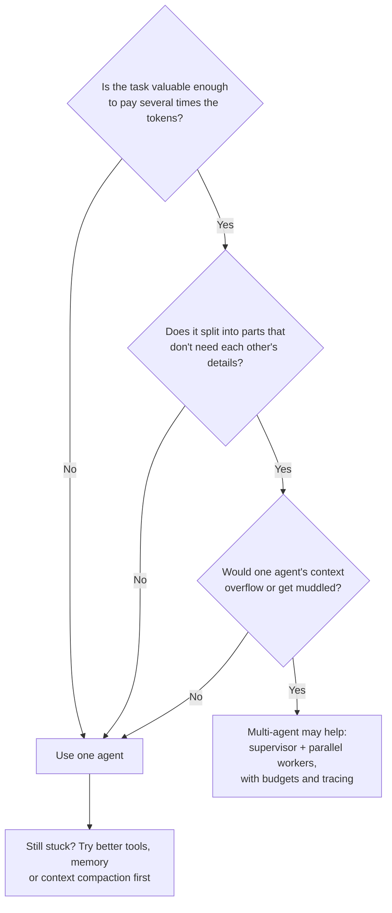

🏠 [Home](../../README.md) › [10 · Multi-Agent Systems](./README.md) › 10.6 When multi-agent makes things worse

# 10.6 When multi-agent makes things worse

> **Difficulty:** 🔴 Advanced · **Reading time:** ~8 min · **Prerequisites:** [10.1 Why multiple agents?](./10.1-why-multiple-agents.md), [10.4 Shared state & communication](./10.4-shared-state-and-communication.md)

**In one sentence:** Multi-agent systems multiply token cost, often add latency, fail in new ways when agents misunderstand each other, and lose context at every boundary, so use them only when the task is valuable, broad and splits cleanly.

📑 **On this page**

- [Why does this matter?](#-why-does-this-matter)
- [The idea, in plain words](#-the-idea-in-plain-words)
- [Picture it](#-picture-it)
- [How it works, step by step](#-how-it-works-step-by-step)
- [Worked example](#-worked-example)
- [Code](#-code)
- [Common mistakes & gotchas](#-common-mistakes--gotchas)
- [Key takeaways](#-key-takeaways)
- [Try it yourself](#-try-it-yourself)
- [Further reading](#-further-reading)

## 🤔 Why does this matter?

A team replaces its single coding [agent](../../GLOSSARY.md#agent) with a "planner, coder, reviewer, tester" crew. The demo looks impressive: four agents chatting, each with a role. In production, the bill goes up several times, each request takes much longer, and the error rate gets *worse*. The coder and the tester disagree about an interface neither of them chose on purpose, and the reviewer approves code it never saw run.

This is common enough that two well-known engineering posts take opposite sides. Anthropic explains how and why it built a [multi-agent system](../../GLOSSARY.md#multi-agent-system) for research. Cognition argues *"Don't Build Multi-Agents"* for most tasks. Both are right, about different tasks. This page is about telling them apart.

## 🧠 The idea, in plain words

Adding people to a project doesn't always make it faster. New people need briefing, they talk past each other, and someone has to stitch their work together. Fred Brooks put it famously for software projects: adding people to a late project makes it later. Agents are no different, except that briefing them costs tokens and they never say "wait, what did you mean?"

Four costs come with every extra agent:

| Cost | Why it happens |
| --- | --- |
| **[Tokens](../../GLOSSARY.md#token)** | Every agent reads its own [system prompt](../../GLOSSARY.md#system-prompt), tool definitions and [context](../../GLOSSARY.md#context-window) on every call. Nothing is shared for free |
| **Latency** | Every hop (brief, delegate, report, combine) is at least one more model call. Sequential hand-offs add up. Parallel agents wait for the slowest one |
| **Coordination failures** | Agents misread briefs, duplicate work, contradict each other, or stop too early, and the lead believes them |
| **Lost context** | Each boundary is a summary. Details, and the implicit decisions behind them, don't make it across |

## 👀 Picture it



*Three "yes" answers before you split. Most tasks fall out at the second question: their parts depend on each other's details.*

## 🔍 How it works, step by step

### 1. Cost: tokens multiply

Anthropic reports that in their data, agents used about **4× more tokens than chat**, and multi-agent systems about **15× more**. They also found that token usage by itself explained 80% of the performance variance on the BrowseComp evaluation. So part of the multi-agent gain comes from spending more. Their conclusion: multi-agent systems need tasks whose value is high enough to pay for the extra tokens.

### 2. Latency: more hops

A supervisor adds at least two model calls (delegate, then combine) on top of the specialists' work. Running specialists in parallel helps, and Anthropic reports that parallel subagents and parallel tool calls cut research time by up to 90% for complex queries. But a parallel step is only as fast as its slowest agent. Anthropic also notes that its lead agent waits for each set of subagents to finish, so one slow subagent can block the whole system. Handoff chains are sequential by nature.

### 3. Coordination failures: new ways to be wrong

*Why Do Multi-Agent LLM Systems Fail?* (Cemri et al.) annotated more than 1,600 traces from 7 popular multi-agent frameworks. It found 14 failure modes in three groups: **system design issues**, **inter-agent misalignment** and **task verification**. It also notes that performance gains on popular benchmarks are often minimal. In plain terms: agents are given badly designed roles, they misunderstand or ignore each other, and nobody properly checks the result. These problems come from the multi-agent structure, not from any one model.

Anthropic describes a related effect: small changes to the lead agent can unpredictably change how subagents behave, and one failing step can send agents down a completely different path. Errors compound across steps and agents ([compounding errors](../../GLOSSARY.md#compounding-errors)). That makes multi-agent systems harder to debug and to evaluate ([12.1](../12-evaluation/12.1-why-agent-evals-are-hard.md)).

### 4. Lost context: implicit decisions don't travel

Cognition's two principles are *"share context, and share full agent traces, not just individual messages"* and *"actions carry implicit decisions, and conflicting decisions carry bad results"*. Their example splits a Flappy Bird clone between a background subagent and a bird subagent. The results don't fit together, because each made style choices the other couldn't see. Their recommended default is a single-threaded, linear agent, with context compression for long tasks. Anthropic draws the same line from the other side: tasks where all agents must share the same context, or with many dependencies between agents, are not a good fit for multi-agent systems today, and most coding tasks have fewer truly parallel parts than research.

### 5. What to try before splitting

- **Better tools.** Fewer, clearer, higher-level tools often fix "too many tools" confusion ([3.4](../03-tools-and-function-calling/03.4-designing-good-tools.md)).
- **Context management.** Summarise or trim old steps, and keep big artefacts in files ([5.2](../05-memory/05.2-summarisation-and-context-compaction.md)).
- **A workflow.** If the steps are known, fixed code is cheaper and more reliable than agents negotiating ([chapter 09](../09-agent-design-patterns/README.md)).
- **One isolated subagent**, for one bulky, self-contained step (such as reading 40 files and returning a summary), instead of a whole team.

## 💡 Worked example

An illustrative cost comparison. The numbers are assumptions chosen to be realistic, not measurements. Prices are Claude Sonnet 5.5's list prices as of November 2026: $2 per million input tokens and $10 per million output tokens.

| | Single agent | Lead + 4 parallel subagents |
| --- | --- | --- |
| Model calls | 8 | Lead 4, plus 4 × 10 = 44 |
| Input tokens | 8 × 6,000 = 48,000 | Lead 4 × 8,000 + subagents 40 × 10,000 = 432,000 |
| Output tokens | 8 × 400 = 3,200 | Lead 4 × 800 + subagents 40 × 500 = 23,200 |
| Cost | $0.096 + $0.032 = **$0.13** | $0.864 + $0.232 = **$1.10** |
| Wall-clock (3 s per call, subagents in parallel) | 8 × 3 = 24 s | 4 × 3 + 10 × 3 = 42 s |

The multi-agent run costs about 8.5× more and, here, is also slower. It covers far more ground (40 subagent calls instead of 8), which is the whole point. **If the task needed that breadth, the spend may be worth it. If one agent with 8 calls would have answered well, it's pure waste.** You can only tell with an [eval](../../GLOSSARY.md#eval) ([chapter 12](../12-evaluation/README.md)) that compares both on the same questions, and tracks cost and latency alongside quality.

## 💻 Code

Whatever you build, give the whole team **one** budget, so fan-out can't hide spend. Every agent calls the model through a function that charges the shared budget:

```python
from dataclasses import dataclass


class BudgetExceeded(RuntimeError):
    """Raised when the whole team has spent its token budget."""


@dataclass
class SharedBudget:
    """One budget for every agent in a run, so fan-out can't hide spend."""

    max_tokens: int
    used: int = 0

    def charge(self, agent: str, reply) -> None:
        self.used += reply.usage.input_tokens + reply.usage.output_tokens
        if self.used > self.max_tokens:
            raise BudgetExceeded(f"{agent} pushed the run to {self.used} tokens (limit {self.max_tokens})")


def budgeted_chat(llm, budget: SharedBudget, agent: str, messages, **kwargs):
    """Every agent calls the model through this, so every call is counted."""
    reply = llm.chat(messages, **kwargs)
    budget.charge(agent, reply)
    return reply


@dataclass
class Usage:
    input_tokens: int
    output_tokens: int


@dataclass
class Reply:
    text: str
    usage: Usage


class FakeLLM:
    """A scripted stand-in for a model client: the same reply and token count on every call."""

    def chat(self, messages, **kwargs) -> Reply:
        return Reply("Found 3 sources on topic A.", Usage(input_tokens=248, output_tokens=30))


budget = SharedBudget(max_tokens=1000)
llm = FakeLLM()
try:
    for i in range(1, 11):  # a lead agent spawning up to 10 subagents
        budgeted_chat(llm, budget, f"subagent-{i}", [{"role": "user", "content": f"Research part {i} of the question."}])
        print(f"subagent-{i}: total so far {budget.used} tokens")
except BudgetExceeded as exc:
    print("STOP:", exc)
```

The output:

```text
subagent-1: total so far 278 tokens
subagent-2: total so far 556 tokens
subagent-3: total so far 834 tokens
STOP: subagent-4 pushed the run to 1112 tokens (limit 1000)
```

This check runs *after* each call, so a run can overshoot by one call. Production systems also check before starting a new agent, and limit the number and depth of agents. Agent SDKs increasingly build this in: the Claude Agent SDK, for example, caps subagent depth and concurrency and offers a spend limit. See [16.5 Budget limits per run](../16-cost-and-performance/16.5-budget-limits-per-run.md).

## 🚨 Common mistakes & gotchas

- **Choosing multi-agent for the architecture diagram.** Roles like "planner, coder, critic" look tidy but often split one tightly coupled task into four contexts. **Fix:** require an eval showing it beats one agent on quality per dollar.
- **Comparing quality without cost.** A multi-agent system that spends 10× the tokens *should* do better on some tasks. **Fix:** report quality, cost and latency together, and compare against a single agent given the same token budget.
- **Debugging blind.** With several agents, "the answer is wrong" could be a bad brief, a bad subagent or a bad merge. **Fix:** one trace for the whole run, with every brief and report visible ([14.1](../14-observability-and-debugging/14.1-tracing-agent-runs.md)).
- **Believing subagent reports.** The lead agent can't check what it didn't see. **Fix:** require evidence (sources, test output, IDs), and verify key claims in code or with a separate check ([chapter 08](../08-reflection-and-self-correction/README.md)).
- **No kill switch.** A recursive or chatty team can burn through a budget in minutes. **Fix:** shared token budget, maximum agents, maximum depth, maximum handoffs and a timeout.

## ✅ Key takeaways

- Multi-agent costs scale with the number of agents. Anthropic reports about 15× the tokens of chat.
- Parallelism can cut time, but every extra hop adds latency, and the slowest agent sets the pace.
- Multi-agent systems fail in their own ways: poor role design, inter-agent misalignment and weak verification.
- Every boundary loses context. Tightly coupled tasks, including most coding, usually do better with one agent.
- Split only for valuable, broad, separable tasks, and then with budgets, limits and tracing.

## 🧪 Try it yourself

1. Using the worked example's prices, what would the multi-agent run cost if each subagent made 5 calls instead of 10?
2. A "blog post crew" has a researcher, a writer and an editor, run one after another. Each hands the next a summary. Name two concrete things likely to go wrong, and one design change for each.

<details>
<summary>Show answer</summary>

1. Subagents: 4 × 5 = 20 calls, so 200,000 input and 10,000 output tokens. Add the lead's 32,000 input and 3,200 output: 232,000 input and 13,200 output in total. Cost: 232,000 × $2/M + 13,200 × $10/M = $0.464 + $0.132 ≈ **$0.60**. That is still about 4.7× the single agent's $0.13.
2. For example: (a) the writer only sees the researcher's summary, so it can't cite sources or check a surprising claim. Fix: store the sources in a shared file and pass a reference, or merge research and writing into one agent. (b) The editor changes tone or structure in ways that contradict choices the writer made for a reason (an implicit decision). Fix: agree a style brief up front that both read, or have the editor return comments for the writer to apply, instead of rewriting.

</details>

## 📚 Further reading

- [How we built our multi-agent research system](https://www.anthropic.com/engineering/multi-agent-research-system) (Anthropic). The token multipliers, when multi-agent is and isn't a good fit, and production lessons.
- [Don't Build Multi-Agents](https://cognition.com/blog/dont-build-multi-agents) (Cognition). The case for single-threaded agents and shared context.
- [Why Do Multi-Agent LLM Systems Fail?](https://arxiv.org/abs/2503.13657) (Cemri et al., 2025). The MAST taxonomy of multi-agent failures.
- [Pricing](https://platform.claude.com/docs/en/about-claude/pricing) (Claude docs). The per-token prices used in the worked example.

<!-- FOOTER -->

---

⬅️ **Previous:** [10.5 Agent-to-agent protocols](./10.5-agent-to-agent-protocols.md) ·
🏠 [Chapter home](./README.md) ·
➡️ **Next:** [11 · Frameworks → 11.1 Framework landscape](../11-frameworks/11.1-framework-landscape.md)
