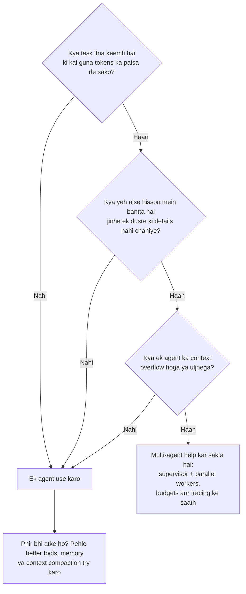

🏠 [Home](../../README.md) › [10 · Multi-Agent Systems](./README.md) › 10.6 Jab multi-agent cheezein aur bigaad deta hai

# 10.6 Jab multi-agent cheezein aur bigaad deta hai

> **Level:** 🔴 Advanced · **Padhne ka time:** ~8 min · **Pehle padho:** [10.1 Multiple agents kyun?](./10.1-why-multiple-agents.md), [10.4 Shared state aur communication](./10.4-shared-state-and-communication.md)

**Ek line mein:** Multi-agent systems token cost ko kai guna kar dete hain, aksar latency badhate hain, agents ke ek dusre ko galat samajhne par naye tarike se fail hote hain, aur har boundary par context kho dete hain. Isliye inhe tabhi use karo jab task keemti ho, bada ho aur saaf-saaf hisson mein bant sake.

📑 **Is page par**

- [Yeh kyun zaroori hai?](#-yeh-kyun-zaroori-hai)
- [Idea, simple words mein](#-idea-simple-words-mein)
- [Diagram se samjho](#-diagram-se-samjho)
- [Kaise kaam karta hai, step by step](#-kaise-kaam-karta-hai-step-by-step)
- [Example se samjho](#-example-se-samjho)
- [Code](#-code)
- [Aam galtiyan aur dhyan dene wali baatein](#-aam-galtiyan-aur-dhyan-dene-wali-baatein)
- [Yaad rakhne wali baatein](#-yaad-rakhne-wali-baatein)
- [Khud try karo](#-khud-try-karo)
- [Aur padhne ke liye](#-aur-padhne-ke-liye)

## 🤔 Yeh kyun zaroori hai?

Ek team apne single coding [agent](../../GLOSSARY.md#agent) ko hata ke "planner, coder, reviewer, tester" wali crew laga deti hai. Demo impressive lagta hai: chaar agents baat kar rahe hain, har ek ka apna role. Production mein bill kai guna badh jaata hai, har request ko bahut zyada time lagta hai, aur error rate *aur kharab* ho jaata hai. Coder aur tester ek interface par lad padte hain jo dono mein se kisi ne soch-samajh ke chuna hi nahi tha. Aur reviewer aisa code approve kar deta hai jise usne kabhi chalte hue dekha hi nahi.

Yeh itna aam hai ki do mashhoor engineering posts ulti taraf khade hain. Anthropic batata hai ki usne research ke liye [multi-agent system](../../GLOSSARY.md#multi-agent-system) kaise aur kyun banaya. Cognition zyadatar tasks ke liye kehta hai *"Don't Build Multi-Agents"*. Dono sahi hain, bas alag-alag tasks ke baare mein. Yeh page in dono ko alag pehchanne ke baare mein hai.

## 🧠 Idea, simple words mein

Project mein log jodne se woh hamesha fast nahi hota. Naye logon ko briefing chahiye, woh ek dusre ki baat samajhe bina bolte rehte hain, aur kisi ko unka kaam jodna padta hai. Fred Brooks ne software projects ke liye mashhoor baat kahi thi: late project mein log jodne se woh aur late hota hai. Agents bhi alag nahi hain, bas farak yeh hai ki unki briefing mein tokens lagte hain aur woh kabhi nahi kehte "ruko, tumhara matlab kya tha?"

Cricket team socho. Gyarah ki jagah bees players field par utaar do to catch pakadne ke liye do-do log daudenge aur takraayenge. Zyada log matlab zyada coordination, aur zaroori nahi ki zyada wickets.

Har extra agent ke saath chaar keematein aati hain:

| Keemat | Kyun hoti hai |
| --- | --- |
| **[Tokens](../../GLOSSARY.md#token)** | Har agent har call par apna [system prompt](../../GLOSSARY.md#system-prompt), tool definitions aur [context](../../GLOSSARY.md#context-window) padhta hai. Kuch bhi free mein share nahi hota |
| **Latency** | Har hop (brief, delegate, report, combine) kam se kam ek extra model call hai. Ek ke baad ek hand-offs jud jaate hain. Parallel agents sabse slow wale ka wait karte hain |
| **Coordination failures** | Agents briefs galat padhte hain, kaam duplicate karte hain, ek dusre ko kaat-te hain, ya jaldi ruk jaate hain, aur lead unki baat maan leta hai |
| **Khoya hua context** | Har boundary ek summary hai. Details, aur unke peeche chhupe decisions, paar nahi pahunchte |

## 👀 Diagram se samjho



*Baantne se pehle teen "haan" chahiye. Zyadatar tasks dusre sawal par hi bahar ho jaate hain: unke hisse ek dusre ki details par depend karte hain.*

## 🔍 Kaise kaam karta hai, step by step

### 1. Cost: tokens kai guna ho jaate hain

Anthropic report karta hai ki unke data mein agents ne **chat se lagbhag 4× zyada tokens** use kiye, aur multi-agent systems ne lagbhag **15× zyada**. Unhe yeh bhi mila ki BrowseComp evaluation par performance variance ka 80% akele token usage se samajh aa jaata tha. Matlab multi-agent ka kuch fayda sirf zyada kharch karne se aata hai. Unka conclusion: multi-agent systems ko aise tasks chahiye jinki value itni ho ki extra tokens ka paisa nikal sake.

### 2. Latency: zyada hops

Supervisor specialists ke kaam ke upar kam se kam do model calls jodta hai (delegate, phir combine). Specialists ko parallel chalana help karta hai. Anthropic report karta hai ki parallel subagents aur parallel tool calls ne complex queries ke liye research time 90% tak kam kiya. Lekin parallel step utna hi fast hai jitna uska sabse slow agent. Anthropic yeh bhi batata hai ki unka lead agent subagents ke har set ke khatam hone ka wait karta hai, to ek slow subagent poore system ko rok sakta hai. Handoff chains to apne nature se hi sequential hoti hain.

### 3. Coordination failures: galat hone ke naye tarike

*Why Do Multi-Agent LLM Systems Fail?* (Cemri et al.) ne 7 popular multi-agent frameworks ke 1,600 se zyada traces annotate kiye. Unhe teen groups mein 14 failure modes mile: **system design issues**, **inter-agent misalignment** aur **task verification**. Paper yeh bhi kehta hai ki popular benchmarks par performance gains aksar bahut kam hote hain. Seedhe shabdon mein: agents ko kharab design kiye roles milte hain, woh ek dusre ko galat samajhte ya ignore karte hain, aur result ko koi theek se check nahi karta. Yeh problems multi-agent structure se aati hain, kisi ek model se nahi.

Anthropic ek milta-julta effect batata hai: lead agent mein chhote badlav subagents ke behaviour ko unpredictable tarike se badal sakte hain, aur ek fail hota step agents ko bilkul alag raaste par bhej sakta hai. Errors steps aur agents ke paar badhte jaate hain ([compounding errors](../../GLOSSARY.md#compounding-errors)). Isse multi-agent systems ko debug aur evaluate karna mushkil ho jaata hai ([12.1](../12-evaluation/12.1-why-agent-evals-are-hard.md)).

### 4. Khoya context: chhupe decisions aage nahi jaate

Cognition ke do principles hain *"share context, and share full agent traces, not just individual messages"* aur *"actions carry implicit decisions, and conflicting decisions carry bad results"*. Matlab: context share karo, sirf alag messages nahi balki poore traces; aur har action mein chhupe decisions hote hain, jo takraayein to result bura hota hai. Unka example ek Flappy Bird clone ko background subagent aur bird subagent mein baantta hai. Results aapas mein fit nahi hote, kyunki har ek ne aisi style choices li jo dusre ko dikh nahi rahi thi. Unka recommended default ek single-threaded, linear agent hai, aur lambe tasks ke liye context compression. Anthropic dusri taraf se wahi line kheenchta hai: jin tasks mein saare agents ko same context share karna ho, ya agents ke beech bahut dependencies hon, woh aaj multi-agent systems ke liye achha fit nahi hain. Aur zyadatar coding tasks mein research ke mukable kam truly parallel hisse hote hain.

### 5. Baantne se pehle kya try karein

- **Better tools.** Kam, saaf, higher-level tools aksar "too many tools" wala confusion theek kar dete hain ([3.4](../03-tools-and-function-calling/03.4-designing-good-tools.md)).
- **Context management.** Purane steps summarise ya trim karo, aur bade artefacts files mein rakho ([5.2](../05-memory/05.2-summarisation-and-context-compaction.md)).
- **Ek workflow.** Agar steps pehle se pata hain, to fixed code agents ke aapas mein negotiate karne se sasta aur zyada reliable hai ([chapter 09](../09-agent-design-patterns/README.md)).
- **Ek isolated subagent**, ek bhaari, self-contained step ke liye (jaise 40 files padh ke ek summary lautana), poori team ki jagah.

## 💡 Example se samjho

Ek illustrative cost comparison. Numbers assumptions hain jo realistic rakhe gaye hain, measurements nahi. Prices Claude Sonnet 5.5 ki November 2026 ki list prices hain: $2 per million input tokens aur $10 per million output tokens.

| | Single agent | Lead + 4 parallel subagents |
| --- | --- | --- |
| Model calls | 8 | Lead 4, plus 4 × 10 = 44 |
| Input tokens | 8 × 6,000 = 48,000 | Lead 4 × 8,000 + subagents 40 × 10,000 = 432,000 |
| Output tokens | 8 × 400 = 3,200 | Lead 4 × 800 + subagents 40 × 500 = 23,200 |
| Cost | $0.096 + $0.032 = **$0.13** | $0.864 + $0.232 = **$1.10** |
| Wall-clock (3 s per call, subagents parallel mein) | 8 × 3 = 24 s | 4 × 3 + 10 × 3 = 42 s |

Multi-agent run lagbhag 8.5× mehenga hai aur yahan slow bhi hai. Woh kahin zyada ground cover karta hai (8 ki jagah 40 subagent calls), aur yahi poora point hai. **Agar task ko itni breadth chahiye thi, to kharcha worth ho sakta hai. Agar 8 calls wala ek agent achha jawab de deta, to yeh sirf barbaadi hai.** Yeh tum sirf ek [eval](../../GLOSSARY.md#eval) se bata sakte ho ([chapter 12](../12-evaluation/README.md)) jo dono ko same sawalon par compare kare, aur quality ke saath cost aur latency bhi track kare.

## 💻 Code

Tum kuch bhi banao, poori team ko **ek** budget do, taaki fan-out kharcha chhupa na sake. Har agent model ko ek aise function ke through call karta hai jo shared budget se paisa kaatta hai:

```python
from dataclasses import dataclass


class BudgetExceeded(RuntimeError):
    """Tab raise hota hai jab poori team apna token budget kharch kar chuki ho."""


@dataclass
class SharedBudget:
    """Ek run ke har agent ke liye ek hi budget, taaki fan-out kharcha chhupa na sake."""

    max_tokens: int
    used: int = 0

    def charge(self, agent: str, reply) -> None:
        self.used += reply.usage.input_tokens + reply.usage.output_tokens
        if self.used > self.max_tokens:
            raise BudgetExceeded(f"{agent} pushed the run to {self.used} tokens (limit {self.max_tokens})")


def budgeted_chat(llm, budget: SharedBudget, agent: str, messages, **kwargs):
    """Har agent model ko isi ke through call karta hai, taaki har call gina jaye."""
    reply = llm.chat(messages, **kwargs)
    budget.charge(agent, reply)
    return reply


@dataclass
class Usage:
    input_tokens: int
    output_tokens: int


@dataclass
class Reply:
    text: str
    usage: Usage


class FakeLLM:
    """Model client ki jagah ek scripted stand-in: har call par same reply aur same token count."""

    def chat(self, messages, **kwargs) -> Reply:
        return Reply("Found 3 sources on topic A.", Usage(input_tokens=248, output_tokens=30))


budget = SharedBudget(max_tokens=1000)
llm = FakeLLM()
try:
    for i in range(1, 11):  # ek lead agent jo 10 tak subagents spawn karta hai
        budgeted_chat(llm, budget, f"subagent-{i}", [{"role": "user", "content": f"Research part {i} of the question."}])
        print(f"subagent-{i}: total so far {budget.used} tokens")
except BudgetExceeded as exc:
    print("STOP:", exc)
```

Output:

```text
subagent-1: total so far 278 tokens
subagent-2: total so far 556 tokens
subagent-3: total so far 834 tokens
STOP: subagent-4 pushed the run to 1112 tokens (limit 1000)
```

Yeh check har call ke *baad* chalta hai, isliye run ek call se limit ke paar ja sakta hai. Production systems naya agent start karne se pehle bhi check karte hain, aur agents ki sankhya aur depth limit karte hain. Agent SDKs ab yeh khud build kar rahe hain: jaise Claude Agent SDK subagent depth aur concurrency par cap lagata hai aur ek spend limit deta hai. [16.5 Har run ki budget limits](../16-cost-and-performance/16.5-budget-limits-per-run.md) dekho.

## 🚨 Aam galtiyan aur dhyan dene wali baatein

- **Architecture diagram ke liye multi-agent chunna.** "Planner, coder, critic" jaise roles saaf dikhte hain, lekin aksar ek tightly coupled task ko chaar contexts mein baant dete hain. **Fix:** ek eval maango jo dikhaye ki yeh quality per dollar mein ek agent ko beat karta hai.
- **Cost ke bina quality compare karna.** Jo multi-agent system 10× tokens kharch karta hai, use kuch tasks par better karna hi *chahiye*. **Fix:** quality, cost aur latency saath mein report karo, aur usi token budget wale single agent se compare karo.
- **Andhere mein debug karna.** Kai agents ke saath "jawab galat hai" ka matlab ho sakta hai kharab brief, kharab subagent ya kharab merge. **Fix:** poore run ka ek trace, jisme har brief aur report dikhe ([14.1](../14-observability-and-debugging/14.1-tracing-agent-runs.md)).
- **Subagent reports par aankh band karke bharosa.** Lead agent woh check nahi kar sakta jo usne dekha hi nahi. **Fix:** saboot maango (sources, test output, IDs), aur zaroori claims code mein ya alag check se verify karo ([chapter 08](../08-reflection-and-self-correction/README.md)).
- **Koi kill switch nahi.** Recursive ya bahut baatuni team minutes mein budget uda sakti hai. **Fix:** shared token budget, maximum agents, maximum depth, maximum handoffs aur ek timeout.

## ✅ Yaad rakhne wali baatein

- Multi-agent ki cost agents ki sankhya ke saath badhti hai. Anthropic chat ke mukable lagbhag 15× tokens report karta hai.
- Parallelism time kam kar sakta hai, lekin har extra hop latency jodta hai, aur raftaar sabse slow agent tay karta hai.
- Multi-agent systems apne tarike se fail hote hain: kharab role design, inter-agent misalignment aur kamzor verification.
- Har boundary context khoti hai. Tightly coupled tasks, zyadatar coding bhi, aam taur par ek agent ke saath better chalte hain.
- Sirf keemti, bade, alag ho sakne wale tasks ke liye baanto, aur tab bhi budgets, limits aur tracing ke saath.

## 🧪 Khud try karo

1. Example wali prices use karke batao: agar har subagent 10 ki jagah 5 calls kare, to multi-agent run ki cost kitni hogi?
2. Ek "blog post crew" mein researcher, writer aur editor hain, jo ek ke baad ek chalte hain. Har ek agle ko ek summary deta hai. Do concrete cheezein batao jo galat ho sakti hain, aur har ek ke liye ek design change.

<details>
<summary>Answer dekho</summary>

1. Subagents: 4 × 5 = 20 calls, to 200,000 input aur 10,000 output tokens. Lead ke 32,000 input aur 3,200 output jodo: total 232,000 input aur 13,200 output. Cost: 232,000 × $2/M + 13,200 × $10/M = $0.464 + $0.132 ≈ **$0.60**. Yeh phir bhi single agent ke $0.13 ka lagbhag 4.7× hai.
2. Jaise: (a) writer sirf researcher ki summary dekhta hai, isliye woh sources cite nahi kar sakta ya kisi chaunkane wale claim ko check nahi kar sakta. Fix: sources ek shared file mein store karo aur reference pass karo, ya research aur writing ko ek agent mein mila do. (b) Editor tone ya structure aise badal deta hai jo writer ki kisi wajah se li gayi choices ke khilaf jaata hai (ek chhupa hua decision). Fix: pehle hi ek style brief tay karo jo dono padhein, ya editor rewrite karne ki jagah comments lautaye jinhe writer apply kare.

</details>

## 📚 Aur padhne ke liye

- [How we built our multi-agent research system](https://www.anthropic.com/engineering/multi-agent-research-system) (Anthropic). Token multipliers, multi-agent kab achha fit hai aur kab nahi, aur production ki seekhein.
- [Don't Build Multi-Agents](https://cognition.com/blog/dont-build-multi-agents) (Cognition). Single-threaded agents aur shared context ke paksh mein daleel.
- [Why Do Multi-Agent LLM Systems Fail?](https://arxiv.org/abs/2503.13657) (Cemri et al., 2025). Multi-agent failures ki MAST taxonomy.
- [Pricing](https://platform.claude.com/docs/en/about-claude/pricing) (Claude docs). Example mein use ki gayi per-token prices.

<!-- FOOTER -->

---

⬅️ **Pichla:** [10.5 Agent-to-agent protocols](./10.5-agent-to-agent-protocols.md) ·
🏠 [Chapter home](./README.md) ·
➡️ **Agla:** [11 · Frameworks → 11.1 Frameworks ka poora naksha](../11-frameworks/11.1-framework-landscape.md)
