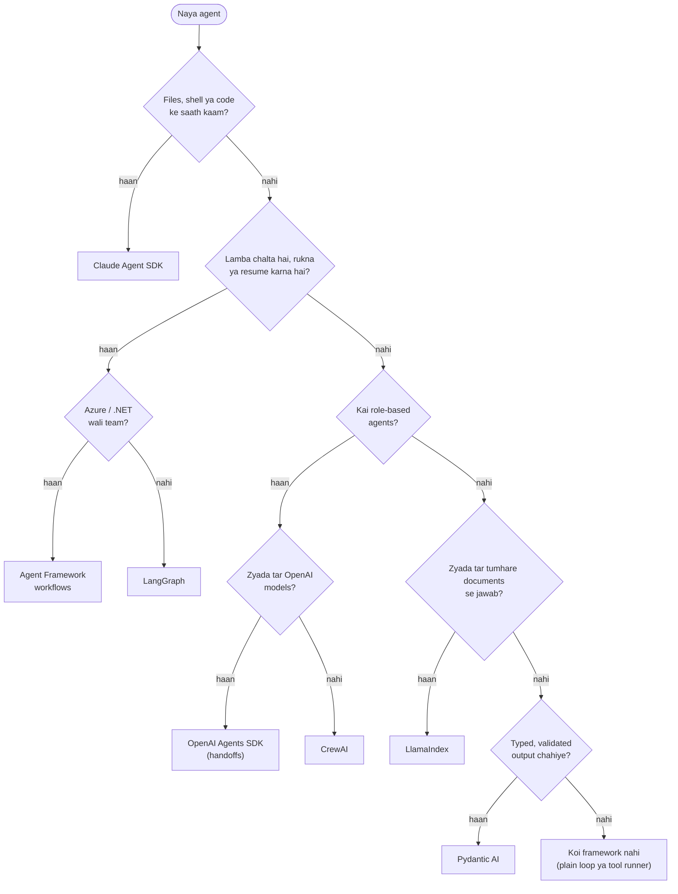

🏠 [Home](../../README.md) › [11 · Frameworks](./README.md) › 11.10 Framework kaise choose karo

# 11.10 Framework kaise choose karo

> **Level:** 🟢 Beginner · **Padhne ka time:** ~8 min · **Pehle padho:** [11.1 Frameworks ka poora naksha](./11.1-framework-landscape.md)

**Ek line mein:** Framework choose karne ke liye apne agent ke baare mein kuch concrete sawalon ka jawab do (use kya karna hai, kitni der chalta hai, kaunse models aur languages use karte ho, aur kya test kar sakte ho), aur sabse kam framework se shuru karo jo un jawabon ko poora kare.

📑 **Is page par**

- [Yeh kyun zaroori hai?](#-yeh-kyun-zaroori-hai)
- [Idea, simple words mein](#-idea-simple-words-mein)
- [Diagram se samjho](#-diagram-se-samjho)
- [Kaise kaam karta hai, step by step](#-kaise-kaam-karta-hai-step-by-step)
- [Example se samjho](#-example-se-samjho)
- [Code](#-code)
- [Aam galtiyan aur dhyan dene wali baatein](#-aam-galtiyan-aur-dhyan-dene-wali-baatein)
- [Yaad rakhne wali baatein](#-yaad-rakhne-wali-baatein)
- [Khud try karo](#-khud-try-karo)
- [Aur padhne ke liye](#-aur-padhne-ke-liye)

## 🤔 Yeh kyun zaroori hai?

Launch ke baad framework badalna mehnga padta hai: prompts, tools, tests, tracing aur deployment sab shift karne padte hain. Teams aksar pehle hafte mein hi choose kar leti hain, jab unke paas sabse kam information hoti hai.

Tum sab kuch predict nahi kar sakte. Lekin sabse zaroori sawal pooch sakte ho aur unke jawab likh ke rakh sakte ho. Yeh page baaki chapter ko unhi sawalon mein badal deta hai.

## 🧠 Idea, simple words mein

Ise trip ke liye transport chunne jaisa socho. Paidal, cycle, car aur train sab tumhe pahuncha dete hain. Kaunsa sahi hai yeh distance, saamaan, kitne log saath aa rahe hain aur raaste mein rukna hai ya nahi, is par depend karta hai. Koi nahi poochta "sabse best kaunsa hai?"; sab poochte hain "is trip ko kya chahiye?". Ghar se kirana dukaan tak train nahi pakadte, aur Delhi se Mumbai cycle se nahi jaate.

Agents ke saath bhi yahi hai. Neeche ke sawal woh cheezein cover karte hain jo is chapter ke frameworks ko sach mein alag karti hain. Practice mein hum yeh rule suggest karte hain: **sabse kam framework se shuru karo jo tumhare jawabon ko poora kare**, aur upar tabhi jao jab koi asli zaroorat aaye. Ek plain loop jise baad mein replace karo, woh ek din ka kharcha hai; ek bhaari framework jiski zaroorat nahi thi, woh har din ka kharcha hai.

| Sawal | Agar jawab hai… | Iski taraf jhuko |
| --- | --- | --- |
| Kya agent ko files, shell ya codebase ke saath kaam karna hai? | Haan | [Claude Agent SDK](./11.6-claude-agent-sdk.md) (ek harness jisme yeh tools aur permissions built-in hain) |
| Kya runs ko restarts jhelne hain, logon ke liye rukna hai, ya ghanton chalna hai? | Haan | [LangGraph](./11.2-langgraph.md) ya [Agent Framework workflows](./11.4-microsoft-autogen-and-agent-framework.md) |
| Kya main kaam tumhare apne documents se jawab dena hai? | Haan | [LlamaIndex](./11.7-llamaindex-agents.md) |
| Kya output doosre code ke liye validated, typed object hona chahiye? | Haan | [Pydantic AI](./11.8-pydantic-ai.md) (ya OpenAI Agents SDK mein `output_type`) |
| Kya tumhe roles wale kai agents chahiye jo ek doosre ko kaam saunpein? | Haan, aur readability sabse zaroori hai | [CrewAI](./11.3-crewai.md) ya [OpenAI Agents SDK handoffs](./11.5-openai-agents-sdk.md) |
| Kya tum Azure, .NET par ho, ya AutoGen ya Semantic Kernel se migrate kar rahe ho? | Haan | [Microsoft Agent Framework](./11.4-microsoft-autogen-and-agent-framework.md) |
| Kya tum zyada tar OpenAI models par ho aur tracing aur guardrails built-in chahiye? | Haan | [OpenAI Agents SDK](./11.5-openai-agents-sdk.md) |
| Kya yeh bas ek agent hai jiske paas kuch hi tools hain? | Haan | [Koi framework nahi](./11.9-the-no-framework-approach.md), ya Anthropic SDK ka tool runner |

Phir jo bhi chuna, uske practical constraints check karo:

- **Models.** Kya yeh har woh provider support karta hai jo tumhe chahiye, structured output aur parallel tool calls jaise features ke saath? (Claude Agent SDK: sirf Claude. OpenAI Agents SDK: OpenAI par sabse achha.)
- **Language.** Sirf Python, ya TypeScript ya .NET bhi?
- **Testing.** Kya offline tests ke liye isme [fake model](../../GLOSSARY.md#fake-model) hai? (Zyada tar mein hai; [11.1](./11.1-framework-landscape.md#-example-se-samjho) ki table dekho.)
- **Data aur telemetry.** Traces default mein kahan jaate hain? Kya tum use band kar sakte ho?
- **Health.** Kya yeh actively maintained hai? (AutoGen archived hai.) Breaking changes kitni baar aate hain?
- **Licence aur terms.** Zyada tar MIT; Claude Agent SDK ka use Anthropic ke Commercial Terms ke under aata hai.

## 👀 Diagram se samjho



*Yeh ek starting point hai, pakka rule nahi. Kai projects ek se zyada branch se match karte hain; pehle "haan" ko apni shortlist samjho, phir models, language, testing aur licence check karo. Aur jo bhi chuno, pehle single-agent: "kai agents" wale zyada tar ideas achhe tools wale ek agent ki tarah better chalte hain ([10.6](../10-multi-agent-systems/10.6-when-multi-agent-makes-things-worse.md)).*

## 🔍 Kaise kaam karta hai, step by step

Ek ghante ka selection process jo practice mein achha kaam karta hai:

1. **Kaam ko ek paragraph mein likho.** Agent kya karta hai, kiske liye, use kaunse tools chahiye, aur ek run kitni der leta hai.
2. **Sawalon wali table ka jawab do.** Har row ke liye "haan", "nahi" ya "abhi nahi" likho. "Abhi nahi" ka matlab: design aisa rakho ki baad mein jod sako, lekin abhi uska kharcha mat uthao.
3. **Do options shortlist karo.** Aam taur par ek framework aur no-framework baseline.
4. **Dono mein same chhota agent banao.** Is chapter ka weather agent achhe size ka hai: do tools, teen model calls. Har framework ka fake model use karo taaki kuch kharcha na ho.
5. **Score karo** is par ki padhna, test karna, debug karna aur badalna kitna aasaan tha. Is par nahi ki kitni kam lines lagi.
6. **Constraints list check karo** (models, language, testing, telemetry, health, licence).
7. **Decision record karo**, reasons ke saath, apni repository mein, aur woh exact versions bhi jo tumne pin kiye. Jab woh reasons sach nahi rahe, dobara socho.

## 💡 Example se samjho

Teen teams, teen jawab.

**Team A: ek internal "flaky test theek karo" bot.** Yeh repository padhta hai, tests chalata hai, code edit karta hai aur pull request kholta hai. Sawal 1 ka jawab saaf haan hai. Choice: **Claude Agent SDK**, jisme `tools` read, edit aur ek restricted shell tak limited hain, safe tools ke liye `allowed_tools`, aur ek hook jo `main` par `git push` block karta hai. Plain loop ka matlab hota file, shell aur permission tools scratch se likhna.

**Team B: ek loan-application assistant.** Yeh kai dinon tak documents ikattha karta hai, ek [human underwriter](../../GLOSSARY.md#human-in-the-loop-hitl) ko approve karna hota hai, aur service baar baar redeploy hoti hai. Sawal 2 ka jawab haan hai; team AWS par Python use karti hai. Choice: **LangGraph**, database checkpointer ke saath aur approval step se pehle ek interrupt ke saath. Graph diagram hi woh document ban jaata hai jis par compliance team sign off karti hai.

**Team C: ek meeting-notes extractor.** Yeh transcript ko task tracker ke liye `{"decisions": [...], "action_items": [{"owner", "due"}]}` mein badalta hai. Ek model call, shayad logon ko dhoondhne ke liye ek tool. Sirf sawal 5 ka jawab haan hai. Choice: `output_type` ke saath **Pydantic AI**, ya bas structured output wala ek plain call. Kisi [multi-agent](../../GLOSSARY.md#multi-agent-system) framework ki zaroorat nahi.

Har team ne same sawalon ka jawab diya. Alag jawab, alag tools.

## 💻 Code

Compare karne ka sabse tez tarika: same agent ko har candidate se guzaro, har ek apne virtual environment mein pinned versions ke saath installed ho. Har candidate ko same check do, uske apne fake model ke against, taaki barabar ki cheez barabar se compare ho:

```python
QUESTION = "Is it warmer in Paris or Rome right now, and by how much?"
EXPECTED_TOOL_CALLS = [
    ("get_weather", {"city": "Paris"}),
    ("get_weather", {"city": "Rome"}),
    ("calculator", {"expression": "19 - 14"}),
]


def check_candidate(run_agent) -> None:
    """`run_agent(question)` ek framework ke agent ko uske fake model par chalata hai aur (answer, tool_calls) return karta hai."""
    answer, tool_calls = run_agent(QUESTION)
    assert tool_calls == EXPECTED_TOOL_CALLS
    assert "Rome" in answer and "5" in answer
```

Har framework ke liye `run_agent` likhna hi asli test hai: answer aur tool calls bahar nikaalne mein kitna glue code laga? Phir candidates ka agent code aur tests saath saath padho. Khud se poocho: raat 2 baje main kise debug karna pasand karunga?

No-framework baseline [11.9](./11.9-the-no-framework-approach.md) wala plain loop hai.

## 🚨 Aam galtiyan aur dhyan dene wali baatein

- **Demo ke liye choose karna, kaam ke liye nahi.** Jo framework paanch-agent demo ko shaandaar dikhata hai, woh ek-agent product mein shayad kuch na jode.
- **Pehle multi-agent choose karna.** Zyada agents matlab zyada cost, latency aur failure points. Doosra agent jodne se pehle sabit karo ki ek agent yeh nahi kar sakta ([10.1](../10-multi-agent-systems/10.1-why-multiple-agents.md)).
- **Testing ko ignore karna.** Agar tum apna agent CI mein offline nahi chala sakte, toh tum use test karna band kar doge. Pehle din hi fake model check karo ([12.5](../12-evaluation/12.5-regression-testing-in-ci.md)).
- **Apni business logic ko framework mein lock kar dena.** Tools ko plain functions aur prompts ko plain strings rakho, taaki baad mein switch karne par sirf glue code shift ho, tumhara product nahi.
- **Versions pin na karna.** Yahan ke har framework ne pichle saal kuch na kuch important badla hai. Pin karo, aur soch samajh ke upgrade karo.
- **Bahar nikalne ka kharcha bhool jaana.** Commit karne se pehle poocho "hum kaise niklenge?": traces, stored state aur deployment tooling shift karne mein sabse mushkil hote hain.

## ✅ Yaad rakhne wali baatein

- Sawalon se choose karo, popularity se nahi: files aur shell, durability, documents, typed output, roles, platform, provider.
- Sabse kam framework se shuru karo jo tumhare jawab poore kare; no-framework loop ek asli option hai.
- Do shortlist karo, dono mein fake models ke saath same chhota agent banao, aur readability aur testability judge karo.
- Practical constraints check karo: models, language, testing, telemetry, maintenance aur licence.
- Tools aur prompts ko framework-free rakho taaki baad mein tum apna mann badal sako.

## 🧪 Khud try karo

1. Is agent ke liye sawalon wali table use karo: *"A Slack bot that answers HR policy questions from 300 internal PDFs and can open a ticket in the HR system."* Matlab ek Slack bot jo 300 internal PDFs se HR policy ke sawalon ka jawab de aur HR system mein ticket khol sake. Tum kya shortlist karoge?
2. Tumhari team ne paanch-agent research crew ke liye CrewAI chuna. Cost zyada hai aur answers ek single agent se better nahi hain. Tum pehle kya try karoge?

<details>
<summary>Answer dekho</summary>

1. "Zyada tar tumhare apne documents se jawab" ka jawab haan hai, isliye LlamaIndex shortlist mein jaata hai (PDFs par ek query-engine tool plus ek `open_ticket` function tool). Baaki sawalon ke jawab zyada tar "nahi" hain: chhote runs, ek agent, plain text output. Isliye doosra option hai provider SDK ke upar ek plain loop, tumhare khud likhe retrieval tool ke saath ([chapter 06](../06-rag-for-agents/README.md)). Dono mein same chhota bot banao aur compare karo.
2. Crew ko ek agent mein samet do, jisme har role ke best tools hon, aur same evaluation set par answer quality aur cost measure karo ([12.4](../12-evaluation/12.4-building-an-eval-dataset.md)). Agar ek agent crew ke barabar hai, toh use hi rakho. CrewAI ek-agent crew bhi chala sakta hai, isliye shayad tumhe framework badalna hi na pade.

</details>

## 📚 Aur padhne ke liye

- [Building effective agents](https://www.anthropic.com/engineering/building-effective-agents) (Anthropic). Kab workflows use karo aur kab agents, aur kab frameworks skip karo.
- [Microsoft Agent Framework overview](https://learn.microsoft.com/en-us/agent-framework/overview/). Isme ek saaf "agents vs workflows" decision table hai.
- [LangGraph overview](https://docs.langchain.com/oss/python/langgraph/overview). LangChain kab LangGraph suggest karta hai aur kab higher-level agents.
- [Agent SDK overview](https://code.claude.com/docs/en/agent-sdk/overview). Agent SDK, CLI, client SDK aur Managed Agents ke beech choose karne ke liye Anthropic ki apni guide.

<!-- FOOTER -->

---

⬅️ **Pichla:** [11.9 Bina framework wala tarika](./11.9-the-no-framework-approach.md) ·
🏠 [Chapter home](./README.md) ·
➡️ **Agla:** [12 · Evaluation → 12.1 Agents ke evals mushkil kyun hain?](../12-evaluation/12.1-why-agent-evals-are-hard.md)
