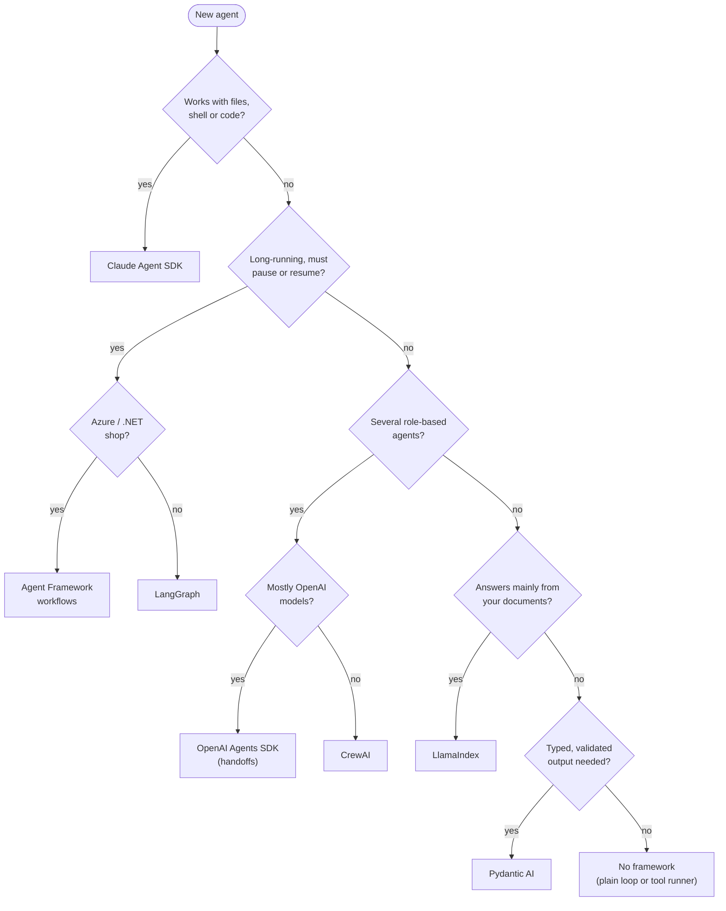

🏠 [Home](../../README.md) › [11 · Frameworks](./README.md) › 11.10 How to choose a framework

# 11.10 How to choose a framework

> **Difficulty:** 🟢 Beginner · **Reading time:** ~8 min · **Prerequisites:** [11.1 Framework landscape](./11.1-framework-landscape.md)

**In one sentence:** Choose a framework by answering a few concrete questions about your agent (what it must do, how long it runs, which models and languages you use, and what you can test), and start with the least framework that meets the answers.

📑 **On this page**

- [Why does this matter?](#-why-does-this-matter)
- [The idea, in plain words](#-the-idea-in-plain-words)
- [Picture it](#-picture-it)
- [How it works, step by step](#-how-it-works-step-by-step)
- [Worked example](#-worked-example)
- [Code](#-code)
- [Common mistakes & gotchas](#-common-mistakes--gotchas)
- [Key takeaways](#-key-takeaways)
- [Try it yourself](#-try-it-yourself)
- [Further reading](#-further-reading)

## 🤔 Why does this matter?

Switching frameworks after launch is expensive: prompts, tools, tests, tracing and deployment all have to move. Teams usually choose in the first week, with the least information they will ever have.

You can't predict everything, but you can ask the questions that matter most and write the answers down. This page turns the rest of the chapter into those questions.

## 🧠 The idea, in plain words

Think of it like choosing transport for a trip. A walk, a bike, a car and a train all get you there. Which one is right depends on distance, luggage, how many people come along and whether you want to stop on the way. Nobody asks "which is best?"; they ask "what does this trip need?".

The same goes for agents. The questions below cover the things that actually separate the frameworks in this chapter. In practice, we recommend this rule: **start with the least framework that meets your answers**, and move up only when you hit a real need. A plain loop that you later replace costs a day; a heavy framework you didn't need costs every day.

| Question | If the answer is… | Lean towards |
| --- | --- | --- |
| Does the agent need to work with files, a shell or a codebase? | Yes | [Claude Agent SDK](./11.6-claude-agent-sdk.md) (a harness with those tools and permissions built in) |
| Must runs survive restarts, pause for people, or last hours? | Yes | [LangGraph](./11.2-langgraph.md) or [Agent Framework workflows](./11.4-microsoft-autogen-and-agent-framework.md) |
| Is the main job answering from your own documents? | Yes | [LlamaIndex](./11.7-llamaindex-agents.md) |
| Must the output be a validated, typed object for other code? | Yes | [Pydantic AI](./11.8-pydantic-ai.md) (or `output_type` in the OpenAI Agents SDK) |
| Do you need several agents with roles that hand work to each other? | Yes, and readability matters most | [CrewAI](./11.3-crewai.md) or [OpenAI Agents SDK handoffs](./11.5-openai-agents-sdk.md) |
| Are you on Azure, .NET, or migrating from AutoGen or Semantic Kernel? | Yes | [Microsoft Agent Framework](./11.4-microsoft-autogen-and-agent-framework.md) |
| Are you mostly on OpenAI models and want tracing and guardrails built in? | Yes | [OpenAI Agents SDK](./11.5-openai-agents-sdk.md) |
| Is it one agent with a handful of tools? | Yes | [No framework](./11.9-the-no-framework-approach.md), or the Anthropic SDK tool runner |

Then check the practical constraints for whatever you picked:

- **Models.** Does it support every provider you need, including features like structured output and parallel tool calls? (Claude Agent SDK: Claude only. OpenAI Agents SDK: best on OpenAI.)
- **Language.** Python only, or also TypeScript or .NET?
- **Testing.** Does it have a [fake model](../../GLOSSARY.md#fake-model) for offline tests? (Most do; see the table in [11.1](./11.1-framework-landscape.md#-worked-example).)
- **Data and telemetry.** Where do traces go by default? Can you switch it off?
- **Health.** Is it actively maintained? (AutoGen is archived.) How often do breaking changes land?
- **Licence and terms.** MIT for most; the Claude Agent SDK's use is governed by Anthropic's Commercial Terms.

## 👀 Picture it



*A starting point, not a law. Many projects match more than one branch; take the first "yes" as your shortlist, then check models, language, testing and licence. And whatever you pick, single-agent first: most "several agents" ideas work better as one agent with good tools ([10.6](../10-multi-agent-systems/10.6-when-multi-agent-makes-things-worse.md)).*

## 🔍 How it works, step by step

A one-hour selection process that works well in practice:

1. **Write the job down in one paragraph.** What the agent does, for whom, which tools it needs, and how long a run takes.
2. **Answer the question table.** Write "yes", "no" or "not yet" for each row. "Not yet" means: design so you could add it, but don't pay for it now.
3. **Shortlist two options.** Usually one framework and the no-framework baseline.
4. **Build the same small agent in both.** This chapter's weather agent is a good size: two tools, three model calls. Use each framework's fake model so it costs nothing.
5. **Score them** on how easy it was to read, test, debug and change, not on how few lines it took.
6. **Check the constraints list** (models, language, testing, telemetry, health, licence).
7. **Record the decision** and the reasons in your repository, with the exact versions you pinned. When the reasons stop being true, revisit it.

## 💡 Worked example

Three teams, three answers.

**Team A: an internal "fix the flaky test" bot.** It reads the repository, runs tests, edits code and opens a pull request. Question 1 is a clear yes. Choice: **Claude Agent SDK**, with `tools` limited to read, edit and a restricted shell, `allowed_tools` for the safe ones, and a hook that blocks `git push` to `main`. A plain loop would mean writing file, shell and permission tools from scratch.

**Team B: a loan-application assistant.** It gathers documents over several days, a [human underwriter](../../GLOSSARY.md#human-in-the-loop-hitl) must approve, and the service is redeployed often. Question 2 is a yes; the team uses Python on AWS. Choice: **LangGraph** with a database checkpointer and an interrupt before the approval step. The graph diagram also becomes the document the compliance team signs off.

**Team C: a meeting-notes extractor.** It turns a transcript into `{"decisions": [...], "action_items": [{"owner", "due"}]}` for a task tracker. One model call, maybe one tool to look up people. Only question 5 is a yes. Choice: **Pydantic AI** with an `output_type`, or simply a plain call with structured output. No [multi-agent](../../GLOSSARY.md#multi-agent-system) framework needed.

Each team answered the same questions. Different answers, different tools.

## 💻 Code

The fastest way to compare is to put the same agent through each candidate. Every example in this chapter has the same shape, so you can run them side by side, each in its own environment:

```bash
cd examples
python -m venv 11-pydantic-ai/.venv
source 11-pydantic-ai/.venv/bin/activate        # Windows: 11-pydantic-ai\.venv\Scripts\activate
pip install -r 11-pydantic-ai/requirements.txt
python 11-pydantic-ai/main.py
python -m pytest 11-pydantic-ai
deactivate
# ...then the same for 11-langgraph and 11-openai-agents-sdk
```

Then read the three `main.py` files and the three `tests/test_main.py` files next to each other. Ask: which one would I rather debug at 2 a.m.?

The no-framework baseline is [`examples/01-anatomy-of-an-agent`](../../examples/01-anatomy-of-an-agent/README.md), which needs only the shared `examples/requirements.txt`.

## 🚨 Common mistakes & gotchas

- **Choosing for the demo, not the job.** A framework that makes a five-agent demo look great may add nothing for a one-agent product.
- **Choosing multi-agent first.** More agents means more cost, latency and failure points. Prove one agent can't do it before adding a second ([10.1](../10-multi-agent-systems/10.1-why-multiple-agents.md)).
- **Ignoring testing.** If you can't run your agent offline in CI, you will stop testing it. Check for a fake model on day one ([12.5](../12-evaluation/12.5-regression-testing-in-ci.md)).
- **Locking your business logic into the framework.** Keep tools as plain functions and prompts as plain strings, so a later switch moves glue code, not your product.
- **Not pinning versions.** Every framework here changed something important in the last year. Pin, and upgrade on purpose.
- **Forgetting the exit cost.** Ask "how would we leave?" before you commit: traces, stored state and deployment tooling are the hardest parts to move.

## ✅ Key takeaways

- Choose by questions, not popularity: files and shell, durability, documents, typed output, roles, platform, provider.
- Start with the least framework that meets your answers; the no-framework loop is a real option.
- Shortlist two, build the same small agent in both with fake models, and judge readability and testability.
- Check the practical constraints: models, language, testing, telemetry, maintenance and licence.
- Keep tools and prompts framework-free so you can change your mind later.

## 🧪 Try it yourself

1. Use the question table for this agent: *"A Slack bot that answers HR policy questions from 300 internal PDFs and can open a ticket in the HR system."* What would you shortlist?
2. Your team chose CrewAI for a five-agent research crew. Costs are high and answers are no better than a single agent's. What do you try first?

<details>
<summary>Show answer</summary>

1. "Answers mainly from your own documents" is yes, so LlamaIndex goes on the shortlist (a query-engine tool over the PDFs plus an `open_ticket` function tool). The other questions are mostly "no": short runs, one agent, plain text output. So the second option is a plain loop over the provider SDK with a retrieval tool you write ([chapter 06](../06-rag-for-agents/README.md)). Build the same small bot in both and compare.
2. Collapse the crew into one agent with the best tools from each role, and measure answer quality and cost on the same evaluation set ([12.4](../12-evaluation/12.4-building-an-eval-dataset.md)). If one agent matches the crew, keep it. CrewAI can still run a one-agent crew, so you may not need to change framework at all.

</details>

## 📚 Further reading

- [Building effective agents](https://www.anthropic.com/engineering/building-effective-agents) (Anthropic). When to use workflows versus agents, and when to skip frameworks.
- [Microsoft Agent Framework overview](https://learn.microsoft.com/en-us/agent-framework/overview/). Includes a clear "agents versus workflows" decision table.
- [LangGraph overview](https://docs.langchain.com/oss/python/langgraph/overview). When LangChain suggests LangGraph versus higher-level agents.
- [Agent SDK overview](https://code.claude.com/docs/en/agent-sdk/overview). Anthropic's own guide to choosing between the Agent SDK, the CLI, the client SDK and Managed Agents.

<!-- FOOTER -->

---

⬅️ **Previous:** [11.9 The no-framework approach](./11.9-the-no-framework-approach.md) ·
🏠 [Chapter home](./README.md) ·
➡️ **Next:** [12 · Evaluation → 12.1 Why evals are hard for agents](../12-evaluation/12.1-why-agent-evals-are-hard.md)
