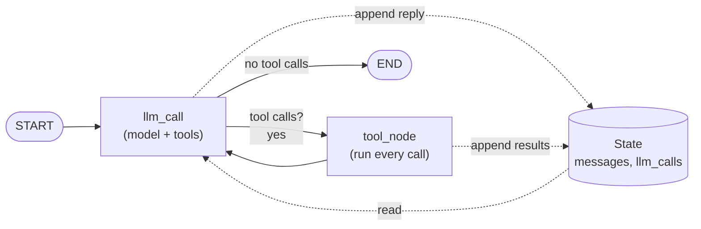

🏠 [Home](../../README.md) › [11 · Frameworks](./README.md) › 11.2 LangGraph

# 11.2 LangGraph

> **Difficulty:** 🟡 Intermediate · **Reading time:** ~15 min · **Prerequisites:** [11.1 Framework landscape](./11.1-framework-landscape.md), [1.5 Anatomy of an agent](../01-foundations/01.5-anatomy-of-an-agent.md)
>
> Last verified: November 2026 with langgraph==1.2.21

**In one sentence:** LangGraph builds an agent as a graph: nodes do the work, edges decide what runs next, and one shared state object carries everything the agent knows, so you can see, save and resume every step.

📑 **On this page**

- [Why does this matter?](#-why-does-this-matter)
- [The idea, in plain words](#-the-idea-in-plain-words)
- [Picture it](#-picture-it)
- [How it works, step by step](#-how-it-works-step-by-step)
- [Worked example](#-worked-example)
- [Code](#-code)
- [Common mistakes & gotchas](#-common-mistakes--gotchas)
- [Key takeaways](#-key-takeaways)
- [Try it yourself](#-try-it-yourself)
- [Further reading](#-further-reading)

## 🤔 Why does this matter?

An insurance company's claims agent gathers documents, checks the policy, and drafts a payout. Before any money moves, a human must approve. The approver might answer in five minutes or on Monday. Meanwhile the server restarts twice.

A plain `while` loop keeps its state in local variables, so a restart loses everything. You need the agent's progress saved after every step, a way to pause for a person, and a clear picture of which step comes next. That is what LangGraph is for.

## 🧠 The idea, in plain words

LangGraph describes itself as a "low-level orchestration framework and runtime for long-running, stateful agents". In plain words: you draw your agent as a flowchart, and LangGraph runs the flowchart.

A [state graph](../../GLOSSARY.md#state-graph) has three parts:

| Part | What it is | In the weather agent |
| --- | --- | --- |
| **State** | A typed dictionary every step can read and update | `messages` (the conversation) and `llm_calls` (a counter) |
| **Nodes** | Plain Python functions: take the state, return an update | `llm_call` (ask the model) and `tool_node` (run tools) |
| **Edges** | What runs next. Normal edges always go; conditional edges pick a branch | `START → llm_call`; `llm_call → tool_node or END`; `tool_node → llm_call` |

Think of a board game. The state is the board. Each node is a player's move. The edges are the rules for whose turn is next. Because the board is one object, you can photograph it after every move (a [checkpoint](../../GLOSSARY.md#checkpoint)) and pick the game up later.

Notice what LangGraph does *not* do: it does not write your prompt or decide your agent's architecture. The [agent loop](../../GLOSSARY.md#agent-loop) from [chapter 02](../02-the-agent-loop/README.md) is just a cycle in the graph, and you draw it yourself. If you want a ready-made loop, LangChain's `create_agent` builds one on top of LangGraph (shown in [Code](#-code)).

## 👀 Picture it



*The loop from chapter 02 is now visible as a cycle between two nodes. Every node reads the shared state and returns only the part it changes; LangGraph merges the update.*

## 🔍 How it works, step by step

1. **Define the state.** A `TypedDict`. `Annotated[list[AnyMessage], operator.add]` tells LangGraph to *append* new messages instead of replacing the list. This merge rule is called a reducer.
2. **Write the nodes.** Each node is a function `state -> dict`. `llm_call` sends the system prompt plus `state["messages"]` to the model. `tool_node` runs every tool call in the last message and returns one `ToolMessage` per call.
3. **Draw the edges.** `add_edge(START, "llm_call")`, a conditional edge from `llm_call` that returns `"tool_node"` or `END`, and `add_edge("tool_node", "llm_call")` to close the loop.
4. **Compile.** `builder.compile()` checks the graph and returns a runnable. Pass a `checkpointer` here to save state after every step.
5. **Invoke.** `graph.invoke({"messages": [...]}, config)`. LangGraph runs node after node until it reaches `END`. The `recursion_limit` in the config caps the number of steps, which is your safety net.
6. **Persist and resume (optional).** With a checkpointer and a `thread_id` in the config, every step is saved. `graph.get_state(config)` shows the latest state; [interrupts](https://docs.langchain.com/oss/python/langgraph/interrupts) pause the graph for a human and resume it later.

## 💡 Worked example

From [`examples/11-langgraph`](../../examples/11-langgraph/README.md), run offline with a scripted fake chat model. Streaming the graph with `stream_mode="updates"` shows which node ran at each step:

```text
step 1  llm_call   -> AI asks for get_weather(Paris) and get_weather(Rome)
step 2  tool_node  -> two ToolMessages: {"city": "Paris", "temp_c": 14}, {"city": "Rome", "temp_c": 19}
step 3  llm_call   -> AI asks for calculator("19 - 14")
step 4  tool_node  -> ToolMessage: 5
step 5  llm_call   -> AI answers, no tool calls -> END
```

The printed output of `python 11-langgraph/main.py`:

```text
Goal: Is it warmer in Paris or Rome right now, and by how much?

tool call:   get_weather({"city": "Paris"})
tool call:   get_weather({"city": "Rome"})
tool result: {"city": "Paris", "temp_c": 14}
tool result: {"city": "Rome", "temp_c": 19}
tool call:   calculator({"expression": "19 - 14"})
tool result: 5

Answer: Rome is warmer: 19°C versus 14°C in Paris, a difference of 5°C.
Model calls: 3
```

With a checkpointer and `thread_id="user-42"`, the saved state after the run holds 7 messages: the question, three model replies and three tool results. A second `invoke` on the same thread starts from those 7, which is how LangGraph gives an agent [short-term memory](../../GLOSSARY.md#short-term-memory) across requests.

## 💻 Code

The plain-Python loop from [1.5](../01-foundations/01.5-anatomy-of-an-agent.md#-code) hides its control flow inside a `for` loop. Here the same agent is a graph. Condensed from the example, which follows the official [LangGraph quickstart](https://docs.langchain.com/oss/python/langgraph/quickstart):

```python
import operator
from typing import Annotated, Literal

from langchain.chat_models import init_chat_model
from langchain.messages import AnyMessage, HumanMessage, SystemMessage, ToolMessage
from langchain.tools import tool
from langgraph.graph import END, START, StateGraph
from typing_extensions import TypedDict


@tool
def get_weather(city: str) -> str:
    """Get the current temperature in °C for one city.

    Args:
        city: City name, e.g. 'Paris'.
    """
    ...  # calculator is defined the same way

TOOLS_BY_NAME = {t.name: t for t in [get_weather, calculator]}
model = init_chat_model("anthropic:claude-opus-5-5")  # or "openai:<model>"; needs an API key
model_with_tools = model.bind_tools(list(TOOLS_BY_NAME.values()))


class State(TypedDict):
    messages: Annotated[list[AnyMessage], operator.add]  # reducer: append, don't replace
    llm_calls: int


def llm_call(state: State) -> dict:
    reply = model_with_tools.invoke([SystemMessage(content=INSTRUCTIONS)] + state["messages"])
    return {"messages": [reply], "llm_calls": state.get("llm_calls", 0) + 1}


def tool_node(state: State) -> dict:
    results = []
    for call in state["messages"][-1].tool_calls:
        output = TOOLS_BY_NAME[call["name"]].invoke(call["args"])
        results.append(ToolMessage(content=output, tool_call_id=call["id"]))
    return {"messages": results}


def should_continue(state: State) -> Literal["tool_node", "__end__"]:
    return "tool_node" if state["messages"][-1].tool_calls else END


builder = StateGraph(State)
builder.add_node("llm_call", llm_call)
builder.add_node("tool_node", tool_node)
builder.add_edge(START, "llm_call")
builder.add_conditional_edges("llm_call", should_continue, ["tool_node", END])
builder.add_edge("tool_node", "llm_call")
graph = builder.compile()  # compile(checkpointer=InMemorySaver()) to save every step

final = graph.invoke(
    {"messages": [HumanMessage(content=GOAL)], "llm_calls": 0},
    {"recursion_limit": 12},  # safety net: at most 12 node visits
)
print(final["messages"][-1].text)
```

If you don't need a custom graph, LangChain's prebuilt agent builds the same loop for you (verified with the same fake model):

```python
from langchain.agents import create_agent

agent = create_agent(model, tools=[get_weather, calculator], system_prompt=INSTRUCTIONS)
result = agent.invoke({"messages": [{"role": "user", "content": GOAL}]})
```

**Testing offline.** LangChain's [unit-testing guide](https://docs.langchain.com/oss/python/langchain/test/unit-testing) recommends `GenericFakeChatModel` with a subclass whose `bind_tools` returns the model unchanged. The example does exactly that:

```python
class FakeToolCallingModel(GenericFakeChatModel):
    def bind_tools(self, tools, **kwargs):
        return self

model = FakeToolCallingModel(messages=iter([
    AIMessage(content="", tool_calls=[ToolCall(name="get_weather", args={"city": "Paris"}, id="call_1"), ...]),
    AIMessage(content="", tool_calls=[ToolCall(name="calculator", args={"expression": "19 - 14"}, id="call_3")]),
    AIMessage(content="Rome is warmer: 19°C versus 14°C in Paris, a difference of 5°C."),
]))
```

Full runnable version, install commands and 6 tests: [`examples/11-langgraph`](../../examples/11-langgraph/README.md).

## 🚨 Common mistakes & gotchas

- **Forgetting the reducer.** Without `Annotated[..., operator.add]`, each node's `messages` *replaces* the list and the model loses the conversation. **Fix:** use a reducer (or LangGraph's built-in `MessagesState`).
- **Returning the whole state from a node.** Nodes should return only what changed. Returning everything with a reducer duplicates messages.
- **No recursion limit thinking.** A graph that loops forever stops with `GraphRecursionError` when it hits `recursion_limit`. Set it on purpose and catch the error, rather than discovering the default in production.
- **Using `InMemorySaver` in production.** It lives in one process and vanishes on restart. **Fix:** use a database-backed checkpointer ([persistence docs](https://docs.langchain.com/oss/python/langgraph/persistence); see also [15.4](../15-production-and-deployment/15.4-state-persistence-and-resumability.md)).
- **Reusing a fake model across tests.** `GenericFakeChatModel` reads from an iterator, and an exhausted iterator cannot be reused. Build a fresh one per test.
- **Mixing up LangChain and LangGraph.** LangGraph is the runtime; LangChain supplies model and tool integrations and higher-level agents. You can use LangGraph with plain Python nodes and no LangChain models at all.

## ✅ Key takeaways

- LangGraph models an agent as **state + nodes + edges**; the agent loop is a cycle you draw.
- The shared state, merged by reducers, is what makes runs inspectable, saveable and resumable.
- Checkpointers plus a `thread_id` give persistence, memory across requests and [human-in-the-loop](../../GLOSSARY.md#human-in-the-loop-hitl) pauses.
- It is low-level by design: more code than an agent SDK, but nothing about control flow is hidden.
- Test offline with a fake chat model; the graph and tools still run for real.

### Pros and cons

| Pros | Cons |
| --- | --- |
| Explicit, visible control flow; you can draw the graph | More code and concepts (state, reducers, edges) than an agent SDK |
| Durable execution: checkpoints, resume, human-in-the-loop | The LangChain ecosystem is large and its APIs have moved over time |
| Any topology: loops, branches, parallel steps, subgraphs, multi-agent | You design the agent's architecture yourself |
| Model-agnostic through LangChain integrations, or plain Python | The smoothest tracing and deployment story is LangSmith, a separate product |

### When to choose it

- Long-running or multi-step processes that must survive restarts or wait for people.
- Agents where you need to control exactly which step runs next, such as approval flows or routers ([chapter 09](../09-agent-design-patterns/README.md)).
- [Multi-agent systems](../../GLOSSARY.md#multi-agent-system) with a custom shape ([chapter 10](../10-multi-agent-systems/README.md)).
- Skip it for a simple tool-calling assistant; an agent SDK or a plain loop is shorter.

## 🧪 Try it yourself

1. In the example, change `recursion_limit` from 12 to 3 and run. What happens, and after which node?
2. Add a third node, `check_answer`, that runs after the model's final reply and appends a warning if the answer has no number in it. Where do the new edges go?

<details>
<summary>Show answer</summary>

1. LangGraph raises `GraphRecursionError`. The run needs 5 node visits (`llm_call`, `tool_node`, `llm_call`, `tool_node`, `llm_call`), so with a limit of 3 it stops after the second `llm_call`, before the calculator result comes back.
2. Change the conditional edge so "no tool calls" goes to `"check_answer"` instead of `END`, then add `builder.add_edge("check_answer", END)`. The node returns `{"messages": [AIMessage(content="Warning: ...")]}` only when needed, and an empty dict otherwise.

</details>

## 📚 Further reading

- [LangGraph overview](https://docs.langchain.com/oss/python/langgraph/overview). What LangGraph is, and how it relates to LangChain and Deep Agents.
- [Graph API overview](https://docs.langchain.com/oss/python/langgraph/graph-api). State, reducers, nodes and edges in depth.
- [LangGraph quickstart](https://docs.langchain.com/oss/python/langgraph/quickstart). The official calculator agent this example's structure follows.
- [Persistence](https://docs.langchain.com/oss/python/langgraph/persistence) and [Interrupts](https://docs.langchain.com/oss/python/langgraph/interrupts). Checkpointers, threads and pausing for a human.
- [Unit testing](https://docs.langchain.com/oss/python/langchain/test/unit-testing). Fake chat models for offline tests.

<!-- FOOTER -->

---

⬅️ **Previous:** [11.1 Framework landscape](./11.1-framework-landscape.md) ·
🏠 [Chapter home](./README.md) ·
➡️ **Next:** [11.3 CrewAI](./11.3-crewai.md)
