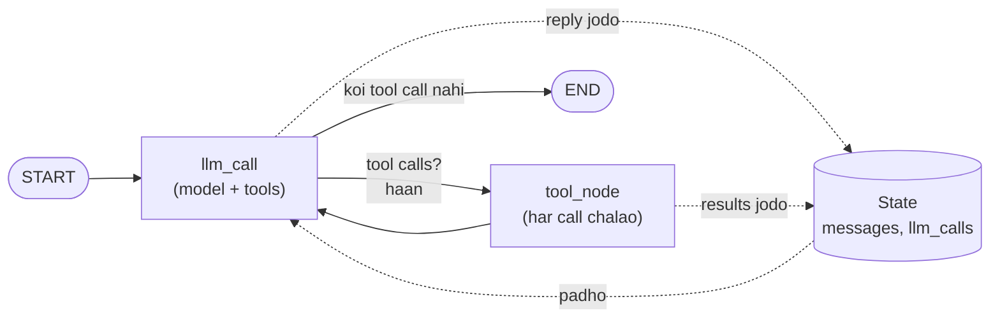

🏠 [Home](../../README.md) › [11 · Frameworks](./README.md) › 11.2 LangGraph

# 11.2 LangGraph

> **Level:** 🟡 Intermediate · **Padhne ka time:** ~15 min · **Pehle padho:** [11.1 Frameworks ka poora naksha](./11.1-framework-landscape.md), [1.5 Agent ke andar kya-kya hota hai](../01-foundations/01.5-anatomy-of-an-agent.md)
>
> Last verified: November 2026 with langgraph==1.2.21

**Ek line mein:** LangGraph agent ko ek graph ki tarah banata hai: nodes kaam karte hain, edges decide karte hain ki aage kya chalega, aur ek shared state object woh sab rakhta hai jo agent jaanta hai, isliye tum har step dekh, save aur resume kar sakte ho.

📑 **Is page par**

- [Yeh kyun zaroori hai?](#-yeh-kyun-zaroori-hai)
- [Idea, simple words mein](#-idea-simple-words-mein)
- [Diagram se samjho](#-diagram-se-samjho)
- [Kaise kaam karta hai, step by step](#-kaise-kaam-karta-hai-step-by-step)
- [Example se samjho](#-example-se-samjho)
- [Code](#-code)
- [Aam galtiyan aur dhyan dene wali baatein](#-aam-galtiyan-aur-dhyan-dene-wali-baatein)
- [Yaad rakhne wali baatein](#-yaad-rakhne-wali-baatein)
- [Khud try karo](#-khud-try-karo)
- [Aur padhne ke liye](#-aur-padhne-ke-liye)

## 🤔 Yeh kyun zaroori hai?

Ek insurance company ka claims agent documents ikattha karta hai, policy check karta hai, aur payout ka draft banata hai. Paisa move hone se pehle ek insaan ko approve karna hota hai. Approver paanch minute mein jawab de sakta hai, ya Monday ko. Is beech server do baar restart ho jaata hai.

Ek plain `while` loop apna state local variables mein rakhta hai. Restart hua toh sab gaya. Tumhe chahiye ki har step ke baad agent ki progress save ho. Kisi insaan ke liye rukne ka tarika ho. Aur saaf dikhe ki agla step kaunsa hai. LangGraph isi kaam ke liye hai.

## 🧠 Idea, simple words mein

LangGraph khud ko "low-level orchestration framework and runtime for long-running, stateful agents" kehta hai. Simple words mein: tum apne agent ko ek flowchart ki tarah draw karte ho, aur LangGraph woh flowchart chalata hai.

Ek [state graph](../../GLOSSARY.md#state-graph) ke teen parts hote hain:

| Part | Yeh kya hai | Weather agent mein |
| --- | --- | --- |
| **State** | Ek typed dictionary jise har step padh aur update kar sakta hai | `messages` (conversation) aur `llm_calls` (ek counter) |
| **Nodes** | Plain Python functions: state lo, ek update return karo | `llm_call` (model se poocho) aur `tool_node` (tools chalao) |
| **Edges** | Aage kya chalega. Normal edges hamesha jaate hain; conditional edges ek branch chunte hain | `START → llm_call`; `llm_call → tool_node ya END`; `tool_node → llm_call` |

Ek board game socho, jaise ludo. State board hai. Har node ek player ki chaal hai. Edges rules hain ki agli baari kiski hai. Kyunki board ek hi object hai, tum har chaal ke baad uski photo le sakte ho (ek [checkpoint](../../GLOSSARY.md#checkpoint)) aur game baad mein wahi se continue kar sakte ho.

Dhyan do LangGraph kya *nahi* karta: woh tumhara prompt nahi likhta, aur tumhare agent ka architecture decide nahi karta. [Chapter 02](../02-the-agent-loop/README.md) wala [agent loop](../../GLOSSARY.md#agent-loop) yahan graph mein bas ek cycle hai, aur use tum khud draw karte ho. Agar ready-made loop chahiye, toh LangChain ka `create_agent` LangGraph ke upar ek bana deta hai ([Code](#-code) mein dikhaya hai).

## 👀 Diagram se samjho



*Chapter 02 wala loop ab do nodes ke beech ek cycle ki tarah dikhta hai. Har node shared state padhta hai aur sirf woh hissa return karta hai jo usne badla; LangGraph us update ko merge kar deta hai.*

## 🔍 Kaise kaam karta hai, step by step

1. **State define karo.** Ek `TypedDict`. `Annotated[list[AnyMessage], operator.add]` LangGraph ko batata hai ki naye messages list mein *jodo*, list replace mat karo. Is merge rule ko reducer kehte hain.
2. **Nodes likho.** Har node ek function `state -> dict` hai. `llm_call` system prompt plus `state["messages"]` model ko bhejta hai. `tool_node` last message ke har tool call ko chalata hai aur har call ke liye ek `ToolMessage` return karta hai.
3. **Edges draw karo.** `add_edge(START, "llm_call")`, phir `llm_call` se ek conditional edge jo `"tool_node"` ya `END` return karta hai, aur loop band karne ke liye `add_edge("tool_node", "llm_call")`.
4. **Compile karo.** `builder.compile()` graph check karta hai aur ek runnable return karta hai. Har step ke baad state save karna ho toh yahan `checkpointer` pass karo.
5. **Invoke karo.** `graph.invoke({"messages": [...]}, config)`. LangGraph ek ke baad ek node chalata hai jab tak `END` nahi aa jaata. Config mein `recursion_limit` steps ki ginti par cap lagata hai. Yahi tumhara safety net hai.
6. **Persist aur resume (optional).** Checkpointer aur config mein `thread_id` ho toh har step save hota hai. `graph.get_state(config)` latest state dikhata hai; [interrupts](https://docs.langchain.com/oss/python/langgraph/interrupts) graph ko kisi insaan ke liye rok dete hain aur baad mein resume karte hain.

## 💡 Example se samjho

Ek scripted fake chat model ke saath offline chalao. Graph ko `stream_mode="updates"` ke saath stream karne par dikhta hai ki har step par kaunsa node chala:

```text
step 1  llm_call   -> AI asks for get_weather(Paris) and get_weather(Rome)
step 2  tool_node  -> two ToolMessages: {"city": "Paris", "temp_c": 14}, {"city": "Rome", "temp_c": 19}
step 3  llm_call   -> AI asks for calculator("19 - 14")
step 4  tool_node  -> ToolMessage: 5
step 5  llm_call   -> AI answers, no tool calls -> END
```

Print hua output:

```text
Goal: Is it warmer in Paris or Rome right now, and by how much?

tool call:   get_weather({"city": "Paris"})
tool call:   get_weather({"city": "Rome"})
tool result: {"city": "Paris", "temp_c": 14}
tool result: {"city": "Rome", "temp_c": 19}
tool call:   calculator({"expression": "19 - 14"})
tool result: 5

Answer: Rome is warmer: 19°C versus 14°C in Paris, a difference of 5°C.
Model calls: 3
```

Checkpointer aur `thread_id="user-42"` ke saath, run ke baad saved state mein 7 messages hote hain: sawal, model ke teen replies aur teen tool results. Same thread par doosra `invoke` inhi 7 se shuru hota hai. Isi tarah LangGraph agent ko requests ke beech [short-term memory](../../GLOSSARY.md#short-term-memory) deta hai.

## 💻 Code

[1.5](../01-foundations/01.5-anatomy-of-an-agent.md#-code) wala plain-Python loop apna control flow ek `for` loop ke andar chhupa leta hai. Yahan wahi agent ek graph hai, official [LangGraph quickstart](https://docs.langchain.com/oss/python/langgraph/quickstart) ke hisaab se:

```python
import operator
from typing import Annotated, Literal

from langchain.chat_models import init_chat_model
from langchain.messages import AnyMessage, HumanMessage, SystemMessage, ToolMessage
from langchain.tools import tool
from langgraph.graph import END, START, StateGraph
from typing_extensions import TypedDict


@tool
def get_weather(city: str) -> str:
    """Get the current temperature in °C for one city.

    Args:
        city: City name, e.g. 'Paris'.
    """
    ...  # calculator bhi isi tarah define hota hai

TOOLS_BY_NAME = {t.name: t for t in [get_weather, calculator]}
model = init_chat_model("anthropic:claude-opus-5-5")  # ya "openai:<model>"; API key chahiye
model_with_tools = model.bind_tools(list(TOOLS_BY_NAME.values()))


class State(TypedDict):
    messages: Annotated[list[AnyMessage], operator.add]  # reducer: jodo, replace mat karo
    llm_calls: int


def llm_call(state: State) -> dict:
    reply = model_with_tools.invoke([SystemMessage(content=INSTRUCTIONS)] + state["messages"])
    return {"messages": [reply], "llm_calls": state.get("llm_calls", 0) + 1}


def tool_node(state: State) -> dict:
    results = []
    for call in state["messages"][-1].tool_calls:
        output = TOOLS_BY_NAME[call["name"]].invoke(call["args"])
        results.append(ToolMessage(content=output, tool_call_id=call["id"]))
    return {"messages": results}


def should_continue(state: State) -> Literal["tool_node", "__end__"]:
    return "tool_node" if state["messages"][-1].tool_calls else END


builder = StateGraph(State)
builder.add_node("llm_call", llm_call)
builder.add_node("tool_node", tool_node)
builder.add_edge(START, "llm_call")
builder.add_conditional_edges("llm_call", should_continue, ["tool_node", END])
builder.add_edge("tool_node", "llm_call")
graph = builder.compile()  # har step save karne ke liye compile(checkpointer=InMemorySaver())

final = graph.invoke(
    {"messages": [HumanMessage(content=GOAL)], "llm_calls": 0},
    {"recursion_limit": 12},  # safety net: zyada se zyada 12 node visits
)
print(final["messages"][-1].text)
```

Agar custom graph nahi chahiye, toh LangChain ka prebuilt agent tumhare liye wahi loop bana deta hai (same fake model se verify kiya gaya):

```python
from langchain.agents import create_agent

agent = create_agent(model, tools=[get_weather, calculator], system_prompt=INSTRUCTIONS)
result = agent.invoke({"messages": [{"role": "user", "content": GOAL}]})
```

**Offline testing.** LangChain ki [unit-testing guide](https://docs.langchain.com/oss/python/langchain/test/unit-testing) `GenericFakeChatModel` suggest karti hai, ek subclass ke saath jiska `bind_tools` model ko bina badle return kar de:

```python
class FakeToolCallingModel(GenericFakeChatModel):
    def bind_tools(self, tools, **kwargs):
        return self

model = FakeToolCallingModel(messages=iter([
    AIMessage(content="", tool_calls=[ToolCall(name="get_weather", args={"city": "Paris"}, id="call_1"), ...]),
    AIMessage(content="", tool_calls=[ToolCall(name="calculator", args={"expression": "19 - 14"}, id="call_3")]),
    AIMessage(content="Rome is warmer: 19°C versus 14°C in Paris, a difference of 5°C."),
]))
```

## 🚨 Aam galtiyan aur dhyan dene wali baatein

- **Reducer bhool jaana.** `Annotated[..., operator.add]` ke bina har node ka `messages` list ko *replace* kar deta hai, aur model conversation bhool jaata hai. **Fix:** reducer use karo (ya LangGraph ka built-in `MessagesState`).
- **Node se poora state return karna.** Nodes ko sirf woh return karna chahiye jo badla. Reducer ke saath sab kuch return karoge toh messages duplicate ho jaayenge.
- **Recursion limit ke baare mein na sochna.** Jo graph hamesha loop karta rahe, woh `recursion_limit` hit hone par `GraphRecursionError` ke saath ruk jaata hai. Ise soch samajh ke set karo aur error catch karo. Production mein default ka pata chalna achhi baat nahi.
- **Production mein `InMemorySaver` use karna.** Yeh ek process mein rehta hai aur restart par gayab ho jaata hai. **Fix:** database-backed checkpointer use karo ([persistence docs](https://docs.langchain.com/oss/python/langgraph/persistence); [15.4](../15-production-and-deployment/15.4-state-persistence-and-resumability.md) bhi dekho).
- **Ek fake model kai tests mein reuse karna.** `GenericFakeChatModel` ek iterator se padhta hai, aur khatam ho chuka iterator dobara use nahi hota. Har test ke liye naya banao.
- **LangChain aur LangGraph ko mix up karna.** LangGraph runtime hai; LangChain model aur tool integrations aur higher-level agents deta hai. Tum LangGraph ko plain Python nodes ke saath bina kisi LangChain model ke bhi use kar sakte ho.

## ✅ Yaad rakhne wali baatein

- LangGraph agent ko **state + nodes + edges** ki tarah model karta hai; agent loop ek cycle hai jo tum draw karte ho.
- Shared state, jo reducers se merge hota hai, wahi runs ko inspect, save aur resume karne layak banata hai.
- Checkpointers plus ek `thread_id` se persistence, requests ke beech memory, aur [human-in-the-loop](../../GLOSSARY.md#human-in-the-loop-hitl) pauses milte hain.
- Yeh jaan boojh ke low-level hai: agent SDK se zyada code, lekin control flow ka kuch bhi chhupa nahi.
- Fake chat model se offline test karo; graph aur tools phir bhi sach mein chalte hain.

### Fayde aur nuksaan

| Fayde | Nuksaan |
| --- | --- |
| Explicit, dikhne wala control flow; tum graph draw kar sakte ho | Agent SDK se zyada code aur concepts (state, reducers, edges) |
| Durable execution: checkpoints, resume, human-in-the-loop | LangChain ecosystem bada hai aur iski APIs time ke saath badli hain |
| Koi bhi topology: loops, branches, parallel steps, subgraphs, multi-agent | Agent ka architecture tumhe khud design karna padta hai |
| LangChain integrations ke through model-agnostic, ya plain Python | Sabse smooth tracing aur deployment LangSmith ke saath hai, jo alag product hai |

### Kab choose karo

- Lambe ya multi-step processes jo restarts jhel sakein ya logon ka wait kar sakein.
- Aise agents jahan tumhe exactly control karna hai ki agla step kaunsa chalega, jaise approval flows ya routers ([chapter 09](../09-agent-design-patterns/README.md)).
- Custom shape wale [multi-agent systems](../../GLOSSARY.md#multi-agent-system) ([chapter 10](../10-multi-agent-systems/README.md)).
- Simple tool-calling assistant ke liye ise skip karo; agent SDK ya plain loop chhota padta hai.

## 🧪 Khud try karo

1. Code snippet mein `recursion_limit` ko 12 se 3 karo. Kya hota hai, aur kis node ke baad?
2. Ek teesra node `check_answer` jodo jo model ke final reply ke baad chale, aur agar answer mein koi number nahi hai toh ek warning append kare. Naye edges kahan jaayenge?

<details>
<summary>Answer dekho</summary>

1. LangGraph `GraphRecursionError` raise karta hai. Run ko 5 node visits chahiye (`llm_call`, `tool_node`, `llm_call`, `tool_node`, `llm_call`), isliye limit 3 par yeh doosre `llm_call` ke baad ruk jaata hai, calculator ka result aane se pehle.
2. Conditional edge badlo taaki "no tool calls" wala raasta `END` ki jagah `"check_answer"` par jaaye, phir `builder.add_edge("check_answer", END)` jodo. Node sirf zaroorat hone par `{"messages": [AIMessage(content="Warning: ...")]}` return karta hai, warna ek empty dict.

</details>

## 📚 Aur padhne ke liye

- [LangGraph overview](https://docs.langchain.com/oss/python/langgraph/overview). LangGraph kya hai, aur LangChain aur Deep Agents se iska kya rishta hai.
- [Graph API overview](https://docs.langchain.com/oss/python/langgraph/graph-api). State, reducers, nodes aur edges detail mein.
- [LangGraph quickstart](https://docs.langchain.com/oss/python/langgraph/quickstart). Official calculator agent jise is page ka code follow karta hai.
- [Persistence](https://docs.langchain.com/oss/python/langgraph/persistence) aur [Interrupts](https://docs.langchain.com/oss/python/langgraph/interrupts). Checkpointers, threads aur insaan ke liye rukna.
- [Unit testing](https://docs.langchain.com/oss/python/langchain/test/unit-testing). Offline tests ke liye fake chat models.

<!-- FOOTER -->

---

⬅️ **Pichla:** [11.1 Frameworks ka poora naksha](./11.1-framework-landscape.md) ·
🏠 [Chapter home](./README.md) ·
➡️ **Agla:** [11.3 CrewAI](./11.3-crewai.md)
