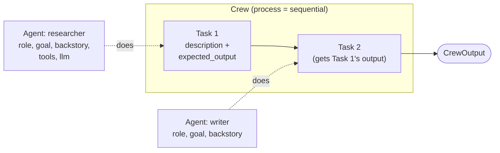

🏠 [Home](../../README.md) › [11 · Frameworks](./README.md) › 11.3 CrewAI

# 11.3 CrewAI

> **Difficulty:** 🟡 Intermediate · **Reading time:** ~12 min · **Prerequisites:** [11.1 Framework landscape](./11.1-framework-landscape.md), [1.5 Anatomy of an agent](../01-foundations/01.5-anatomy-of-an-agent.md)
>
> Last verified: November 2026 with crewai==1.15.41

**In one sentence:** CrewAI describes agents the way you would describe a team: each agent has a role, a goal and a backstory, each task has a clear expected output, and a crew runs the tasks in order or under a manager.

📑 **On this page**

- [Why does this matter?](#-why-does-this-matter)
- [The idea, in plain words](#-the-idea-in-plain-words)
- [Picture it](#-picture-it)
- [How it works, step by step](#-how-it-works-step-by-step)
- [Worked example](#-worked-example)
- [Code](#-code)
- [Common mistakes & gotchas](#-common-mistakes--gotchas)
- [Key takeaways](#-key-takeaways)
- [Try it yourself](#-try-it-yourself)
- [Further reading](#-further-reading)

## 🤔 Why does this matter?

A marketing team wants a weekly competitor report. A researcher gathers news, an analyst compares prices, a writer turns it into a two-page brief. Everyone on the team already thinks in these roles. If the code reads the same way ("the analyst's goal is…", "this task should produce…"), non-engineers can review the prompts and engineers can change one role without touching the others.

CrewAI is built around that idea. It is one of the quickest ways to go from "a team of specialists" on a whiteboard to running code.

## 🧠 The idea, in plain words

Three objects do most of the work:

| Object | What you give it | Like… |
| --- | --- | --- |
| `Agent` | `role`, `goal`, `backstory`, `tools`, `llm` | A team member with a job title and a personality |
| `Task` | `description`, `expected_output`, the `agent` who does it | A ticket with acceptance criteria |
| `Crew` | `agents`, `tasks`, a `process` | The team plus its way of working |

The `process` is either **sequential** (tasks run one after another, each seeing earlier results) or **hierarchical** (a manager model or manager agent delegates tasks and checks the results). For event-driven pipelines with branches and state, CrewAI also has **Flows**, which can call crews as steps.

Under the hood, each agent is still the five-part agent from [1.5](../01-foundations/01.5-anatomy-of-an-agent.md). CrewAI turns role, goal and backstory into the [system prompt](../../GLOSSARY.md#system-prompt), turns the task into the user message, and runs the [agent loop](../../GLOSSARY.md#agent-loop) up to `max_iter` times.

## 👀 Picture it



*A crew is a list of tasks, each owned by an agent. In a sequential crew, each task's output becomes context for the next. Our weather example is the smallest case: one agent, one task.*

## 🔍 How it works, step by step

1. **Define tools.** Decorate a function with `@tool("name")` from `crewai.tools`. The docstring becomes the description and the type hints become the schema.
2. **Define agents.** `Agent(role=..., goal=..., backstory=..., tools=[...], llm=...)`. `llm` can be a model string or an `LLM(model="anthropic/...")` object.
3. **Define tasks.** `Task(description=..., expected_output=..., agent=...)`. The expected output is the task's acceptance criteria; CrewAI puts it in the prompt.
4. **Assemble the crew.** `Crew(agents=[...], tasks=[...], process=Process.sequential)`.
5. **Kick off.** `crew.kickoff()` runs each task. For each one, the agent's loop calls the model, runs requested tools natively (when the model supports function calling), and repeats.
6. **Hit the limit gracefully.** At `max_iter` (default 25), CrewAI makes one last call *without tools* and tells the model to give its best final answer.
7. **Read the result.** `kickoff()` returns a `CrewOutput`; `.raw` is the final text, and each task's output is available too.

## 💡 Worked example

Run offline with a scripted model, the first request the model receives shows exactly how CrewAI turned our objects into a prompt:

```text
system: You are Travel weather assistant. You are concise. You always use get_weather for
        temperatures and calculator for arithmetic.
        Your personal goal is: Compare current temperatures between cities using real data, never guesses.

user:   Current Task: Is it warmer in Paris or Rome right now, and by how much?

        This is the expected criteria for your final answer: One or two sentences naming the
        warmer city and the difference in °C.
        you MUST return the actual complete content as the final answer, not a summary.

tools:  get_weather(city: string), calculator(expression: string)   (sent as function schemas)
```

Then the run:

```text
Goal: Is it warmer in Paris or Rome right now, and by how much?

tool: get_weather('Paris') -> {"city": "Paris", "temp_c": 14}
tool: get_weather('Rome') -> {"city": "Rome", "temp_c": 19}
tool: calculator('19 - 14') -> 5

Answer: Rome is warmer: 19°C versus 14°C in Paris, a difference of 5°C.
```

The model made three calls: two weather lookups at once, the subtraction, then the answer. In a test where the scripted model *never* stops calling tools, the sixth call (with `max_iter=6`) arrives with no tools and the instruction to give a final answer.

## 💻 Code

Compare with the plain loop in [1.5](../01-foundations/01.5-anatomy-of-an-agent.md#-code): there you wrote the system prompt and the loop; here you describe a role and a task, and CrewAI writes both:

```python
from crewai import LLM, Agent, Crew, Process, Task
from crewai.tools import tool


@tool("get_weather")
def get_weather(city: str) -> str:
    """Get the current temperature in °C for one city, e.g. 'Paris'."""
    ...  # calculator is defined the same way


forecaster = Agent(
    role="Travel weather assistant",
    goal="Compare current temperatures between cities using real data, never guesses.",
    backstory="You are concise. You always use get_weather for temperatures and calculator for arithmetic.",
    tools=[get_weather, calculator],
    llm=LLM(model="anthropic/claude-opus-5-5"),  # or "openai/<model>"; needs an API key
    max_iter=6,  # the loop's safety net (default 25)
)
compare = Task(
    description="Is it warmer in Paris or Rome right now, and by how much?",
    expected_output="One or two sentences naming the warmer city and the difference in °C.",
    agent=forecaster,
)
crew = Crew(agents=[forecaster], tasks=[compare], process=Process.sequential)
print(crew.kickoff().raw)
```

**Testing offline.** CrewAI has no built-in fake model, but it documents [custom LLMs](https://docs.crewai.com/en/learn/custom-llm) through `BaseLLM`. A small `ScriptedLLM` returns OpenAI-style [tool calls](../../GLOSSARY.md#tool-call) from `call()`, and CrewAI's executor runs the tools natively:

```python
class ScriptedLLM(BaseLLM):
    def call(self, messages, tools=None, callbacks=None, available_functions=None, **kwargs):
        self.calls.append({"messages": messages, "tools": tools})  # record what CrewAI sent
        return self.reply(messages)  # a string, or a list of {"id", "type": "function", "function": {...}}

    def supports_function_calling(self) -> bool:
        return True
```

Returning a list of tool calls from a custom `call()` is how CrewAI 1.15's executor handles native function calling; the custom-LLM guide shows an older pattern where the LLM runs the tools itself. Pin your version if you rely on either.

## 🚨 Common mistakes & gotchas

- **Vague `expected_output`.** It is your acceptance test written in English. "A summary" gives the model nothing to aim at; "Two sentences naming the warmer city and the difference in °C" does.
- **Too many agents.** Each agent adds model calls, cost and hand-off errors. One well-instructed agent with good tools often beats a crew of five ([10.6](../10-multi-agent-systems/10.6-when-multi-agent-makes-things-worse.md)).
- **Forgetting telemetry.** CrewAI collects anonymous usage telemetry by default. Set `CREWAI_DISABLE_TELEMETRY=true` (or `OTEL_SDK_DISABLED=true`) if your policy requires it; trace upload is separate (`CREWAI_TRACING_ENABLED=false`).
- **Python version.** `crewai` 1.15.41 requires Python 3.10 to 3.13; it will not install on 3.14 yet.
- **Provider extras.** Native Anthropic support needs `crewai[anthropic]`; providers without a native integration need `crewai[litellm]`.
- **Assuming the prompt is yours.** CrewAI adds its own wording around your role and task (see the worked example). Read the first request in a test so you know what the model really sees.

## ✅ Key takeaways

- CrewAI's units are **Agent** (role, goal, backstory), **Task** (description, expected output) and **Crew** (agents, tasks, process).
- Role, goal and backstory become the system prompt; the task becomes the user message.
- Processes are sequential or hierarchical; Flows add event-driven pipelines around crews.
- `max_iter` ends the loop with a forced, tool-free final answer.
- Test offline by subclassing `BaseLLM` and recording what CrewAI sends.

### Pros and cons

| Pros | Cons |
| --- | --- |
| Very readable: roles and tasks map to how people describe work | Extra prompt text you don't control by default |
| Fast to prototype [multi-agent](../../GLOSSARY.md#multi-agent-system) teams | Multi-agent crews multiply cost and failure points |
| Native integrations for major providers, LiteLLM for the rest | No built-in fake model for tests |
| Flows for structured, event-driven pipelines | Telemetry on by default |

### When to choose it

- You want a team of role-based agents working through clear tasks, and you value readability over fine control.
- Prototyping a multi-agent idea quickly, before deciding whether you need it.
- Skip it when one agent with good tools is enough, or when you need exact control over every prompt and step (consider [LangGraph](./11.2-langgraph.md) or a [plain loop](./11.9-the-no-framework-approach.md)).

## 🧪 Try it yourself

1. Add a second agent, a "friendly writer", and a second task that turns the comparison into a cheerful one-line travel tip. What does the writer's first request contain?
2. Use the `ScriptedLLM` above with a script that *never* stops calling tools, and `max_iter=6`. What are the `tools` recorded on the last request, and why?

<details>
<summary>Show answer</summary>

1. In a sequential crew, the second task's prompt includes the first task's output as context, so the writer sees "Rome is warmer: 19°C versus 14°C in Paris…" alongside its own task description and expected output. Its system prompt is built from its own role, goal and backstory.
2. `None`. When the agent reaches `max_iter`, CrewAI withholds the tools and adds a message telling the model to give its best final answer, so the run always ends with text instead of looping forever.

</details>

## 📚 Further reading

- [Agents](https://docs.crewai.com/en/concepts/agents), [Tasks](https://docs.crewai.com/en/concepts/tasks) and [Crews](https://docs.crewai.com/en/concepts/crews). The three core concepts, with every option.
- [Processes](https://docs.crewai.com/en/concepts/processes). Sequential and hierarchical crews.
- [Flows](https://docs.crewai.com/en/concepts/flows). Event-driven pipelines that can call crews.
- [LLMs](https://docs.crewai.com/en/concepts/llms) and [Custom LLM implementation](https://docs.crewai.com/en/learn/custom-llm). Providers, and the `BaseLLM` extension point used for offline tests.
- [Telemetry](https://docs.crewai.com/en/telemetry). What is collected and how to switch it off.

<!-- FOOTER -->

---

⬅️ **Previous:** [11.2 LangGraph](./11.2-langgraph.md) ·
🏠 [Chapter home](./README.md) ·
➡️ **Next:** [11.4 Microsoft AutoGen & Agent Framework](./11.4-microsoft-autogen-and-agent-framework.md)
