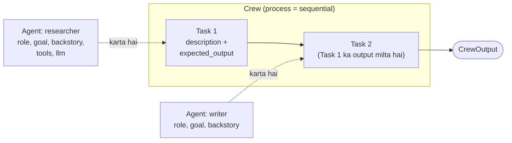

🏠 [Home](../../README.md) › [11 · Frameworks](./README.md) › 11.3 CrewAI

# 11.3 CrewAI

> **Level:** 🟡 Intermediate · **Padhne ka time:** ~12 min · **Pehle padho:** [11.1 Frameworks ka poora naksha](./11.1-framework-landscape.md), [1.5 Agent ke andar kya-kya hota hai](../01-foundations/01.5-anatomy-of-an-agent.md)
>
> Last verified: November 2026 with crewai==1.15.41

**Ek line mein:** CrewAI agents ko waise describe karta hai jaise tum ek team ko describe karte: har agent ka ek role, goal aur backstory hota hai, har task ka ek saaf expected output hota hai, aur ek crew tasks ko order mein ya ek manager ke under chalati hai.

📑 **Is page par**

- [Yeh kyun zaroori hai?](#-yeh-kyun-zaroori-hai)
- [Idea, simple words mein](#-idea-simple-words-mein)
- [Diagram se samjho](#-diagram-se-samjho)
- [Kaise kaam karta hai, step by step](#-kaise-kaam-karta-hai-step-by-step)
- [Example se samjho](#-example-se-samjho)
- [Code](#-code)
- [Aam galtiyan aur dhyan dene wali baatein](#-aam-galtiyan-aur-dhyan-dene-wali-baatein)
- [Yaad rakhne wali baatein](#-yaad-rakhne-wali-baatein)
- [Khud try karo](#-khud-try-karo)
- [Aur padhne ke liye](#-aur-padhne-ke-liye)

## 🤔 Yeh kyun zaroori hai?

Ek marketing team ko har hafte competitor report chahiye. Ek researcher news ikattha karta hai, ek analyst prices compare karta hai, ek writer use do page ke brief mein badal deta hai. Team ka har banda pehle se inhi roles mein sochta hai.

Agar code bhi waise hi padha jaaye ("analyst ka goal hai…", "yeh task yeh produce karega…"), toh non-engineers bhi prompts review kar sakte hain. Aur engineers ek role badal sakte hain bina baaki ko chhede.

CrewAI isi idea par bana hai. Whiteboard par likhi "specialists ki team" se chalte hue code tak pahunchne ka yeh sabse tez tariko mein se ek hai.

## 🧠 Idea, simple words mein

Zyada tar kaam teen objects karte hain:

| Object | Tum ise kya dete ho | Jaise… |
| --- | --- | --- |
| `Agent` | `role`, `goal`, `backstory`, `tools`, `llm` | Ek team member jiska job title aur personality hai |
| `Task` | `description`, `expected_output`, aur woh `agent` jo ise karega | Acceptance criteria wala ek ticket |
| `Crew` | `agents`, `tasks`, ek `process` | Team plus uske kaam karne ka tarika |

Socho ek shaadi ka function. Caterer ka role khana hai, decorator ka role sajawat, photographer ka role photos. Har ek ko apna kaam aur "expected output" pata hai. Event planner (manager) chahe toh kaam baant sakta hai aur check kar sakta hai. CrewAI ki crew bhi aisi hi hai.

`process` ya toh **sequential** hota hai (tasks ek ke baad ek chalte hain, aur har task pichle results dekhta hai) ya **hierarchical** (ek manager model ya manager agent tasks delegate karta hai aur results check karta hai). Branches aur state wali event-driven pipelines ke liye CrewAI mein **Flows** bhi hain, jo crews ko steps ki tarah call kar sakte hain.

Andar se, har agent ab bhi [1.5](../01-foundations/01.5-anatomy-of-an-agent.md) wala paanch-part agent hi hai. CrewAI role, goal aur backstory ko [system prompt](../../GLOSSARY.md#system-prompt) bana deta hai, task ko user message bana deta hai, aur [agent loop](../../GLOSSARY.md#agent-loop) ko `max_iter` baar tak chalata hai.

## 👀 Diagram se samjho



*Crew tasks ki ek list hai, aur har task ka ek agent owner hai. Sequential crew mein har task ka output agle task ke liye context ban jaata hai. Hamara weather example sabse chhota case hai: ek agent, ek task.*

## 🔍 Kaise kaam karta hai, step by step

1. **Tools define karo.** Kisi function par `crewai.tools` ka `@tool("name")` decorator lagao. Docstring description ban jaati hai aur type hints schema ban jaate hain.
2. **Agents define karo.** `Agent(role=..., goal=..., backstory=..., tools=[...], llm=...)`. `llm` ek model string ho sakta hai ya ek `LLM(model="anthropic/...")` object.
3. **Tasks define karo.** `Task(description=..., expected_output=..., agent=...)`. Expected output task ka acceptance criteria hai; CrewAI ise prompt mein daal deta hai.
4. **Crew jodo.** `Crew(agents=[...], tasks=[...], process=Process.sequential)`.
5. **Kick off karo.** `crew.kickoff()` har task chalata hai. Har task ke liye agent ka loop model ko call karta hai, maange gaye tools natively chalata hai (jab model function calling support karta hai), aur repeat karta hai.
6. **Limit par aaram se ruko.** `max_iter` (default 25) par CrewAI ek aakhri call *bina tools ke* karta hai aur model ko kehta hai ki apna best final answer de.
7. **Result padho.** `kickoff()` ek `CrewOutput` return karta hai; `.raw` final text hai, aur har task ka output bhi milta hai.

## 💡 Example se samjho

Scripted model ke saath offline chalao. Model ko jo pehli request milti hai, woh exactly dikhati hai ki CrewAI ne hamare objects ko prompt mein kaise badla:

```text
system: You are Travel weather assistant. You are concise. You always use get_weather for
        temperatures and calculator for arithmetic.
        Your personal goal is: Compare current temperatures between cities using real data, never guesses.

user:   Current Task: Is it warmer in Paris or Rome right now, and by how much?

        This is the expected criteria for your final answer: One or two sentences naming the
        warmer city and the difference in °C.
        you MUST return the actual complete content as the final answer, not a summary.

tools:  get_weather(city: string), calculator(expression: string)   (sent as function schemas)
```

Phir run:

```text
Goal: Is it warmer in Paris or Rome right now, and by how much?

tool: get_weather('Paris') -> {"city": "Paris", "temp_c": 14}
tool: get_weather('Rome') -> {"city": "Rome", "temp_c": 19}
tool: calculator('19 - 14') -> 5

Answer: Rome is warmer: 19°C versus 14°C in Paris, a difference of 5°C.
```

Model ne teen calls kiye: ek saath do weather lookups, phir subtraction, phir answer. Ek test mein jahan scripted model tools call karna *kabhi* band nahi karta, chhatha call (`max_iter=6` ke saath) bina tools ke aata hai, aur saath mein final answer dene ki instruction hoti hai.

## 💻 Code

[1.5](../01-foundations/01.5-anatomy-of-an-agent.md#-code) wale plain loop se compare karo: wahan system prompt aur loop tumne likhe the. Yahan tum ek role aur ek task describe karte ho, aur dono CrewAI likhta hai:

```python
from crewai import LLM, Agent, Crew, Process, Task
from crewai.tools import tool


@tool("get_weather")
def get_weather(city: str) -> str:
    """Get the current temperature in °C for one city, e.g. 'Paris'."""
    ...  # calculator bhi isi tarah define hota hai


forecaster = Agent(
    role="Travel weather assistant",
    goal="Compare current temperatures between cities using real data, never guesses.",
    backstory="You are concise. You always use get_weather for temperatures and calculator for arithmetic.",
    tools=[get_weather, calculator],
    llm=LLM(model="anthropic/claude-opus-5-5"),  # ya "openai/<model>"; API key chahiye
    max_iter=6,  # loop ka safety net (default 25)
)
compare = Task(
    description="Is it warmer in Paris or Rome right now, and by how much?",
    expected_output="One or two sentences naming the warmer city and the difference in °C.",
    agent=forecaster,
)
crew = Crew(agents=[forecaster], tasks=[compare], process=Process.sequential)
print(crew.kickoff().raw)
```

**Offline testing.** CrewAI mein built-in fake model nahi hai, lekin yeh `BaseLLM` ke through [custom LLMs](https://docs.crewai.com/en/learn/custom-llm) document karta hai. Ek chhota `ScriptedLLM` `call()` se OpenAI-style [tool calls](../../GLOSSARY.md#tool-call) return karta hai, aur CrewAI ka executor tools natively chalata hai:

```python
class ScriptedLLM(BaseLLM):
    def call(self, messages, tools=None, callbacks=None, available_functions=None, **kwargs):
        self.calls.append({"messages": messages, "tools": tools})  # record karo CrewAI ne kya bheja
        return self.reply(messages)  # ek string, ya {"id", "type": "function", "function": {...}} ki list

    def supports_function_calling(self) -> bool:
        return True
```

Custom `call()` se tool calls ki list return karna woh tarika hai jisse CrewAI 1.15 ka executor native function calling handle karta hai. Custom-LLM guide ek purana pattern dikhati hai jahan LLM tools khud chalata hai. Agar tum in dono mein se kisi par depend ho, toh apna version pin karo.

## 🚨 Aam galtiyan aur dhyan dene wali baatein

- **Gol-mol `expected_output`.** Yeh English mein likha tumhara acceptance test hai. "A summary" se model ko koi target nahi milta; "Two sentences naming the warmer city and the difference in °C" se milta hai.
- **Bahut zyada agents.** Har agent zyada model calls, zyada cost aur hand-off errors laata hai. Achhe tools wala ek achhi tarah instruct kiya gaya agent aksar paanch agents ki crew se better hota hai ([10.6](../10-multi-agent-systems/10.6-when-multi-agent-makes-things-worse.md)).
- **Telemetry bhool jaana.** CrewAI default mein anonymous usage telemetry collect karta hai. Agar tumhari policy kehti hai toh `CREWAI_DISABLE_TELEMETRY=true` (ya `OTEL_SDK_DISABLED=true`) set karo; trace upload alag cheez hai (`CREWAI_TRACING_ENABLED=false`).
- **Python version.** `crewai` 1.15.41 ko Python 3.10 se 3.13 chahiye; abhi yeh 3.14 par install nahi hoga.
- **Provider extras.** Native Anthropic support ke liye `crewai[anthropic]` chahiye; jin providers ka native integration nahi hai unke liye `crewai[litellm]` chahiye.
- **Yeh maan lena ki prompt poora tumhara hai.** CrewAI tumhare role aur task ke around apni wording jodta hai (example dekho). Test mein pehli request padho taaki pata chale model asal mein kya dekhta hai.

## ✅ Yaad rakhne wali baatein

- CrewAI ki units hain **Agent** (role, goal, backstory), **Task** (description, expected output) aur **Crew** (agents, tasks, process).
- Role, goal aur backstory system prompt bante hain; task user message banta hai.
- Processes sequential ya hierarchical hote hain; Flows crews ke around event-driven pipelines jodte hain.
- `max_iter` loop ko ek forced, bina-tool wale final answer ke saath khatam karta hai.
- `BaseLLM` ko subclass karke aur CrewAI jo bhejta hai use record karke offline test karo.

### Fayde aur nuksaan

| Fayde | Nuksaan |
| --- | --- |
| Bahut readable: roles aur tasks waise hi hain jaise log kaam describe karte hain | Extra prompt text jo default mein tumhare control mein nahi |
| [Multi-agent](../../GLOSSARY.md#multi-agent-system) teams ka jaldi prototype | Multi-agent crews cost aur failure points dono badha deti hain |
| Bade providers ke native integrations, baaki ke liye LiteLLM | Tests ke liye built-in fake model nahi |
| Structured, event-driven pipelines ke liye Flows | Telemetry default mein on |

### Kab choose karo

- Tumhe role-based agents ki ek team chahiye jo saaf tasks par kaam kare, aur tum fine control se zyada readability ko value dete ho.
- Kisi multi-agent idea ka jaldi prototype banana ho, yeh decide karne se pehle ki use sach mein zaroorat hai ya nahi.
- Jab achhe tools wala ek agent kaafi ho, ya jab har prompt aur step par exact control chahiye, tab ise skip karo ([LangGraph](./11.2-langgraph.md) ya [plain loop](./11.9-the-no-framework-approach.md) socho).

## 🧪 Khud try karo

1. Ek doosra agent jodo, ek "friendly writer", aur ek doosra task jo comparison ko ek cheerful one-line travel tip mein badal de. Writer ki pehli request mein kya hota hai?
2. Upar wala `ScriptedLLM` ek aise script ke saath use karo jo tools call karna *kabhi* band nahi karta, aur `max_iter=6` rakho. Last request par record hue `tools` kya hain, aur kyun?

<details>
<summary>Answer dekho</summary>

1. Sequential crew mein doosre task ke prompt mein pehle task ka output context ki tarah hota hai. Isliye writer ko "Rome is warmer: 19°C versus 14°C in Paris…" dikhta hai, apne task description aur expected output ke saath. Uska system prompt uske apne role, goal aur backstory se banta hai.
2. `None`. Jab agent `max_iter` par pahunchta hai, CrewAI tools rok leta hai aur ek message jodta hai jo model ko apna best final answer dene ko kehta hai. Isliye run hamesha text par khatam hota hai, hamesha loop nahi karta.

</details>

## 📚 Aur padhne ke liye

- [Agents](https://docs.crewai.com/en/concepts/agents), [Tasks](https://docs.crewai.com/en/concepts/tasks) aur [Crews](https://docs.crewai.com/en/concepts/crews). Teeno core concepts, har option ke saath.
- [Processes](https://docs.crewai.com/en/concepts/processes). Sequential aur hierarchical crews.
- [Flows](https://docs.crewai.com/en/concepts/flows). Event-driven pipelines jo crews ko call kar sakti hain.
- [LLMs](https://docs.crewai.com/en/concepts/llms) aur [Custom LLM implementation](https://docs.crewai.com/en/learn/custom-llm). Providers, aur `BaseLLM` extension point jo offline tests mein use hota hai.
- [Telemetry](https://docs.crewai.com/en/telemetry). Kya collect hota hai aur ise band kaise karo.

<!-- FOOTER -->

---

⬅️ **Pichla:** [11.2 LangGraph](./11.2-langgraph.md) ·
🏠 [Chapter home](./README.md) ·
➡️ **Agla:** [11.4 Microsoft AutoGen aur Agent Framework](./11.4-microsoft-autogen-and-agent-framework.md)
