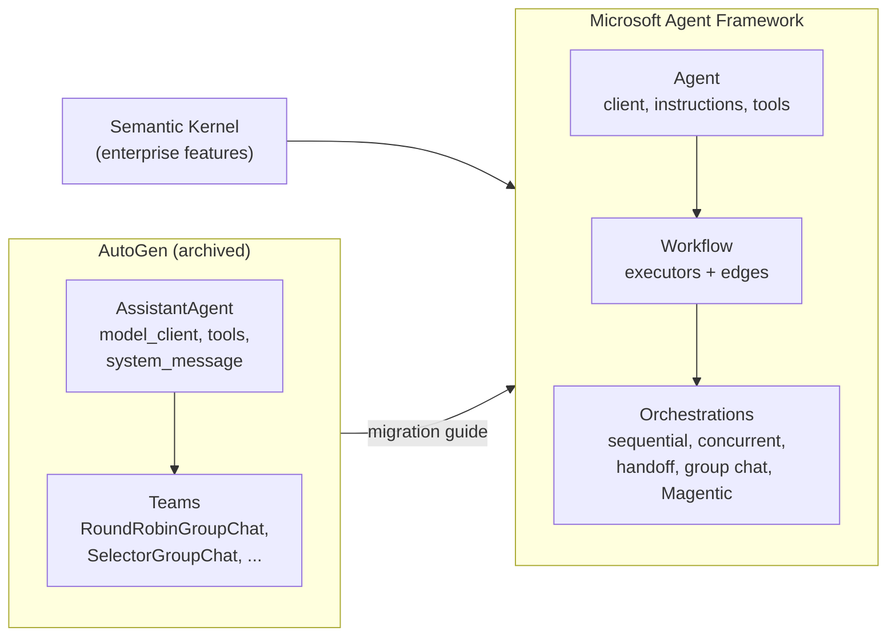

🏠 [Home](../../README.md) › [11 · Frameworks](./README.md) › 11.4 Microsoft AutoGen aur Agent Framework

# 11.4 Microsoft AutoGen aur Agent Framework

> **Level:** 🟡 Intermediate · **Padhne ka time:** ~12 min · **Pehle padho:** [11.1 Frameworks ka poora naksha](./11.1-framework-landscape.md), [1.5 Agent ke andar kya-kya hota hai](../01-foundations/01.5-anatomy-of-an-agent.md)
>
> Last verified: November 2026 with agent-framework==1.26.0 (and autogen-agentchat==0.7.5)

**Ek line mein:** AutoGen ne multi-agent conversations ki shuruaat ki thi lekin ab woh archived hai; Microsoft Agent Framework uska official successor hai, jo AutoGen ke simple agents ko Semantic Kernel ke enterprise features ke saath jodta hai aur graph-based workflows add karta hai.

📑 **Is page par**

- [Yeh kyun zaroori hai?](#-yeh-kyun-zaroori-hai)
- [Idea, simple words mein](#-idea-simple-words-mein)
- [Diagram se samjho](#-diagram-se-samjho)
- [Kaise kaam karta hai, step by step](#-kaise-kaam-karta-hai-step-by-step)
- [Example se samjho](#-example-se-samjho)
- [Code](#-code)
- [Aam galtiyan aur dhyan dene wali baatein](#-aam-galtiyan-aur-dhyan-dene-wali-baatein)
- [Yaad rakhne wali baatein](#-yaad-rakhne-wali-baatein)
- [Khud try karo](#-khud-try-karo)
- [Aur padhne ke liye](#-aur-padhne-ke-liye)

## 🤔 Yeh kyun zaroori hai?

2023–2025 mein likha gaya bahut saara agent code AutoGen use karta hai. Kai blog posts aur courses abhi bhi ise sikhate hain. Agar tum aaj inme se kisi tutorial se naya project shuru karte ho, toh tum ek aise project par build kar rahe ho jise ab koi fix nahi milega, security fixes bhi nahi.

Socho tum ek aisi building mein flat le lo jiska builder project chhod ke chala gaya. Flat abhi khada hai, lekin leak ya crack aaya toh koi theek karne nahi aayega.

Isliye yeh page do practical sawalon ka jawab deta hai: *AutoGen ka status kya hai*, aur *uski jagah kya use karo?* Dono jawab Microsoft ke apne sources se aate hain, jo neeche quote kiye gaye hain.

## 🧠 Idea, simple words mein

### Aaj Microsoft AutoGen ke baare mein kya kehta hai

[AutoGen repository](https://github.com/microsoft/autogen) ka README aur [AutoGen documentation](https://microsoft.github.io/autogen/stable/) dono par same notice hai (November 2026 mein check kiya):

- Project "has been archived and is no longer actively maintained by Microsoft". Matlab project archive ho chuka hai aur Microsoft ise ab maintain nahi karta.
- Microsoft "is not providing bug fixes, security fixes, new features, or support for this project". Matlab na bug fixes, na security fixes, na naye features, na support.
- "New users should start with Microsoft Agent Framework. Existing users are encouraged to migrate". Matlab naye users Microsoft Agent Framework se shuru karein, aur purane users official migration guide se migrate karein.

`autogen-agentchat` ki last PyPI release 0.7.5 hai, September 2025 ki.

### Microsoft Agent Framework kya hai

[Agent Framework overview](https://learn.microsoft.com/en-us/agent-framework/overview/) ise "the direct successor, created by the same teams" kehta hai, yaani Semantic Kernel aur AutoGen banane wali teams ka direct successor: "the next generation of both". Yeh AutoGen ke simple agent abstractions ko Semantic Kernel ke enterprise features (session-based state, type safety, middleware, telemetry) ke saath jodta hai aur workflows add karta hai. Yeh Python aur .NET ke liye available hai, aur Go public preview mein hai.

Iske chaar main areas hain:

| Area | Tumhe kya deta hai |
| --- | --- |
| **Agents** | Ek `Agent` = ek chat client (model), instructions aur tools. Yeh tab tak tools call karta rehta hai jab tak answer na de sake. |
| **Harness agent** | Ek opinionated agent jisme planning, to-do tracking, [context compaction](../../GLOSSARY.md#context-compaction), file access aur memory built-in hain |
| **Workflows** | Graph-based workflows jo agents aur functions ko explicit raaston se jodte hain, plus ready-made orchestrations: sequential, concurrent, handoff, group chat aur Magentic |
| **Integrations** | Model providers (Microsoft Foundry, Azure OpenAI, OpenAI, Anthropic, Ollama aur aur bhi), [MCP](../../GLOSSARY.md#model-context-protocol-mcp), memory, evaluation aur UI |

Docs ka apna rule of thumb: open-ended tasks ke liye agent use karo, jab steps achhi tarah defined hon tab workflow, aur "if you can write a function to handle the task, do that instead of using an AI agent". Matlab agar ek normal function se kaam ho jaaye, toh AI agent mat lagao.

## 👀 Diagram se samjho



*Agent Framework AutoGen ka simple "model client aur tools wala agent" idea rakhta hai, Semantic Kernel se enterprise features leta hai, aur AutoGen ki teams ki jagah typed, graph-based workflows laata hai.*

## 🔍 Kaise kaam karta hai, step by step

Agent Framework ka `Agent` hamare weather sawal ka jawab kaise deta hai:

1. **Chat client banao.** Jaise `OpenAIChatClient(model=...)` (Responses API), `OpenAIChatCompletionClient` (Chat Completions) ya `AnthropicClient(model=...)`. Client ① model wala part hai.
2. **Agent banao.** `Agent(client=client, name=..., instructions=..., tools=[get_weather, calculator])`. Plain functions tools ban jaate hain; docstring aur `Annotated[..., Field(description=...)]` schema banate hain.
3. **Chalao.** `await agent.run(goal)`. Client ki *function invocation layer* request bhejti hai, model ka har tool call chalati hai, results wapas bhejti hai, aur repeat karti hai.
4. **Ruko.** Loop tab khatam hota hai jab model bina tool calls ke answer de, ya `max_iterations` model round trips ke baad (`function_invocation_configuration` se configure hota hai). Limit par yeh tools band karke ek aakhri request karta hai, taaki tumhe phir bhi answer mile.
5. **Response padho.** Ek `AgentResponse` jisme `.text` aur saare `.messages` hote hain, har function call aur result ke saath.

Kai runs tak chalne wali conversations ke liye ek `AgentSession` pass karo. Kai agents ke liye ek `Workflow` banao ya koi orchestration use karo.

## 💡 Example se samjho

Scripted chat client ke saath offline chalao:

```text
Goal: Is it warmer in Paris or Rome right now, and by how much?

tool call:   get_weather({"city": "Paris"})
tool call:   get_weather({"city": "Rome"})
tool result: {"city": "Paris", "temp_c": 14}
tool result: {"city": "Rome", "temp_c": 19}
tool call:   calculator({"expression": "19 - 14"})
tool result: 5

Answer: Rome is warmer: 19°C versus 14°C in Paris, a difference of 5°C.
```

Scripted client ko uski teen requests mein se har ek par kya mila:

| Request | Usne kaunse messages dekhe | Options |
| --- | --- | --- |
| 1 | user ka sawal | `instructions`, `tools` = `get_weather`, `calculator` |
| 2 | … + assistant (2 function calls) + **ek** `tool` message jisme dono results hain | same |
| 3 | … + assistant (calculator call) + tool message (`5`) | same |

Legacy AutoGen mein same agent bhi same trace print karta hai, lekin sirf isliye kyunki usme `max_tool_iterations=6` set hai. AutoGen ke default 1 ke saath, `AssistantAgent` tools ka ek round chalata hai aur answer ki jagah ek tool-call summary return kar deta hai. Microsoft ki migration guide exactly yahi farak batati hai: AutoGen ka agent "is single-turn unless you increase `max_tool_iterations`", jabki Agent Framework ka `Agent` "is multi-turn by default".

## 💻 Code

[1.5](../01-foundations/01.5-anatomy-of-an-agent.md#-code) wala loop, Agent Framework mein dobara banaya gaya:

```python
import asyncio
from typing import Annotated

from agent_framework import Agent
from agent_framework.anthropic import AnthropicClient   # ya: from agent_framework.openai import OpenAIChatClient
from pydantic import Field


def get_weather(city: Annotated[str, Field(description="City name, e.g. 'Paris'.")]) -> str:
    """Get the current temperature in °C for one city."""
    ...  # calculator bhi isi tarah define hota hai


agent = Agent(
    client=AnthropicClient(model="claude-opus-5-5"),  # ANTHROPIC_API_KEY chahiye
    name="TravelAssistant",
    instructions=INSTRUCTIONS,
    tools=[get_weather, calculator],  # plain functions
)
response = asyncio.run(agent.run("Is it warmer in Paris or Rome right now, and by how much?"))
print(response.text)
```

Migrate karte waqt compare karne ke liye, wahi agent AutoGen mein:

```python
from autogen_agentchat.agents import AssistantAgent
from autogen_ext.models.openai import OpenAIChatCompletionClient

agent = AssistantAgent(
    name="travel_assistant",
    model_client=OpenAIChatCompletionClient(model=OPENAI_MODEL),
    tools=[get_weather, calculator],
    system_message=INSTRUCTIONS,
    max_tool_iterations=6,  # default 1 hai
)
result = asyncio.run(agent.run(task=GOAL))
print(result.messages[-1].to_text())
```

**Offline testing.** Agent Framework mein koi ready-made fake model nahi hai. Yeh wala documented `BaseChatClient` base class ko framework ki `FunctionInvocationLayer` (woh hissa jo tools chalata hai aur loop karta hai) ke saath jodta hai. Isliye sirf model ke replies fake hain:

```python
class ScriptedChatClient(FunctionInvocationLayer, BaseChatClient):
    def _inner_get_response(self, *, messages, stream, options, **kwargs):
        async def respond() -> ChatResponse:
            self.calls.append({"messages": list(messages), "options": dict(options)})
            return ChatResponse(messages=[self.reply(messages)])  # text ya function calls wala ek Message
        return respond()
```

AutoGen isi kaam ke liye `ReplayChatCompletionClient` deta hai.

## 🚨 Aam galtiyan aur dhyan dene wali baatein

- **Naya kaam AutoGen par shuru karna.** Yeh archived hai: na bug fixes, na security fixes. Agent Framework use karo, aur purane code ke liye [migration guide](https://learn.microsoft.com/en-us/agent-framework/migration-guide/from-autogen/) follow karo.
- **Naamon mein confuse hona.** "AutoGen", "AutoGen Studio", "Semantic Kernel" aur "Agent Framework" alag products hain. Successor PyPI par `agent-framework` naam se publish hai, aur `agent_framework` ke naam se import hota hai.
- **Zaroorat se zyada install karna.** `pip install agent-framework` har integration kheench laata hai (darjanon packages). Chhote install ke liye `agent-framework-core` plus sirf woh provider packages lo jo chahiye.
- **Pre-release integrations.** Kuch integrations, Anthropic samet, pre-release packages (version `1.0.0b…`) ki tarah publish hain, isliye unki APIs abhi badal sakti hain. Inhe pin karo.
- **Yeh expect karna ki `.env` apne aap load hoga.** Docs batate hain ki Agent Framework `.env` files automatically load nahi karta. `load_dotenv()` khud call karo.
- **AutoGen ka one-round default.** Port kiya gaya AutoGen code jo `max_tool_iterations=1` par depend karta tha, alag behave karega, kyunki Agent Framework ka `Agent` tab tak tools call karta rehta hai jab tak answer na de sake.

## ✅ Yaad rakhne wali baatein

- AutoGen archived hai; Microsoft naye users ko Microsoft Agent Framework se shuru karne ko kehta hai.
- Agent Framework AutoGen aur Semantic Kernel dono ka successor hai, Python aur .NET ke liye.
- Ek `Agent` = chat client + instructions + tools, aur yeh tab tak loop karta hai jab tak answer na de sake, `max_iterations` iski limit hai.
- Multi-step aur multi-agent kaam ke liye graph-based workflows aur built-in orchestrations use karo.
- `BaseChatClient` aur `FunctionInvocationLayer` par bane ek chhote custom chat client se offline test karo.

### Fayde aur nuksaan

| Fayde | Nuksaan |
| --- | --- |
| Stable 1.x APIs wala official Microsoft successor | Bada surface: agents, workflows, harness, bahut saare integrations |
| Python aur .NET, Azure aur Foundry integration ke saath | Meta-package bahut saari dependencies install karta hai |
| [Checkpointing](../../GLOSSARY.md#checkpoint) aur [human-in-the-loop](../../GLOSSARY.md#human-in-the-loop-hitl) wale typed, graph-based workflows | Kuch integrations (Anthropic, Ollama) abhi bhi pre-release hain |
| Middleware, sessions aur telemetry built-in | Built-in fake model nahi; ek chhota test client tumhe khud likhna padta hai |

### Kab choose karo

- Tumhari organisation Azure, Microsoft Foundry ya .NET par build karti hai, ya pehle se Semantic Kernel ya AutoGen use karti hai.
- Tumhe ek hi framework se single agents aur explicit multi-agent workflows dono chahiye.
- AutoGen code migrate karna hai: iske liye ek official, side-by-side migration guide hai.
- Ek chhote Python-only agent ke liye ise skip karo, jahan halka SDK ya [plain loop](./11.9-the-no-framework-approach.md) kaafi hai.

## 🧪 Khud try karo

1. Upar wale AutoGen comparison code mein se `max_tool_iterations=6` hata do. Ab agent kya karta hai, aur last message kya hai?
2. Upar wale comparison code ke har AutoGen argument ko uske Agent Framework equivalent se match karo.

<details>
<summary>Answer dekho</summary>

1. Default 1 ke saath, agent do weather calls chalata hai aur ruk jaata hai; last message ek `ToolCallSummaryMessage` hai jisme tool results hain, answer nahi. Jo test final answer expect karta hai woh ab fail hoga.
2. `model_client` → `client`; `system_message` → `instructions`; `tools` → `tools` (dono mein plain functions); `name` → `name`; `max_tool_iterations` → koi direct equivalent nahi, kyunki Agent Framework ka agent default mein loop karta hai, `function_invocation_configuration["max_iterations"]` ki limit ke saath; `agent.run(task=...)` → `agent.run(...)`.

</details>

## 📚 Aur padhne ke liye

- [Microsoft Agent Framework overview](https://learn.microsoft.com/en-us/agent-framework/overview/). Chaar areas, aur Semantic Kernel aur AutoGen se rishta.
- [AutoGen to Microsoft Agent Framework migration guide](https://learn.microsoft.com/en-us/agent-framework/migration-guide/from-autogen/). Agents, tools, teams aur workflows ka side-by-side code.
- [Using function tools with an agent](https://learn.microsoft.com/en-us/agent-framework/agents/tools/function-tools). Plain functions, `@tool` aur explicit schemas.
- [Workflow orchestrations](https://learn.microsoft.com/en-us/agent-framework/workflows/orchestrations/). Sequential, concurrent, handoff, group chat aur Magentic patterns.
- GitHub par [microsoft/agent-framework](https://github.com/microsoft/agent-framework) aur [microsoft/autogen](https://github.com/microsoft/autogen). Source, samples aur archive notice.

<!-- FOOTER -->

---

⬅️ **Pichla:** [11.3 CrewAI](./11.3-crewai.md) ·
🏠 [Chapter home](./README.md) ·
➡️ **Agla:** [11.5 OpenAI Agents SDK](./11.5-openai-agents-sdk.md)
