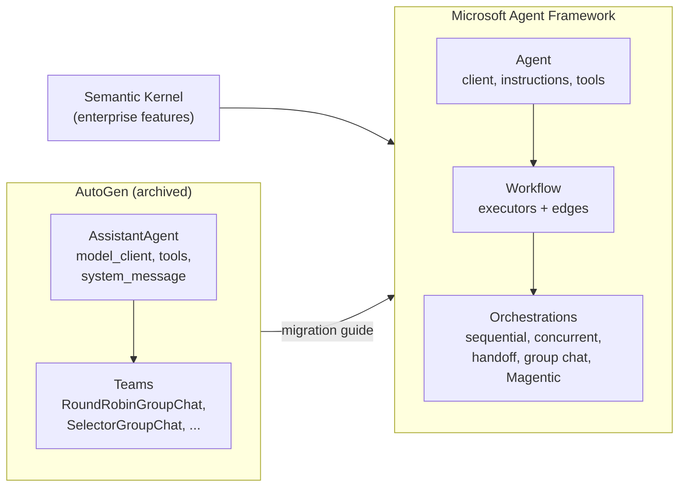

🏠 [Home](../../README.md) › [11 · Frameworks](./README.md) › 11.4 Microsoft AutoGen & Agent Framework

# 11.4 Microsoft AutoGen & Agent Framework

> **Difficulty:** 🟡 Intermediate · **Reading time:** ~12 min · **Prerequisites:** [11.1 Framework landscape](./11.1-framework-landscape.md), [1.5 Anatomy of an agent](../01-foundations/01.5-anatomy-of-an-agent.md)
>
> Last verified: November 2026 with agent-framework==1.26.0 (and autogen-agentchat==0.7.5)

**In one sentence:** AutoGen pioneered multi-agent conversations but is now archived; Microsoft Agent Framework is its official successor, combining AutoGen's simple agents with Semantic Kernel's enterprise features and adding graph-based workflows.

📑 **On this page**

- [Why does this matter?](#-why-does-this-matter)
- [The idea, in plain words](#-the-idea-in-plain-words)
- [Picture it](#-picture-it)
- [How it works, step by step](#-how-it-works-step-by-step)
- [Worked example](#-worked-example)
- [Code](#-code)
- [Common mistakes & gotchas](#-common-mistakes--gotchas)
- [Key takeaways](#-key-takeaways)
- [Try it yourself](#-try-it-yourself)
- [Further reading](#-further-reading)

## 🤔 Why does this matter?

A lot of agent code written in 2023–2025 uses AutoGen. Many blog posts and courses still teach it. If you start a new project from one of those tutorials today, you build on a project that gets no more fixes, including security fixes.

So this page answers two practical questions: *what is the status of AutoGen*, and *what should you use instead?* Both answers come from Microsoft's own sources, quoted below.

## 🧠 The idea, in plain words

### What Microsoft says about AutoGen today

The [AutoGen repository](https://github.com/microsoft/autogen) README and the [AutoGen documentation](https://microsoft.github.io/autogen/stable/) both carry the same notice (checked November 2026):

- The project "has been archived and is no longer actively maintained by Microsoft".
- Microsoft "is not providing bug fixes, security fixes, new features, or support for this project".
- "New users should start with Microsoft Agent Framework. Existing users are encouraged to migrate" using the official migration guide.

The last PyPI release of `autogen-agentchat` is 0.7.5, from September 2025.

### What Microsoft Agent Framework is

The [Agent Framework overview](https://learn.microsoft.com/en-us/agent-framework/overview/) calls it "the direct successor, created by the same teams" behind Semantic Kernel and AutoGen: "the next generation of both". It combines AutoGen's simple agent abstractions with Semantic Kernel's enterprise features (session-based state, type safety, middleware, telemetry) and adds workflows. It is available for Python and .NET, with Go in public preview.

It has four main areas:

| Area | What it gives you |
| --- | --- |
| **Agents** | An `Agent` = a chat client (the model), instructions and tools. It keeps calling tools until it can answer. |
| **Harness agent** | An opinionated agent with planning, to-do tracking, [context compaction](../../GLOSSARY.md#context-compaction), file access and memory built in |
| **Workflows** | Graph-based workflows that connect agents and functions along explicit paths, plus ready-made orchestrations: sequential, concurrent, handoff, group chat and Magentic |
| **Integrations** | Model providers (Microsoft Foundry, Azure OpenAI, OpenAI, Anthropic, Ollama and more), [MCP](../../GLOSSARY.md#model-context-protocol-mcp), memory, evaluation and UI |

The docs' own rule of thumb: use an agent for open-ended tasks, a workflow when the steps are well defined, and "if you can write a function to handle the task, do that instead of using an AI agent".

## 👀 Picture it



*Agent Framework keeps AutoGen's simple "agent with a model client and tools" idea, takes enterprise features from Semantic Kernel, and replaces AutoGen's teams with typed, graph-based workflows.*

## 🔍 How it works, step by step

How an Agent Framework `Agent` answers our weather question:

1. **Create a chat client.** For example `OpenAIChatClient(model=...)` (Responses API), `OpenAIChatCompletionClient` (Chat Completions) or `AnthropicClient(model=...)`. The client is the ① model part.
2. **Create the agent.** `Agent(client=client, name=..., instructions=..., tools=[get_weather, calculator])`. Plain functions become tools; the docstring and `Annotated[..., Field(description=...)]` build the schema.
3. **Run it.** `await agent.run(goal)`. The client's *function invocation layer* sends the request, runs every tool call the model makes, sends the results back, and repeats.
4. **Stop.** The loop ends when the model answers without tool calls, or after `max_iterations` model round trips (configurable through `function_invocation_configuration`). At the limit it makes one last request with tools turned off, so you still get an answer.
5. **Read the response.** An `AgentResponse` with `.text` and all `.messages`, including every function call and result.

For conversations that span several runs, pass an `AgentSession`. For several agents, build a `Workflow` or use an orchestration.

## 💡 Worked example

Run offline with a scripted chat client:

```text
Goal: Is it warmer in Paris or Rome right now, and by how much?

tool call:   get_weather({"city": "Paris"})
tool call:   get_weather({"city": "Rome"})
tool result: {"city": "Paris", "temp_c": 14}
tool result: {"city": "Rome", "temp_c": 19}
tool call:   calculator({"expression": "19 - 14"})
tool result: 5

Answer: Rome is warmer: 19°C versus 14°C in Paris, a difference of 5°C.
```

What the scripted client received on each of its three requests:

| Request | Messages it saw | Options |
| --- | --- | --- |
| 1 | user question | `instructions`, `tools` = `get_weather`, `calculator` |
| 2 | … + assistant (2 function calls) + **one** `tool` message holding both results | same |
| 3 | … + assistant (calculator call) + tool message (`5`) | same |

The same agent in legacy AutoGen prints the same trace, but only because it sets `max_tool_iterations=6`. With AutoGen's default of 1, the `AssistantAgent` runs one round of tools and returns a tool-call summary instead of an answer. Microsoft's migration guide lists exactly this difference: AutoGen's agent "is single-turn unless you increase `max_tool_iterations`", while the Agent Framework `Agent` "is multi-turn by default".

## 💻 Code

The [1.5](../01-foundations/01.5-anatomy-of-an-agent.md#-code) loop, rebuilt in Agent Framework:

```python
import asyncio
from typing import Annotated

from agent_framework import Agent
from agent_framework.anthropic import AnthropicClient   # or: from agent_framework.openai import OpenAIChatClient
from pydantic import Field


def get_weather(city: Annotated[str, Field(description="City name, e.g. 'Paris'.")]) -> str:
    """Get the current temperature in °C for one city."""
    ...  # calculator is defined the same way


agent = Agent(
    client=AnthropicClient(model="claude-opus-5-5"),  # needs ANTHROPIC_API_KEY
    name="TravelAssistant",
    instructions=INSTRUCTIONS,
    tools=[get_weather, calculator],  # plain functions
)
response = asyncio.run(agent.run("Is it warmer in Paris or Rome right now, and by how much?"))
print(response.text)
```

The same agent in AutoGen, for comparison when you migrate:

```python
from autogen_agentchat.agents import AssistantAgent
from autogen_ext.models.openai import OpenAIChatCompletionClient

agent = AssistantAgent(
    name="travel_assistant",
    model_client=OpenAIChatCompletionClient(model=OPENAI_MODEL),
    tools=[get_weather, calculator],
    system_message=INSTRUCTIONS,
    max_tool_iterations=6,  # the default is 1
)
result = asyncio.run(agent.run(task=GOAL))
print(result.messages[-1].to_text())
```

**Testing offline.** Agent Framework has no ready-made fake model. This one combines the documented `BaseChatClient` base class with the framework's `FunctionInvocationLayer` (the part that runs tools and loops), so only the model's replies are fake:

```python
class ScriptedChatClient(FunctionInvocationLayer, BaseChatClient):
    def _inner_get_response(self, *, messages, stream, options, **kwargs):
        async def respond() -> ChatResponse:
            self.calls.append({"messages": list(messages), "options": dict(options)})
            return ChatResponse(messages=[self.reply(messages)])  # a Message with text or function calls
        return respond()
```

AutoGen ships `ReplayChatCompletionClient` for the same job.

## 🚨 Common mistakes & gotchas

- **Starting new work on AutoGen.** It is archived: no bug or security fixes. Use Agent Framework, and follow the [migration guide](https://learn.microsoft.com/en-us/agent-framework/migration-guide/from-autogen/) for existing code.
- **Confusing the names.** "AutoGen", "AutoGen Studio", "Semantic Kernel" and "Agent Framework" are different products. The successor is published on PyPI as `agent-framework`, imported as `agent_framework`.
- **Installing more than you need.** `pip install agent-framework` pulls in every integration (dozens of packages). Smaller installs use `agent-framework-core` plus the provider packages you need.
- **Pre-release integrations.** Some integrations, including Anthropic, are published as pre-release packages (version `1.0.0b…`), so their APIs may still change. Pin them.
- **Expecting `.env` to load itself.** The docs note that Agent Framework does not load `.env` files automatically. Call `load_dotenv()` yourself.
- **AutoGen's one-round default.** Ported AutoGen code that relied on `max_tool_iterations=1` will behave differently, because an Agent Framework `Agent` keeps calling tools until it can answer.

## ✅ Key takeaways

- AutoGen is archived; Microsoft tells new users to start with Microsoft Agent Framework.
- Agent Framework is the successor to both AutoGen and Semantic Kernel, for Python and .NET.
- An `Agent` is a chat client + instructions + tools, and it loops until it can answer, with `max_iterations` as the limit.
- For multi-step and multi-agent work, use graph-based workflows and the built-in orchestrations.
- Test offline with a small custom chat client built on `BaseChatClient` and `FunctionInvocationLayer`.

### Pros and cons

| Pros | Cons |
| --- | --- |
| Official Microsoft successor with stable 1.x APIs | Large surface: agents, workflows, harness, many integrations |
| Python and .NET, with Azure and Foundry integration | The meta-package installs a lot of dependencies |
| Typed, graph-based workflows with [checkpointing](../../GLOSSARY.md#checkpoint) and [human-in-the-loop](../../GLOSSARY.md#human-in-the-loop-hitl) | Some integrations (Anthropic, Ollama) are still pre-release |
| Middleware, sessions and telemetry built in | No built-in fake model; you write a small test client |

### When to choose it

- Your organisation builds on Azure, Microsoft Foundry or .NET, or already uses Semantic Kernel or AutoGen.
- You need both single agents and explicit multi-agent workflows from one framework.
- Migrating AutoGen code: there is an official, side-by-side migration guide.
- Skip it for a small Python-only agent where a lighter SDK or a [plain loop](./11.9-the-no-framework-approach.md) is enough.

## 🧪 Try it yourself

1. In the AutoGen comparison code above, delete `max_tool_iterations=6`. What does the agent do now, and what is the last message?
2. Map each AutoGen argument in the comparison code above to its Agent Framework equivalent.

<details>
<summary>Show answer</summary>

1. With the default of 1, the agent runs the two weather calls and then stops; the last message is a `ToolCallSummaryMessage` containing the tool results, not an answer. A test that expects the final answer now fails.
2. `model_client` → `client`; `system_message` → `instructions`; `tools` → `tools` (plain functions in both); `name` → `name`; `max_tool_iterations` → no direct equivalent, because an Agent Framework agent loops by default, limited by `function_invocation_configuration["max_iterations"]`; `agent.run(task=...)` → `agent.run(...)`.

</details>

## 📚 Further reading

- [Microsoft Agent Framework overview](https://learn.microsoft.com/en-us/agent-framework/overview/). The four areas, and the relationship to Semantic Kernel and AutoGen.
- [AutoGen to Microsoft Agent Framework migration guide](https://learn.microsoft.com/en-us/agent-framework/migration-guide/from-autogen/). Side-by-side code for agents, tools, teams and workflows.
- [Using function tools with an agent](https://learn.microsoft.com/en-us/agent-framework/agents/tools/function-tools). Plain functions, `@tool` and explicit schemas.
- [Workflow orchestrations](https://learn.microsoft.com/en-us/agent-framework/workflows/orchestrations/). Sequential, concurrent, handoff, group chat and Magentic patterns.
- [microsoft/agent-framework](https://github.com/microsoft/agent-framework) and [microsoft/autogen](https://github.com/microsoft/autogen) on GitHub. Source, samples and the archive notice.

<!-- FOOTER -->

---

⬅️ **Previous:** [11.3 CrewAI](./11.3-crewai.md) ·
🏠 [Chapter home](./README.md) ·
➡️ **Next:** [11.5 OpenAI Agents SDK](./11.5-openai-agents-sdk.md)
