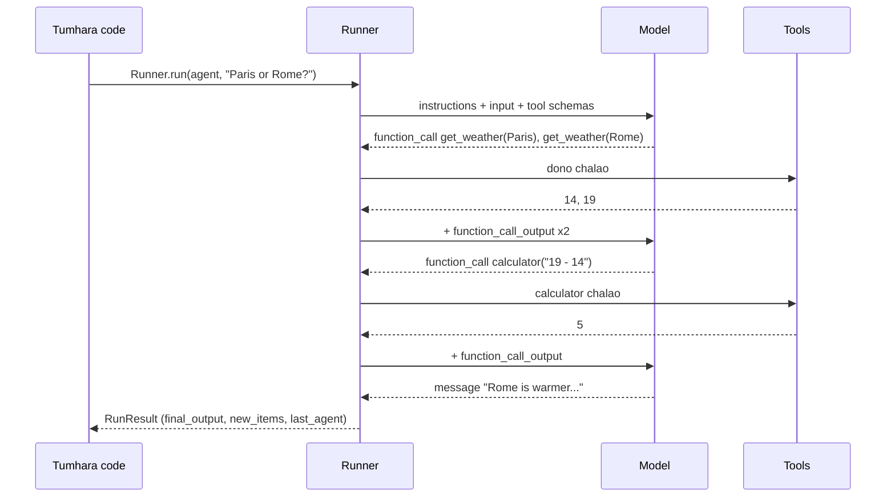

🏠 [Home](../../README.md) › [11 · Frameworks](./README.md) › 11.5 OpenAI Agents SDK

# 11.5 OpenAI Agents SDK

> **Level:** 🟡 Intermediate · **Padhne ka time:** ~12 min · **Pehle padho:** [11.1 Frameworks ka poora naksha](./11.1-framework-landscape.md), [1.5 Agent ke andar kya-kya hota hai](../01-foundations/01.5-anatomy-of-an-agent.md)
>
> Last verified: November 2026 with openai-agents==0.24.0

**Ek line mein:** OpenAI Agents SDK agent ke idea ko chhota rakhta hai: ek `Agent` matlab instructions aur tools wala model, ek `Runner` loop chalata hai, aur handoffs, guardrails, sessions aur tracing sirf tab jodte ho jab zaroorat ho.

📑 **Is page par**

- [Yeh kyun zaroori hai?](#-yeh-kyun-zaroori-hai)
- [Idea, simple words mein](#-idea-simple-words-mein)
- [Diagram se samjho](#-diagram-se-samjho)
- [Kaise kaam karta hai, step by step](#-kaise-kaam-karta-hai-step-by-step)
- [Example se samjho](#-example-se-samjho)
- [Code](#-code)
- [Aam galtiyan aur dhyan dene wali baatein](#-aam-galtiyan-aur-dhyan-dene-wali-baatein)
- [Yaad rakhne wali baatein](#-yaad-rakhne-wali-baatein)
- [Khud try karo](#-khud-try-karo)
- [Aur padhne ke liye](#-aur-padhne-ke-liye)

## 🤔 Yeh kyun zaroori hai?

Ek travel company ke help desk par teen tarah ke sawal aate hain: bookings, refunds aur "wahan mausam kaisa hai?". Ek bahut bada prompt jo sab handle kare, use test karna mushkil hota hai aur todna aasaan.

Team ko ek front-desk agent chahiye jo har sawal ko sahi specialist tak bheje. Jo check kare ki koi chat mein card numbers paste na kare. Aur jab customer complain kare, toh har run ka trace dikhaye.

OpenAI Agents SDK isi shape ke liye design hua hai. Iske docs ise OpenAI ke pehle wale experimental agents project, Swarm, ka "a production-ready upgrade" kehte hain, jisme "a very small set of primitives" hain. Matlab bahut kam building blocks.

## 🧠 Idea, simple words mein

SDK mein bas kuch hi building blocks hain:

| Primitive | Yeh kya hai | Roz ki life mein |
| --- | --- | --- |
| `Agent` | Model + instructions + tools (+ optional `output_type`) | Job description wala ek specialist |
| `Runner` | [Agent loop](../../GLOSSARY.md#agent-loop) chalata hai: model call karo, tools chalao, repeat karo | Manager jo specialist ko kaam khatam hone tak lagaye rakhta hai |
| [Handoff](../../GLOSSARY.md#handoff) | Ek agent conversation doosre agent ko de sakta hai | "Main aapko hamari refunds team se connect karta hoon" |
| Agents as tools | Ek agent doosre ko tool ki tarah call karta hai aur control apne paas rakhta hai | Kisi colleague se ek chhota sa sawal poochna |
| [Guardrails](../../GLOSSARY.md#guardrail) | Input, output ya [tool calls](../../GLOSSARY.md#tool-call) par checks jo run rok sakte hain | Ek supervisor jo "ruko" bol sakta hai |
| Sessions | Runs ke beech stored conversation history | Ticket ki history |
| Tracing | Har model call, tool call aur handoff ka built-in record | Call recording |

Bank ka customer care socho. Pehle IVR ya front-desk wala sunta hai, phir "loan ke liye 2 dabaiye" karke sahi department mein bhej deta hai. Yahi handoff hai. Aur call "quality ke liye record" hoti hai. Yahi tracing hai.

Tools plain Python functions hain jin par ek decorator laga hota hai. SDK naam, type hints aur docstring padh ke [JSON Schema](../../GLOSSARY.md#json-schema) banata hai, aur model ke arguments ko Pydantic se validate karta hai.

OpenAI models ke liye SDK default mein Responses API use karta hai. Doosre providers OpenAI-compatible Chat Completions endpoints ya (beta) LiteLLM aur Any-LLM adapters ke through kaam karte hain.

## 👀 Diagram se samjho



*Loop `Runner` ke haath mein hai. Model ka har reply ya toh tool calls hai (unhe chalao aur phir se round lagao), ya handoff (agent badlo aur phir se round lagao), ya final output (ruk jao).*

## 🔍 Kaise kaam karta hai, step by step

1. **Tools par decorator lagao.** `agents.decorators` ka `@tool` (jo `function_tool` naam se bhi export hota hai) ek function ko strict JSON Schema wale `FunctionTool` mein badal deta hai.
2. **Agent banao.** `Agent(name=..., instructions=..., model=..., tools=[...])`. Zaroorat ho toh `handoffs=[other_agent]`, `input_guardrails=[...]` ya `output_type=SomeModel` jodo.
3. **Chalao.** `await Runner.run(agent, input, max_turns=...)` (ya `Runner.run_sync`). `max_turns` ka default 10 hai.
4. **Loop.** Runner model ko call karta hai. Tool calls chalaye jaate hain aur unke outputs `function_call_output` items ki tarah jode jaate hain. Handoff current agent ko badal deta hai. Final message run khatam kar deta hai.
5. **Limits aur failures.** Bahut zyada turns hone par `MaxTurnsExceeded` raise hota hai; koi guardrail trip ho toh tripwire exception raise hota hai.
6. **Result padho.** `result.final_output` answer hai (agar `output_type` set kiya toh typed), `result.new_items` har tool call, output aur message ki list hai, aur `result.last_agent` batata hai ki kisne kaam khatam kiya.
7. **Tracing.** Har run default mein [trace](../../GLOSSARY.md#trace) hota hai aur OpenAI dashboard par upload hota hai. Ise har run ke liye `RunConfig(tracing_disabled=True)` se, code mein `set_tracing_disabled(True)` se, ya `OPENAI_AGENTS_DISABLE_TRACING=1` se band karo.

## 💡 Example se samjho

SDK ke apne `ScriptedModel` ke saath offline chalao:

```text
Goal: Is it warmer in Paris or Rome right now, and by how much?

tool call:   get_weather({"city":"Paris"})
tool call:   get_weather({"city":"Rome"})
tool result: {"city": "Paris", "temp_c": 14}
tool result: {"city": "Rome", "temp_c": 19}
tool call:   calculator({"expression":"19 - 14"})
tool result: 5
message:     Rome is warmer: 19°C versus 14°C in Paris, a difference of 5°C.

Answer: Rome is warmer: 19°C versus 14°C in Paris, a difference of 5°C.
```

**Handoff jodna.** Aage ek "Triage" agent lagao, `handoffs=[travel_agent]` ke saath. Triage model ko ek extra tool dikhta hai, `transfer_to_travel_assistant`. Woh use call karta hai, aur runner agent badal deta hai:

```text
new_items: HandoffCallItem, HandoffOutputItem,                         <- triage hands off
           ToolCallItem, ToolCallItem, ToolCallOutputItem, ToolCallOutputItem,
           ToolCallItem, ToolCallOutputItem, MessageOutputItem          <- travel agent works
last_agent: Travel assistant
```

Handoff bas ek tool call hai. Isiliye routing ka decision traces mein dikhta hai aur kisi bhi doosre tool call ki tarah test ho sakta hai.

## 💻 Code

[1.5](../01-foundations/01.5-anatomy-of-an-agent.md#-code) wala loop ab ek line hai, `Runner.run`. Official [quickstart](https://openai.github.io/openai-agents-python/quickstart/) ke hisaab se:

```python
import asyncio

from agents import Agent, Runner
from agents.decorators import tool


@tool
def get_weather(city: str) -> str:
    """Get the current temperature in °C for one city.

    Args:
        city: City name, e.g. 'Paris'.
    """
    ...  # calculator bhi isi tarah define hota hai


agent = Agent(
    name="Travel assistant",
    instructions=INSTRUCTIONS,
    model=OPENAI_MODEL,  # ek model name: SDK Responses API call karta hai; OPENAI_API_KEY chahiye
    tools=[get_weather, calculator],
)


async def main() -> None:
    result = await Runner.run(agent, "Is it warmer in Paris or Rome right now, and by how much?", max_turns=6)
    print(result.final_output)

asyncio.run(main())
```

Handoff bas ek aur argument hai:

```python
triage = Agent(
    name="Triage",
    instructions="Route travel questions to the travel assistant.",
    handoffs=[agent],  # transfer_to_travel_assistant naam ka tool ban jaata hai
)
```

**Offline testing.** SDK `agents.testing` mein test doubles deta hai ([testing guide](https://openai.github.io/openai-agents-python/testing/) dekho). `ScriptedModel` model ke outputs replay karta hai, jabki asli runner, tools aur guardrails chalte hain:

```python
from agents import RunConfig
from agents.testing import ScriptedModel, assistant_message, function_call

model = ScriptedModel([
    [function_call("get_weather", {"city": "Paris"}, call_id="call_1"),
     function_call("get_weather", {"city": "Rome"}, call_id="call_2")],
    [function_call("calculator", {"expression": "19 - 14"}, call_id="call_3")],
    [assistant_message("Rome is warmer: 19°C versus 14°C in Paris, a difference of 5°C.")],
])
result = await Runner.run(Agent(name="Travel assistant", model=model, tools=[...]), GOAL,
                          run_config=RunConfig(tracing_disabled=True))
model.assert_complete()            # har scripted step use hua
assert model.first_call.system_instructions == INSTRUCTIONS
```

## 🚨 Aam galtiyan aur dhyan dene wali baatein

- **Bhool jaana ki tracing on hai.** Runs default mein OpenAI ko trace hote hain. Jahan data tumhare system se bahar nahi jaana chahiye, wahan ise band karo. Aur dhyan do, docs kehte hain ki Zero Data Retention policy ke under tracing available nahi hai.
- **Achanak `max_turns` hit ho jaana.** Default 10 turns hai. Bahut saare tool calls wala research agent ise paar kar sakta hai. Ise soch ke set karo aur `MaxTurnsExceeded` catch karo.
- **Doosre providers aur Responses API.** SDK default mein Responses API use karta hai, jo bahut saare doosre providers support nahi karte. Unka Chat Completions endpoint ya ek adapter use karo, aur expect karo ki kuch features (hosted tools, structured output) alag honge.
- **Tests mein tool ka Python function seedha call karna.** Isse schema validation, guardrails aur error handling skip ho jaate hain. `Runner` ke through `ScriptedModel` ke saath test karo, jaisa SDK ki testing guide kehti hai.
- **Handoff ya agent-as-tool?** Handoff conversation de deta hai; tool ki tarah use hua agent answer wapas deta hai aur caller control mein rehta hai. Soch samajh ke chuno ([10.3](../10-multi-agent-systems/10.3-peer-to-peer-and-handoffs.md)).
- **Version churn.** Package abhi bhi 0.x hai; ise pin karo, aur upgrade se pehle changelog padho.

## ✅ Yaad rakhne wali baatein

- `Agent` (model, instructions, tools) + `Runner` (loop) zyada tar single-agent zarooratein cover kar dete hain.
- Handoffs `transfer_to_<agent>` naam ke tool calls hain, isliye routing dikhti hai aur test ho sakti hai.
- Guardrails, sessions, MCP aur tracing built-in hain aur optional hain.
- OpenAI models default mein Responses API use karte hain; doosre providers ko compatible endpoints ya adapters chahiye.
- `agents.testing.ScriptedModel` asli runner ke offline tests aasaan bana deta hai.

### Fayde aur nuksaan

| Fayde | Nuksaan |
| --- | --- |
| Bahut chhoti API; jaldi seekh sakte ho | Sabse achha experience OpenAI models aur Responses API ke saath hai |
| Handoffs, guardrails aur sessions built-in | Tracing default mein OpenAI par upload hoti hai |
| Official test doubles (`agents.testing`) | Abhi bhi 0.x package |
| Built-in tracing aur ek visual dashboard | Complex control flow par graph framework se kam control |

### Kab choose karo

- Tum OpenAI models use karte ho aur tumhe ek halka framework chahiye jisme tracing, guardrails aur handoffs seedhe mil jaayein.
- Triage-aur-specialist designs jahan agents ek doosre ko conversations pass karte hain.
- Jab durable, resumable multi-step workflows chahiye (dekho [LangGraph](./11.2-langgraph.md) ya [Agent Framework workflows](./11.4-microsoft-autogen-and-agent-framework.md)), ya jab tum kisi aur provider par standardise kar rahe ho, tab ise skip karo.

## 🧪 Khud try karo

1. Ek test mein agent ko aise `ScriptedModel` ke saath chalao jo das baar `calculator` call return kare, aur `max_turns=6` rakho. Kya hota hai?
2. Tum travel assistant ko triage agent ko *handoff* ki jagah *tool* (`travel.as_tool(...)`) ki tarah kab doge?

<details>
<summary>Answer dekho</summary>

1. Chhathe turn ke baad runner `MaxTurnsExceeded` raise karta hai.
2. Tool tab use karo jab triage agent ko control mein rehna hai: woh travel agent se sawal poochta hai, answer wapas leta hai aur final reply khud banata hai (jaise weather ko booking check ke saath jodna). Handoff tab use karo jab specialist ko conversation poori tarah sambhal leni chahiye, taaki user ke aage ke messages seedhe usi ke paas jaayein.

</details>

## 📚 Aur padhne ke liye

- [OpenAI Agents SDK](https://openai.github.io/openai-agents-python/). Overview, primitives aur design principles.
- [Quickstart](https://openai.github.io/openai-agents-python/quickstart/) aur [Tools](https://openai.github.io/openai-agents-python/tools/). Pehla agent banana aur function tools.
- [Handoffs](https://openai.github.io/openai-agents-python/handoffs/) aur [Agent orchestration](https://openai.github.io/openai-agents-python/multi_agent/). Handoffs vs agents as tools.
- [Guardrails](https://openai.github.io/openai-agents-python/guardrails/) aur [Tracing](https://openai.github.io/openai-agents-python/tracing/). Safety checks aur trace format, tracing band karne ka tarika bhi.
- [Testing](https://openai.github.io/openai-agents-python/testing/) aur [Models](https://openai.github.io/openai-agents-python/models/). `ScriptedModel`, aur non-OpenAI providers kaise use karo.

<!-- FOOTER -->

---

⬅️ **Pichla:** [11.4 Microsoft AutoGen aur Agent Framework](./11.4-microsoft-autogen-and-agent-framework.md) ·
🏠 [Chapter home](./README.md) ·
➡️ **Agla:** [11.6 Claude Agent SDK](./11.6-claude-agent-sdk.md)
