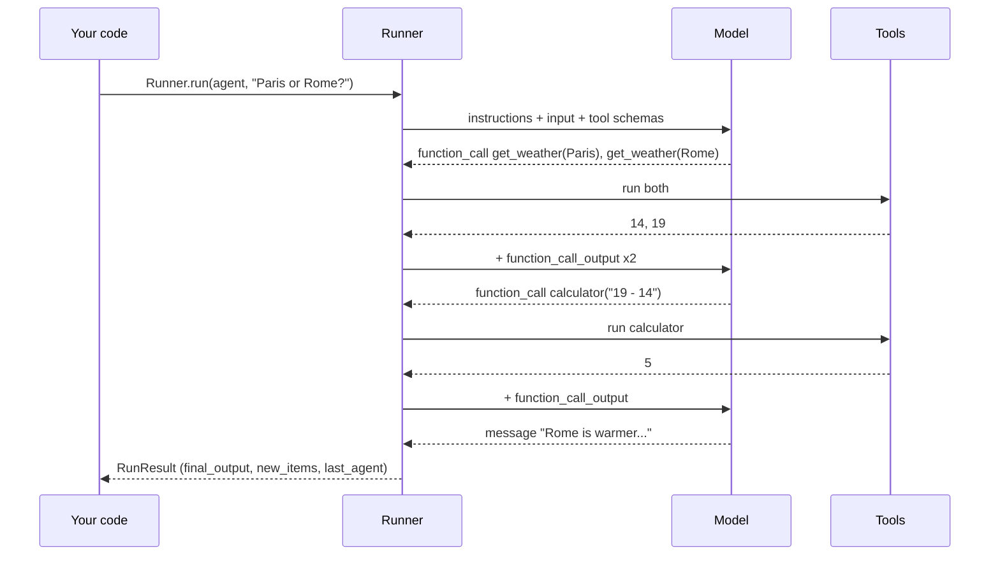

🏠 [Home](../../README.md) › [11 · Frameworks](./README.md) › 11.5 OpenAI Agents SDK

# 11.5 OpenAI Agents SDK

> **Difficulty:** 🟡 Intermediate · **Reading time:** ~12 min · **Prerequisites:** [11.1 Framework landscape](./11.1-framework-landscape.md), [1.5 Anatomy of an agent](../01-foundations/01.5-anatomy-of-an-agent.md)
>
> Last verified: November 2026 with openai-agents==0.24.0

**In one sentence:** The OpenAI Agents SDK keeps the agent idea small: an `Agent` is a model with instructions and tools, a `Runner` runs the loop, and handoffs, guardrails, sessions and tracing are added only when you need them.

📑 **On this page**

- [Why does this matter?](#-why-does-this-matter)
- [The idea, in plain words](#-the-idea-in-plain-words)
- [Picture it](#-picture-it)
- [How it works, step by step](#-how-it-works-step-by-step)
- [Worked example](#-worked-example)
- [Code](#-code)
- [Common mistakes & gotchas](#-common-mistakes--gotchas)
- [Key takeaways](#-key-takeaways)
- [Try it yourself](#-try-it-yourself)
- [Further reading](#-further-reading)

## 🤔 Why does this matter?

A travel company's help desk gets three kinds of questions: bookings, refunds and "what's the weather like there?". One giant prompt that handles everything becomes hard to test and easy to break. The team wants a front-desk agent that routes each question to a specialist, checks that nobody pastes card numbers into the chat, and shows a trace of every run when a customer complains.

That is the shape the OpenAI Agents SDK is designed for. Its docs describe it as "a production-ready upgrade" of OpenAI's earlier experimental agents project, Swarm, with "a very small set of primitives".

## 🧠 The idea, in plain words

The SDK has a handful of building blocks:

| Primitive | What it is | Everyday picture |
| --- | --- | --- |
| `Agent` | Model + instructions + tools (+ optional `output_type`) | A specialist with a job description |
| `Runner` | Runs the [agent loop](../../GLOSSARY.md#agent-loop): call model, run tools, repeat | The manager who keeps the specialist working until done |
| [Handoff](../../GLOSSARY.md#handoff) | Lets one agent pass the conversation to another | "Let me transfer you to our refunds team" |
| Agents as tools | One agent calls another like a tool and keeps control | Asking a colleague a quick question |
| [Guardrails](../../GLOSSARY.md#guardrail) | Checks on input, output or [tool calls](../../GLOSSARY.md#tool-call) that can stop a run | A supervisor who can say "stop" |
| Sessions | Stored conversation history across runs | The ticket history |
| Tracing | A built-in record of every model call, tool call and handoff | The call recording |

Tools are plain Python functions with a decorator. The SDK reads the name, type hints and docstring to build the [JSON Schema](../../GLOSSARY.md#json-schema), and validates the model's arguments with Pydantic.

For OpenAI models the SDK uses the Responses API by default. Other providers work through OpenAI-compatible Chat Completions endpoints or the (beta) LiteLLM and Any-LLM adapters.

## 👀 Picture it



*`Runner` owns the loop. Each model reply is either tool calls (run them and go round again), a handoff (switch agent and go round again) or a final output (stop).*

## 🔍 How it works, step by step

1. **Decorate tools.** `@tool` from `agents.decorators` (also exported as `function_tool`) turns a function into a `FunctionTool` with a strict JSON Schema.
2. **Create the agent.** `Agent(name=..., instructions=..., model=..., tools=[...])`. Add `handoffs=[other_agent]`, `input_guardrails=[...]` or `output_type=SomeModel` when you need them.
3. **Run it.** `await Runner.run(agent, input, max_turns=...)` (or `Runner.run_sync`). `max_turns` defaults to 10.
4. **The loop.** The runner calls the model. Tool calls are executed and their outputs appended as `function_call_output` items. A handoff switches the current agent. A final message ends the run.
5. **Limits and failures.** Too many turns raises `MaxTurnsExceeded`; a tripped guardrail raises a tripwire exception.
6. **Read the result.** `result.final_output` is the answer (typed if you set `output_type`), `result.new_items` lists every tool call, output and message, and `result.last_agent` tells you who finished.
7. **Tracing.** Each run is [traced](../../GLOSSARY.md#trace) by default and uploaded to the OpenAI dashboard. Switch it off per run with `RunConfig(tracing_disabled=True)`, in code with `set_tracing_disabled(True)`, or with `OPENAI_AGENTS_DISABLE_TRACING=1`.

## 💡 Worked example

Run offline with the SDK's own `ScriptedModel`:

```text
Goal: Is it warmer in Paris or Rome right now, and by how much?

tool call:   get_weather({"city":"Paris"})
tool call:   get_weather({"city":"Rome"})
tool result: {"city": "Paris", "temp_c": 14}
tool result: {"city": "Rome", "temp_c": 19}
tool call:   calculator({"expression":"19 - 14"})
tool result: 5
message:     Rome is warmer: 19°C versus 14°C in Paris, a difference of 5°C.

Answer: Rome is warmer: 19°C versus 14°C in Paris, a difference of 5°C.
```

**Adding a handoff.** Put a "Triage" agent in front, with `handoffs=[travel_agent]`. The triage model sees one extra tool, `transfer_to_travel_assistant`. It calls it, and the runner switches agents:

```text
new_items: HandoffCallItem, HandoffOutputItem,                         <- triage hands off
           ToolCallItem, ToolCallItem, ToolCallOutputItem, ToolCallOutputItem,
           ToolCallItem, ToolCallOutputItem, MessageOutputItem          <- travel agent works
last_agent: Travel assistant
```

The handoff is just a tool call. That is why the routing decision shows up in traces and can be tested like any other tool call.

## 💻 Code

The [1.5](../01-foundations/01.5-anatomy-of-an-agent.md#-code) loop is now one line, `Runner.run`. Following the official [quickstart](https://openai.github.io/openai-agents-python/quickstart/):

```python
import asyncio

from agents import Agent, Runner
from agents.decorators import tool


@tool
def get_weather(city: str) -> str:
    """Get the current temperature in °C for one city.

    Args:
        city: City name, e.g. 'Paris'.
    """
    ...  # calculator is defined the same way


agent = Agent(
    name="Travel assistant",
    instructions=INSTRUCTIONS,
    model=OPENAI_MODEL,  # a model name: the SDK calls the Responses API; needs OPENAI_API_KEY
    tools=[get_weather, calculator],
)


async def main() -> None:
    result = await Runner.run(agent, "Is it warmer in Paris or Rome right now, and by how much?", max_turns=6)
    print(result.final_output)

asyncio.run(main())
```

A handoff is one more argument:

```python
triage = Agent(
    name="Triage",
    instructions="Route travel questions to the travel assistant.",
    handoffs=[agent],  # becomes a tool called transfer_to_travel_assistant
)
```

**Testing offline.** The SDK ships test doubles in `agents.testing` (see the [testing guide](https://openai.github.io/openai-agents-python/testing/)). `ScriptedModel` replays model outputs while the real runner, tools and guardrails run:

```python
from agents import RunConfig
from agents.testing import ScriptedModel, assistant_message, function_call

model = ScriptedModel([
    [function_call("get_weather", {"city": "Paris"}, call_id="call_1"),
     function_call("get_weather", {"city": "Rome"}, call_id="call_2")],
    [function_call("calculator", {"expression": "19 - 14"}, call_id="call_3")],
    [assistant_message("Rome is warmer: 19°C versus 14°C in Paris, a difference of 5°C.")],
])
result = await Runner.run(Agent(name="Travel assistant", model=model, tools=[...]), GOAL,
                          run_config=RunConfig(tracing_disabled=True))
model.assert_complete()            # every scripted step was used
assert model.first_call.system_instructions == INSTRUCTIONS
```

## 🚨 Common mistakes & gotchas

- **Forgetting tracing is on.** Runs are traced to OpenAI by default. Turn it off where data must not leave your system, and note the docs say tracing is unavailable under a Zero Data Retention policy.
- **Hitting `max_turns` by surprise.** The default is 10 turns. A research agent with many tool calls can exceed it. Set it on purpose and catch `MaxTurnsExceeded`.
- **Other providers and the Responses API.** The SDK defaults to the Responses API, which many other providers do not support. Use their Chat Completions endpoint or an adapter, and expect some features (hosted tools, structured output) to differ.
- **Calling the tool's Python function directly in tests.** That skips schema validation, guardrails and error handling. Test through `Runner` with `ScriptedModel`, as the SDK's testing guide recommends.
- **Handoff or agent-as-tool?** A handoff gives the conversation away; an agent used as a tool returns an answer and the caller stays in charge. Pick deliberately ([10.3](../10-multi-agent-systems/10.3-peer-to-peer-and-handoffs.md)).
- **Version churn.** The package is still 0.x; pin it, and read the changelog before upgrading.

## ✅ Key takeaways

- `Agent` (model, instructions, tools) + `Runner` (the loop) cover most single-agent needs.
- Handoffs are tool calls named `transfer_to_<agent>`, so routing is visible and testable.
- Guardrails, sessions, MCP and tracing are built in and optional.
- OpenAI models use the Responses API by default; other providers need compatible endpoints or adapters.
- `agents.testing.ScriptedModel` makes offline tests of the real runner easy.

### Pros and cons

| Pros | Cons |
| --- | --- |
| Very small API; quick to learn | Best experience is with OpenAI models and the Responses API |
| Handoffs, guardrails and sessions built in | Tracing uploads to OpenAI by default |
| Official test doubles (`agents.testing`) | Still a 0.x package |
| Built-in tracing and a visual dashboard | Less control over complex control flow than a graph framework |

### When to choose it

- You use OpenAI models and want a light framework with tracing, guardrails and handoffs out of the box.
- Triage-and-specialist designs where agents pass conversations to each other.
- Skip it when you need durable, resumable multi-step workflows (see [LangGraph](./11.2-langgraph.md) or [Agent Framework workflows](./11.4-microsoft-autogen-and-agent-framework.md)), or when you are standardising on another provider.

## 🧪 Try it yourself

1. In a test, run the agent with a `ScriptedModel` that returns a `calculator` call ten times, and `max_turns=6`. What happens?
2. When would you give the travel assistant to a triage agent as a *tool* (`travel.as_tool(...)`) rather than as a *handoff*?

<details>
<summary>Show answer</summary>

1. The runner raises `MaxTurnsExceeded` after the sixth turn.
2. Use a tool when the triage agent should stay in charge: it asks the travel agent a question, gets the answer back and composes the final reply (for example, combining weather with a booking check). Use a handoff when the specialist should take over the conversation completely, so later user messages go straight to it.

</details>

## 📚 Further reading

- [OpenAI Agents SDK](https://openai.github.io/openai-agents-python/). Overview, primitives and design principles.
- [Quickstart](https://openai.github.io/openai-agents-python/quickstart/) and [Tools](https://openai.github.io/openai-agents-python/tools/). Building a first agent and function tools.
- [Handoffs](https://openai.github.io/openai-agents-python/handoffs/) and [Agent orchestration](https://openai.github.io/openai-agents-python/multi_agent/). Handoffs versus agents as tools.
- [Guardrails](https://openai.github.io/openai-agents-python/guardrails/) and [Tracing](https://openai.github.io/openai-agents-python/tracing/). Safety checks and the trace format, including how to disable tracing.
- [Testing](https://openai.github.io/openai-agents-python/testing/) and [Models](https://openai.github.io/openai-agents-python/models/). `ScriptedModel`, and how to use non-OpenAI providers.

<!-- FOOTER -->

---

⬅️ **Previous:** [11.4 Microsoft AutoGen & Agent Framework](./11.4-microsoft-autogen-and-agent-framework.md) ·
🏠 [Chapter home](./README.md) ·
➡️ **Next:** [11.6 Claude Agent SDK](./11.6-claude-agent-sdk.md)
