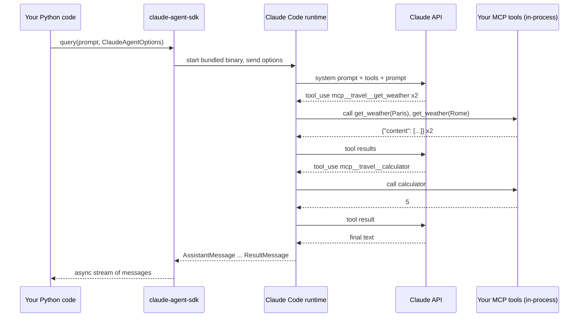

🏠 [Home](../../README.md) › [11 · Frameworks](./README.md) › 11.6 Claude Agent SDK

# 11.6 Claude Agent SDK

> **Difficulty:** 🟡 Intermediate · **Reading time:** ~12 min · **Prerequisites:** [11.1 Framework landscape](./11.1-framework-landscape.md), [1.5 Anatomy of an agent](../01-foundations/01.5-anatomy-of-an-agent.md), [4.1 Why MCP exists](../04-model-context-protocol/04.1-why-mcp-exists.md)
>
> Last verified: November 2026 with claude-agent-sdk==0.2.180

**In one sentence:** The Claude Agent SDK lets your Python or TypeScript program drive Claude Code's own agent loop, with its built-in tools for files, commands and the web, its permissions, hooks, [subagents](../../GLOSSARY.md#subagent) and sessions, and your own tools added through MCP.

📑 **On this page**

- [Why does this matter?](#-why-does-this-matter)
- [The idea, in plain words](#-the-idea-in-plain-words)
- [Picture it](#-picture-it)
- [How it works, step by step](#-how-it-works-step-by-step)
- [Worked example](#-worked-example)
- [Code](#-code)
- [Common mistakes & gotchas](#-common-mistakes--gotchas)
- [Key takeaways](#-key-takeaways)
- [Try it yourself](#-try-it-yourself)
- [Further reading](#-further-reading)

## 🤔 Why does this matter?

A team wants an agent that reads a repository, runs the tests, fixes what fails and opens a pull request. Building that from scratch means writing file-reading tools, a safe shell tool, a permission system so it can't delete everything, [context compaction](../../GLOSSARY.md#context-compaction) for long sessions, and resumable sessions. That is months of work, and it is exactly what a coding agent like Claude Code already has.

The Claude Agent SDK gives you that agent as a library. Anthropic's docs put it as: "Build production AI agents with Claude Code as a library".

## 🧠 The idea, in plain words

Most frameworks in this chapter give you a loop and expect you to bring every tool. The Claude Agent SDK gives you an [agent harness](../../GLOSSARY.md#agent-harness): a whole agent with tools, safety rules and memory management already fitted. You configure it rather than build it.

| Claude Code capability | What you get through the SDK |
| --- | --- |
| Built-in tools | Read, write and edit files, run commands, search the web |
| Permissions | Pre-approve, ask about, or deny each tool |
| Hooks | Your code runs before or after tool calls and other lifecycle events |
| Subagents | Spawn focused helper agents for subtasks |
| MCP | Connect external tools and data via the [Model Context Protocol](../../GLOSSARY.md#model-context-protocol-mcp) |
| Sessions | Keep context across exchanges; resume or fork later |
| Skills, commands, memory | Loaded from `.claude/` folders and `CLAUDE.md`, as in Claude Code |

### Agent SDK or the API SDK's tool runner?

Anthropic has two Python packages that can "run the loop for you", and they are easy to mix up:

| | `claude-agent-sdk` (this page) | `anthropic` SDK tool runner |
| --- | --- | --- |
| What it is | Claude Code's agent loop as a library | A beta helper in the API client: `client.beta.messages.tool_runner(...)` |
| Where the loop runs | In a bundled Claude Code binary that the SDK starts and talks to | In your Python process, calling the Messages API |
| Built-in tools | Yes: files, shell, web search, and more | None; you pass your own `@beta_tool` functions |
| Permissions, hooks, subagents, sessions | Yes | No; you build what you need |
| Custom tools | Through an in-process [MCP server](../../GLOSSARY.md#mcp-server) (`@tool`, `create_sdk_mcp_server`) | Decorated Python functions |
| Use it when | The agent needs to work with files, code or a computer | You want a simple tool loop over the Messages API ([11.9](./11.9-the-no-framework-approach.md)) |

Anthropic's own [comparison](https://code.claude.com/docs/en/agent-sdk/overview) adds two more options: the Claude Code CLI for interactive work, and Managed Agents, where Anthropic hosts the agent harness for you.

## 👀 Picture it



*Your code never calls the model directly. The Claude Code runtime runs the loop and calls back into your process only to run your MCP tools; you watch the run as a stream of messages.*

## 🔍 How it works, step by step

1. **Install.** `pip install claude-agent-sdk`. On supported platforms the wheel bundles a native Claude Code binary, so there is nothing else to install. Set `ANTHROPIC_API_KEY` (or the Amazon Bedrock, Google Cloud or Microsoft Foundry variables).
2. **Define custom tools.** `@tool(name, description, input_schema)` on an `async` handler that returns `{"content": [{"type": "text", "text": ...}]}`, plus `"is_error": True` for failures.
3. **Wrap them in a server.** `create_sdk_mcp_server(name="travel", tools=[...])` makes an in-process MCP server. Its tools appear to Claude as `mcp__travel__get_weather` and so on.
4. **Configure the agent.** `ClaudeAgentOptions(...)`: `system_prompt`, `mcp_servers`, `tools` (which built-in tools exist; `[]` removes them all), `allowed_tools` (which tools are pre-approved), `max_turns`, `max_budget_usd`, `model`, `setting_sources`, hooks and more.
5. **Run.** `async for message in query(prompt=..., options=...)`. For multi-turn conversations, use `ClaudeSDKClient`.
6. **Read the stream.** `AssistantMessage` objects carry text and `ToolUseBlock`s; `UserMessage` objects carry tool results; a final `ResultMessage` has `.result`, `.num_turns`, `.total_cost_usd` and a `subtype` such as `"success"` or `"error_max_turns"`.

A *turn* is one model response plus the tool calls it asked for. Our weather task takes three: two weather calls, the calculator, then the text answer. The docs explain that `max_turns` must leave room for that final text-only turn.

## 💡 Worked example

With no API key, [`examples/11-claude-agent-sdk`](../../examples/11-claude-agent-sdk/README.md) says so and replays the expected tool calls through the real handlers:

```text
Goal: Is it warmer in Paris or Rome right now, and by how much?

ANTHROPIC_API_KEY is not set, so this script does not start a real Claude Code session.
Replaying the expected tool calls locally instead:

tool call:   mcp__travel__get_weather({"city": "Paris"}) -> {"city": "Paris", "temp_c": 14}
tool call:   mcp__travel__get_weather({"city": "Rome"}) -> {"city": "Rome", "temp_c": 19}
tool call:   mcp__travel__calculator({"expression": "19 - 14"}) -> 5
```

With a key, `run()` prints each `ToolUseBlock` as Claude makes it, then a summary line built from the `ResultMessage` (subtype, number of turns and cost), then the answer. We don't paste a live transcript here because the wording, turn count and cost vary from run to run.

Three options in the example matter more than they look:

| Option | Why |
| --- | --- |
| `tools=[]` | Removes every built-in tool. This weather agent has no business running shell commands or reading files. |
| `allowed_tools=["mcp__travel__get_weather", "mcp__travel__calculator"]` | Pre-approves our two tools so the run never stops to ask for permission. |
| `setting_sources=[]` | Ignores `CLAUDE.md`, settings and skills on the machine. By default the SDK loads them, so the same script could behave differently on your laptop and on a server. |

## 💻 Code

The [1.5](../01-foundations/01.5-anatomy-of-an-agent.md#-code) agent, rebuilt on the harness (condensed from the example, following the official [custom tools guide](https://code.claude.com/docs/en/agent-sdk/custom-tools)):

```python
import asyncio
import json
from typing import Any

from claude_agent_sdk import (
    AssistantMessage, ClaudeAgentOptions, ResultMessage, ToolAnnotations, ToolUseBlock,
    create_sdk_mcp_server, query, tool,
)


@tool("get_weather", "Get the current temperature in °C for one city.", {"city": str},
      annotations=ToolAnnotations(readOnlyHint=True))  # read-only tools may run in parallel
async def get_weather(args: dict[str, Any]) -> dict[str, Any]:
    temp = FAKE_WEATHER.get(args["city"].lower())
    if temp is None:
        return {"content": [{"type": "text", "text": f"Unknown city: {args['city']}"}], "is_error": True}
    return {"content": [{"type": "text", "text": json.dumps({"city": args["city"], "temp_c": temp})}]}

# calculator is defined the same way

options = ClaudeAgentOptions(
    system_prompt=INSTRUCTIONS,
    mcp_servers={"travel": create_sdk_mcp_server(name="travel", version="1.0.0", tools=[get_weather, calculator])},
    tools=[],                                   # no built-in tools
    allowed_tools=["mcp__travel__get_weather", "mcp__travel__calculator"],
    setting_sources=[],                         # don't load CLAUDE.md or local settings
    max_turns=6,
)


async def main() -> None:  # needs ANTHROPIC_API_KEY
    async for message in query(prompt="Is it warmer in Paris or Rome right now, and by how much?", options=options):
        if isinstance(message, AssistantMessage):
            for block in message.content:
                if isinstance(block, ToolUseBlock):
                    print("tool call:", block.name, block.input)
        elif isinstance(message, ResultMessage):
            print(message.subtype, message.result)

asyncio.run(main())
```

For contrast, the Anthropic API SDK's tool runner runs a plain tool loop in your process with no harness; see [11.9](./11.9-the-no-framework-approach.md#-code).

**Testing offline.** There is no fake model for the Agent SDK: a run needs the Claude Code runtime and a key. The example's tests cover what you can test offline (the tool handlers, error results and options) and include one end-to-end test that runs only when you set `CLAUDE_AGENT_SDK_LIVE=1` and `ANTHROPIC_API_KEY`:

```python
def test_tool_failures_are_reported_as_errors() -> None:
    unknown = asyncio.run(main.get_weather.handler({"city": "Atlantis"}))
    assert unknown["is_error"] is True
```

Full runnable version, install commands and tests: [`examples/11-claude-agent-sdk`](../../examples/11-claude-agent-sdk/README.md).

## 🚨 Common mistakes & gotchas

- **Leaving every built-in tool switched on.** Without `tools=[...]` the agent can read files and run commands. Give it only what the job needs ([13.3](../13-safety-and-guardrails/13.3-least-privilege-and-sandboxing.md)), and use `allowed_tools`, `disallowed_tools` and the permission mode deliberately.
- **Machine-dependent behaviour.** By default the SDK loads `CLAUDE.md`, settings and skills from the project and from `~/.claude/`. Set `setting_sources` explicitly in production.
- **Assuming you get Claude Code's system prompt.** With no `system_prompt`, the SDK uses a minimal prompt; Claude Code's full prompt (with its safety guidance) is the opt-in `claude_code` preset.
- **Running out of turns.** `max_turns` counts every tool-using turn plus the final answer. Too low a limit ends with subtype `error_max_turns` and no answer; `max_budget_usd` caps spend instead.
- **Mixing up `is_error` spellings.** Python tool handlers return `"is_error": True`; the TypeScript docs use `isError`.
- **Offering claude.ai login in your product.** The docs say third-party developers may not offer claude.ai login or rate limits without approval; use API keys. Your product also may not be branded as "Claude Code".
- **Expecting other model providers.** The SDK runs Claude models only (via the Claude API, Amazon Bedrock, Google Cloud or Microsoft Foundry).

## ✅ Key takeaways

- The Claude Agent SDK is Claude Code's agent loop, tools, permissions and context management as a library.
- It is a harness: you configure a ready-made agent instead of building the loop and tools.
- Custom tools run in-process as an SDK MCP server and appear as `mcp__<server>__<tool>`.
- Restrict built-in tools, pre-approve only what is needed, and pin `setting_sources` for reproducible behaviour.
- It is different from the `anthropic` SDK's tool runner, which is a plain tool loop with no harness.

### Pros and cons

| Pros | Cons |
| --- | --- |
| Production-grade harness: file, shell and web tools, permissions, hooks, subagents, sessions, compaction | Claude models only |
| The same loop that powers Claude Code | Starts a separate runtime process; heavier than a plain API loop |
| MCP-native: in-process and external MCP servers | No offline fake model; end-to-end tests need a key |
| Python and TypeScript | Use is governed by Anthropic's Commercial Terms, plus branding rules |

### When to choose it

- Agents that work on a computer: code, documents, files, shell commands, research with web search.
- You want permissions, hooks and long-session context management without building them.
- Skip it for a small, pure tool-calling assistant, a provider-neutral app, or anything that must run without the Claude Code runtime; use the [tool runner or a plain loop](./11.9-the-no-framework-approach.md) or another framework.

## 🧪 Try it yourself

1. With a key, remove `tools=[]` from the example and ask *"Which files are in this folder?"*. Which built-in tool does Claude use, and does it need permission?
2. Why does the example pass `setting_sources=[]`, and what could happen on a teammate's machine without it?

<details>
<summary>Show answer</summary>

1. Claude typically reaches for a file-listing built-in such as `Glob` or `Bash`. Because those tools are not in `allowed_tools`, the call goes through the permission flow (the `permission_mode` and any `can_use_tool` callback) instead of running automatically.
2. Without it, the SDK loads the user's and project's settings, `CLAUDE.md` and skills. A teammate's `~/.claude/CLAUDE.md` could add instructions, or their settings could allow extra tools, so the same script would behave differently on their machine. Pinning `setting_sources` makes runs reproducible.

</details>

## 📚 Further reading

- [Agent SDK overview](https://code.claude.com/docs/en/agent-sdk/overview). Capabilities, and the comparison with the CLI, the client SDK and Managed Agents.
- [Quickstart](https://code.claude.com/docs/en/agent-sdk/quickstart) and [How the agent loop works](https://code.claude.com/docs/en/agent-sdk/agent-loop). Installation, authentication, turns and message types.
- [Give Claude custom tools](https://code.claude.com/docs/en/agent-sdk/custom-tools). `@tool`, in-process MCP servers, annotations and error handling.
- [Configure permissions](https://code.claude.com/docs/en/agent-sdk/permissions), [Hooks](https://code.claude.com/docs/en/agent-sdk/hooks) and [Subagents](https://code.claude.com/docs/en/agent-sdk/subagents). Controlling what the agent may do.
- [Python SDK reference](https://code.claude.com/docs/en/agent-sdk/python). Every option and message type.
- [Tool runner (SDK)](https://platform.claude.com/docs/en/agents-and-tools/tool-use/tool-runner). The `anthropic` package's lighter alternative.

<!-- FOOTER -->

---

⬅️ **Previous:** [11.5 OpenAI Agents SDK](./11.5-openai-agents-sdk.md) ·
🏠 [Chapter home](./README.md) ·
➡️ **Next:** [11.7 LlamaIndex agents](./11.7-llamaindex-agents.md)
