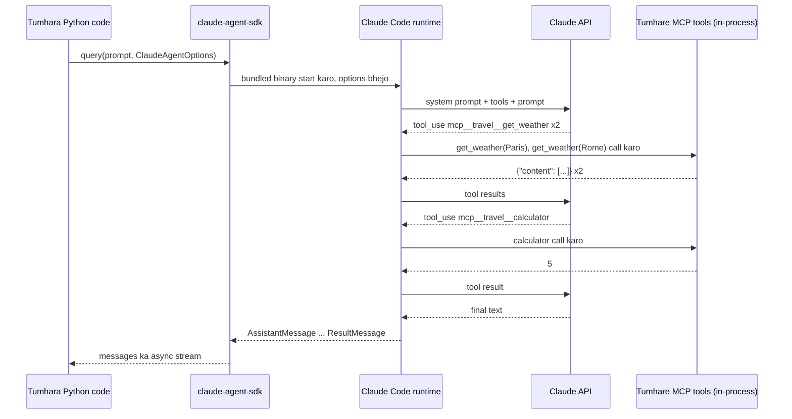

🏠 [Home](../../README.md) › [11 · Frameworks](./README.md) › 11.6 Claude Agent SDK

# 11.6 Claude Agent SDK

> **Level:** 🟡 Intermediate · **Padhne ka time:** ~12 min · **Pehle padho:** [11.1 Frameworks ka poora naksha](./11.1-framework-landscape.md), [1.5 Agent ke andar kya-kya hota hai](../01-foundations/01.5-anatomy-of-an-agent.md), [4.1 MCP kyun bana?](../04-model-context-protocol/04.1-why-mcp-exists.md)
>
> Last verified: November 2026 with claude-agent-sdk==0.2.180

**Ek line mein:** Claude Agent SDK tumhare Python ya TypeScript program ko Claude Code ka apna agent loop chalane deta hai, uske built-in tools (files, commands aur web ke liye), permissions, hooks, [subagents](../../GLOSSARY.md#subagent) aur sessions ke saath, aur tumhare apne tools MCP ke through jodta hai.

📑 **Is page par**

- [Yeh kyun zaroori hai?](#-yeh-kyun-zaroori-hai)
- [Idea, simple words mein](#-idea-simple-words-mein)
- [Diagram se samjho](#-diagram-se-samjho)
- [Kaise kaam karta hai, step by step](#-kaise-kaam-karta-hai-step-by-step)
- [Example se samjho](#-example-se-samjho)
- [Code](#-code)
- [Aam galtiyan aur dhyan dene wali baatein](#-aam-galtiyan-aur-dhyan-dene-wali-baatein)
- [Yaad rakhne wali baatein](#-yaad-rakhne-wali-baatein)
- [Khud try karo](#-khud-try-karo)
- [Aur padhne ke liye](#-aur-padhne-ke-liye)

## 🤔 Yeh kyun zaroori hai?

Ek team ko aisa agent chahiye jo repository padhe, tests chalaye, jo fail ho use fix kare aur pull request khole. Ise scratch se banane ka matlab hai: file padhne wale tools likhna, ek safe shell tool, ek permission system taaki woh sab delete na kar de, lambe sessions ke liye [context compaction](../../GLOSSARY.md#context-compaction), aur resume ho sakne wale sessions.

Yeh mahino ka kaam hai. Aur exactly yahi sab Claude Code jaise coding agent mein pehle se hai.

Claude Agent SDK tumhe woh agent ek library ki tarah deta hai. Anthropic ke docs kehte hain: "Build production AI agents with Claude Code as a library". Matlab Claude Code ko library ki tarah use karke production AI agents banao.

## 🧠 Idea, simple words mein

Is chapter ke zyada tar frameworks tumhe ek loop dete hain aur expect karte hain ki har tool tum khud laoge. Claude Agent SDK tumhe ek [agent harness](../../GLOSSARY.md#agent-harness) deta hai: ek poora agent jisme tools, safety rules aur memory management pehle se fit hain. Tum ise banate nahi, configure karte ho.

Socho ek furnished flat kiraye par lena. Bed, fridge, gas sab pehle se laga hai, aur society ke rules bhi hain. Tum bas apna saamaan laate ho aur decide karte ho ki kaunsa kamra kisko milega. Khaali flat (plain loop) mein sab kuch khud kharidna padta.

| Claude Code capability | SDK se tumhe kya milta hai |
| --- | --- |
| Built-in tools | Files padhna, likhna aur edit karna, commands chalana, web search karna |
| Permissions | Har tool ko pehle se approve karo, uske baare mein poocho, ya deny karo |
| Hooks | Tool calls aur doosre lifecycle events se pehle ya baad tumhara code chalta hai |
| Subagents | Subtasks ke liye focused helper agents spawn karo |
| MCP | [Model Context Protocol](../../GLOSSARY.md#model-context-protocol-mcp) se external tools aur data jodo |
| Sessions | Exchanges ke beech context rakho; baad mein resume ya fork karo |
| Skills, commands, memory | `.claude/` folders aur `CLAUDE.md` se load hote hain, jaise Claude Code mein |

### Agent SDK ya API SDK ka tool runner?

Anthropic ke do Python packages hain jo "tumhare liye loop chala sakte hain", aur inhe mix up karna aasaan hai:

| | `claude-agent-sdk` (yeh page) | `anthropic` SDK tool runner |
| --- | --- | --- |
| Yeh kya hai | Claude Code ka agent loop, ek library ki tarah | API client mein ek beta helper: `client.beta.messages.tool_runner(...)` |
| Loop kahan chalta hai | Ek bundled Claude Code binary mein, jise SDK start karta hai aur usse baat karta hai | Tumhare Python process mein, Messages API call karte hue |
| Built-in tools | Haan: files, shell, web search, aur bhi | Koi nahi; tum apne `@beta_tool` functions dete ho |
| Permissions, hooks, subagents, sessions | Haan | Nahi; jo chahiye woh tum banate ho |
| Custom tools | Ek in-process [MCP server](../../GLOSSARY.md#mcp-server) ke through (`@tool`, `create_sdk_mcp_server`) | Decorated Python functions |
| Kab use karo | Jab agent ko files, code ya computer ke saath kaam karna ho | Jab tumhe Messages API ke upar ek simple tool loop chahiye ([11.9](./11.9-the-no-framework-approach.md)) |

Anthropic ka apna [comparison](https://code.claude.com/docs/en/agent-sdk/overview) do aur options jodta hai: interactive kaam ke liye Claude Code CLI, aur Managed Agents, jahan Anthropic tumhare liye agent harness host karta hai.

## 👀 Diagram se samjho



*Tumhara code kabhi model ko seedha call nahi karta. Claude Code runtime loop chalata hai aur tumhare process mein sirf tumhare MCP tools chalane ke liye wapas aata hai; tum run ko messages ke stream ki tarah dekhte ho.*

## 🔍 Kaise kaam karta hai, step by step

1. **Install karo.** `pip install claude-agent-sdk`. Supported platforms par wheel ke andar ek native Claude Code binary bundled hoti hai, isliye aur kuch install nahi karna. `ANTHROPIC_API_KEY` set karo (ya Amazon Bedrock, Google Cloud ya Microsoft Foundry ke variables).
2. **Custom tools define karo.** Ek `async` handler par `@tool(name, description, input_schema)` lagao jo `{"content": [{"type": "text", "text": ...}]}` return kare, aur failures ke liye `"is_error": True` bhi.
3. **Inhe ek server mein lapeto.** `create_sdk_mcp_server(name="travel", tools=[...])` ek in-process MCP server banata hai. Iske tools Claude ko `mcp__travel__get_weather` jaise naamon se dikhte hain.
4. **Agent configure karo.** `ClaudeAgentOptions(...)`: `system_prompt`, `mcp_servers`, `tools` (kaunse built-in tools exist karte hain; `[]` sab hata deta hai), `allowed_tools` (kaunse tools pehle se approved hain), `max_turns`, `max_budget_usd`, `model`, `setting_sources`, hooks aur aur bhi.
5. **Chalao.** `async for message in query(prompt=..., options=...)`. Multi-turn conversations ke liye `ClaudeSDKClient` use karo.
6. **Stream padho.** `AssistantMessage` objects mein text aur `ToolUseBlock`s hote hain; `UserMessage` objects mein tool results hote hain; aakhri `ResultMessage` mein `.result`, `.num_turns`, `.total_cost_usd` aur ek `subtype` hota hai jaise `"success"` ya `"error_max_turns"`.

Ek *turn* matlab model ka ek response plus woh tool calls jo usne maange. Hamare weather task mein teen lagte hain: do weather calls, calculator, phir text answer. Docs samjhate hain ki `max_turns` mein us aakhri text-only turn ki jagah bachni chahiye.

## 💡 Example se samjho

API key ke bina script asli session start nahi kar sakti. Woh bas yeh bata sakti hai aur expected tool calls asli handlers se replay kar sakti hai:

```text
Goal: Is it warmer in Paris or Rome right now, and by how much?

ANTHROPIC_API_KEY is not set, so this script does not start a real Claude Code session.
Replaying the expected tool calls locally instead:

tool call:   mcp__travel__get_weather({"city": "Paris"}) -> {"city": "Paris", "temp_c": 14}
tool call:   mcp__travel__get_weather({"city": "Rome"}) -> {"city": "Rome", "temp_c": 19}
tool call:   mcp__travel__calculator({"expression": "19 - 14"}) -> 5
```

Key ke saath, ek live run har `ToolUseBlock` ko print karta hai jaise jaise Claude use banata hai, phir `ResultMessage` se bani ek summary line (subtype, turns ki ginti aur cost), phir answer. Hum yahan live transcript paste nahi kar rahe kyunki wording, turn count aur cost har run mein badalte hain.

Neeche Code ke teen options jitne dikhte hain usse zyada important hain:

| Option | Kyun |
| --- | --- |
| `tools=[]` | Har built-in tool hata deta hai. Is weather agent ka shell commands chalane ya files padhne se koi lena dena nahi. |
| `allowed_tools=["mcp__travel__get_weather", "mcp__travel__calculator"]` | Hamare do tools ko pehle se approve kar deta hai taaki run kabhi permission maangne ke liye na ruke. |
| `setting_sources=[]` | Machine par maujood `CLAUDE.md`, settings aur skills ko ignore karta hai. Default mein SDK inhe load karta hai, isliye same script tumhare laptop aur server par alag behave kar sakti hai. |

## 💻 Code

[1.5](../01-foundations/01.5-anatomy-of-an-agent.md#-code) wala agent, harness par dobara banaya gaya (official [custom tools guide](https://code.claude.com/docs/en/agent-sdk/custom-tools) ke hisaab se):

```python
import asyncio
import json
from typing import Any

from claude_agent_sdk import (
    AssistantMessage, ClaudeAgentOptions, ResultMessage, ToolAnnotations, ToolUseBlock,
    create_sdk_mcp_server, query, tool,
)


@tool("get_weather", "Get the current temperature in °C for one city.", {"city": str},
      annotations=ToolAnnotations(readOnlyHint=True))  # read-only tools parallel mein chal sakte hain
async def get_weather(args: dict[str, Any]) -> dict[str, Any]:
    temp = FAKE_WEATHER.get(args["city"].lower())
    if temp is None:
        return {"content": [{"type": "text", "text": f"Unknown city: {args['city']}"}], "is_error": True}
    return {"content": [{"type": "text", "text": json.dumps({"city": args["city"], "temp_c": temp})}]}

# calculator bhi isi tarah define hota hai

options = ClaudeAgentOptions(
    system_prompt=INSTRUCTIONS,
    mcp_servers={"travel": create_sdk_mcp_server(name="travel", version="1.0.0", tools=[get_weather, calculator])},
    tools=[],                                   # koi built-in tool nahi
    allowed_tools=["mcp__travel__get_weather", "mcp__travel__calculator"],
    setting_sources=[],                         # CLAUDE.md ya local settings load mat karo
    max_turns=6,
)


async def main() -> None:  # ANTHROPIC_API_KEY chahiye
    async for message in query(prompt="Is it warmer in Paris or Rome right now, and by how much?", options=options):
        if isinstance(message, AssistantMessage):
            for block in message.content:
                if isinstance(block, ToolUseBlock):
                    print("tool call:", block.name, block.input)
        elif isinstance(message, ResultMessage):
            print(message.subtype, message.result)

asyncio.run(main())
```

Farak dekhne ke liye: Anthropic API SDK ka tool runner tumhare process mein bina harness ke ek plain tool loop chalata hai; [11.9](./11.9-the-no-framework-approach.md#-code) dekho.

**Offline testing.** Agent SDK ke liye koi fake model nahi hai: run ko Claude Code runtime aur ek key chahiye. Jo offline test ho sake woh karo (tool handlers, error results aur options), aur ek end-to-end test rakho jo sirf tab chale jab tum `CLAUDE_AGENT_SDK_LIVE=1` jaisa flag aur `ANTHROPIC_API_KEY` set karo:

```python
def test_tool_failures_are_reported_as_errors() -> None:
    unknown = asyncio.run(get_weather.handler({"city": "Atlantis"}))
    assert unknown["is_error"] is True
```

## 🚨 Aam galtiyan aur dhyan dene wali baatein

- **Har built-in tool on chhod dena.** `tools=[...]` ke bina agent files padh sakta hai aur commands chala sakta hai. Use sirf utna do jitna kaam ke liye chahiye ([13.3](../13-safety-and-guardrails/13.3-least-privilege-and-sandboxing.md)), aur `allowed_tools`, `disallowed_tools` aur permission mode soch samajh ke use karo.
- **Machine par depend karne wala behaviour.** Default mein SDK project se aur `~/.claude/` se `CLAUDE.md`, settings aur skills load karta hai. Production mein `setting_sources` explicitly set karo.
- **Yeh maan lena ki Claude Code ka system prompt milega.** `system_prompt` na do toh SDK ek minimal prompt use karta hai; Claude Code ka poora prompt (uski safety guidance ke saath) opt-in `claude_code` preset hai.
- **Turns khatam ho jaana.** `max_turns` har tool-using turn plus final answer ko ginta hai. Bahut kam limit par run `error_max_turns` subtype ke saath bina answer ke khatam hota hai; `max_budget_usd` iski jagah kharche par cap lagata hai.
- **`is_error` ki spellings mix up karna.** Python tool handlers `"is_error": True` return karte hain; TypeScript docs `isError` use karte hain.
- **Apne product mein claude.ai login dena.** Docs kehte hain ki third-party developers bina approval ke claude.ai login ya rate limits offer nahi kar sakte; API keys use karo. Tumhare product ki branding bhi "Claude Code" nahi ho sakti.
- **Doosre model providers expect karna.** SDK sirf Claude models chalata hai (Claude API, Amazon Bedrock, Google Cloud ya Microsoft Foundry ke through).

## ✅ Yaad rakhne wali baatein

- Claude Agent SDK matlab Claude Code ka agent loop, tools, permissions aur context management, ek library ki tarah.
- Yeh ek harness hai: loop aur tools banane ki jagah tum ek ready-made agent configure karte ho.
- Custom tools in-process SDK MCP server ki tarah chalte hain aur `mcp__<server>__<tool>` naam se dikhte hain.
- Built-in tools restrict karo, sirf zaroori cheezein pre-approve karo, aur reproducible behaviour ke liye `setting_sources` pin karo.
- Yeh `anthropic` SDK ke tool runner se alag hai, jo bina harness ka ek plain tool loop hai.

### Fayde aur nuksaan

| Fayde | Nuksaan |
| --- | --- |
| Production-grade harness: file, shell aur web tools, permissions, hooks, subagents, sessions, compaction | Sirf Claude models |
| Wahi loop jo Claude Code ko chalata hai | Ek alag runtime process start karta hai; plain API loop se bhaari |
| MCP-native: in-process aur external MCP servers | Offline fake model nahi; end-to-end tests ko key chahiye |
| Python aur TypeScript | Use Anthropic ke Commercial Terms ke under aata hai, plus branding rules |

### Kab choose karo

- Aise agents jo computer par kaam karte hain: code, documents, files, shell commands, web search ke saath research.
- Tumhe permissions, hooks aur long-session context management chahiye bina inhe khud banaye.
- Ek chhote, sirf tool-calling assistant ke liye, provider-neutral app ke liye, ya kisi bhi aisi cheez ke liye jo Claude Code runtime ke bina chalni chahiye, ise skip karo; [tool runner ya plain loop](./11.9-the-no-framework-approach.md) ya koi aur framework use karo.

## 🧪 Khud try karo

1. Key ke saath, Code snippet se `tools=[]` hata do aur poocho *"Which files are in this folder?"*. Claude kaunsa built-in tool use karta hai, aur kya use permission chahiye?
2. Snippet `setting_sources=[]` kyun pass karta hai, aur iske bina kisi teammate ki machine par kya ho sakta hai?

<details>
<summary>Answer dekho</summary>

1. Claude aam taur par `Glob` ya `Bash` jaisa file-listing built-in tool uthata hai. Kyunki yeh tools `allowed_tools` mein nahi hain, call apne aap chalne ki jagah permission flow (`permission_mode` aur koi `can_use_tool` callback) se guzarti hai.
2. Iske bina SDK user aur project ki settings, `CLAUDE.md` aur skills load karta hai. Teammate ka `~/.claude/CLAUDE.md` naye instructions jod sakta hai, ya unki settings extra tools allow kar sakti hain, isliye same script unki machine par alag behave karegi. `setting_sources` pin karne se runs reproducible bante hain.

</details>

## 📚 Aur padhne ke liye

- [Agent SDK overview](https://code.claude.com/docs/en/agent-sdk/overview). Capabilities, aur CLI, client SDK aur Managed Agents ke saath comparison.
- [Quickstart](https://code.claude.com/docs/en/agent-sdk/quickstart) aur [How the agent loop works](https://code.claude.com/docs/en/agent-sdk/agent-loop). Installation, authentication, turns aur message types.
- [Give Claude custom tools](https://code.claude.com/docs/en/agent-sdk/custom-tools). `@tool`, in-process MCP servers, annotations aur error handling.
- [Configure permissions](https://code.claude.com/docs/en/agent-sdk/permissions), [Hooks](https://code.claude.com/docs/en/agent-sdk/hooks) aur [Subagents](https://code.claude.com/docs/en/agent-sdk/subagents). Agent kya kar sakta hai, ise control karna.
- [Python SDK reference](https://code.claude.com/docs/en/agent-sdk/python). Har option aur message type.
- [Tool runner (SDK)](https://platform.claude.com/docs/en/agents-and-tools/tool-use/tool-runner). `anthropic` package ka halka alternative.

<!-- FOOTER -->

---

⬅️ **Pichla:** [11.5 OpenAI Agents SDK](./11.5-openai-agents-sdk.md) ·
🏠 [Chapter home](./README.md) ·
➡️ **Agla:** [11.7 LlamaIndex agents](./11.7-llamaindex-agents.md)
