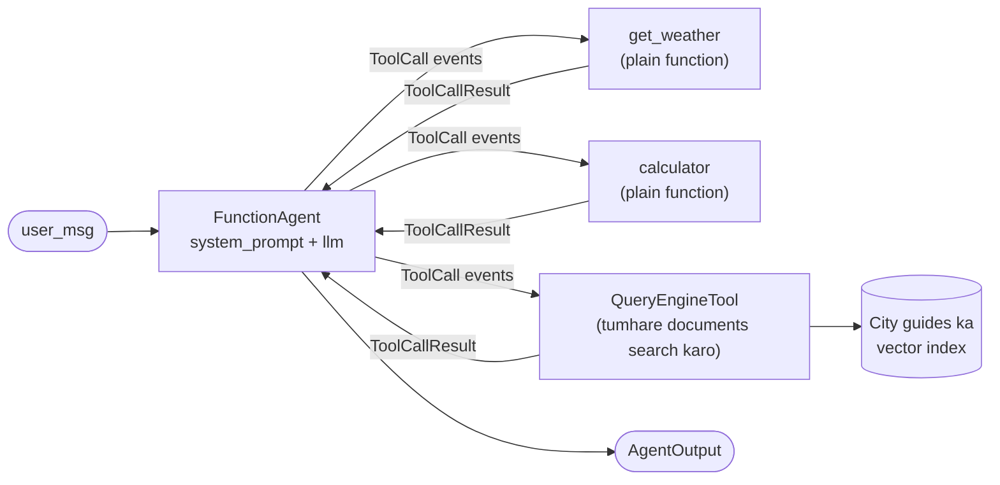

🏠 [Home](../../README.md) › [11 · Frameworks](./README.md) › 11.7 LlamaIndex agents

# 11.7 LlamaIndex agents

> **Level:** 🟡 Intermediate · **Padhne ka time:** ~12 min · **Pehle padho:** [11.1 Frameworks ka poora naksha](./11.1-framework-landscape.md), [1.5 Agent ke andar kya-kya hota hai](../01-foundations/01.5-anatomy-of-an-agent.md), [6.1 RAG, 5 minute mein](../06-rag-for-agents/06.1-rag-in-5-minutes.md)
>
> Last verified: November 2026 with llama-index-core==0.14.25

**Ek line mein:** LlamaIndex shuru mein LLMs ko tumhare apne data se jodne ka toolkit tha, aur iske agents (`FunctionAgent`, `ReActAgent`, `CodeActAgent`, `AgentWorkflow`) agent ko normal tools ke saath-saath tumhare documents par search dena aasaan bana dete hain.

📑 **Is page par**

- [Yeh kyun zaroori hai?](#-yeh-kyun-zaroori-hai)
- [Idea, simple words mein](#-idea-simple-words-mein)
- [Diagram se samjho](#-diagram-se-samjho)
- [Kaise kaam karta hai, step by step](#-kaise-kaam-karta-hai-step-by-step)
- [Example se samjho](#-example-se-samjho)
- [Code](#-code)
- [Aam galtiyan aur dhyan dene wali baatein](#-aam-galtiyan-aur-dhyan-dene-wali-baatein)
- [Yaad rakhne wali baatein](#-yaad-rakhne-wali-baatein)
- [Khud try karo](#-khud-try-karo)
- [Aur padhne ke liye](#-aur-padhne-ke-liye)

## 🤔 Yeh kyun zaroori hai?

Ek travel agency ke paas 400 PDF city guides, ek booking API aur ek weather API hai. Customers aise sawal poochte hain: *"Is Rome warmer than Paris this week, and which museums in Rome are open on Mondays?"*. Is jawab ka aadha hissa live API mein hai; baaki aadha PDFs mein.

Bahut saare frameworks API call kar sakte hain. Lekin kam hi aise hain jo 400 PDFs load karna, unhe chunk aur index karna, aur agent ko ek aur tool ki tarah dena aasaan banate hain. Yeh combination LlamaIndex ka ghar ka maidan hai.

## 🧠 Idea, simple words mein

LlamaIndex ke do hisse hain jo saath fit hote hain:

- **Data**: readers jo documents load karte hain, indexes jo unhe searchable banate hain, aur *query engines* jo ek index par sawalon ke jawab dete hain ([retrieval-augmented generation](../../GLOSSARY.md#retrieval-augmented-generation-rag), dekho [chapter 06](../06-rag-for-agents/README.md)).
- **Agents**: ready-made agents jo loop mein tools call karte hain. Tool ek plain Python function ho sakta hai, ya `QueryEngineTool` mein lipta poora query engine.

Socho ek library ka librarian. Woh har kitaab yaad nahi rakhta, lekin catalogue (index) dekh ke turant sahi shelf se sahi kitaab nikaal deta hai. Saath mein woh phone uthake kisi aur se bhi pooch sakta hai (doosre tools). LlamaIndex agent bhi aisa hi hai.

Agent classes `llama_index.core.agent.workflow` mein hain:

| Agent | Tools kaise call karta hai | Kab use karo |
| --- | --- | --- |
| `FunctionAgent` | Model ki native [function calling](../../GLOSSARY.md#function-calling) se | Tumhara model tool calls support karta hai (aaj ke zyada tar models karte hain) |
| `ReActAgent` | [ReAct](../../GLOSSARY.md#react) text format se: Thought, Action, Observation | Model mein native tool calling nahi hai |
| `CodeActAgent` | Model code likhta hai jo tools call karta hai | Tum chahte ho ki model tools ko code mein combine kare |
| `AgentWorkflow` | Kai agents jo ek doosre ko hand off karte hain | Thode se extra code mein ek [multi-agent system](../../GLOSSARY.md#multi-agent-system) |

Yeh sab LlamaIndex **Workflows** par bane hain, jo multi-step programs likhne ka ek event-driven tarika hai. Agent ka loop ek workflow hai jo events emit karta hai (`ToolCall`, `ToolCallResult`, `AgentStream`, `AgentOutput`), jinhe tum stream aur inspect kar sakte ho.

## 👀 Diagram se samjho



*Agent ke liye tumhare documents search karna bas ek aur tool hai. Weather example sirf do function tools use karta hai; document search jodna `tools` list mein bas ek aur item hai.*

## 🔍 Kaise kaam karta hai, step by step

1. **Tools likho.** Plain functions kaafi hain: LlamaIndex naam, type hints aur docstring padhta hai. Zyada control ke liye `FunctionTool` use karo, ya ek index expose karne ke liye `QueryEngineTool.from_defaults(query_engine, name=..., description=...)`.
2. **Model chuno.** Ek integration package install karo, jaise `llama-index-llms-anthropic` ya `llama-index-llms-openai`, aur `Anthropic(model=...)` ya `OpenAI(model=...)` banao.
3. **Agent banao.** `FunctionAgent(tools=[...], llm=llm, system_prompt=...)`.
4. **Chalao.** `handler = agent.run(user_msg=...)` workflow start karta hai aur turant ek handler return karta hai. `await handler` final `AgentOutput` deta hai; `async for event in handler.stream_events()` chalte waqt har step dikhata hai.
5. **Loop.** Agent system prompt, memory aur tool schemas model ko bhejta hai, model ke maange har tool call ko chalata hai, results memory mein jodta hai, aur tab tak repeat karta hai jab tak model bina tool calls ke answer na de.
6. **Limit.** `run(..., max_iterations=...)` loop par cap lagata hai (default 20). Iske paar jaane par workflow error raise karta hai, ya agar tumne `early_stopping_method="generate"` set kiya hai toh ek final answer generate karta hai.
7. **State rakho.** Runs ke beech state rakhni ho toh kai runs mein same `Context` pass karo; docs dikhate hain ki conversation save aur restore karne ke liye ise serialise kaise karo.

## 💡 Example se samjho

LlamaIndex ke `MockFunctionCallingLLM` ke saath offline chalao. Trace workflow ke `ToolCall` aur `ToolCallResult` events se bana hai:

```text
Goal: Is it warmer in Paris or Rome right now, and by how much?

tool call:   get_weather({"city": "Paris"})
tool call:   get_weather({"city": "Rome"})
tool result: {"city": "Paris", "temp_c": 14}
tool result: {"city": "Rome", "temp_c": 19}
tool call:   calculator({"expression": "19 - 14"})
tool result: 5

Answer: Rome is warmer: 19°C versus 14°C in Paris, a difference of 5°C.
```

Model ko uski teen calls mein se har ek par kaunse messages mile, role ke hisaab se:

```text
call 1: system, user
call 2: system, user, assistant (2 tool calls), tool, tool
call 3: system, user, assistant, tool, tool, assistant (1 tool call), tool
```

`system` message hamara `system_prompt` hai, aur har call ke saath dono tool schemas bhi gaye. Yeh wahi badhti hui conversation hai jo tumne [chapter 02](../02-the-agent-loop/README.md) mein haath se banayi thi.

## 💻 Code

[1.5](../01-foundations/01.5-anatomy-of-an-agent.md#-code) wala agent ek `FunctionAgent` ki tarah, official [Building an agent](https://developers.llamaindex.ai/python/framework/understanding/agent/) tutorial ke hisaab se:

```python
import asyncio

from llama_index.core.agent.workflow import FunctionAgent, ToolCall, ToolCallResult
from llama_index.llms.anthropic import Anthropic   # ya: from llama_index.llms.openai import OpenAI


def get_weather(city: str) -> str:
    """Get the current temperature in °C for one city, e.g. 'Paris'."""
    ...  # calculator bhi ek plain function hai


agent = FunctionAgent(
    tools=[get_weather, calculator],          # plain functions tools ban jaate hain
    llm=Anthropic(model="claude-opus-5-5", max_tokens=4096),  # ANTHROPIC_API_KEY chahiye
    system_prompt=INSTRUCTIONS,
)


async def main() -> None:
    handler = agent.run(user_msg="Is it warmer in Paris or Rome right now, and by how much?", max_iterations=6)
    async for event in handler.stream_events():   # loop ko chalte hue dekho
        if isinstance(event, ToolCall):
            print("tool call:", event.tool_name, event.tool_kwargs)
        elif isinstance(event, ToolCallResult):
            print("tool result:", event.tool_output.content)
    print(await handler)

asyncio.run(main())
```

Apne documents jodna bas ek aur tool hai:

```python
from llama_index.core import SimpleDirectoryReader, VectorStoreIndex
from llama_index.core.tools import QueryEngineTool

index = VectorStoreIndex.from_documents(SimpleDirectoryReader("city_guides").load_data())
guides = QueryEngineTool.from_defaults(
    index.as_query_engine(),
    name="city_guides",
    description="Answers questions about museums, food and opening hours from our city guides.",
)
agent = FunctionAgent(tools=[get_weather, calculator, guides], llm=llm, system_prompt=INSTRUCTIONS)
```

**Offline testing.** `llama_index.core.llms` ka `MockFunctionCallingLLM` ek `response_generator(messages, **kwargs)` leta hai jo agla `ChatMessage` return karta hai. Tool calls ke liye `ToolCallBlock`s return karo, ya answer ke liye text:

```python
def scripted_reply(messages, **kwargs) -> ChatMessage:
    results_seen = sum(m.role == MessageRole.TOOL for m in messages)
    if results_seen == 0:
        return ChatMessage(role=MessageRole.ASSISTANT, blocks=[
            ToolCallBlock(tool_call_id="call_1", tool_name="get_weather", tool_kwargs={"city": "Paris"}),
            ToolCallBlock(tool_call_id="call_2", tool_name="get_weather", tool_kwargs={"city": "Rome"}),
        ])
    ...

agent = FunctionAgent(tools=[...], llm=MockFunctionCallingLLM(response_generator=scripted_reply), system_prompt=...)
```

## 🚨 Aam galtiyan aur dhyan dene wali baatein

- **512-token default.** `llama_index.llms.anthropic.Anthropic` ka default `max_tokens=512` hai, jo lambe answers beech mein kaat deta hai. `max_tokens` khud set karo.
- **Anjaan model names.** `llama_index.llms.openai.OpenAI` model name ko ek built-in list se check karta hai aur jo naam use nahi pata unke liye `Unknown model` raise karta hai (jaise tumhare package se naya koi model). Integration upgrade karo, ya koi OpenAI-compatible class use karo.
- **Bhool jaana ki yeh async hai.** `agent.run(...)` ek handler return karta hai; use ek event loop ke andar `await` karna zaroori hai. Scripts ko `asyncio.run(main())` mein lapeto.
- **Default mein streaming.** `FunctionAgent` default mein model output stream karta hai. Agar koi model ya proxy streaming support nahi karta, toh `streaming=False` pass karo.
- **Gol-mol query-engine descriptions.** Agent `city_guides` tabhi chunega jab uski description bataye ki andar kya hai. "Search tool" kaafi nahi hai ([3.4](../03-tools-and-function-calling/03.4-designing-good-tools.md)).
- **Packages ka bantwara.** `llama-index` ek bundle hai; `llama-index-core` plus sirf zaroori integrations halka padta hai. Inke versions compatible rakho (inhe saath mein pin karo).

## ✅ Yaad rakhne wali baatein

- LlamaIndex ek strong data layer (loaders, indexes, query engines) ko ready-made agents ke saath jodta hai.
- `FunctionAgent` native tool calling use karta hai; `ReActAgent` aur `CodeActAgent` text aur code use karte hain; `AgentWorkflow` kai agents ko coordinate karta hai.
- Plain functions aur poore query engines dono bas tools hain.
- Agents workflows hain: har step dekhne aur test karne ke liye `ToolCall` aur `ToolCallResult` events stream karo.
- Response generator ke saath `MockFunctionCallingLLM` offline tests simple bana deta hai.

### Fayde aur nuksaan

| Fayde | Nuksaan |
| --- | --- |
| Tumhara data load, index aur query karne ke liye best-in-class tools | Install karne aur saath mein rakhne ke liye bahut saare packages |
| Kuch lines mein ek document index agent tool ban jaata hai | Async-first API naye logon ko surprise kar sakti hai |
| Kai agent styles, plus multi-agent `AgentWorkflow` | Kuch integration defaults (jaise `max_tokens=512`) override karne padte hain |
| Event streaming se loop observe aur test karna aasaan | Complex control flow par graph framework se kam control |

### Kab choose karo

- Tumhare agent ka main kaam tumhare apne documents ya data se jawab dena hai, saath mein kuch action tools.
- Tum pehle se RAG ke liye LlamaIndex use karte ho aur ab tool use jodna chahte ho.
- Jab koi document search hai hi nahi, tab ise skip karo; ek halka agent SDK ya [plain loop](./11.9-the-no-framework-approach.md) kaam kar dega.

## 🧪 Khud try karo

1. Code section wala agent `max_iterations=1` ke saath chalao. Kya hota hai, aur kyun?
2. Tumne ek `city_guides` query-engine tool joda, lekin agent museum ke sawalon ka jawab apni knowledge se deta rehta hai. Check karne wali do cheezein batao.

<details>
<summary>Answer dekho</summary>

1. Workflow ek `WorkflowRuntimeError` ("Max iterations of 1 reached!") raise karta hai, kyunki agent ko khatam karne ke liye teen model calls chahiye.
2. Pehla, tool ki `description`: kya woh saaf batati hai ki guides mein museums aur opening hours hain? Doosra, `system_prompt`: agent ko bolo ki city ki jagahon ke baare mein kuch bhi ho toh `city_guides` use kare, aur kabhi memory se jawab na de. Yeh bhi check karo ki documents mein sach mein jawab hai, `index.as_query_engine().query(...)` seedha call karke.

</details>

## 📚 Aur padhne ke liye

- [Building an agent](https://developers.llamaindex.ai/python/framework/understanding/agent/). Official `FunctionAgent` tutorial.
- [Agents](https://developers.llamaindex.ai/python/framework/module_guides/deploying/agents/). Agent types, tools aur Tool Specs.
- [Maintaining state](https://developers.llamaindex.ai/python/framework/understanding/agent/state/). `Context`, aur runs ke beech use serialise karna.
- [Multi-agent patterns in LlamaIndex](https://developers.llamaindex.ai/python/framework/understanding/agent/multi_agent/). `AgentWorkflow`, orchestrator agents aur custom planners.
- [Workflows](https://developers.llamaindex.ai/python/llamaagents/workflows/). Agents ke neeche chalne wala event-driven engine.

<!-- FOOTER -->

---

⬅️ **Pichla:** [11.6 Claude Agent SDK](./11.6-claude-agent-sdk.md) ·
🏠 [Chapter home](./README.md) ·
➡️ **Agla:** [11.8 Pydantic AI](./11.8-pydantic-ai.md)
