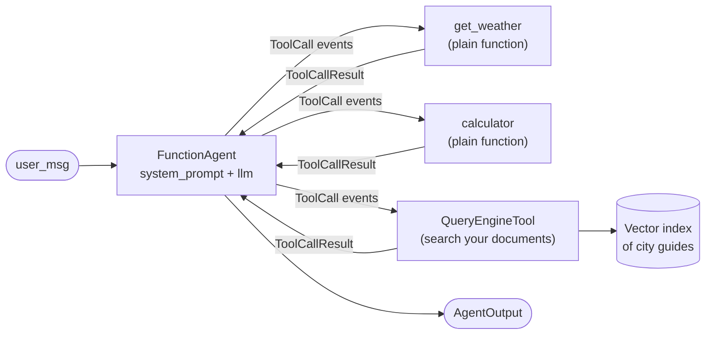

🏠 [Home](../../README.md) › [11 · Frameworks](./README.md) › 11.7 LlamaIndex agents

# 11.7 LlamaIndex agents

> **Difficulty:** 🟡 Intermediate · **Reading time:** ~12 min · **Prerequisites:** [11.1 Framework landscape](./11.1-framework-landscape.md), [1.5 Anatomy of an agent](../01-foundations/01.5-anatomy-of-an-agent.md), [6.1 RAG in 5 minutes](../06-rag-for-agents/06.1-rag-in-5-minutes.md)
>
> Last verified: November 2026 with llama-index-core==0.14.25

**In one sentence:** LlamaIndex started as a toolkit for connecting LLMs to your own data, and its agents (`FunctionAgent`, `ReActAgent`, `CodeActAgent`, `AgentWorkflow`) make it easy to give an agent search over your documents alongside ordinary tools.

📑 **On this page**

- [Why does this matter?](#-why-does-this-matter)
- [The idea, in plain words](#-the-idea-in-plain-words)
- [Picture it](#-picture-it)
- [How it works, step by step](#-how-it-works-step-by-step)
- [Worked example](#-worked-example)
- [Code](#-code)
- [Common mistakes & gotchas](#-common-mistakes--gotchas)
- [Key takeaways](#-key-takeaways)
- [Try it yourself](#-try-it-yourself)
- [Further reading](#-further-reading)

## 🤔 Why does this matter?

A travel agency has 400 PDF city guides, a booking API and a weather API. Customers ask things like *"Is Rome warmer than Paris this week, and which museums in Rome are open on Mondays?"*. Half of that answer lives in a live API; the other half lives in the PDFs.

Plenty of frameworks can call an API. Fewer make it easy to load 400 PDFs, chunk and index them, and expose them to an agent as one more tool. That combination is LlamaIndex's home ground.

## 🧠 The idea, in plain words

LlamaIndex has two halves that fit together:

- **Data**: readers that load documents, indexes that make them searchable, and *query engines* that answer questions over an index ([retrieval-augmented generation](../../GLOSSARY.md#retrieval-augmented-generation-rag), see [chapter 06](../06-rag-for-agents/README.md)).
- **Agents**: ready-made agents that call tools in a loop. A tool can be a plain Python function or a whole query engine wrapped as `QueryEngineTool`.

The agent classes live in `llama_index.core.agent.workflow`:

| Agent | How it calls tools | Use it when |
| --- | --- | --- |
| `FunctionAgent` | The model's native [function calling](../../GLOSSARY.md#function-calling) | Your model supports tool calls (most current models do) |
| `ReActAgent` | The [ReAct](../../GLOSSARY.md#react) text format: Thought, Action, Observation | The model has no native tool calling |
| `CodeActAgent` | The model writes code that calls the tools | You want the model to combine tools in code |
| `AgentWorkflow` | Several agents that hand off to each other | A [multi-agent system](../../GLOSSARY.md#multi-agent-system) with little extra code |

All of them are built on LlamaIndex **Workflows**, an event-driven way to write multi-step programs. The agent's loop is a workflow that emits events (`ToolCall`, `ToolCallResult`, `AgentStream`, `AgentOutput`) you can stream and inspect.

## 👀 Picture it



*To the agent, searching your documents is just another tool. The weather example uses only the two function tools; adding the document search is one more item in the `tools` list.*

## 🔍 How it works, step by step

1. **Write tools.** Plain functions are enough: LlamaIndex reads the name, type hints and docstring. Use `FunctionTool` for more control, or `QueryEngineTool.from_defaults(query_engine, name=..., description=...)` to expose an index.
2. **Pick a model.** Install an integration package, such as `llama-index-llms-anthropic` or `llama-index-llms-openai`, and create `Anthropic(model=...)` or `OpenAI(model=...)`.
3. **Create the agent.** `FunctionAgent(tools=[...], llm=llm, system_prompt=...)`.
4. **Run it.** `handler = agent.run(user_msg=...)` starts the workflow and returns a handler at once. `await handler` gives the final `AgentOutput`; `async for event in handler.stream_events()` shows each step while it runs.
5. **The loop.** The agent sends the system prompt, memory and tool schemas to the model, runs every tool call the model asked for, adds the results to memory, and repeats until the model answers without tool calls.
6. **The limit.** `run(..., max_iterations=...)` caps the loop (default 20). Past it, the workflow raises an error, or generates a final answer if you set `early_stopping_method="generate"`.
7. **Keep state.** Pass the same `Context` to several runs to keep state between them; the docs show how to serialise it to save and restore a conversation.

## 💡 Worked example

Run offline with LlamaIndex's `MockFunctionCallingLLM`. The trace is built from the workflow's `ToolCall` and `ToolCallResult` events:

```text
Goal: Is it warmer in Paris or Rome right now, and by how much?

tool call:   get_weather({"city": "Paris"})
tool call:   get_weather({"city": "Rome"})
tool result: {"city": "Paris", "temp_c": 14}
tool result: {"city": "Rome", "temp_c": 19}
tool call:   calculator({"expression": "19 - 14"})
tool result: 5

Answer: Rome is warmer: 19°C versus 14°C in Paris, a difference of 5°C.
```

The messages the model received on each of its three calls, by role:

```text
call 1: system, user
call 2: system, user, assistant (2 tool calls), tool, tool
call 3: system, user, assistant, tool, tool, assistant (1 tool call), tool
```

The `system` message is our `system_prompt`, and every call also carried the two tool schemas. This is the same growing conversation you built by hand in [chapter 02](../02-the-agent-loop/README.md).

## 💻 Code

The [1.5](../01-foundations/01.5-anatomy-of-an-agent.md#-code) agent as a `FunctionAgent`, following the official [Building an agent](https://developers.llamaindex.ai/python/framework/understanding/agent/) tutorial:

```python
import asyncio

from llama_index.core.agent.workflow import FunctionAgent, ToolCall, ToolCallResult
from llama_index.llms.anthropic import Anthropic   # or: from llama_index.llms.openai import OpenAI


def get_weather(city: str) -> str:
    """Get the current temperature in °C for one city, e.g. 'Paris'."""
    ...  # calculator is a plain function too


agent = FunctionAgent(
    tools=[get_weather, calculator],          # plain functions become tools
    llm=Anthropic(model="claude-opus-5-5", max_tokens=4096),  # needs ANTHROPIC_API_KEY
    system_prompt=INSTRUCTIONS,
)


async def main() -> None:
    handler = agent.run(user_msg="Is it warmer in Paris or Rome right now, and by how much?", max_iterations=6)
    async for event in handler.stream_events():   # watch the loop as it runs
        if isinstance(event, ToolCall):
            print("tool call:", event.tool_name, event.tool_kwargs)
        elif isinstance(event, ToolCallResult):
            print("tool result:", event.tool_output.content)
    print(await handler)

asyncio.run(main())
```

Adding your documents is one more tool:

```python
from llama_index.core import SimpleDirectoryReader, VectorStoreIndex
from llama_index.core.tools import QueryEngineTool

index = VectorStoreIndex.from_documents(SimpleDirectoryReader("city_guides").load_data())
guides = QueryEngineTool.from_defaults(
    index.as_query_engine(),
    name="city_guides",
    description="Answers questions about museums, food and opening hours from our city guides.",
)
agent = FunctionAgent(tools=[get_weather, calculator, guides], llm=llm, system_prompt=INSTRUCTIONS)
```

**Testing offline.** `MockFunctionCallingLLM` from `llama_index.core.llms` takes a `response_generator(messages, **kwargs)` that returns the next `ChatMessage`. Return `ToolCallBlock`s for tool calls, or text for the answer:

```python
def scripted_reply(messages, **kwargs) -> ChatMessage:
    results_seen = sum(m.role == MessageRole.TOOL for m in messages)
    if results_seen == 0:
        return ChatMessage(role=MessageRole.ASSISTANT, blocks=[
            ToolCallBlock(tool_call_id="call_1", tool_name="get_weather", tool_kwargs={"city": "Paris"}),
            ToolCallBlock(tool_call_id="call_2", tool_name="get_weather", tool_kwargs={"city": "Rome"}),
        ])
    ...

agent = FunctionAgent(tools=[...], llm=MockFunctionCallingLLM(response_generator=scripted_reply), system_prompt=...)
```

## 🚨 Common mistakes & gotchas

- **The 512-token default.** `llama_index.llms.anthropic.Anthropic` defaults to `max_tokens=512`, which cuts long answers short. Set `max_tokens` yourself.
- **Unknown model names.** `llama_index.llms.openai.OpenAI` checks the model name against a built-in list and raises `Unknown model` for names it doesn't know (for example a model newer than your package). Upgrade the integration, or use an OpenAI-compatible class.
- **Forgetting it is async.** `agent.run(...)` returns a handler; you must `await` it inside an event loop. Wrap scripts in `asyncio.run(main())`.
- **Streaming by default.** `FunctionAgent` streams model output by default. If a model or proxy doesn't support streaming, pass `streaming=False`.
- **Vague query-engine descriptions.** The agent chooses `city_guides` only if its description says what is inside. "Search tool" is not enough ([3.4](../03-tools-and-function-calling/03.4-designing-good-tools.md)).
- **Splitting packages.** `llama-index` is a bundle; `llama-index-core` plus the integrations you need is lighter. Keep their versions compatible (pin them together).

## ✅ Key takeaways

- LlamaIndex pairs a strong data layer (loaders, indexes, query engines) with ready-made agents.
- `FunctionAgent` uses native tool calling; `ReActAgent` and `CodeActAgent` use text and code; `AgentWorkflow` coordinates several agents.
- Plain functions and whole query engines are both just tools.
- Agents are workflows: stream `ToolCall` and `ToolCallResult` events to see and test each step.
- `MockFunctionCallingLLM` with a response generator makes offline tests simple.

### Pros and cons

| Pros | Cons |
| --- | --- |
| Best-in-class tools for loading, indexing and querying your data | Many packages to install and keep in step |
| A document index becomes an agent tool in a few lines | Async-first API can surprise newcomers |
| Several agent styles, plus multi-agent `AgentWorkflow` | Some integration defaults (like `max_tokens=512`) need overriding |
| Event streaming makes the loop easy to observe and test | Less control over complex control flow than a graph framework |

### When to choose it

- Your agent's main job is answering from your own documents or data, with a few action tools on the side.
- You already use LlamaIndex for RAG and want to add tool use.
- Skip it when you have no document search at all; a lighter agent SDK or a [plain loop](./11.9-the-no-framework-approach.md) will do.

## 🧪 Try it yourself

1. Run the agent from the Code section with `max_iterations=1`. What happens, and why?
2. You add a `city_guides` query-engine tool, but the agent keeps answering museum questions from its own knowledge. Name two things to check.

<details>
<summary>Show answer</summary>

1. The workflow raises a `WorkflowRuntimeError` ("Max iterations of 1 reached!") because the agent needs three model calls to finish.
2. First, the tool's `description`: does it clearly say the guides cover museums and opening hours? Second, the `system_prompt`: tell the agent to use `city_guides` for anything about places in a city, and never to answer from memory. Also check that the documents really contain the answer by calling `index.as_query_engine().query(...)` directly.

</details>

## 📚 Further reading

- [Building an agent](https://developers.llamaindex.ai/python/framework/understanding/agent/). The official `FunctionAgent` tutorial.
- [Agents](https://developers.llamaindex.ai/python/framework/module_guides/deploying/agents/). Agent types, tools and Tool Specs.
- [Maintaining state](https://developers.llamaindex.ai/python/framework/understanding/agent/state/). `Context`, and serialising it between runs.
- [Multi-agent patterns in LlamaIndex](https://developers.llamaindex.ai/python/framework/understanding/agent/multi_agent/). `AgentWorkflow`, orchestrator agents and custom planners.
- [Workflows](https://developers.llamaindex.ai/python/llamaagents/workflows/). The event-driven engine underneath the agents.

<!-- FOOTER -->

---

⬅️ **Previous:** [11.6 Claude Agent SDK](./11.6-claude-agent-sdk.md) ·
🏠 [Chapter home](./README.md) ·
➡️ **Next:** [11.8 Pydantic AI](./11.8-pydantic-ai.md)
