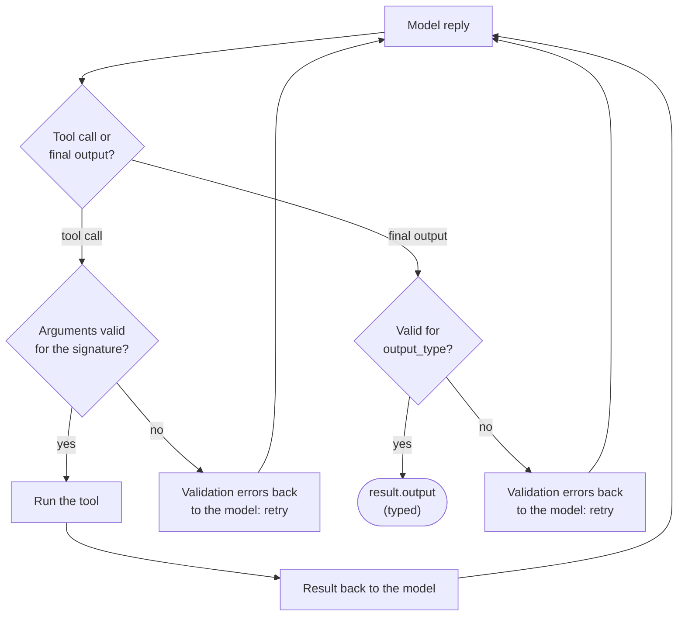

🏠 [Home](../../README.md) › [11 · Frameworks](./README.md) › 11.8 Pydantic AI

# 11.8 Pydantic AI

> **Difficulty:** 🟡 Intermediate · **Reading time:** ~12 min · **Prerequisites:** [11.1 Framework landscape](./11.1-framework-landscape.md), [1.5 Anatomy of an agent](../01-foundations/01.5-anatomy-of-an-agent.md), [3.2 JSON Schema for tools](../03-tools-and-function-calling/03.2-json-schema-for-tools.md)
>
> Last verified: November 2026 with pydantic-ai-slim==2.68.0

**In one sentence:** Pydantic AI, from the team behind the Pydantic validation library, treats an agent like well-typed Python: tool arguments and final outputs are validated against types, bad values go back to the model to fix, and test models let you check it all offline.

📑 **On this page**

- [Why does this matter?](#-why-does-this-matter)
- [The idea, in plain words](#-the-idea-in-plain-words)
- [Picture it](#-picture-it)
- [How it works, step by step](#-how-it-works-step-by-step)
- [Worked example](#-worked-example)
- [Code](#-code)
- [Common mistakes & gotchas](#-common-mistakes--gotchas)
- [Key takeaways](#-key-takeaways)
- [Try it yourself](#-try-it-yourself)
- [Further reading](#-further-reading)

## 🤔 Why does this matter?

An invoice-processing agent reads supplier emails and returns `{"supplier": ..., "amount": ..., "due_date": ...}` for the accounts system. One day the model returns `"amount": "about 1,200"`. The accounts system crashes at 2 a.m.

Models produce text; your code needs typed data. The usual fix is a pile of `try`/`except` and hand-written JSON checks after every call. Pydantic AI makes the types part of the agent: if the model's tool arguments or final answer don't fit the declared type, the framework tells the model what was wrong and lets it try again, before your code ever sees the value.

## 🧠 The idea, in plain words

If you have used FastAPI, the style will feel familiar: type hints do the work.

| Concept | What it is | In the weather agent |
| --- | --- | --- |
| `Agent` | Instructions, tools, and the types of its dependencies and output | `Agent(instructions=INSTRUCTIONS)` |
| Tools | Functions registered with `@agent.tool_plain` (no context) or `@agent.tool` (gets a `RunContext`) | `get_weather(city: str)`, `calculator(expression: str)` |
| `output_type` | The type of the final answer: `str` by default, or a Pydantic model, dataclass, list… | `str` here; a `Comparison` model in [Code](#-code) |
| `deps_type` | The type of the dependencies (database client, user ID) passed into each run and reachable from tools | not needed here |
| Model | A string such as `"anthropic:claude-opus-5-5"` or `"openai:<model>"`, or a model object; chosen per agent or per run | chosen at run time |
| Test models | `TestModel` (calls every tool with made-up valid arguments) and `FunctionModel` (your function plays the model) | `FunctionModel(scripted_reply)` |

Validation is the key idea. Pydantic checks each tool call's arguments against the function's signature, and the final output against `output_type`. A failure is not an exception in your code; it becomes a message back to the model saying exactly which field was wrong.

## 👀 Picture it



*Every value that crosses from the model into your code passes a type check. Failures loop back to the model as feedback, up to a retry limit, instead of crashing your program.*

## 🔍 How it works, step by step

1. **Create the agent.** `Agent(model?, instructions=..., output_type=..., deps_type=...)`. The model can be left out and chosen per run.
2. **Register tools.** `@agent.tool_plain` or `@agent.tool`. Pydantic AI builds the [JSON Schema](../../GLOSSARY.md#json-schema) from type hints, and the descriptions from the docstring (Google, NumPy and Sphinx styles).
3. **Run.** `agent.run_sync(prompt, model=..., deps=..., usage_limits=...)`, or `await agent.run(...)`, or a streaming variant.
4. **Validate tool calls.** For each tool call, the arguments are validated. Valid: the tool runs and its return value goes back. Invalid: the errors go back to the model as a retry.
5. **Validate the output.** For a structured `output_type`, the model answers by calling a special output tool (named `final_result` by default); its arguments are validated into your type.
6. **Limit the run.** `UsageLimits(request_limit=..., total_tokens_limit=...)` caps model requests and tokens; exceeding them raises `UsageLimitExceeded`.
7. **Inspect.** `result.output` is the typed answer, `result.all_messages()` the full history, `result.usage` the request and token counts.

## 💡 Worked example

Run offline with `FunctionModel`:

```text
Goal: Is it warmer in Paris or Rome right now, and by how much?

tool call:   get_weather({"city":"Paris"})
tool call:   get_weather({"city":"Rome"})
tool result: {"city": "Paris", "temp_c": 14}
tool result: {"city": "Rome", "temp_c": 19}
tool call:   calculator({"expression":"19 - 14"})
tool result: 5

Answer: Rome is warmer: 19°C versus 14°C in Paris, a difference of 5°C.
Model requests: 3
```

**What happens with a bad argument.** Suppose a test scripts the model to call `get_weather({"town": "Paris"})`, the wrong parameter name. The tool never runs. Instead the model's next request contains a tool return marked `outcome="retried"` (cause: `validation_error`) whose content tells the model what to fix:

```text
{"error": [{"type": "missing", "loc": ["city"], "msg": "Field required", "input": {"town": "Paris"}},
           {"type": "extra_forbidden", "loc": ["town"], "msg": "Extra inputs are not permitted", "input": "Paris"}]}
```

A real model reads that and calls `get_weather({"city": "Paris"})` on its next turn.

## 💻 Code

The [1.5](../01-foundations/01.5-anatomy-of-an-agent.md#-code) agent in Pydantic AI:

```python
from pydantic_ai import Agent, UsageLimits

agent = Agent(instructions=INSTRUCTIONS)  # the model is chosen per run


@agent.tool_plain
def get_weather(city: str) -> str:
    """Get the current temperature in °C for one city.

    Args:
        city: City name, e.g. 'Paris'.
    """
    ...  # calculator is registered the same way


result = agent.run_sync(
    "Is it warmer in Paris or Rome right now, and by how much?",
    model="anthropic:claude-opus-5-5",            # or "openai:<model>"; needs an API key
    usage_limits=UsageLimits(request_limit=6),    # the loop's safety net
)
print(result.output)
```

Asking for typed output instead of text is one argument (verified with `FunctionModel` and `TestModel`):

```python
from pydantic import BaseModel


class Comparison(BaseModel):
    warmer_city: str
    difference_c: float


typed_agent = Agent(instructions=INSTRUCTIONS, output_type=Comparison, tools=[...])
result = typed_agent.run_sync(GOAL, model="anthropic:claude-opus-5-5")
result.output  # Comparison(warmer_city='Rome', difference_c=5.0)
```

**Testing offline.** Pydantic AI's [testing guide](https://pydantic.dev/docs/ai/guides/testing/) recommends `TestModel` and `FunctionModel`, plus a safety switch so no test can call a real model:

```python
from pydantic_ai import ModelResponse, TextPart, ToolCallPart, models
from pydantic_ai.models.function import AgentInfo, FunctionModel

models.ALLOW_MODEL_REQUESTS = False  # any real model request in tests now fails


def scripted_reply(messages, info: AgentInfo) -> ModelResponse:
    replies_so_far = sum(isinstance(m, ModelResponse) for m in messages)
    if replies_so_far == 0:
        return ModelResponse(parts=[ToolCallPart("get_weather", {"city": "Paris"}),
                                    ToolCallPart("get_weather", {"city": "Rome"})])
    if replies_so_far == 1:
        return ModelResponse(parts=[ToolCallPart("calculator", {"expression": "19 - 14"})])
    return ModelResponse(parts=[TextPart("Rome is warmer: 19°C versus 14°C in Paris, a difference of 5°C.")])


result = agent.run_sync(GOAL, model=FunctionModel(scripted_reply))
```

`info.function_tools` inside the function shows the exact tool schemas the agent sent, which makes schema tests one line.

## 🚨 Common mistakes & gotchas

- **Old tutorials.** Pydantic AI is on major version 2 (2.68.0 here), and some APIs changed. For example, `result.usage` is now a property; calling `result.usage()` prints a deprecation warning.
- **Python version.** Version 2 needs Python 3.11 or newer.
- **`tool` vs `tool_plain`.** `@agent.tool` functions must take a `RunContext` as their first argument; `@agent.tool_plain` functions must not. Get it wrong and Pydantic AI raises a `UserError` as soon as you decorate the function.
- **Over-strict output types.** Every validation failure costs another model call. Very strict or deeply nested `output_type`s can burn retries. Start simple, and set `retries=` deliberately.
- **Forgetting `ALLOW_MODEL_REQUESTS = False` in tests.** Without it, a test that forgets to override the model can quietly call a real, paid API.
- **`pydantic-ai` vs `pydantic-ai-slim`.** The full package installs many integrations; `pydantic-ai-slim[anthropic,openai]` installs only what you name.
- **The start-up banner.** Recent versions print a banner suggesting [observability](../../GLOSSARY.md#observability) setup; set `PYDANTIC_AI_NO_BANNER=1` to hide it.

## ✅ Key takeaways

- Pydantic AI makes types part of the agent: tool arguments and outputs are validated, and failures go back to the model to fix.
- `output_type` turns the agent into a function that returns a validated Python object.
- `deps_type` and `RunContext` give tools typed access to your services, which also makes them easy to fake in tests.
- `TestModel`, `FunctionModel` and `ALLOW_MODEL_REQUESTS = False` make offline testing first-class.
- It is model-agnostic: switch providers by changing one model string.

### Pros and cons

| Pros | Cons |
| --- | --- |
| Type-safe tools and outputs with automatic retry on validation errors | Python only, 3.11+ |
| Excellent offline testing tools | Major version 2: older examples may not work |
| Many providers through one `provider:model` string | Graph and multi-agent features are less central than in LangGraph or CrewAI |
| Familiar to anyone who knows Pydantic or FastAPI | Observability works best with Logfire (any OpenTelemetry backend also works) |

### When to choose it

- The agent's output feeds other code: extraction, classification, form filling, API calls.
- You want strong typing and tests from the first day.
- You switch between model providers.
- Skip it when you need a ready-made harness with file and shell tools ([11.6](./11.6-claude-agent-sdk.md)) or a complex, durable workflow ([11.2](./11.2-langgraph.md)).

## 🧪 Try it yourself

1. Give the agent `output_type=Comparison` as in [Code](#-code), and change `scripted_reply` so the last reply is a call to the `final_result` tool. What does `result.output` look like?
2. In the bad-argument test from the worked example, what would happen if the model kept sending `{"town": "Paris"}` every time?

<details>
<summary>Show answer</summary>

1. The last reply becomes `ModelResponse(parts=[ToolCallPart("final_result", {"warmer_city": "Rome", "difference_c": 5})])`, and `result.output` is `Comparison(warmer_city='Rome', difference_c=5.0)`. Note that `5` was converted to the float `5.0` by validation. (`info.output_tools` in a `FunctionModel` shows the output tool's real name.)
2. Each invalid call uses up a retry. Once the tool's retry limit is used up (the default here is 1 retry), Pydantic AI stops the run with `UnexpectedModelBehavior: Tool 'get_weather' exceeded max retries count of 1` instead of looping forever. Raise `retries=` on the agent or tool if your model needs more attempts.

</details>

## 📚 Further reading

- [Pydantic AI overview](https://pydantic.dev/docs/ai/overview/) and [Agents](https://pydantic.dev/docs/ai/core-concepts/agent/). The core concepts.
- [Function tools](https://pydantic.dev/docs/ai/tools-toolsets/tools/). `tool`, `tool_plain`, docstring formats and schemas.
- [Output](https://pydantic.dev/docs/ai/core-concepts/output/) and [Dependencies](https://pydantic.dev/docs/ai/core-concepts/dependencies/). Typed outputs and dependency injection.
- [Unit testing](https://pydantic.dev/docs/ai/guides/testing/). `TestModel`, `FunctionModel`, `override` and `capture_run_messages`.
- [Models and providers](https://pydantic.dev/docs/ai/models/overview/) and [Multi-agent applications](https://pydantic.dev/docs/ai/guides/multi-agent-applications/). Every supported provider, and delegation, hand-off and graphs.

<!-- FOOTER -->

---

⬅️ **Previous:** [11.7 LlamaIndex agents](./11.7-llamaindex-agents.md) ·
🏠 [Chapter home](./README.md) ·
➡️ **Next:** [11.9 The no-framework approach](./11.9-the-no-framework-approach.md)
