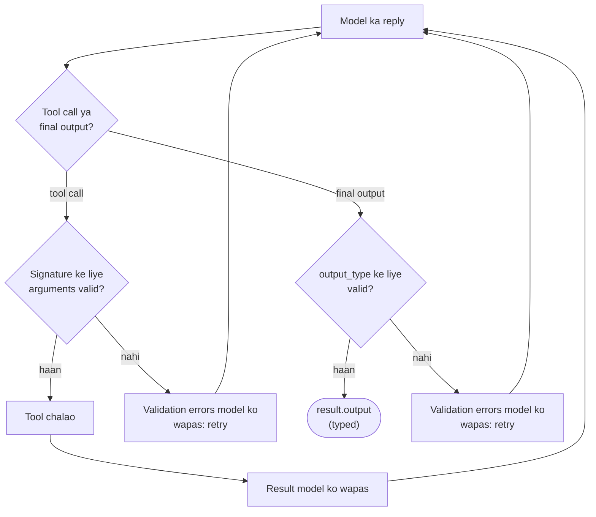

🏠 [Home](../../README.md) › [11 · Frameworks](./README.md) › 11.8 Pydantic AI

# 11.8 Pydantic AI

> **Level:** 🟡 Intermediate · **Padhne ka time:** ~12 min · **Pehle padho:** [11.1 Frameworks ka poora naksha](./11.1-framework-landscape.md), [1.5 Agent ke andar kya-kya hota hai](../01-foundations/01.5-anatomy-of-an-agent.md), [3.2 Tool definitions ke liye JSON Schema](../03-tools-and-function-calling/03.2-json-schema-for-tools.md)
>
> Last verified: November 2026 with pydantic-ai-slim==2.68.0

**Ek line mein:** Pydantic AI, Pydantic validation library banane wali team ki taraf se, agent ko achhe typed Python ki tarah treat karta hai: tool arguments aur final outputs types ke against validate hote hain, galat values model ko theek karne ke liye wapas jaati hain, aur test models se tum yeh sab offline check kar sakte ho.

📑 **Is page par**

- [Yeh kyun zaroori hai?](#-yeh-kyun-zaroori-hai)
- [Idea, simple words mein](#-idea-simple-words-mein)
- [Diagram se samjho](#-diagram-se-samjho)
- [Kaise kaam karta hai, step by step](#-kaise-kaam-karta-hai-step-by-step)
- [Example se samjho](#-example-se-samjho)
- [Code](#-code)
- [Aam galtiyan aur dhyan dene wali baatein](#-aam-galtiyan-aur-dhyan-dene-wali-baatein)
- [Yaad rakhne wali baatein](#-yaad-rakhne-wali-baatein)
- [Khud try karo](#-khud-try-karo)
- [Aur padhne ke liye](#-aur-padhne-ke-liye)

## 🤔 Yeh kyun zaroori hai?

Ek invoice-processing agent suppliers ke emails padhta hai aur accounts system ke liye `{"supplier": ..., "amount": ..., "due_date": ...}` return karta hai. Ek din model `"amount": "about 1,200"` return kar deta hai. Raat 2 baje accounts system crash ho jaata hai.

Models text banate hain; tumhare code ko typed data chahiye. Aam fix hai har call ke baad `try`/`except` ka dher aur haath se likhe JSON checks.

Pydantic AI types ko agent ka hissa bana deta hai. Agar model ke tool arguments ya final answer declared type mein fit nahi hote, toh framework model ko batata hai ki kya galat tha aur dobara try karne deta hai. Yeh sab tumhare code ko value dikhne se pehle hota hai.

Socho railway reservation form. Agar tumne age ke box mein "thoda zyada" likh diya, toh counter wala form wapas kar dega: "yahan number likho". Form system mein tabhi jaata hai jab sahi bhara ho. Pydantic AI bhi model ke saath yahi karta hai.

## 🧠 Idea, simple words mein

Agar tumne FastAPI use kiya hai, toh yeh style jaana pehchana lagega: kaam type hints karte hain.

| Concept | Yeh kya hai | Weather agent mein |
| --- | --- | --- |
| `Agent` | Instructions, tools, aur uski dependencies aur output ke types | `Agent(instructions=INSTRUCTIONS)` |
| Tools | `@agent.tool_plain` (bina context) ya `@agent.tool` (jise `RunContext` milta hai) se register kiye functions | `get_weather(city: str)`, `calculator(expression: str)` |
| `output_type` | Final answer ka type: default mein `str`, ya ek Pydantic model, dataclass, list… | yahan `str`; [Code](#-code) mein ek `Comparison` model |
| `deps_type` | Dependencies (database client, user ID) ka type, jo har run mein pass hoti hain aur tools se reachable hain | yahan zaroorat nahi |
| Model | `"anthropic:claude-opus-5-5"` ya `"openai:<model>"` jaisi string, ya ek model object; har agent ya har run ke liye chuna jaata hai | run time par chuna gaya |
| Test models | `TestModel` (har tool ko banaye hue valid arguments se call karta hai) aur `FunctionModel` (tumhara function model ka role nibhata hai) | `FunctionModel(scripted_reply)` |

Validation hi key idea hai. Pydantic har tool call ke arguments ko function ke signature ke against check karta hai, aur final output ko `output_type` ke against. Failure tumhare code mein exception nahi banta; woh model ko wapas ek message ban jaata hai jo exactly batata hai ki kaunsa field galat tha.

## 👀 Diagram se samjho



*Model se tumhare code mein aane wali har value ek type check se guzarti hai. Failures program crash karne ki jagah feedback ki tarah model ke paas wapas jaate hain, ek retry limit tak.*

## 🔍 Kaise kaam karta hai, step by step

1. **Agent banao.** `Agent(model?, instructions=..., output_type=..., deps_type=...)`. Model chhod sakte ho aur har run mein chun sakte ho.
2. **Tools register karo.** `@agent.tool_plain` ya `@agent.tool`. Pydantic AI type hints se [JSON Schema](../../GLOSSARY.md#json-schema) banata hai, aur docstring se descriptions (Google, NumPy aur Sphinx styles).
3. **Chalao.** `agent.run_sync(prompt, model=..., deps=..., usage_limits=...)`, ya `await agent.run(...)`, ya koi streaming variant.
4. **Tool calls validate karo.** Har tool call ke arguments validate hote hain. Valid: tool chalta hai aur uski return value wapas jaati hai. Invalid: errors retry ki tarah model ke paas wapas jaate hain.
5. **Output validate karo.** Structured `output_type` ke liye, model ek special output tool (default naam `final_result`) call karke answer deta hai; uske arguments tumhare type mein validate hote hain.
6. **Run ko limit karo.** `UsageLimits(request_limit=..., total_tokens_limit=...)` model requests aur tokens par cap lagata hai; inhe paar karne par `UsageLimitExceeded` raise hota hai.
7. **Inspect karo.** `result.output` typed answer hai, `result.all_messages()` poori history, `result.usage` request aur token counts.

## 💡 Example se samjho

`FunctionModel` ke saath offline chalao:

```text
Goal: Is it warmer in Paris or Rome right now, and by how much?

tool call:   get_weather({"city":"Paris"})
tool call:   get_weather({"city":"Rome"})
tool result: {"city": "Paris", "temp_c": 14}
tool result: {"city": "Rome", "temp_c": 19}
tool call:   calculator({"expression":"19 - 14"})
tool result: 5

Answer: Rome is warmer: 19°C versus 14°C in Paris, a difference of 5°C.
Model requests: 3
```

**Galat argument par kya hota hai.** Maan lo ek test model ko script karta hai ki woh `get_weather({"town": "Paris"})` call kare, yaani galat parameter name. Tool kabhi chalta hi nahi. Uski jagah model ki agli request mein ek tool return hota hai jis par `outcome="retried"` (cause: `validation_error`) mark hota hai, aur jiska content model ko batata hai ki kya theek karna hai:

```text
{"error": [{"type": "missing", "loc": ["city"], "msg": "Field required", "input": {"town": "Paris"}},
           {"type": "extra_forbidden", "loc": ["town"], "msg": "Extra inputs are not permitted", "input": "Paris"}]}
```

Ek asli model yeh padhta hai aur apne agle turn par `get_weather({"city": "Paris"})` call karta hai.

## 💻 Code

[1.5](../01-foundations/01.5-anatomy-of-an-agent.md#-code) wala agent Pydantic AI mein:

```python
from pydantic_ai import Agent, UsageLimits

agent = Agent(instructions=INSTRUCTIONS)  # model har run mein chuna jaata hai


@agent.tool_plain
def get_weather(city: str) -> str:
    """Get the current temperature in °C for one city.

    Args:
        city: City name, e.g. 'Paris'.
    """
    ...  # calculator bhi isi tarah register hota hai


result = agent.run_sync(
    "Is it warmer in Paris or Rome right now, and by how much?",
    model="anthropic:claude-opus-5-5",            # ya "openai:<model>"; API key chahiye
    usage_limits=UsageLimits(request_limit=6),    # loop ka safety net
)
print(result.output)
```

Text ki jagah typed output maangna bas ek argument hai (`FunctionModel` aur `TestModel` se verify kiya gaya):

```python
from pydantic import BaseModel


class Comparison(BaseModel):
    warmer_city: str
    difference_c: float


typed_agent = Agent(instructions=INSTRUCTIONS, output_type=Comparison, tools=[...])
result = typed_agent.run_sync(GOAL, model="anthropic:claude-opus-5-5")
result.output  # Comparison(warmer_city='Rome', difference_c=5.0)
```

**Offline testing.** Pydantic AI ki [testing guide](https://pydantic.dev/docs/ai/guides/testing/) `TestModel` aur `FunctionModel` suggest karti hai, plus ek safety switch taaki koi test asli model call na kar sake:

```python
from pydantic_ai import ModelResponse, TextPart, ToolCallPart, models
from pydantic_ai.models.function import AgentInfo, FunctionModel

models.ALLOW_MODEL_REQUESTS = False  # ab tests mein koi bhi asli model request fail hogi


def scripted_reply(messages, info: AgentInfo) -> ModelResponse:
    replies_so_far = sum(isinstance(m, ModelResponse) for m in messages)
    if replies_so_far == 0:
        return ModelResponse(parts=[ToolCallPart("get_weather", {"city": "Paris"}),
                                    ToolCallPart("get_weather", {"city": "Rome"})])
    if replies_so_far == 1:
        return ModelResponse(parts=[ToolCallPart("calculator", {"expression": "19 - 14"})])
    return ModelResponse(parts=[TextPart("Rome is warmer: 19°C versus 14°C in Paris, a difference of 5°C.")])


result = agent.run_sync(GOAL, model=FunctionModel(scripted_reply))
```

Function ke andar `info.function_tools` exactly woh tool schemas dikhata hai jo agent ne bheje, isliye schema tests ek line ke ho jaate hain.

## 🚨 Aam galtiyan aur dhyan dene wali baatein

- **Purane tutorials.** Pydantic AI major version 2 par hai (yahan 2.68.0), aur kuch APIs badal gayi hain. Jaise, `result.usage` ab ek property hai; `result.usage()` call karne par deprecation warning print hoti hai.
- **Python version.** Version 2 ko Python 3.11 ya naya chahiye.
- **`tool` vs `tool_plain`.** `@agent.tool` functions ka pehla argument `RunContext` hona zaroori hai; `@agent.tool_plain` functions mein nahi hona chahiye. Galti ki toh function decorate karte hi Pydantic AI `UserError` raise karta hai.
- **Bahut strict output types.** Har validation failure ek aur model call ka kharcha hai. Bahut strict ya gehre nested `output_type`s retries jala sakte hain. Simple se shuru karo, aur `retries=` soch ke set karo.
- **Tests mein `ALLOW_MODEL_REQUESTS = False` bhool jaana.** Iske bina, jo test model override karna bhool gaya woh chupchaap ek asli, paid API call kar sakta hai.
- **`pydantic-ai` vs `pydantic-ai-slim`.** Poora package bahut saare integrations install karta hai; `pydantic-ai-slim[anthropic,openai]` sirf wahi install karta hai jo tum naam se batao.
- **Start-up banner.** Naye versions ek banner print karte hain jo [observability](../../GLOSSARY.md#observability) setup suggest karta hai; ise chhupane ke liye `PYDANTIC_AI_NO_BANNER=1` set karo.

## ✅ Yaad rakhne wali baatein

- Pydantic AI types ko agent ka hissa banata hai: tool arguments aur outputs validate hote hain, aur failures theek karne ke liye model ke paas wapas jaate hain.
- `output_type` agent ko ek aise function mein badal deta hai jo validated Python object return karta hai.
- `deps_type` aur `RunContext` tools ko tumhari services tak typed access dete hain, jisse tests mein unhe fake karna bhi aasaan ho jaata hai.
- `TestModel`, `FunctionModel` aur `ALLOW_MODEL_REQUESTS = False` offline testing ko first-class banate hain.
- Yeh model-agnostic hai: ek model string badlo aur provider badal jaata hai.

### Fayde aur nuksaan

| Fayde | Nuksaan |
| --- | --- |
| Type-safe tools aur outputs, validation errors par automatic retry ke saath | Sirf Python, 3.11+ |
| Shandaar offline testing tools | Major version 2: purane examples shayad kaam na karein |
| Ek `provider:model` string se bahut saare providers | Graph aur multi-agent features LangGraph ya CrewAI jitne central nahi |
| Pydantic ya FastAPI jaanne wale ko jaana pehchana lagta hai | Observability Logfire ke saath sabse achha kaam karti hai (koi bhi OpenTelemetry backend bhi chalta hai) |

### Kab choose karo

- Agent ka output doosre code mein jaata hai: extraction, classification, form filling, API calls.
- Tumhe pehle din se strong typing aur tests chahiye.
- Tum model providers ke beech switch karte rehte ho.
- Jab file aur shell tools wala ready-made harness chahiye ([11.6](./11.6-claude-agent-sdk.md)) ya ek complex, durable workflow ([11.2](./11.2-langgraph.md)), tab ise skip karo.

## 🧪 Khud try karo

1. [Code](#-code) ki tarah agent ko `output_type=Comparison` do, aur `scripted_reply` badlo taaki last reply `final_result` tool ka call ho. `result.output` kaisa dikhta hai?
2. Example wale bad-argument test mein, agar model har baar `{"town": "Paris"}` hi bhejta rahe toh kya hoga?

<details>
<summary>Answer dekho</summary>

1. Last reply `ModelResponse(parts=[ToolCallPart("final_result", {"warmer_city": "Rome", "difference_c": 5})])` ban jaata hai, aur `result.output` hai `Comparison(warmer_city='Rome', difference_c=5.0)`. Dhyan do ki validation ne `5` ko float `5.0` mein convert kar diya. (`FunctionModel` mein `info.output_tools` output tool ka asli naam dikhata hai.)
2. Har invalid call ek retry kha jaati hai. Jab tool ki retry limit khatam ho jaati hai (yahan default 1 retry hai), Pydantic AI hamesha loop karne ki jagah run ko `UnexpectedModelBehavior: Tool 'get_weather' exceeded max retries count of 1` ke saath rok deta hai. Agar tumhare model ko zyada attempts chahiye, toh agent ya tool par `retries=` badhao.

</details>

## 📚 Aur padhne ke liye

- [Pydantic AI overview](https://pydantic.dev/docs/ai/overview/) aur [Agents](https://pydantic.dev/docs/ai/core-concepts/agent/). Core concepts.
- [Function tools](https://pydantic.dev/docs/ai/tools-toolsets/tools/). `tool`, `tool_plain`, docstring formats aur schemas.
- [Output](https://pydantic.dev/docs/ai/core-concepts/output/) aur [Dependencies](https://pydantic.dev/docs/ai/core-concepts/dependencies/). Typed outputs aur dependency injection.
- [Unit testing](https://pydantic.dev/docs/ai/guides/testing/). `TestModel`, `FunctionModel`, `override` aur `capture_run_messages`.
- [Models and providers](https://pydantic.dev/docs/ai/models/overview/) aur [Multi-agent applications](https://pydantic.dev/docs/ai/guides/multi-agent-applications/). Har supported provider, aur delegation, hand-off aur graphs.

<!-- FOOTER -->

---

⬅️ **Pichla:** [11.7 LlamaIndex agents](./11.7-llamaindex-agents.md) ·
🏠 [Chapter home](./README.md) ·
➡️ **Agla:** [11.9 Bina framework wala tarika](./11.9-the-no-framework-approach.md)
