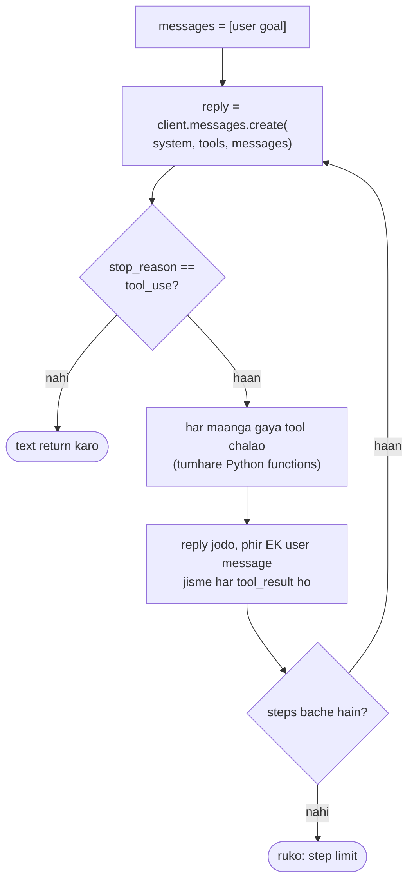

🏠 [Home](../../README.md) › [11 · Frameworks](./README.md) › 11.9 Bina framework wala tarika

# 11.9 Bina framework wala tarika

> **Level:** 🟡 Intermediate · **Padhne ka time:** ~10 min · **Pehle padho:** [2.3 50 lines mein agent, bilkul zero se](../02-the-agent-loop/02.3-a-50-line-agent-from-scratch.md), [11.1 Frameworks ka poora naksha](./11.1-framework-landscape.md)

**Ek line mein:** Bahut saare agents ke liye sabse achha framework koi framework nahi hai: provider ke apne SDK ke upar ek chhota loop padhne mein aasaan, debug karne mein aasaan hota hai aur usme tootne wali koi dependency nahi hoti, aur agar tum usse bade ho jao toh baad mein framework jod sakte ho.

📑 **Is page par**

- [Yeh kyun zaroori hai?](#-yeh-kyun-zaroori-hai)
- [Idea, simple words mein](#-idea-simple-words-mein)
- [Diagram se samjho](#-diagram-se-samjho)
- [Kaise kaam karta hai, step by step](#-kaise-kaam-karta-hai-step-by-step)
- [Example se samjho](#-example-se-samjho)
- [Code](#-code)
- [Aam galtiyan aur dhyan dene wali baatein](#-aam-galtiyan-aur-dhyan-dene-wali-baatein)
- [Yaad rakhne wali baatein](#-yaad-rakhne-wali-baatein)
- [Khud try karo](#-khud-try-karo)
- [Aur padhne ke liye](#-aur-padhne-ke-liye)

## 🤔 Yeh kyun zaroori hai?

Ek developer teen tools wala support agent banane ke liye ek framework jodti hai. Do mahine baad ek customer galat answer report karta hai. Debug karne ke liye use seekhna padta hai ki framework apna prompt kaise banata hai, history kahan store karta hai, aur ek tool call ko do baar retry kyun kiya. Phir ek upgrade aadhe imports ke naam badal deta hai.

Uske colleague ka agent provider SDK ke upar 60 lines ka hai. Jab woh gadbad karta hai, woh `messages` list print karta hai aur exactly dekh leta hai ki model ne kya dekha.

Anthropic ka [Building effective agents](https://www.anthropic.com/engineering/building-effective-agents) bhi yahi kehta hai: shuru mein LLM APIs seedha use karo, kyunki bahut saare patterns sirf kuch lines ke code mein ho jaate hain. Aur agar framework use karte ho, toh pakka karo ki neeche ka code tum samajhte ho.

## 🧠 Idea, simple words mein

Ek [agent](../../GLOSSARY.md#agent) matlab model, instructions, tools, memory aur ek loop ([1.5](../01-foundations/01.5-anatomy-of-an-agent.md)). Provider SDK pehle se model call deta hai. Baaki sab normal Python hai:

| Part | Bina framework ke |
| --- | --- |
| ① Model | `client.messages.create(...)` ya `client.chat.completions.create(...)` |
| ② Instructions | `system` ki tarah pass ki gayi ek string |
| ③ Tools | Functions ki ek dict, plus har ek ke liye ek [JSON Schema](../../GLOSSARY.md#json-schema) ([3.2](../03-tools-and-function-calling/03.2-json-schema-for-tools.md)) |
| ④ Memory | `messages` list (short-term); tumhara database (long-term) |
| ⑤ Loop | Step limit wala ek `for` loop |

Yeh meal kit ki jagah scratch se khana banane jaisa hai. Ghar pe dal-chawal banao: thodi zyada mehnat lagti hai, lekin har masala tumhe pata hai, aur aisa kuch nahi aata jo tumne order nahi kiya.

Ek beech ka raasta bhi hai. `anthropic` Python SDK mein ek beta **tool runner** hai: tum functions par `@beta_tool` decorator lagate ho aur `client.beta.messages.tool_runner(...)` tumhare liye loop chalata hai, phir bhi tumhare process ke andar, bina kisi extra dependency ke.

## 👀 Diagram se samjho



*Bas yahi poora agent hai. Is chapter ka har framework is loop ke kisi version ko wrap karta hai; yahan tum har box dekh aur badal sakte ho.*

## 🔍 Kaise kaam karta hai, step by step

1. **Tools describe karo.** Har tool ke liye ek dict: `name`, `description`, `input_schema` (Anthropic) ya `{"type": "function", "function": {...}}` shape (OpenAI Chat Completions).
2. **History shuru karo.** `messages = [{"role": "user", "content": goal}]`.
3. **Model call karo**, system prompt, tools aur history ke saath.
4. **Check karo ki woh kyun ruka.** Anthropic: `stop_reason == "tool_use"` matlab use tools chahiye. OpenAI: message mein `tool_calls` hain. Kuch aur ho toh: text return karo ([stop reasons](../../GLOSSARY.md#stop-reason)).
5. **Tools chalao** aur results jodo. Anthropic: assistant reply jodo, phir **ek** user message jisme har `tool_result` block ho. OpenAI: assistant message jodo, phir har call ke liye ek `{"role": "tool", "tool_call_id": ...}` message.
6. **Repeat karo** jab tak model answer na de ya step limit hit na ho.

Phir production ko jo chahiye woh jodo, ek ek karke, sirf jab zaroorat ho: error handling ([2.5](../02-the-agent-loop/02.5-handling-errors-in-the-loop.md)), [tracing](../../GLOSSARY.md#trace) ([14.1](../14-observability-and-debugging/14.1-tracing-agent-runs.md)), retries aur fallbacks ([15.5](../15-production-and-deployment/15.5-rate-limits-and-fallbacks.md)), persistence ([15.4](../15-production-and-deployment/15.4-state-persistence-and-resumability.md)), [budgets](../../GLOSSARY.md#run-budget) ([16.5](../16-cost-and-performance/16.5-budget-limits-per-run.md)).

## 💡 Example se samjho

[1.5](../01-foundations/01.5-anatomy-of-an-agent.md) wala weather agent exactly yahi tarika hai. Ek run aisa dikhta hai:

```text
step 1: get_weather({'city': 'Paris'}) -> {"city": "Paris", "temp_c": 14}
step 1: get_weather({'city': 'Rome'}) -> {"city": "Rome", "temp_c": 19}
step 2: calculator({'expression': '19 - 14'}) -> 5
step 3: answer

Answer: Rome is warmer: 19°C versus 14°C in Paris, a difference of 5°C.
```

Humne [Code](#-code) wala raw Anthropic loop bhi asli `anthropic` SDK ke against chalaya, ek fake HTTP server ke saath jo API ka role nibha raha tha. Loop ne jo doosri request bheji, woh is message par khatam hui. Yahi Messages API ka rule kaam karte hue dikhta hai (dono results ek user message mein, har ek `tool_use_id` se apne call se juda hua):

```json
{"role": "user", "content": [
  {"type": "tool_result", "tool_use_id": "toolu_1", "content": "{\"city\": \"Paris\", \"temp_c\": 14}"},
  {"type": "tool_result", "tool_use_id": "toolu_2", "content": "{\"city\": \"Rome\", \"temp_c\": 19}"}
]}
```

OpenAI version yahi information do alag `"role": "tool"` messages mein bhejta hai. Loop same hai; sirf message shapes alag hain, aur tumhara apna ek chhota provider-neutral wrapper yeh farak chhupa sakta hai.

## 💻 Code

**Anthropic SDK ke upar raw loop.** Yahi poora agent hai; `WEATHER_SPEC`, `CALCULATOR_SPEC` aur functions wahi hain jo [1.5](../01-foundations/01.5-anatomy-of-an-agent.md#-code) mein the.

```python
import anthropic

client = anthropic.Anthropic()  # ANTHROPIC_API_KEY padhta hai
TOOLS = [WEATHER_SPEC, CALCULATOR_SPEC]  # name, description, input_schema
FUNCTIONS = {"get_weather": get_weather, "calculator": calculator}


def run(goal: str, max_steps: int = 6) -> str:
    messages = [{"role": "user", "content": goal}]
    for _ in range(max_steps):
        response = client.messages.create(
            model="claude-opus-5-5",
            max_tokens=16000,
            system=INSTRUCTIONS,
            tools=TOOLS,
            messages=messages,
        )
        messages.append({"role": "assistant", "content": response.content})
        if response.stop_reason != "tool_use":
            return "".join(b.text for b in response.content if b.type == "text")
        results = [
            {"type": "tool_result", "tool_use_id": b.id, "content": FUNCTIONS[b.name](**b.input)}
            for b in response.content
            if b.type == "tool_use"
        ]
        messages.append({"role": "user", "content": results})  # saare results EK user message mein
    return "Stopped: step limit reached."
```

**Wahi loop OpenAI Chat Completions ke upar.**

```python
import json
import os

from openai import OpenAI

client = OpenAI()  # OPENAI_API_KEY padhta hai
OPENAI_TOOLS = [
    {"type": "function", "function": {"name": s["name"], "description": s["description"], "parameters": s["input_schema"]}}
    for s in (WEATHER_SPEC, CALCULATOR_SPEC)
]


def run_openai(goal: str, max_steps: int = 6) -> str:
    messages = [{"role": "system", "content": INSTRUCTIONS}, {"role": "user", "content": goal}]
    for _ in range(max_steps):
        response = client.chat.completions.create(
            model=os.environ["OPENAI_MODEL"], messages=messages, tools=OPENAI_TOOLS
        )
        message = response.choices[0].message
        messages.append(message.model_dump(exclude_none=True))
        if not message.tool_calls:
            return message.content or ""
        for call in message.tool_calls:  # har call ke liye ek "tool" message
            args = json.loads(call.function.arguments)
            messages.append({"role": "tool", "tool_call_id": call.id, "content": FUNCTIONS[call.function.name](**args)})
    return "Stopped: step limit reached."
```

**Beech ka raasta: Anthropic SDK ka tool runner (beta).** Loop gayab; tools decorated functions hain.

```python
import anthropic
from anthropic import beta_tool

client = anthropic.Anthropic()


@beta_tool
def get_weather(city: str) -> str:
    """Get the current temperature in °C for one city.

    Args:
        city: City name, e.g. 'Paris'.
    """
    ...  # calculator par bhi isi tarah decorator lagta hai


runner = client.beta.messages.tool_runner(
    model="claude-opus-5-5",
    max_tokens=16000,
    system=INSTRUCTIONS,
    tools=[get_weather, calculator],
    messages=[{"role": "user", "content": "Is it warmer in Paris or Rome right now, and by how much?"}],
    max_iterations=6,
)
final = runner.until_done()  # ya: for message in runner: ... har step dekhne ke liye
print(final.content[-1].text)
```

Teeno snippets asli `anthropic` 2.8.0 aur `openai` 3.49.0 SDKs ke against chalaye gaye, ek fake HTTP server ke saath jo APIs ki jagah khada tha. Step by step bane loop ke liye, tests ke saath, [2.3 50 lines mein agent, bilkul zero se](../02-the-agent-loop/02.3-a-50-line-agent-from-scratch.md) padho.

### Bina framework ke tumhe kya sambhalna padta hai

| Tumhe likhna padega | Kaunse frameworks yeh dete hain |
| --- | --- |
| Tool schemas | Sab (type hints aur docstrings se); tool runner bhi |
| Error handling, retries, timeouts | Zyada tar, alag alag defaults ke saath |
| Tracing | OpenAI Agents SDK (built-in), baaki integrations ke through |
| Durable state aur resume | LangGraph checkpointers, Agent Framework workflows |
| Typed, validated output | Pydantic AI, OpenAI Agents SDK ka `output_type` |
| Permissions ke saath file, shell aur web tools | Claude Agent SDK |
| Multi-agent routing | Zyada tar |

## 🚨 Aam galtiyan aur dhyan dene wali baatein

- **Galti se ek framework dobara bana dena.** Tumhare loop mein plugins, registry, config system ugne lagte hain… Agar tum apna khud ka "graph engine" likh rahe ho, toh ruko aur [11.2](./11.2-langgraph.md) dekho.
- **Koi step limit nahi.** Confused model ke saath ek plain `while True` loop kabhi khatam nahi hota. Hamesha steps, time ya cost par cap lagao ([2.4](../02-the-agent-loop/02.4-stopping-conditions.md)).
- **Tool results ko kai messages mein baant dena (Anthropic).** Ek turn ke saare `tool_result` blocks ek user message mein jaate hain, kisi bhi text se pehle. Inhe alag bhejoge toh errors aayenge.
- **Assistant message chhod dena.** Tool results se pehle model ka reply (uske tool calls ke saath) jodna zaroori hai, warna API request reject kar deti hai.
- **Tool exception ko loop maar dene dena.** Use catch karo aur result ki tarah wapas bhejo (Anthropic: `"is_error": True`) taaki model sambhal sake ([2.5](../02-the-agent-loop/02.5-handling-errors-in-the-loop.md)).
- **Ek provider ke shapes har jagah hard-code karna.** Provider-specific code ek jagah rakho (ek chhota wrapper module) taaki provider badalna sirf ek file ka kaam ho.

## ✅ Yaad rakhne wali baatein

- Ek kaam ka agent aksar provider SDK ke upar 50–100 lines ka hota hai; kuch chhupa nahi aur kuch extra toot nahi sakta.
- Loop har provider ke liye same hai; sirf message shapes alag hain.
- Anthropic SDK ka beta tool runner ek halka beech ka raasta hai, bina extra dependency ke.
- Production features (errors, tracing, persistence, budgets) ek ek karke jodo, jab zaroorat ho.
- Framework par tab jao jab tumhe woh cheez chahiye jo woh achha karta hai, jaise durable workflows, ek poora harness ya typed outputs. Default mein nahi.

## 🧪 Khud try karo

1. Raw Anthropic loop mein, agar tum har `tool_result` ko apne alag user message ki tarah jodo toh kya galat hoga?
2. Tumhare plain-loop agent ko ab ek manager ke approval ke liye rukna hai jisme ek din lag sakta hai, aur restarts bhi jhelne hain. Likho tumhe kya kya banana padega, aur ek framework batao jisme yeh pehle se hai.

<details>
<summary>Answer dekho</summary>

1. Assistant turn ke turant baad wala message sirf pehle tool call ka jawab dega. Anthropic ke docs kehte hain ki tool result blocks ko apne tool use blocks ke turant baad aana chahiye, isliye API request ko "tool_use ids were found without tool_result blocks immediately after" jaise error ke saath reject kar deti hai. Hamesha pehle saare results ek list mein ikatthe karo.
2. Tumhe har step ke baad poori `messages` list aur loop ki position database mein save karni hogi; approval point par loop rokne aur kya pending hai yeh record karne ka tarika chahiye; ek endpoint ya job chahiye jo approval aane par loop resume kare; aur idempotency chahiye taaki resume hua step side effects repeat na kare ([15.3](../15-production-and-deployment/15.3-queues-retries-and-idempotency.md)). LangGraph (checkpointers aur interrupts) aur Microsoft Agent Framework (checkpointing aur human-in-the-loop wale workflows) yeh dete hain.

</details>

## 📚 Aur padhne ke liye

- [Building effective agents](https://www.anthropic.com/engineering/building-effective-agents) (Anthropic). API se seedha shuru kyun karo aur agents simple kyun rakho.
- [Handle tool calls](https://platform.claude.com/docs/en/agents-and-tools/tool-use/handle-tool-calls) (Anthropic). Tool results kaise format karo, ordering rules ke saath.
- [Tool runner (SDK)](https://platform.claude.com/docs/en/agents-and-tools/tool-use/tool-runner) (Anthropic). Beta helper jo tumhare liye loop chalata hai.
- [Function calling](https://platform.openai.com/docs/guides/function-calling) (OpenAI). OpenAI ka tool-calling flow aur message shapes.

<!-- FOOTER -->

---

⬅️ **Pichla:** [11.8 Pydantic AI](./11.8-pydantic-ai.md) ·
🏠 [Chapter home](./README.md) ·
➡️ **Agla:** [11.10 Framework kaise choose karo](./11.10-how-to-choose.md)
