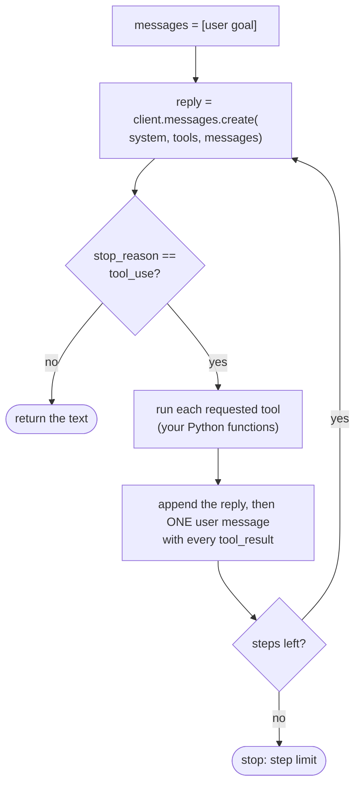

🏠 [Home](../../README.md) › [11 · Frameworks](./README.md) › 11.9 The no-framework approach

# 11.9 The no-framework approach

> **Difficulty:** 🟡 Intermediate · **Reading time:** ~10 min · **Prerequisites:** [2.3 A 50-line agent from scratch](../02-the-agent-loop/02.3-a-50-line-agent-from-scratch.md), [11.1 Framework landscape](./11.1-framework-landscape.md)

**In one sentence:** For many agents, the best framework is none: a short loop over the provider's own SDK is easy to read, easy to debug and has no dependencies to break, and you can add a framework later if you outgrow it.

📑 **On this page**

- [Why does this matter?](#-why-does-this-matter)
- [The idea, in plain words](#-the-idea-in-plain-words)
- [Picture it](#-picture-it)
- [How it works, step by step](#-how-it-works-step-by-step)
- [Worked example](#-worked-example)
- [Code](#-code)
- [Common mistakes & gotchas](#-common-mistakes--gotchas)
- [Key takeaways](#-key-takeaways)
- [Try it yourself](#-try-it-yourself)
- [Further reading](#-further-reading)

## 🤔 Why does this matter?

A developer adds a framework to build a support agent with three tools. Two months later, a customer reports a wrong answer. To debug it she has to learn how the framework builds its prompt, where it stores history, and why it retried a tool call twice. An upgrade then renames half the imports.

Her colleague's agent is 60 lines over the provider SDK. When it misbehaves, he prints the `messages` list and sees exactly what the model saw.

Anthropic's [Building effective agents](https://www.anthropic.com/engineering/building-effective-agents) makes the same point: start by using LLM APIs directly, because many patterns take only a few lines of code, and if you do use a framework, make sure you understand the code underneath.

## 🧠 The idea, in plain words

An [agent](../../GLOSSARY.md#agent) is a model, instructions, tools, memory and a loop ([1.5](../01-foundations/01.5-anatomy-of-an-agent.md)). The provider SDK already gives you the model call. Everything else is ordinary Python:

| Part | Without a framework |
| --- | --- |
| ① Model | `client.messages.create(...)` or `client.chat.completions.create(...)` |
| ② Instructions | A string passed as `system` |
| ③ Tools | A dict of functions, plus a [JSON Schema](../../GLOSSARY.md#json-schema) for each ([3.2](../03-tools-and-function-calling/03.2-json-schema-for-tools.md)) |
| ④ Memory | The `messages` list (short-term); your database (long-term) |
| ⑤ Loop | A `for` loop with a step limit |

It is like cooking from scratch instead of from a meal kit. It takes a little more effort, but you know every ingredient, and nothing arrives that you didn't order.

There is also a middle road. The `anthropic` Python SDK includes a beta **tool runner**: you decorate functions with `@beta_tool` and `client.beta.messages.tool_runner(...)` runs the loop for you, still inside your process, with no extra dependency.

## 👀 Picture it



*That is the whole agent. Every framework in this chapter wraps some version of this loop; here you can see and change every box.*

## 🔍 How it works, step by step

1. **Describe the tools.** One dict per tool: `name`, `description`, `input_schema` (Anthropic) or the `{"type": "function", "function": {...}}` shape (OpenAI Chat Completions).
2. **Start the history.** `messages = [{"role": "user", "content": goal}]`.
3. **Call the model** with the system prompt, tools and history.
4. **Check why it stopped.** Anthropic: `stop_reason == "tool_use"` means it wants tools. OpenAI: the message has `tool_calls`. Anything else: return the text ([stop reasons](../../GLOSSARY.md#stop-reason)).
5. **Run the tools** and append the results. Anthropic: append the assistant reply, then **one** user message holding every `tool_result` block. OpenAI: append the assistant message, then one `{"role": "tool", "tool_call_id": ...}` message per call.
6. **Repeat** until the model answers or the step limit is hit.

Then add what production needs, one piece at a time, only when you need it: error handling ([2.5](../02-the-agent-loop/02.5-handling-errors-in-the-loop.md)), [tracing](../../GLOSSARY.md#trace) ([14.1](../14-observability-and-debugging/14.1-tracing-agent-runs.md)), retries and fallbacks ([15.5](../15-production-and-deployment/15.5-rate-limits-and-fallbacks.md)), persistence ([15.4](../15-production-and-deployment/15.4-state-persistence-and-resumability.md)), [budgets](../../GLOSSARY.md#run-budget) ([16.5](../16-cost-and-performance/16.5-budget-limits-per-run.md)).

## 💡 Worked example

The [`examples/01-anatomy-of-an-agent`](../../examples/01-anatomy-of-an-agent/README.md) agent is exactly this approach, using the notes' small provider-neutral wrapper:

```text
step 1: get_weather({'city': 'Paris'}) -> {"city": "Paris", "temp_c": 14}
step 1: get_weather({'city': 'Rome'}) -> {"city": "Rome", "temp_c": 19}
step 2: calculator({'expression': '19 - 14'}) -> 5
step 3: answer

Answer: Rome is warmer: 19°C versus 14°C in Paris, a difference of 5°C.
```

We also ran the raw Anthropic loop from [Code](#-code) against the real `anthropic` SDK with a fake HTTP server playing the API. The second request the loop sent ended with this message, which is the Messages API's rule in action (both results in one user message, each tied to its call by `tool_use_id`):

```json
{"role": "user", "content": [
  {"type": "tool_result", "tool_use_id": "toolu_1", "content": "{\"city\": \"Paris\", \"temp_c\": 14}"},
  {"type": "tool_result", "tool_use_id": "toolu_2", "content": "{\"city\": \"Rome\", \"temp_c\": 19}"}
]}
```

The OpenAI version sends the same information as two separate `"role": "tool"` messages. The loop is the same; only the message shapes differ, which is what the notes' wrapper in `examples/common/llm.py` hides.

## 💻 Code

**The raw loop over the Anthropic SDK.** This is the whole agent; `WEATHER_SPEC`, `CALCULATOR_SPEC` and the functions are the ones from [1.5](../01-foundations/01.5-anatomy-of-an-agent.md#-code).

```python
import anthropic

client = anthropic.Anthropic()  # reads ANTHROPIC_API_KEY
TOOLS = [WEATHER_SPEC, CALCULATOR_SPEC]  # name, description, input_schema
FUNCTIONS = {"get_weather": get_weather, "calculator": calculator}


def run(goal: str, max_steps: int = 6) -> str:
    messages = [{"role": "user", "content": goal}]
    for _ in range(max_steps):
        response = client.messages.create(
            model="claude-opus-5-5",
            max_tokens=16000,
            system=INSTRUCTIONS,
            tools=TOOLS,
            messages=messages,
        )
        messages.append({"role": "assistant", "content": response.content})
        if response.stop_reason != "tool_use":
            return "".join(b.text for b in response.content if b.type == "text")
        results = [
            {"type": "tool_result", "tool_use_id": b.id, "content": FUNCTIONS[b.name](**b.input)}
            for b in response.content
            if b.type == "tool_use"
        ]
        messages.append({"role": "user", "content": results})  # all results in ONE user message
    return "Stopped: step limit reached."
```

**The same loop over OpenAI Chat Completions.**

```python
import json
import os

from openai import OpenAI

client = OpenAI()  # reads OPENAI_API_KEY
OPENAI_TOOLS = [
    {"type": "function", "function": {"name": s["name"], "description": s["description"], "parameters": s["input_schema"]}}
    for s in (WEATHER_SPEC, CALCULATOR_SPEC)
]


def run_openai(goal: str, max_steps: int = 6) -> str:
    messages = [{"role": "system", "content": INSTRUCTIONS}, {"role": "user", "content": goal}]
    for _ in range(max_steps):
        response = client.chat.completions.create(
            model=os.environ["OPENAI_MODEL"], messages=messages, tools=OPENAI_TOOLS
        )
        message = response.choices[0].message
        messages.append(message.model_dump(exclude_none=True))
        if not message.tool_calls:
            return message.content or ""
        for call in message.tool_calls:  # one "tool" message per call
            args = json.loads(call.function.arguments)
            messages.append({"role": "tool", "tool_call_id": call.id, "content": FUNCTIONS[call.function.name](**args)})
    return "Stopped: step limit reached."
```

**The middle road: the Anthropic SDK's tool runner (beta).** The loop is gone; tools are decorated functions.

```python
import anthropic
from anthropic import beta_tool

client = anthropic.Anthropic()


@beta_tool
def get_weather(city: str) -> str:
    """Get the current temperature in °C for one city.

    Args:
        city: City name, e.g. 'Paris'.
    """
    ...  # calculator is decorated the same way


runner = client.beta.messages.tool_runner(
    model="claude-opus-5-5",
    max_tokens=16000,
    system=INSTRUCTIONS,
    tools=[get_weather, calculator],
    messages=[{"role": "user", "content": "Is it warmer in Paris or Rome right now, and by how much?"}],
    max_iterations=6,
)
final = runner.until_done()  # or: for message in runner: ... to watch each step
print(final.content[-1].text)
```

All three snippets were run against the real `anthropic` 2.8.0 and `openai` 3.49.0 SDKs with a fake HTTP server standing in for the APIs. For the loop built step by step, with tests, read [2.3 A 50-line agent from scratch](../02-the-agent-loop/02.3-a-50-line-agent-from-scratch.md) and the runnable [`examples/01-anatomy-of-an-agent`](../../examples/01-anatomy-of-an-agent/README.md).

### What you take on without a framework

| You must write | Frameworks that provide it |
| --- | --- |
| Tool schemas | All of them (from type hints and docstrings); the tool runner too |
| Error handling, retries, timeouts | Most of them, with different defaults |
| Tracing | OpenAI Agents SDK (built in), others through integrations |
| Durable state and resume | LangGraph checkpointers, Agent Framework workflows |
| Typed, validated output | Pydantic AI, OpenAI Agents SDK `output_type` |
| File, shell and web tools with permissions | Claude Agent SDK |
| Multi-agent routing | Most of them |

## 🚨 Common mistakes & gotchas

- **Rebuilding a framework by accident.** Your loop grows plugins, a registry, a config system… If you are writing your own "graph engine", stop and look at [11.2](./11.2-langgraph.md).
- **No step limit.** A plain `while True` loop with a confused model never ends. Always cap steps, time or cost ([2.4](../02-the-agent-loop/02.4-stopping-conditions.md)).
- **Splitting tool results across messages (Anthropic).** All `tool_result` blocks for one turn go in one user message, before any text. Sending them separately causes errors.
- **Dropping the assistant message.** You must append the model's reply (with its tool calls) before the tool results, or the API rejects the request.
- **Letting a tool exception kill the loop.** Catch it and send it back as a result (Anthropic: `"is_error": True`) so the model can recover ([2.5](../02-the-agent-loop/02.5-handling-errors-in-the-loop.md)).
- **Hard-coding one provider's shapes everywhere.** Keep the provider-specific code in one place (like `examples/common/llm.py`) so switching providers is one file.

## ✅ Key takeaways

- A useful agent is often 50–100 lines over the provider SDK; nothing is hidden and nothing extra can break.
- The loop is the same for every provider; only message shapes differ.
- The Anthropic SDK's beta tool runner is a lightweight middle road with no extra dependency.
- Add production features (errors, tracing, persistence, budgets) one at a time, as you need them.
- Move to a framework when you need what it does well, such as durable workflows, a full harness or typed outputs, not by default.

## 🧪 Try it yourself

1. In the raw Anthropic loop, what goes wrong if you append each `tool_result` as its own user message?
2. Your plain-loop agent now needs to pause for a manager's approval that may take a day, and survive restarts. List what you would have to build, and name a framework that already has it.

<details>
<summary>Show answer</summary>

1. The message right after the assistant turn would answer only the first tool call. Anthropic's docs say tool result blocks must immediately follow their tool use blocks, so the API rejects the request with an error like "tool_use ids were found without tool_result blocks immediately after". Always collect the results into one list first.
2. You would need to save the full `messages` list and loop position to a database after each step, a way to stop the loop at the approval point and record what is pending, an endpoint or job that resumes the loop when the approval arrives, and idempotency so a resumed step doesn't repeat side effects ([15.3](../15-production-and-deployment/15.3-queues-retries-and-idempotency.md)). LangGraph (checkpointers and interrupts) and Microsoft Agent Framework (workflows with checkpointing and human-in-the-loop) provide this.

</details>

## 📚 Further reading

- [Building effective agents](https://www.anthropic.com/engineering/building-effective-agents) (Anthropic). Why to start with the API directly and keep agents simple.
- [Handle tool calls](https://platform.claude.com/docs/en/agents-and-tools/tool-use/handle-tool-calls) (Anthropic). How to format tool results, including the ordering rules.
- [Tool runner (SDK)](https://platform.claude.com/docs/en/agents-and-tools/tool-use/tool-runner) (Anthropic). The beta helper that runs the loop for you.
- [Function calling](https://platform.openai.com/docs/guides/function-calling) (OpenAI). The OpenAI tool-calling flow and message shapes.

<!-- FOOTER -->

---

⬅️ **Previous:** [11.8 Pydantic AI](./11.8-pydantic-ai.md) ·
🏠 [Chapter home](./README.md) ·
➡️ **Next:** [11.10 How to choose a framework](./11.10-how-to-choose.md)
