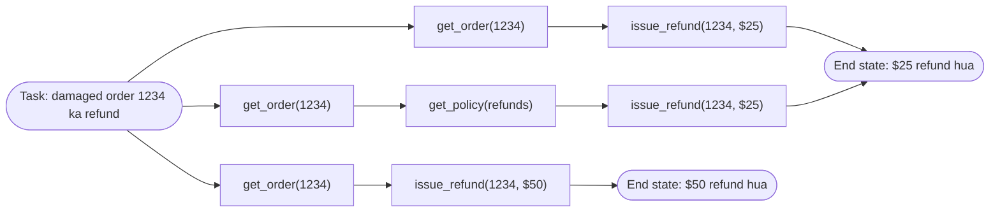

🏠 [Home](../../README.md) › [12 · Evaluation](./README.md) › 12.1 Agents ke evals mushkil kyun hain?

# 12.1 Agents ke evals mushkil kyun hain?

> **Level:** 🟡 Intermediate · **Padhne ka time:** ~8 min · **Pehle padho:** [1.5 Agent ke andar kya-kya hota hai](../01-foundations/01.5-anatomy-of-an-agent.md), [1.6 Agent kab use NAHI karna chahiye](../01-foundations/01.6-when-not-to-use-an-agent.md)

**Ek line mein:** Agent bahut saare steps leta hai, sahi jawab tak kai alag raaston se pahunch sakta hai, har run par alag result deta hai aur duniya mein cheezein badalta hai. Isliye tum use ek output ko ek expected string se compare karke test nahi kar sakte.

📑 **Is page par**

- [Yeh kyun zaroori hai?](#-yeh-kyun-zaroori-hai)
- [Idea, simple words mein](#-idea-simple-words-mein)
- [Diagram se samjho](#-diagram-se-samjho)
- [Kaise kaam karta hai, step by step](#-kaise-kaam-karta-hai-step-by-step)
- [Example se samjho](#-example-se-samjho)
- [Code](#-code)
- [Aam galtiyan aur dhyan dene wali baatein](#-aam-galtiyan-aur-dhyan-dene-wali-baatein)
- [Yaad rakhne wali baatein](#-yaad-rakhne-wali-baatein)
- [Khud try karo](#-khud-try-karo)
- [Aur padhne ke liye](#-aur-padhne-ke-liye)

## 🤔 Yeh kyun zaroori hai?

Socho tumne apne support agent ke system prompt mein ek sentence badla. Haath se teen sawal try kiye, jawab theek lage, aur ship kar diya. Ek hafte baad finance team poochti hai ki refunds double kyun ho gaye. Naye prompt ne agent ko thoda zyada "generous" bana diya tha. Lekin sirf ek type ki request par, aur woh bhi sirf kabhi-kabhi. Tumhare teen manual checks mein yeh kabhi dikhta hi nahi.

Agents aise hi tootte hain: chupchaap, thoda-thoda, aur har baar nahi. Ek [eval](../../GLOSSARY.md#eval) (evaluation ka short form) ek repeatable test hai. Yeh measure karta hai ki system example tasks ke ek set par kitna achha kar raha hai. Evals ke bina tum sirf guess kar rahe ho ki change se fayda hua ya nahi. Evals ke saath tum prompts, tools aur models confidence se badal sakte ho, aur problems users se pehle pakad sakte ho.

Lekin testing ki jo aadatein tumhare paas pehle se hain, woh seedhe kaam nahi aati. Unit test kehta hai `assert add(2, 2) == 4`. Agent ke paas compare karne ke liye koi ek sahi output nahi hota. Aur use do baar chalao toh do alag jawab milte hain. Yeh page samjhata hai ki aisa kyun hai, taaki baaki chapter samajh mein aaye.

## 🧠 Idea, simple words mein

Socho tum ek naye taxi driver ko judge kar rahe ho. Tum yeh check nahi karoge ki usne *bilkul wahi* route liya jo tum lete. Tum check karoge ki woh sahi address par pahuncha, raste mein koi rule nahi toda, faltu ka chakkar nahi lagaya, aur yeh sab baar-baar reliably kiya, sirf ek baar nahi. Aur tum use ek se zyada trip par test karoge.

Agents ko bhi aisi hi judgement chahiye. Paanch cheezein ise mushkil banati hain:

| Problem | Matlab kya hai | Tum iska kya karo |
| --- | --- | --- |
| **Bahut saare steps** | Ek task model calls aur [tool](../../GLOSSARY.md#tool) calls ki ek chain hai. Shuru ki ek galti baad ka sab kuch bigaad deti hai. | End result *aur* steps, dono check karo ([12.2](./12.2-task-trajectory-and-tool-metrics.md)) |
| **Kai sahi raaste** | Agent cheezein alag order mein dekh sakta hai, ya ek extra harmless call kar sakta hai, aur phir bhi sahi ho sakta hai. | Ek exact path mat maango. Outcome ko grade karo; path checks loose rakho |
| **Non-determinism** | Same input alag runs par alag output deta hai ([sampling](../../GLOSSARY.md#sampling)). | Har task kai baar chalao aur ek rate report karo, sirf ek pass/fail nahi |
| **Side effects** | Agent emails bhejta hai, refunds deta hai, files likhta hai. Real systems par test karna khatarnak hai, aur result text mein nahi, duniya mein hota hai. | Fake tools ke saath sandbox mein chalao, phir end state check karo |
| **Cost aur time** | Har run model tokens kharch karta hai aur seconds se minutes tak leta hai. Sainkdon runs ka kharcha jud jaata hai. | Har change par recorded runs replay karo; real model schedule par chalao ([12.5](./12.5-regression-testing-in-ci.md)) |

Free-text jawab ek chhathi, chhoti problem laata hai. "Aapka refund aa raha hai" likhne ke hazaar tarike hain. Strings compare karna fail ho jaata hai. Tumhe loose checks chahiye, ya grader ki tarah kaam karne wala ek doosra model ([12.3](./12.3-llm-as-judge.md)).

## 👀 Diagram se samjho



*Same task ke teen runs. Upar wale do alag raaste lete hain aur dono sahi hain. Neeche wala lagbhag same dikhta hai, lekin refund amount galat hai. Dhyan do: sirf end state hi achhe aur bure runs ko saaf-saaf alag karta hai.*

## 🔍 Kaise kaam karta hai, step by step

Yahan dekho ki normal testing ki har aadat kyun toot-ti hai, aur uski jagah kya aata hai.

1. **"Output ko expected output se compare karo."** Agent ke liye jo output matter karta hai, woh aksar text hota hi nahi. Woh database mein ek refund hai, disk par ek file hai, ya queue mein ek ticket hai. *Iski jagah:* agent ko aise fake tools ke saath chalao jo record karein ki kya badla. Phir us **final state** ko expected state se compare karo. Yeh tumhare paas sabse reliable single check hai.

2. **"Steps ka ek hi sahi sequence hai."** Aksar aisa nahi hota. Jo agent refund karne se pehle refund policy check karta hai, woh careful hai, galat nahi. *Iski jagah:* path ko loosely check karo. Kya expected tool calls hue, kisi sensible order mein? Kya koi faltu ya forbidden call hua? [12.2](./12.2-task-trajectory-and-tool-metrics.md) mein strict, in-order aur any-order matching define ki gayi hai.

3. **"Test ya toh pass hota hai ya fail."** Ek task das baar chalao, shayad saat baar pass ho. *Iski jagah:* har task kai baar chalao (har run ek *trial* hai) aur rates report karo. Do alag rates matter karte hain: "kya yeh kam se kam ek baar succeed karta hai?" aur "kya yeh har baar succeed karta hai?". Yeh pass@k aur pass^k hain, yeh bhi [12.2](./12.2-task-trajectory-and-tool-metrics.md) mein. Randomness band karke tum ise fix nahi kar sakte. Current Claude models `temperature` parameter reject karte hain, aur doosre models temperature 0 par bhi deterministic hone ki guarantee nahi dete.

4. **"Errors independent hote hain."** Multi-step run mein nahi hote. Agar har step 95% time sahi hai, toh lagaatar das steps sirf lagbhag 60% time sahi honge (0.95¹⁰ ≈ 0.60). Ise [compounding errors](../../GLOSSARY.md#compounding-errors) kehte hain. Isi wajah se lambe agent tasks ko single prompts se zyada careful evals chahiye. Socho train ki ticket booking: IRCTC login, train select, payment, confirmation. Har step 95% chalta ho, phir bhi poori booking utni baar nahi hoti.

5. **"Har change par test suite chalao."** 50 tasks × 5 trials ka test suite matlab 250 agent runs. Lagbhag ek cent per run par (neeche wale example mein measured average) yeh $2.50 aur kai minute per eval hai, model grader add karne se pehle hi. Nightly job ke liye theek hai; har commit ke liye bahut slow aur mehnga. *Iski jagah:* evals ko do layers mein baanto. Ek sasta offline layer jo har change par chale, aur ek live layer jo schedule par chale ([12.5](./12.5-regression-testing-in-ci.md)).

6. **"Test data toh obvious hai."** Agent ke liye mushkil hissa aise tasks chunna hai jo real usage jaise dikhein, rare aur tricky cases ke saath. [12.4](./12.4-building-an-eval-dataset.md) woh dataset banana sikhata hai.

## 💡 Example se samjho

Yeh *same* task ke chaar recorded runs hain. User ne likha: *"My desk lamp from order 1234 arrived broken. Can I get a refund?"* (matlab: order 1234 ka desk lamp toota hua aaya, refund mil sakta hai?). Order total $25 hai.

```text
trial 1  get_order(1234) -> issue_refund(1234, 25.0)
         "Sorry about that! I've issued a refund of $25.00 for order 1234."
trial 2  get_order(1234) -> get_policy(refunds) -> issue_refund(1234, 25.0)
         "Our policy covers damaged items, so I've refunded $25.00 to your card."
trial 3  get_order(1234) -> issue_refund(1234, 50.0)
         "Done: I've refunded $50.00 for order 1234."
trial 4  get_order(1234) -> get_order(1234) -> issue_refund(1234, 25.0)
         "I've issued a full refund of $25.00."
```

Ab inpar testing ke normal ideas try karo:

| Check | Trial 1 | Trial 2 | Trial 3 | Trial 4 | Check ka verdict |
| --- | --- | --- | --- | --- | --- |
| Jawab trial 1 ke jawab jaisa hai | ✅ | ❌ | ❌ | ❌ | Bekaar: sahi jawab ke teen alag wordings fail ho jaate hain |
| Bilkul trial 1 jaise tool calls | ✅ | ❌ | ❌ | ❌ | Bahut strict: trial 2 ke careful policy check ko saza deta hai |
| Jawab mein "refund" hai | ✅ | ✅ | ✅ | ✅ | Bahut loose: trial 3 ki $50 wali galti miss kar deta hai |
| End state hai "1234 ke liye $25 refund hua" | ✅ | ✅ | ❌ | ✅ | Sahi: theek bure run ko pakadta hai |

End-state check sahi nikla. Yeh yeh bhi batata hai ki yeh task 4 mein se 3 baar succeed karta hai. Yeh kaafi hai ya nahi, yeh product par depend karta hai. Jo refund agent din mein hazaaron baar chalta hai, uske liye galat refund ka 25% chance ek serious bug hai, chahe "maine try kiya tha toh chal gaya tha".

Trial 4 ko bhi dekho: usne `get_order` do baar call kiya. Isse koi nuksaan nahi hua, lekin extra tokens aur time lage. Sirf path par check (outcome par nahi) yeh notice karega.

## 💻 Code

Har agent eval ka core ek hi chhota harness hai: agent ko ek fresh, fake duniya do; use chalao; phir duniya ko inspect karo. Plain Python, koi framework nahi:

```python
from dataclasses import dataclass, field

@dataclass
class FakeShop:
    """Ek sandbox jise agent safely badal sakta hai. Eval baad mein ise padhta hai."""
    refunds: dict[str, float] = field(default_factory=dict)

    def issue_refund(self, order_id: str, amount: float) -> str:
        self.refunds[order_id] = amount          # side effect record karo, sach mein kisi ko paise mat do
        return f"Refunded ${amount:.2f}"

def eval_task(run_agent, task: dict, trials: int = 5) -> float:
    """Ek task kai baar chalao aur success rate return karo."""
    successes = 0
    for _ in range(trials):
        shop = FakeShop()                        # har trial ke liye ek fresh duniya
        run_agent(task["input"], tools=shop)     # tumhara agent, fake tools se juda hua
        successes += shop.refunds == task["expected_refunds"]   # END STATE ko grade karo
    return successes / trials
```

In kuch lines ke teen choices poore page ka saar hain: har trial ke liye fresh sandbox (side effects), kai trials (non-determinism), aur end state ko grade karna (kai sahi raaste). Path checks aur pass@k isi harness par bante hain ([12.2](./12.2-task-trajectory-and-tool-metrics.md)).

## 🚨 Aam galtiyan aur dhyan dene wali baatein

- **Vibes se testing.** Har change ke baad haath se kuch prompts try karna. Yeh testing jaisa lagta hai, lekin aaj ke vibes ko pichhle hafte ke vibes se compare nahi kar sakte. **Fix:** cases ek baar likh lo aur har baar same tarike se chalao.
- **Har task ka ek hi trial.** Ek run aisa hai jaise sikka ek baar uchhla aur tumne dekh liya. **Fix:** jis cheez par decision lena hai, uske liye har task ke kam se kam 3–5 trials chalao, aur rates report karo.
- **Duniya ki jagah transcript ko grade karna.** Agent *kehta* hai "maine aapka order cancel kar diya", lekin cancel call fail ho gaya tha. **Fix:** fake systems ki final state check karo, aur text ko doosre check ki tarah treat karo.
- **Real systems par testing.** Jo eval real emails bhejta hai ya real paise refund karta hai, woh ek incident hone ka intezaar kar raha hai. **Fix:** har side effect ke liye fake ya sandboxed tools ([13.3](../13-safety-and-guardrails/13.3-least-privilege-and-sandboxing.md)).
- **Ek exact path maangna.** Strict path checks sahi runs ko fail karte hain aur tumhe failures ignore karna sikha dete hain. **Fix:** sabse loose path check use karo jo phir bhi woh pakde jo tumhare liye zaroori hai ([12.2](./12.2-task-trajectory-and-tool-metrics.md)).
- **Tooti infrastructure ko agent ki galti ginna.** Rate-limit error ya timeout ka matlab agent galat nahi hai. **Fix:** infrastructure errors alag record karo, aur unhe retry ya exclude karo.

## ✅ Yaad rakhne wali baatein

- Agents test karna mushkil hai kyunki bahut steps, kai sahi raaste, non-determinism, side effects aur cost hote hain.
- Sabse reliable single check sandboxed duniya ki **end state** hai, jawab ka text nahi.
- Path bhi dekho, lekin loosely: extra careful steps theek hain, galat ya faltu steps nahi.
- Har task kai baar chalao aur rates report karo. "Maine try kiya tha toh chal gaya" koi result nahi hai.
- Evals ko do layers mein baanto: har change ke liye sasta offline layer, aur schedule par live layer.

## 🧪 Khud try karo

1. Ek coding agent ko kaha gaya "make the failing test pass" (matlab fail ho raha test pass karwao). Final state par ek check, path par ek check, aur ek cheez batao jise tum forbidden action ginoge.
2. Tumhara agent ek task 10 mein se 9 trials mein pass karta hai. Har user conversation sahi chalne ke liye lagbhag 4 aise tasks sahi hone chahiye. Poori conversation lagbhag kitni baar sahi chalegi?

<details>
<summary>Answer dekho</summary>

1. Ek possible answer. *Final state:* fresh checkout mein poora test suite pass hota hai, aur diff saaf apply hota hai. *Path:* agent ne finish karne se pehle kam se kam ek baar tests chalaye. *Forbidden:* test ko hi delete ya edit kar dena taaki woh pass ho jaaye, ya repository ke bahar ki files ko chhoona.
2. Lagbhag 0.9⁴ ≈ 0.66, yaani teen mein se lagbhag do conversations. 90% per-task rate high lagta hai, lekin errors steps aur tasks ke saath compound hote hain.

</details>

## 📚 Aur padhne ke liye

- [Demystifying evals for AI agents](https://www.anthropic.com/engineering/demystifying-evals-for-ai-agents) (Anthropic). Agent evals ka practical roadmap, jismein graders, trials aur pass@k vs pass^k shaamil hain.
- [Define success criteria and build evaluations](https://platform.claude.com/docs/en/test-and-evaluate/develop-tests) (Anthropic docs). "Yeh achha kaam kare" ko measurable criteria aur test cases mein kaise badlein.
- [Your AI Product Needs Evals](https://hamel.dev/blog/posts/evals/) (Hamel Husain). LLM product ko behtar banane ka core evals kyun hain, ek worked case study ke saath.
- [τ-bench](https://arxiv.org/abs/2406.12045) (Yao et al., 2024). End-state checks aur repeated trials par bana ek benchmark, aur wahi paper jisne pass^k introduce kiya.

<!-- FOOTER -->

---

⬅️ **Pichla:** [11.10 Framework kaise choose karo](../11-frameworks/11.10-how-to-choose.md) ·
🏠 [Chapter home](./README.md) ·
➡️ **Agla:** [12.2 Task, trajectory aur tool-use metrics](./12.2-task-trajectory-and-tool-metrics.md)
