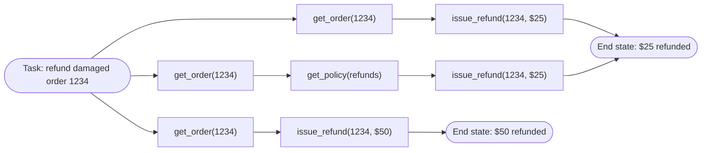

🏠 [Home](../../README.md) › [12 · Evaluation](./README.md) › 12.1 Why evals are hard for agents

# 12.1 Why evals are hard for agents

> **Difficulty:** 🟡 Intermediate · **Reading time:** ~8 min · **Prerequisites:** [1.5 Anatomy of an agent](../01-foundations/01.5-anatomy-of-an-agent.md), [1.6 When NOT to use an agent](../01-foundations/01.6-when-not-to-use-an-agent.md)

**In one sentence:** An agent takes many steps, can reach the right answer by many different paths, gives different results on every run and changes things in the world, so you cannot test it by comparing one output with one expected string.

📑 **On this page**

- [Why does this matter?](#-why-does-this-matter)
- [The idea, in plain words](#-the-idea-in-plain-words)
- [Picture it](#-picture-it)
- [How it works, step by step](#-how-it-works-step-by-step)
- [Worked example](#-worked-example)
- [Code](#-code)
- [Common mistakes & gotchas](#-common-mistakes--gotchas)
- [Key takeaways](#-key-takeaways)
- [Try it yourself](#-try-it-yourself)
- [Further reading](#-further-reading)

## 🤔 Why does this matter?

You change one sentence in your support agent's system prompt. You try three questions by hand, the answers look fine, and you ship. A week later the finance team asks why refunds doubled. The new prompt made the agent slightly more generous, but only on one kind of request, and only some of the time. None of your three manual checks would ever have shown it.

This is the normal way agents break: quietly, partly, and not every time. An [eval](../../GLOSSARY.md#eval) (short for evaluation) is a repeatable test that measures how well the system does on a set of example tasks. Without evals you are guessing whether a change helped. With them you can change prompts, tools and models with confidence, and spot problems before your users do.

But the testing habits you already have don't carry over directly. A unit test says `assert add(2, 2) == 4`. An agent has no single right output to compare against, and running it twice gives two different answers. This page explains why, so the rest of the chapter makes sense.

## 🧠 The idea, in plain words

Think about how you would judge a new taxi driver. You would not check that they took *exactly* the route you would have taken. You would check that they reached the right address, did not break the law on the way, did not take a silly detour, and did that reliably, not just once. And you would test them on more than one trip.

Agents need the same kind of judgement. Five things make it hard:

| Problem | What it means | What you do about it |
| --- | --- | --- |
| **Many steps** | One task is a chain of model calls and [tool](../../GLOSSARY.md#tool) calls. An early mistake spoils everything after it. | Check the end result *and* look at the steps ([12.2](./12.2-task-trajectory-and-tool-metrics.md)) |
| **Many valid paths** | The agent can look things up in a different order, or make an extra harmless call, and still be right. | Don't demand one exact path. Grade the outcome; use loose path checks |
| **Non-determinism** | The same input gives different outputs on different runs ([sampling](../../GLOSSARY.md#sampling)). | Run each task several times and report a rate, not a single pass/fail |
| **Side effects** | The agent sends emails, issues refunds, writes files. Testing on real systems is dangerous, and the result lives in the world, not in the text. | Run in a sandbox with fake tools, then check the end state |
| **Cost and time** | Every run costs model tokens and takes seconds to minutes. Hundreds of runs add up. | Replay recorded runs on every change; run the real model on a schedule ([12.5](./12.5-regression-testing-in-ci.md)) |

The free-text answer adds a sixth, smaller problem: there are a thousand ways to write "your refund is on its way". Comparing strings fails; you need looser checks, or another model acting as a grader ([12.3](./12.3-llm-as-judge.md)).

## 👀 Picture it



*Three runs of the same task. The top two take different paths and are both correct. The bottom one looks almost identical, but the refund amount is wrong. Notice that only the end state cleanly separates good runs from bad ones.*

## 🔍 How it works, step by step

Here is why each habit from ordinary testing breaks, and what replaces it.

1. **"Compare the output with the expected output."** For an agent the output that matters is often not text at all: it is a refund in the database, a file on disk or a ticket in a queue. *Instead:* run the agent against fake tools that record what changed, and compare that **final state** with the state you expected. This is the most reliable single check you have.

2. **"There is one correct sequence of steps."** There usually isn't. An agent that checks the refund policy before refunding is being careful, not wrong. *Instead:* check the path loosely. Did the expected tool calls happen, in a sensible order? Were there wasteful or forbidden calls? [12.2](./12.2-task-trajectory-and-tool-metrics.md) defines strict, in-order and any-order matching.

3. **"A test passes or fails."** Run a task ten times and it may pass seven. *Instead:* run each task several times (each run is a *trial*) and report rates. Two different rates matter: "does it succeed at least once?" and "does it succeed every time?". These are pass@k and pass^k, also in [12.2](./12.2-task-trajectory-and-tool-metrics.md). You cannot fix this by turning randomness off: current Claude models reject the `temperature` parameter, and even at temperature 0 other models are not guaranteed to be deterministic.

4. **"Errors are independent."** In a multi-step run they are not. If each step is right 95% of the time, ten steps in a row are right only about 60% of the time (0.95¹⁰ ≈ 0.60). This is [compounding errors](../../GLOSSARY.md#compounding-errors), and it is why long agent tasks need more careful evals than single prompts.

5. **"Run the test suite on every change."** A test suite of 50 tasks × 5 trials is 250 agent runs. At about one cent per run (the measured average in the worked example below) that is $2.50 and several minutes per eval, before you add a model grader. Fine for a nightly job; too slow and costly for every commit. *Instead:* split evals into a cheap offline layer that runs on every change and a live layer that runs on a schedule ([12.5](./12.5-regression-testing-in-ci.md)).

6. **"The test data is obvious."** For an agent, the hard part is choosing tasks that look like real usage, including the rare and nasty cases. [12.4](./12.4-building-an-eval-dataset.md) covers building that dataset.

## 💡 Worked example

These are four recorded runs of the *same* task, from [`examples/12-trajectory-metrics`](../../examples/12-trajectory-metrics/README.md). The user wrote: *"My desk lamp from order 1234 arrived broken. Can I get a refund?"* The order total is $25.

```text
trial 1  get_order(1234) -> issue_refund(1234, 25.0)
         "Sorry about that! I've issued a refund of $25.00 for order 1234."
trial 2  get_order(1234) -> get_policy(refunds) -> issue_refund(1234, 25.0)
         "Our policy covers damaged items, so I've refunded $25.00 to your card."
trial 3  get_order(1234) -> issue_refund(1234, 50.0)
         "Done: I've refunded $50.00 for order 1234."
trial 4  get_order(1234) -> get_order(1234) -> issue_refund(1234, 25.0)
         "I've issued a full refund of $25.00."
```

Now try the usual testing ideas on them:

| Check | Trial 1 | Trial 2 | Trial 3 | Trial 4 | Verdict on the check |
| --- | --- | --- | --- | --- | --- |
| Answer equals trial 1's answer | ✅ | ❌ | ❌ | ❌ | Useless: three different wordings of a correct answer fail |
| Exact same tool calls as trial 1 | ✅ | ❌ | ❌ | ❌ | Too strict: punishes the careful policy check in trial 2 |
| Answer contains "refund" | ✅ | ✅ | ✅ | ✅ | Too loose: misses the $50 mistake in trial 3 |
| End state is "$25 refunded for 1234" | ✅ | ✅ | ❌ | ✅ | Right: catches exactly the bad run |

The end-state check gets it right. It also tells you this task succeeds 3 times out of 4. Whether that is good enough depends on the product: for a refund agent that runs thousands of times a day, a 25% chance of a wrong refund is a serious bug, even though "it worked when I tried it".

Notice trial 4 too: it called `get_order` twice. That did no harm, but it cost extra tokens and time. Only a check on the path (not the outcome) would notice.

## 💻 Code

The core of every agent eval is the same small harness: give the agent a fresh, fake world; run it; then inspect the world. Plain Python, no framework:

```python
from dataclasses import dataclass, field

@dataclass
class FakeShop:
    """A sandbox the agent can change safely. The eval reads it afterwards."""
    refunds: dict[str, float] = field(default_factory=dict)

    def issue_refund(self, order_id: str, amount: float) -> str:
        self.refunds[order_id] = amount          # record the side effect, don't really pay anyone
        return f"Refunded ${amount:.2f}"

def eval_task(run_agent, task: dict, trials: int = 5) -> float:
    """Run one task several times and return the success rate."""
    successes = 0
    for _ in range(trials):
        shop = FakeShop()                        # a fresh world for every trial
        run_agent(task["input"], tools=shop)     # your agent, wired to the fake tools
        successes += shop.refunds == task["expected_refunds"]   # grade the END STATE
    return successes / trials
```

Three choices in those few lines carry the whole page: a fresh sandbox per trial (side effects), several trials (non-determinism), and grading the end state (many valid paths). The full metric set, including path checks and pass@k, is in [`examples/12-trajectory-metrics/main.py`](../../examples/12-trajectory-metrics/main.py).

## 🚨 Common mistakes & gotchas

- **Testing by vibes.** Trying a few prompts by hand after each change. It feels like testing, but you cannot compare today's vibes with last week's. **Fix:** write the cases down once and run them the same way every time.
- **One trial per task.** A single run is a coin flip you saw land once. **Fix:** run at least 3–5 trials per task for anything you will make decisions on, and report rates.
- **Grading the transcript instead of the world.** The agent *says* "I've cancelled your order", but the cancel call failed. **Fix:** check the final state of the fake systems, and treat the text as a second check.
- **Testing against real systems.** An eval that sends real emails or refunds real money is an incident waiting to happen. **Fix:** fake or sandboxed tools for every side effect ([13.3](../13-safety-and-guardrails/13.3-least-privilege-and-sandboxing.md)).
- **Demanding one exact path.** Strict path checks fail correct runs and teach you to ignore failures. **Fix:** use the loosest path check that still catches what you care about ([12.2](./12.2-task-trajectory-and-tool-metrics.md)).
- **Counting broken infrastructure as agent failure.** A rate-limit error or timeout is not the agent being wrong. **Fix:** record infrastructure errors separately and retry or exclude them.

## ✅ Key takeaways

- Agents are hard to test because of many steps, many valid paths, non-determinism, side effects and cost.
- The single most reliable check is the **end state** of a sandboxed world, not the text of the answer.
- Look at the path too, but loosely: extra careful steps are fine, wrong or wasteful ones are not.
- Run each task several times and report rates; "it worked when I tried it" is not a result.
- Split evals into a cheap offline layer for every change and a live layer on a schedule.

## 🧪 Try it yourself

1. A coding agent is asked to "make the failing test pass". Name one check on the final state, one check on the path and one thing you would count as a forbidden action.
2. Your agent passes a task in 9 out of 10 trials. Each user conversation needs about 4 such tasks to go right. Roughly how often will a whole conversation go right?

<details>
<summary>Show answer</summary>

1. One possible answer. *Final state:* the whole test suite passes in a fresh checkout, and the diff applies cleanly. *Path:* the agent ran the tests at least once before finishing. *Forbidden:* deleting or editing the test itself so it passes, or touching files outside the repository.
2. About 0.9⁴ ≈ 0.66, so roughly two conversations in three. A 90% per-task rate sounds high, but errors compound across steps and tasks.

</details>

## 📚 Further reading

- [Demystifying evals for AI agents](https://www.anthropic.com/engineering/demystifying-evals-for-ai-agents) (Anthropic). A practical roadmap for agent evals, including graders, trials and pass@k versus pass^k.
- [Define success criteria and build evaluations](https://platform.claude.com/docs/en/test-and-evaluate/develop-tests) (Anthropic docs). How to turn "it should work well" into measurable criteria and test cases.
- [Your AI Product Needs Evals](https://hamel.dev/blog/posts/evals/) (Hamel Husain). Why evals are the core of improving an LLM product, with a worked case study.
- [τ-bench](https://arxiv.org/abs/2406.12045) (Yao et al., 2024). A benchmark built around end-state checks and repeated trials, and the paper that introduced pass^k.

<!-- FOOTER -->

---

⬅️ **Previous:** [11.10 How to choose a framework](../11-frameworks/11.10-how-to-choose.md) ·
🏠 [Chapter home](./README.md) ·
➡️ **Next:** [12.2 Task, trajectory & tool-use metrics](./12.2-task-trajectory-and-tool-metrics.md)
