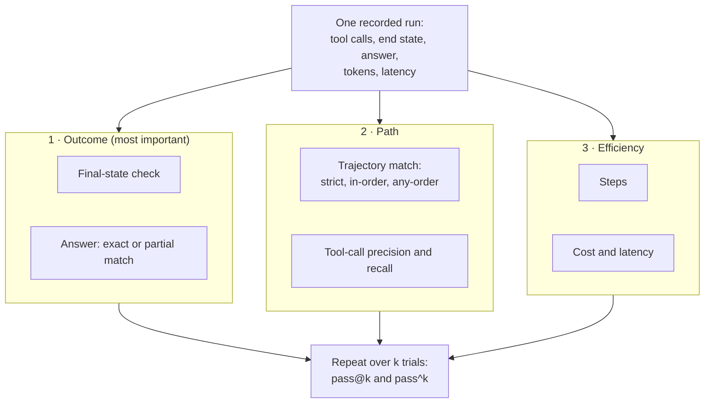

🏠 [Home](../../README.md) › [12 · Evaluation](./README.md) › 12.2 Task, trajectory & tool-use metrics

# 12.2 Task, trajectory & tool-use metrics

> **Difficulty:** 🟡 Intermediate · **Reading time:** ~10 min · **Prerequisites:** [12.1 Why evals are hard for agents](./12.1-why-agent-evals-are-hard.md), [3.3 How function calling works](../03-tools-and-function-calling/03.3-how-function-calling-works.md)

**In one sentence:** Score an agent on three layers (did it reach the right end state, did it take a sensible path, and was it efficient) and run every task several times so you can report both how often it *can* succeed (pass@k) and how often it *always* succeeds (pass^k).

📑 **On this page**

- [Why does this matter?](#-why-does-this-matter)
- [The idea, in plain words](#-the-idea-in-plain-words)
- [Picture it](#-picture-it)
- [How it works, step by step](#-how-it-works-step-by-step)
- [Worked example](#-worked-example)
- [Code](#-code)
- [Common mistakes & gotchas](#-common-mistakes--gotchas)
- [Key takeaways](#-key-takeaways)
- [Try it yourself](#-try-it-yourself)
- [Further reading](#-further-reading)

## 🤔 Why does this matter?

"The agent works 67% of the time" is a number, but it hides almost everything you need to know. Does it fail by doing the wrong thing, or by doing nothing? When it succeeds, does it waste five extra tool calls? If a customer tries twice, will it work at least once, or will it fail them both times?

Each of those questions needs a different metric. Pick the wrong one and you optimise the wrong thing: a strict "exact path" metric will push you to punish careful agents; a success rate alone will hide a 3× cost increase; and a "best of five tries" number will make an unreliable agent look great. This page gives you a small, standard toolkit and says when to use each tool.

## 🧠 The idea, in plain words

Go back to judging the taxi driver from [12.1](./12.1-why-agent-evals-are-hard.md). You check three things, in order of importance:

1. **Outcome.** Did the passenger arrive at the right address? (task success)
2. **Path.** Was the route sensible, with no illegal turns? (the [trajectory](../../GLOSSARY.md#trajectory): the ordered list of steps and tool calls the agent made)
3. **Efficiency.** How long did it take, and what did the fare come to? (steps, cost, latency)

And you don't judge from one trip. You watch several trips on the same route and ask two different questions:

- *"If I book them k times, will at least one trip go well?"* That is [pass@k](../../GLOSSARY.md#passk-pass-at-k).
- *"If I book them k times, will every trip go well?"* That is [pass^k](../../GLOSSARY.md#passk-pass-hat-k) (read "pass hat k").

A research tool that you can retry, where you pick the best attempt, cares about pass@k. A customer-facing agent, where every conversation must go right, cares about pass^k.

## 👀 Picture it



*Every run is scored on three layers, and the outcome layer decides success. Reliability metrics come from repeating the same task, not from one run.*

## 🔍 How it works, step by step

### 1. Outcome: did the job get done?

- **Final-state check.** Run the agent against fake tools (see [12.1](./12.1-why-agent-evals-are-hard.md#-code)) and compare the end state with the expected one: `{"refunds": {"1234": 25.0}}`. This is the headline metric whenever the agent changes something. Benchmarks such as τ-bench grade this way ([12.6](./12.6-public-benchmarks.md)).
- **Exact match** on the answer. Only works for short, closed answers: a number, a yes/no, a label from a fixed list. Normalise first (trim, lower-case).
- **Partial match.** For free text, check that required facts are present: "answer contains *25* and *refund*". Score it as a fraction (1 of 2 keywords = 0.5) so you can see near misses. For fuzzier qualities like tone or helpfulness, use a model grader ([12.3](./12.3-llm-as-judge.md)).

A run **succeeds** when the outcome checks pass. Path and efficiency metrics are diagnostics; they explain *why* success moved, and they catch waste and danger the outcome can't see.

### 2. Path: was the route sensible?

Compare the agent's tool calls with a reference list of expected calls. Each call is a name plus arguments; compare arguments as sorted JSON so `{"a": 1, "b": 2}` equals `{"b": 2, "a": 1}`. There are three standard strictness levels:

| Match mode | Passes when… | Use it for |
| --- | --- | --- |
| **Strict** | The calls are exactly the expected list, same order, nothing extra | Fixed procedures where any deviation is a bug (rare for agents) |
| **In-order** | Every expected call appears, in the expected order; extra calls in between are allowed | Most agent tasks: "look it up *before* you refund it" |
| **Any-order** | Every expected call appears, in any order; extras allowed | Independent steps, such as fetching weather for three cities |

You can loosen any mode further by comparing tool *names* only and ignoring arguments.

- **Tool-call precision** = calls that were expected ÷ calls made. Low precision means wasted or unwanted calls.
- **Tool-call recall** = expected calls that were made ÷ expected calls. Low recall means skipped steps.

Both count duplicates: calling `get_order` twice when one call was expected gives precision 2/3. Keep a separate list of **forbidden calls** (for example `issue_refund` on a tracking question) and fail the run outright if one appears.

### 3. Efficiency: what did it cost?

- **Steps:** the number of tool calls or loop iterations. Rising steps with flat success usually means a confused prompt or a badly described tool.
- **Cost:** input tokens × input price + output tokens × output price, using the token counts the API returns (`usage`). For example, at Claude Opus 5.5 prices ($4 / $20 per million input/output tokens, [as of November 2026](https://platform.claude.com/docs/en/about-claude/pricing)), a run with 2,100 input and 160 output tokens costs (2,100 × 4 + 160 × 20) / 1,000,000 = $0.0116. See [16.1](../16-cost-and-performance/16.1-token-cost-maths.md).
- **Latency:** report the median and a high percentile (or the maximum, for small sets), not just the mean. One slow run is what users remember.

### 4. Reliability: pass@k and pass^k

Run each task n times and count the c successes. If the true per-trial success rate is p, then:

- **pass@k** = chance that *at least one* of k independent trials succeeds = 1 − (1 − p)^k. It rises towards 1 as k grows.
- **pass^k** = chance that *all* k trials succeed = p^k. It falls towards 0 as k grows.
- At k = 1 they are the same number: the plain success rate.

From n recorded trials you estimate them without bias using combinations ("n choose k", `math.comb`):

- pass@k ≈ 1 − C(n − c, k) / C(n, k), the estimator from the Codex paper ([Chen et al., 2021](https://arxiv.org/abs/2107.03374)).
- pass^k ≈ C(c, k) / C(n, k), from the τ-bench paper ([Yao et al., 2024](https://arxiv.org/abs/2406.12045)).

You need n ≥ k. Compute both **per task, then average over tasks**, so every task weighs the same.

## 💡 Worked example

[`examples/12-trajectory-metrics`](../../examples/12-trajectory-metrics/README.md) scores 12 recorded runs: three support tasks (refund, tracking, cancel), four trials each. Real output:

```text
task            #  success strict in-order any-order  prec   rec steps  cost $
refund-damaged  1  yes     yes    yes      yes        1.00  1.00     2  0.0116
refund-damaged  2  yes     no     yes      yes        0.67  1.00     3  0.0174
refund-damaged  3  no      no     no       no         0.50  0.50     2  0.0116
refund-damaged  4  yes     no     yes      yes        0.67  1.00     3  0.0154
track-order     1  yes     yes    yes      yes        1.00  1.00     2  0.0104
track-order     2  yes     yes    yes      yes        1.00  1.00     2  0.0096
track-order     3  no      no     no       no         0.00  0.00     0  0.0040
track-order     4  yes     yes    yes      yes        1.00  1.00     2  0.0104
cancel-order    1  yes     yes    yes      yes        1.00  1.00     2  0.0092
cancel-order    2  yes     no     no       no         1.00  0.50     1  0.0062
cancel-order    3  no      no     no       no         0.00  0.00     2  0.0094
cancel-order    4  no      no     no       no         1.00  0.50     1  0.0078

Task success rate:     8/12 = 67%
Strict trajectory:     5/12
In-order trajectory:   7/12
Mean tool precision:   0.74
Mean tool recall:      0.71
Mean steps per run:    1.83
Mean cost per run:     $0.0103
Latency median / max:  3.4s / 6.0s

Reliability over 4 trials per task (averaged over tasks):
  k   pass@k   pass^k
  1     0.67     0.67
  2     0.94     0.39
  3     1.00     0.17
  4     1.00     0.00
```

Reading it row by row:

- **refund-damaged #2** added a `get_policy` call. Strict fails it; in-order passes it; precision drops to 0.67. The outcome is right, so it is a success. Good: careful behaviour is not punished.
- **refund-damaged #3** refunded $50 instead of $25. Every layer catches it: wrong end state, and the refund call doesn't match because its arguments differ.
- **track-order #3** answered from thin air with no tool calls ("usually 3–5 days"). Recall 0.00 and a missing keyword: a [hallucination](../../GLOSSARY.md#hallucination), cheap and fast but wrong.
- **cancel-order #2** cancelled the right order *without* looking it up first. It counts as a success (the end state is right), but in-order fails and recall is 0.50. The system prompt says "always look the order up first", so this is a policy problem the outcome check alone would hide.
- **cancel-order #4** asked "are you sure?" instead of cancelling. The grader calls it a failure. Is it? The user was explicit, so probably yes, but this is the kind of case where you should read the transcript and maybe fix the *task* rather than the agent ([12.4](./12.4-building-an-eval-dataset.md)).

Now the reliability table. Let us check the k = 2 row by hand. The refund and tracking tasks each succeeded 3 times out of 4, the cancel task 2 times out of 4. There are C(4, 2) = 6 ways to pick 2 of the 4 trials.

- pass^2 for a 3-of-4 task: C(3, 2) / 6 = 3/6 = 0.50. For the 2-of-4 task: C(2, 2) / 6 = 1/6 ≈ 0.17. Average: (0.50 + 0.50 + 0.17) / 3 ≈ **0.39**.
- pass@2 for a 3-of-4 task: 1 − C(1, 2) / 6 = 1 − 0 = 1.00. For the 2-of-4 task: 1 − C(2, 2) / 6 = 5/6 ≈ 0.83. Average ≈ **0.94**.

Same agent, same data: "94% at k = 2" and "39% at k = 2". Which one you report depends on the product. For this support agent, pass^k is the honest number: by k = 4, no task succeeded on every trial.

## 💻 Code

The trajectory checks are a few lines each. Calls are fingerprinted as `name + sorted JSON arguments`:

```python
import json
from collections import Counter
from math import comb

def _key(call: dict) -> str:
    return call["name"] + json.dumps(call["arguments"], sort_keys=True)

def strict_match(actual: list[dict], expected: list[dict]) -> bool:
    return [_key(c) for c in actual] == [_key(c) for c in expected]

def in_order_match(actual: list[dict], expected: list[dict]) -> bool:
    remaining = iter(_key(c) for c in actual)          # each expected call must be found
    return all(any(a == e for a in remaining)          # later than the previous one
               for e in (_key(c) for c in expected))

def any_order_match(actual: list[dict], expected: list[dict]) -> bool:
    missing = Counter(map(_key, expected)) - Counter(map(_key, actual))
    return not missing

def tool_precision_recall(actual: list[dict], expected: list[dict]) -> tuple[float, float]:
    a, e = Counter(map(_key, actual)), Counter(map(_key, expected))
    hits = sum((a & e).values())                       # multiset intersection
    precision = hits / sum(a.values()) if a else float(not e)
    recall = hits / sum(e.values()) if e else 1.0
    return precision, recall

def pass_at_k(n: int, c: int, k: int) -> float:       # at least one of k succeeds
    return 1.0 - comb(n - c, k) / comb(n, k)

def pass_hat_k(n: int, c: int, k: int) -> float:      # all k succeed
    return comb(c, k) / comb(n, k)
```

To record a trajectory from your own agent built on the shared wrapper, pull the tool calls out of the conversation:

```python
def trajectory_from_messages(messages: list[dict]) -> list[dict]:
    return [{"name": tc.name, "arguments": tc.arguments}
            for m in messages if m["role"] == "assistant"
            for tc in m.get("tool_calls", [])]
```

Full version, with the report and tests: [`examples/12-trajectory-metrics/main.py`](../../examples/12-trajectory-metrics/main.py). Tracing tools ([14.1](../14-observability-and-debugging/14.1-tracing-agent-runs.md)) record the same data in production, so you can score real traffic with the same functions.

## 🚨 Common mistakes & gotchas

- **Making the path the headline metric.** Strict trajectory match said only 5 of 12 runs were "right", but 8 reached the right end state. **Fix:** decide success on the outcome; use path metrics to explain and to catch forbidden actions.
- **Confusing pass@k with pass^k.** They answer opposite questions. Reporting pass@5 for a customer-facing agent makes an unreliable agent look excellent. **Fix:** say which one you report, and why, every time.
- **Computing pass^k from the pooled rate.** The pooled success rate here is 8/12 ≈ 0.67, and 0.67² ≈ 0.44, but the real pass^2 is 0.39. Tasks differ in difficulty, and averaging hides that. **Fix:** compute per task, then average.
- **Using pass@k when you can't tell which attempt worked.** "Best of 5" is only useful if something (a test suite, a checker) picks the good attempt automatically. **Fix:** use pass@k only with an automatic verifier; otherwise users see all k attempts.
- **Ignoring arguments.** Name-only matching would pass the $50 refund. **Fix:** compare arguments by default, and loosen only for fields that legitimately vary (free-text notes, timestamps).
- **Mean latency only.** A mean of 3.5 s can hide a 30 s run. **Fix:** report the median and the 95th percentile or maximum.

## ✅ Key takeaways

- Score three layers: **outcome** (decides success), **path** (diagnoses), **efficiency** (steps, cost, latency).
- The final-state check is the strongest outcome metric; exact and partial match handle the answer text.
- In-order trajectory matching fits most agents; strict is usually too strict.
- Tool-call precision catches waste; recall catches skipped steps; a forbidden-call list catches danger.
- pass@k = at least one of k trials succeeds; pass^k = all k succeed. Estimate both per task from n ≥ k trials and average.

## 🧪 Try it yourself

1. An agent is expected to call `[search(q="x"), summarise()]`. It actually calls `[search(q="x"), search(q="x"), summarise()]`. Give strict, in-order, any-order, precision and recall.
2. A task succeeded in 4 of 5 trials. Compute pass@2 and pass^2.
3. In `examples/12-trajectory-metrics/main.py`, change `score_run` so that success also requires `in_order`. What happens to the success rate, and is that a better definition for this agent?

<details>
<summary>Show answer</summary>

1. Strict: no (an extra call). In-order: yes. Any-order: yes. Precision: 2 hits out of 3 calls ≈ 0.67. Recall: 2 of 2 expected calls = 1.0.
2. C(5, 2) = 10. pass@2 = 1 − C(1, 2)/10 = 1 − 0 = 1.0 (with only one failure, any pair contains a success). pass^2 = C(4, 2)/10 = 6/10 = 0.6.
3. `cancel-order` trial 2 stops counting as a success, so the rate drops from 8/12 to 7/12. Whether that is better depends on whether "look it up first" is a real requirement. Here the system prompt makes it a rule, so counting it is reasonable; for a purely helpful step it would not be.

</details>

## 📚 Further reading

- [Evaluating Large Language Models Trained on Code](https://arxiv.org/abs/2107.03374) (Chen et al., 2021). Defines pass@k and its unbiased estimator.
- [τ-bench: A Benchmark for Tool-Agent-User Interaction in Real-World Domains](https://arxiv.org/abs/2406.12045) (Yao et al., 2024). Introduces pass^k and end-state grading for tool-using agents.
- [Demystifying evals for AI agents](https://www.anthropic.com/engineering/demystifying-evals-for-ai-agents) (Anthropic). Graders for outcomes and transcripts, and when to prefer pass@k or pass^k.
- [Task-Specific LLM Evals that Do & Don't Work](https://eugeneyan.com/writing/evals/) (Eugene Yan). Which metrics actually track quality for common LLM tasks.

<!-- FOOTER -->

---

⬅️ **Previous:** [12.1 Why evals are hard for agents](./12.1-why-agent-evals-are-hard.md) ·
🏠 [Chapter home](./README.md) ·
➡️ **Next:** [12.3 LLM-as-judge](./12.3-llm-as-judge.md)
