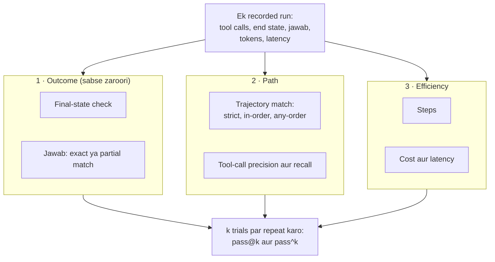

🏠 [Home](../../README.md) › [12 · Evaluation](./README.md) › 12.2 Task, trajectory aur tool-use metrics

# 12.2 Task, trajectory aur tool-use metrics

> **Level:** 🟡 Intermediate · **Padhne ka time:** ~10 min · **Pehle padho:** [12.1 Agents ke evals mushkil kyun hain?](./12.1-why-agent-evals-are-hard.md), [3.3 Function calling kaise kaam karta hai](../03-tools-and-function-calling/03.3-how-function-calling-works.md)

**Ek line mein:** Agent ko teen layers par score karo (kya woh sahi end state tak pahuncha, kya usne sensible path liya, aur kya woh efficient tha), aur har task kai baar chalao taaki tum dono report kar sako: woh kitni baar succeed *kar sakta* hai (pass@k) aur kitni baar *hamesha* succeed karta hai (pass^k).

📑 **Is page par**

- [Yeh kyun zaroori hai?](#-yeh-kyun-zaroori-hai)
- [Idea, simple words mein](#-idea-simple-words-mein)
- [Diagram se samjho](#-diagram-se-samjho)
- [Kaise kaam karta hai, step by step](#-kaise-kaam-karta-hai-step-by-step)
- [Example se samjho](#-example-se-samjho)
- [Code](#-code)
- [Aam galtiyan aur dhyan dene wali baatein](#-aam-galtiyan-aur-dhyan-dene-wali-baatein)
- [Yaad rakhne wali baatein](#-yaad-rakhne-wali-baatein)
- [Khud try karo](#-khud-try-karo)
- [Aur padhne ke liye](#-aur-padhne-ke-liye)

## 🤔 Yeh kyun zaroori hai?

"Agent 67% time kaam karta hai" ek number hai. Lekin yeh lagbhag woh sab chhupa leta hai jo tumhe jaanna hai. Kya woh galat kaam karke fail hota hai, ya kuch na karke? Jab succeed karta hai, tab kya paanch extra tool calls waste karta hai? Agar customer do baar try kare, toh kya kam se kam ek baar chalega, ya dono baar fail hoga?

In sab sawalon ke liye alag metric chahiye. Galat metric chuna toh tum galat cheez optimise karoge. Strict "exact path" metric tumhe careful agents ko saza dene ki taraf dhakelega. Sirf success rate 3× cost badhne ko chhupa dega. Aur "paanch mein se best try" wala number ek unreliable agent ko bahut achha dikhayega. Yeh page tumhe ek chhota, standard toolkit deta hai aur batata hai ki kaunsa tool kab use karna hai.

## 🧠 Idea, simple words mein

[12.1](./12.1-why-agent-evals-are-hard.md) wale taxi driver ko judge karne par wapas chalo. Tum teen cheezein check karte ho, importance ke order mein:

1. **Outcome.** Kya passenger sahi address par pahuncha? (task success)
2. **Path.** Kya route sensible tha, koi illegal turn nahi? (yeh [trajectory](../../GLOSSARY.md#trajectory) hai: agent ne jo steps aur tool calls kiye, unki ordered list)
3. **Efficiency.** Kitna time laga, aur fare kitna aaya? (steps, cost, latency)

Aur tum ek trip se judge nahi karte. Same route par kai trips dekhte ho aur do alag sawal poochte ho:

- *"Agar main unhe k baar book karoon, toh kya kam se kam ek trip achhi jaayegi?"* Yeh [pass@k](../../GLOSSARY.md#passk-pass-at-k) hai.
- *"Agar main unhe k baar book karoon, toh kya har trip achhi jaayegi?"* Yeh [pass^k](../../GLOSSARY.md#passk-pass-hat-k) hai (padho "pass hat k").

Ek research tool jise tum retry kar sakte ho aur best attempt chun sakte ho, uske liye pass@k matter karta hai. Customer-facing agent, jahan har conversation sahi jaani chahiye, uske liye pass^k matter karta hai. Cricket se socho: T20 mein ek batsman jo 5 matches mein ek baar century maarta hai, woh "pass@5" mein achha hai. Lekin Test team ko aisa opener chahiye jo har match mein tike, yaani pass^k.

## 👀 Diagram se samjho



*Har run teen layers par score hota hai, aur outcome layer success decide karti hai. Reliability metrics same task ko repeat karne se aate hain, ek run se nahi.*

## 🔍 Kaise kaam karta hai, step by step

### 1. Outcome: kya kaam hua?

- **Final-state check.** Agent ko fake tools ke saath chalao ([12.1](./12.1-why-agent-evals-are-hard.md#-code) dekho) aur end state ko expected state se compare karo: `{"refunds": {"1234": 25.0}}`. Jab bhi agent kuch badalta hai, yahi headline metric hai. τ-bench jaise benchmarks isi tarah grade karte hain ([12.6](./12.6-public-benchmarks.md)).
- Jawab par **exact match**. Yeh sirf chhote, closed jawabon ke liye kaam karta hai: ek number, yes/no, ya fixed list ka ek label. Pehle normalise karo (trim, lower-case).
- **Partial match.** Free text ke liye check karo ki zaroori facts maujood hain: "jawab mein *25* aur *refund* hai". Ise fraction ki tarah score karo (2 mein se 1 keyword = 0.5), taaki near misses dikhein. Tone ya helpfulness jaisi dhundhli qualities ke liye model grader use karo ([12.3](./12.3-llm-as-judge.md)).

Ek run tab **succeed** karta hai jab outcome checks pass hote hain. Path aur efficiency metrics diagnostics hain. Woh samjhate hain ki success *kyun* badla, aur woh waste aur khatra pakadte hain jo outcome nahi dekh sakta.

### 2. Path: kya route sensible tha?

Agent ke tool calls ko expected calls ki ek reference list se compare karo. Har call ek naam plus arguments hai. Arguments ko sorted JSON ki tarah compare karo, taaki `{"a": 1, "b": 2}` aur `{"b": 2, "a": 1}` barabar hon. Strictness ke teen standard levels hain:

| Match mode | Kab pass hota hai… | Kis ke liye use karo |
| --- | --- | --- |
| **Strict** | Calls bilkul expected list hain, same order, kuch extra nahi | Fixed procedures jahan koi bhi deviation bug hai (agents ke liye rare) |
| **In-order** | Har expected call expected order mein aata hai; beech mein extra calls allowed hain | Zyada tar agent tasks: "refund karne se *pehle* order dekho" |
| **Any-order** | Har expected call kisi bhi order mein aata hai; extras allowed | Independent steps, jaise teen shehron ka weather laana |

Kisi bhi mode ko aur loose kar sakte ho: sirf tool ke *naam* compare karo aur arguments ignore karo.

- **Tool-call precision** = jo calls expected the ÷ jitne calls kiye. Low precision matlab waste ya anchahe calls.
- **Tool-call recall** = expected calls jo kiye gaye ÷ expected calls. Low recall matlab steps skip hue.

Dono duplicates ginte hain: jab ek call expected tha aur `get_order` do baar call hua, toh precision 2/3 hoti hai. **Forbidden calls** ki ek alag list rakho (jaise tracking wale sawal par `issue_refund`), aur agar inmein se koi bhi aaye toh run seedha fail karo.

### 3. Efficiency: kitna kharcha hua?

- **Steps:** tool calls ya loop iterations ki ginti. Agar steps badh rahe hain aur success flat hai, toh aksar prompt confused hai ya koi tool theek se describe nahi hua.
- **Cost:** input tokens × input price + output tokens × output price, API jo token counts return karta hai (`usage`) unse. Jaise, Claude Opus 5.5 ke prices par ($4 / $20 per million input/output tokens, [November 2026 tak](https://platform.claude.com/docs/en/about-claude/pricing)), 2,100 input aur 160 output tokens wale run ka cost hai (2,100 × 4 + 160 × 20) / 1,000,000 = $0.0116. [16.1](../16-cost-and-performance/16.1-token-cost-maths.md) dekho.
- **Latency:** median aur ek high percentile (ya chhote sets ke liye maximum) report karo, sirf mean nahi. Users ko woh ek slow run hi yaad rehta hai.

### 4. Reliability: pass@k aur pass^k

Har task n baar chalao aur c successes gino. Agar asli per-trial success rate p hai, toh:

- **pass@k** = k independent trials mein se *kam se kam ek* ke succeed hone ka chance = 1 − (1 − p)^k. k badhne par yeh 1 ki taraf badhta hai.
- **pass^k** = *saare* k trials ke succeed hone ka chance = p^k. k badhne par yeh 0 ki taraf girta hai.
- k = 1 par dono same number hain: simple success rate.

n recorded trials se tum inhe bina bias ke combinations ("n choose k", `math.comb`) se estimate karte ho:

- pass@k ≈ 1 − C(n − c, k) / C(n, k), Codex paper ka estimator ([Chen et al., 2021](https://arxiv.org/abs/2107.03374)).
- pass^k ≈ C(c, k) / C(n, k), τ-bench paper se ([Yao et al., 2024](https://arxiv.org/abs/2406.12045)).

Tumhe n ≥ k chahiye. Dono ko **pehle per task compute karo, phir tasks par average lo**, taaki har task ka weight barabar ho.

## 💡 Example se samjho

Yahan 12 recorded runs hain, score kiye hue: teen support tasks (refund, tracking, cancel), har ek ke chaar trials. Report aisi dikhti hai:

```text
task            #  success strict in-order any-order  prec   rec steps  cost $
refund-damaged  1  yes     yes    yes      yes        1.00  1.00     2  0.0116
refund-damaged  2  yes     no     yes      yes        0.67  1.00     3  0.0174
refund-damaged  3  no      no     no       no         0.50  0.50     2  0.0116
refund-damaged  4  yes     no     yes      yes        0.67  1.00     3  0.0154
track-order     1  yes     yes    yes      yes        1.00  1.00     2  0.0104
track-order     2  yes     yes    yes      yes        1.00  1.00     2  0.0096
track-order     3  no      no     no       no         0.00  0.00     0  0.0040
track-order     4  yes     yes    yes      yes        1.00  1.00     2  0.0104
cancel-order    1  yes     yes    yes      yes        1.00  1.00     2  0.0092
cancel-order    2  yes     no     no       no         1.00  0.50     1  0.0062
cancel-order    3  no      no     no       no         0.00  0.00     2  0.0094
cancel-order    4  no      no     no       no         1.00  0.50     1  0.0078

Task success rate:     8/12 = 67%
Strict trajectory:     5/12
In-order trajectory:   7/12
Mean tool precision:   0.74
Mean tool recall:      0.71
Mean steps per run:    1.83
Mean cost per run:     $0.0103
Latency median / max:  3.4s / 6.0s

Reliability over 4 trials per task (averaged over tasks):
  k   pass@k   pass^k
  1     0.67     0.67
  2     0.94     0.39
  3     1.00     0.17
  4     1.00     0.00
```

Ise row by row padho:

- **refund-damaged #2** ne ek `get_policy` call add kiya. Strict ise fail karta hai; in-order pass karta hai; precision 0.67 tak girti hai. Outcome sahi hai, isliye yeh success hai. Achha hai: careful behaviour ko saza nahi milti.
- **refund-damaged #3** ne $25 ki jagah $50 refund kiya. Har layer ise pakadti hai: end state galat hai, aur refund call match nahi karta kyunki uske arguments alag hain.
- **track-order #3** ne bina kisi tool call ke hawa mein jawab de diya ("usually 3–5 days"). Recall 0.00 aur ek keyword missing: yeh [hallucination](../../GLOSSARY.md#hallucination) hai. Sasta aur fast, lekin galat.
- **cancel-order #2** ne sahi order cancel kiya, lekin pehle use dekhe *bina*. Yeh success ginta hai (end state sahi hai), lekin in-order fail hota hai aur recall 0.50 hai. System prompt kehta hai "always look the order up first", toh yeh ek policy problem hai jo sirf outcome check chhupa deta.
- **cancel-order #4** ne cancel karne ki jagah poocha "are you sure?". Grader ise failure kehta hai. Kya sach mein hai? User ne saaf bola tha, toh shayad haan. Lekin yeh aisa case hai jahan tumhe transcript padhna chahiye, aur shayad agent ki jagah *task* ko fix karna chahiye ([12.4](./12.4-building-an-eval-dataset.md)).

Ab reliability table. k = 2 wali row haath se check karte hain. Refund aur tracking tasks dono 4 mein se 3 baar succeed hue, cancel task 4 mein se 2 baar. 4 trials mein se 2 chunne ke C(4, 2) = 6 tarike hain.

- 3-of-4 task ke liye pass^2: C(3, 2) / 6 = 3/6 = 0.50. 2-of-4 task ke liye: C(2, 2) / 6 = 1/6 ≈ 0.17. Average: (0.50 + 0.50 + 0.17) / 3 ≈ **0.39**.
- 3-of-4 task ke liye pass@2: 1 − C(1, 2) / 6 = 1 − 0 = 1.00. 2-of-4 task ke liye: 1 − C(2, 2) / 6 = 5/6 ≈ 0.83. Average ≈ **0.94**.

Same agent, same data: "k = 2 par 94%" aur "k = 2 par 39%". Kaunsa report karoge, yeh product par depend karta hai. Is support agent ke liye pass^k imaandaar number hai: k = 4 tak, koi bhi task har trial mein succeed nahi hua.

## 💻 Code

Trajectory checks har ek bas kuch lines ke hain. Calls ka fingerprint `name + sorted JSON arguments` hai:

```python
import json
from collections import Counter
from math import comb

def _key(call: dict) -> str:
    return call["name"] + json.dumps(call["arguments"], sort_keys=True)

def strict_match(actual: list[dict], expected: list[dict]) -> bool:
    return [_key(c) for c in actual] == [_key(c) for c in expected]

def in_order_match(actual: list[dict], expected: list[dict]) -> bool:
    remaining = iter(_key(c) for c in actual)          # har expected call milna chahiye
    return all(any(a == e for a in remaining)          # pichhle wale ke baad
               for e in (_key(c) for c in expected))

def any_order_match(actual: list[dict], expected: list[dict]) -> bool:
    missing = Counter(map(_key, expected)) - Counter(map(_key, actual))
    return not missing

def tool_precision_recall(actual: list[dict], expected: list[dict]) -> tuple[float, float]:
    a, e = Counter(map(_key, actual)), Counter(map(_key, expected))
    hits = sum((a & e).values())                       # multiset intersection
    precision = hits / sum(a.values()) if a else float(not e)
    recall = hits / sum(e.values()) if e else 1.0
    return precision, recall

def pass_at_k(n: int, c: int, k: int) -> float:       # k mein se kam se kam ek succeed
    return 1.0 - comb(n - c, k) / comb(n, k)

def pass_hat_k(n: int, c: int, k: int) -> float:      # saare k succeed
    return comb(c, k) / comb(n, k)
```

Apne agent se trajectory record karne ke liye, conversation history se tool calls nikaalo (yahan har assistant message apne tool calls ko `name` aur `arguments` wale objects ki tarah rakhta hai):

```python
def trajectory_from_messages(messages: list[dict]) -> list[dict]:
    return [{"name": tc.name, "arguments": tc.arguments}
            for m in messages if m["role"] == "assistant"
            for tc in m.get("tool_calls", [])]
```

Tracing tools ([14.1](../14-observability-and-debugging/14.1-tracing-agent-runs.md)) production mein yahi data record karte hain, toh tum real traffic ko bhi inhi functions se score kar sakte ho.

## 🚨 Aam galtiyan aur dhyan dene wali baatein

- **Path ko headline metric banana.** Strict trajectory match ne kaha sirf 12 mein se 5 runs "sahi" the, jabki 8 sahi end state tak pahunche. **Fix:** success outcome par decide karo; path metrics ko samjhane aur forbidden actions pakadne ke liye use karo.
- **pass@k aur pass^k mein confusion.** Yeh ulte sawalon ka jawab dete hain. Customer-facing agent ke liye pass@5 report karna ek unreliable agent ko excellent dikhata hai. **Fix:** har baar batao ki kaunsa report kar rahe ho, aur kyun.
- **Pooled rate se pass^k nikaalna.** Yahan pooled success rate 8/12 ≈ 0.67 hai, aur 0.67² ≈ 0.44, lekin asli pass^2 0.39 hai. Tasks ki difficulty alag hoti hai, aur averaging use chhupa deti hai. **Fix:** per task compute karo, phir average lo.
- **pass@k use karna jab pata hi na chale ki kaunsa attempt chala.** "5 mein se best" tabhi kaam ka hai jab koi cheez (test suite, checker) achha attempt automatically chun le. **Fix:** pass@k sirf automatic verifier ke saath use karo; warna users saare k attempts dekhte hain.
- **Arguments ignore karna.** Sirf naam wala matching $50 wala refund pass kar deta. **Fix:** default mein arguments compare karo, aur sirf un fields ke liye loose karo jo sach mein badalte hain (free-text notes, timestamps).
- **Sirf mean latency.** 3.5 s ka mean ek 30 s wale run ko chhupa sakta hai. **Fix:** median aur 95th percentile ya maximum report karo.

## ✅ Yaad rakhne wali baatein

- Teen layers score karo: **outcome** (success decide karta hai), **path** (diagnose karta hai), **efficiency** (steps, cost, latency).
- Final-state check sabse strong outcome metric hai; exact aur partial match jawab ke text ko handle karte hain.
- In-order trajectory matching zyada tar agents par fit hota hai; strict aksar bahut strict hota hai.
- Tool-call precision waste pakadti hai; recall skip hue steps pakadta hai; forbidden-call list khatra pakadti hai.
- pass@k = k trials mein se kam se kam ek succeed; pass^k = saare k succeed. Dono ko n ≥ k trials se per task estimate karo aur average lo.

## 🧪 Khud try karo

1. Ek agent se expected hai ki woh `[search(q="x"), summarise()]` call kare. Asal mein woh `[search(q="x"), search(q="x"), summarise()]` call karta hai. Strict, in-order, any-order, precision aur recall batao.
2. Ek task 5 mein se 4 trials mein succeed hua. pass@2 aur pass^2 compute karo.
3. Example mein success ka matlab hai sahi end state aur sahi jawab ka text. Maan lo tum definition badalte ho taaki success ke liye in-order trajectory match bhi zaroori ho. Table use karke batao: success rate ka kya hoga, aur kya is agent ke liye yeh behtar definition hai?

<details>
<summary>Answer dekho</summary>

1. Strict: nahi (ek extra call). In-order: haan. Any-order: haan. Precision: 3 calls mein se 2 hits ≈ 0.67. Recall: 2 mein se 2 expected calls = 1.0.
2. C(5, 2) = 10. pass@2 = 1 − C(1, 2)/10 = 1 − 0 = 1.0 (sirf ek failure hai, toh har pair mein ek success hai). pass^2 = C(4, 2)/10 = 6/10 = 0.6.
3. `cancel-order` ka trial 2 ab success nahi ginega, toh rate 8/12 se 7/12 par aa jaata hai. Yeh behtar hai ya nahi, yeh is par depend karta hai ki "pehle order dekho" asli requirement hai ya nahi. Yahan system prompt ise rule banata hai, toh ise ginna theek hai. Sirf helpful step hota toh nahi.

</details>

## 📚 Aur padhne ke liye

- [Evaluating Large Language Models Trained on Code](https://arxiv.org/abs/2107.03374) (Chen et al., 2021). pass@k aur uska unbiased estimator define karta hai.
- [τ-bench: A Benchmark for Tool-Agent-User Interaction in Real-World Domains](https://arxiv.org/abs/2406.12045) (Yao et al., 2024). Tool use karne wale agents ke liye pass^k aur end-state grading introduce karta hai.
- [Demystifying evals for AI agents](https://www.anthropic.com/engineering/demystifying-evals-for-ai-agents) (Anthropic). Outcomes aur transcripts ke liye graders, aur pass@k ya pass^k kab prefer karna hai.
- [Task-Specific LLM Evals that Do & Don't Work](https://eugeneyan.com/writing/evals/) (Eugene Yan). Common LLM tasks ke liye kaunse metrics sach mein quality track karte hain.

<!-- FOOTER -->

---

⬅️ **Pichla:** [12.1 Agents ke evals mushkil kyun hain?](./12.1-why-agent-evals-are-hard.md) ·
🏠 [Chapter home](./README.md) ·
➡️ **Agla:** [12.3 LLM-as-judge: model se grading karwao](./12.3-llm-as-judge.md)
