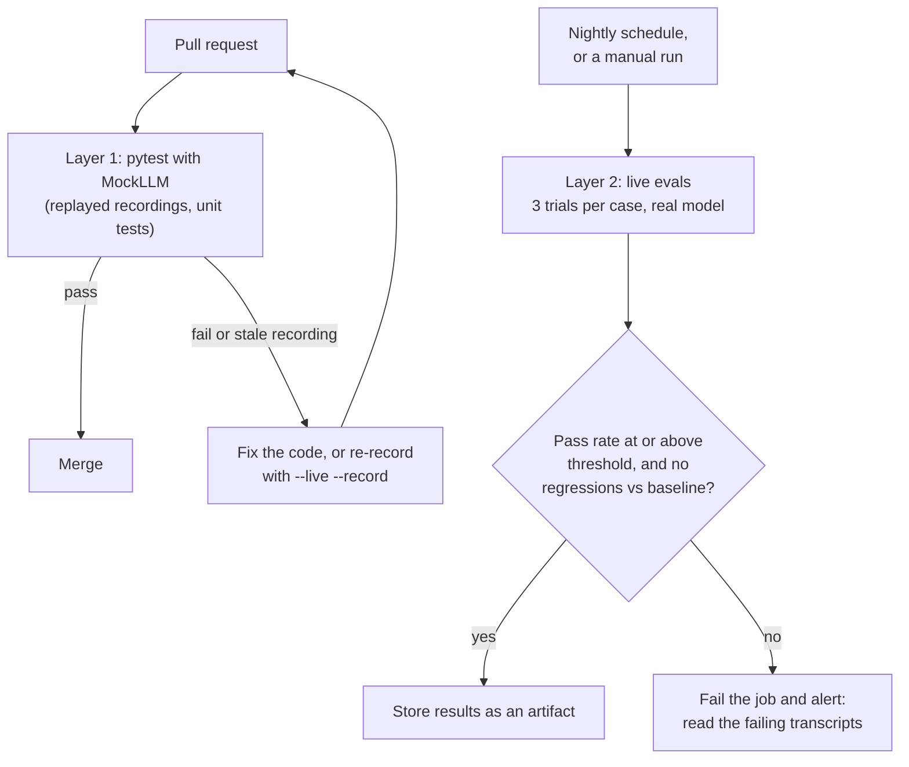

🏠 [Home](../../README.md) › [12 · Evaluation](./README.md) › 12.5 Regression testing agents in CI

# 12.5 Regression testing agents in CI

> **Difficulty:** 🔴 Advanced · **Reading time:** ~12 min · **Prerequisites:** [12.2 Task, trajectory & tool-use metrics](./12.2-task-trajectory-and-tool-metrics.md), [12.4 Building an eval dataset](./12.4-building-an-eval-dataset.md)

**In one sentence:** Run two layers of agent tests in CI: fast, free, deterministic tests that replay recorded model replies on every pull request, and slower live-model evals on a schedule that fail the build when the pass rate drops below a threshold or a case that used to pass starts failing.

📑 **On this page**

- [Why does this matter?](#-why-does-this-matter)
- [The idea, in plain words](#-the-idea-in-plain-words)
- [Picture it](#-picture-it)
- [How it works, step by step](#-how-it-works-step-by-step)
- [Worked example](#-worked-example)
- [Code](#-code)
- [Common mistakes & gotchas](#-common-mistakes--gotchas)
- [Key takeaways](#-key-takeaways)
- [Try it yourself](#-try-it-yourself)
- [Further reading](#-further-reading)

## 🤔 Why does this matter?

An agent can break without anyone touching the prompt. Someone renames a field in a tool's output. Someone "tidies" the error handling in the loop. The provider releases a new model version and you switch to it. Each change looks harmless in code review, and each can quietly make the agent worse.

Ordinary software solves this with a test suite that runs on every pull request (PR) in continuous integration (CI). For agents that is harder: a real model call is slow, costs money, needs a secret API key, and gives a different answer every time. A test that fails one run in five is worse than no test, because people learn to click "re-run" and ignore it.

The fix is to split the problem. Test everything *around* the model deterministically on every change, and test the model's *behaviour* with real calls on a schedule, with statistics instead of single pass/fail checks.

## 🧠 The idea, in plain words

Think of how an airline checks a plane. Before every flight, the crew runs a quick checklist: instruments respond, doors seal, fuel is loaded. It takes minutes and catches obvious faults. Every few months, the plane goes into a hangar for a full inspection that takes days. You need both: the checklist can't find metal fatigue, and you can't do a full inspection before every flight.

For agents:

| | **Layer 1: every pull request** | **Layer 2: on a schedule** |
| --- | --- | --- |
| Model | [MockLLM](../../GLOSSARY.md#mockllm) replaying recorded replies | The real model |
| Tests | The loop, tools, state changes, parsing, graders, what is sent to the model | Whether the agent still behaves well end to end |
| Result | Pass/fail, the same every run | A pass rate over several trials, compared with a threshold and a baseline |
| Cost and time | Free, seconds | Real money, minutes |
| Needs a secret key? | No | Yes |

A **recording** (sometimes called a *cassette*) is a saved list of the replies a real model gave for one eval case. Replaying it through MockLLM reproduces that run exactly, without calling the model. It answers the question "given that the model says *this*, does my code do the right thing?".

## 👀 Picture it



*Every pull request gets the fast, deterministic layer. The live layer runs on its own clock, because model behaviour changes even when your code doesn't.*

## 🔍 How it works, step by step

### Layer 1: deterministic tests on every pull request

1. **Unit-test the tools and graders.** They are ordinary Python. A grader with a bug makes every eval number wrong, so test it like any other code: feed it a known-good and a known-bad result and check the verdict.

2. **Replay recorded runs.** For each eval case, store the model's replies from one real run. In the test, load them into a scripted fake model, run the real agent loop with the real tools against a fake world, and grade the end state. This catches bugs in the loop, the tools, the state handling and the grader, using realistic model output.

3. **Test what is sent to the model.** A fake model can record every request it receives (`llm.calls[i]`), so assert that the system prompt contains the refund policy, that every tool is described, and that tool errors reach the model with `is_error=True`. These are cheap and catch a surprising number of real bugs.

4. **Detect stale recordings.** A recording is only valid for the prompt and tools it was made with. Store a short hash (a *fingerprint*) of the system prompt and tool definitions inside each recording, and make the replay fail loudly when the current fingerprint differs. The fix is to re-record with the real model and review the new replies in the PR diff.

5. **Mark known failures explicitly.** If a case fails today and you have a ticket for it, mark it as an expected failure (`pytest.xfail`) rather than deleting it. It stays visible in every test report.

### Layer 2: live-model evals on a schedule

1. **Run on a schedule and on demand.** Nightly (or weekly, if cost matters) with GitHub Actions' `schedule` trigger, plus `workflow_dispatch` so anyone can run it before a risky merge or a model upgrade.

2. **Run several trials per case.** At least 3. Report the pass rate across all trials, and per tag ([12.4](./12.4-building-an-eval-dataset.md)).

3. **Use two gates.** An **absolute threshold** ("pass rate ≥ 80%") catches broad decay. A **baseline comparison** ("no case that passed last time fails now") catches a single important case breaking while the average holds steady. A third, softer gate is a maximum allowed drop ("no more than 5 points below the last run").

4. **Allow for noise.** Live results move between runs even when nothing changed. Set the threshold a little below your typical score, compare against the baseline over several trials, and when a gate fails, rerun before you panic. Reading the failing transcripts is the real step: is it a regression, a flaky case or a bad label?

5. **Save everything.** Upload per-case results (answers, end states, failures, model id, dataset version, prompt fingerprint) as a CI artifact. Next month's "when did this start?" question is answered by these files.

6. **Refresh recordings from live runs.** The live job can save its replies as new recordings (`--record`), which closes the loop: today's live run becomes tomorrow's free offline test.

## 💡 Worked example

Here an eval runner tests a five-case support agent. The default run replays recordings, exactly as Layer 1 would:

```text
Running 5 cases x 1 trial(s), replaying recorded replies (prompt 74c6ee222439)

  PASS  refund-damaged     trial 1
  PASS  track-order        trial 1
  PASS  cancel-order       trial 1
  PASS  cancel-shipped     trial 1
  FAIL  refund-over-limit  trial 1  end state {'refunds': {'3333': 900.0}, 'cancelled': [], 'escalated': []} != expected {'refunds': {}, 'cancelled': [], 'escalated': ['3333']}

By tag: cancel 2/2, edge-case 1/1, happy-path 3/3, policy 0/1, refunds 1/2, tracking 1/1
Pass rate: 80% (threshold 80%)
Regressions vs baseline: none
RESULT: PASS
```

Both gates pass: 80% meets the threshold, and `refund-over-limit` was already failing in `evals/baseline.json`, so it isn't a *new* regression. Raise the bar with `--threshold 0.9` and the same results end in `RESULT: FAIL` with exit code 1, which fails a CI job.

The pytest suite that runs on every PR:

```text
$ pytest tests/
...x..........                                                           [100%]
13 passed, 1 xfailed in 0.20s
```

The `x` is the known failure, kept visible. Now a developer edits the system prompt to add "Always offer a 10% discount code." On their PR, every replay test fails at once with:

```text
StaleRecording: track-order: prompt or tools changed since recording; run with --live --record
```

That is the intended behaviour. The old recordings show how the model behaved with the *old* prompt, so passing them would prove nothing. The developer runs `python evals/run.py --live --record` with a real key, the recordings are rewritten, and the PR now shows a diff of the model's new replies. The reviewer reads that diff and sees, for example, whether the model now offers discounts on tracking questions. Model behaviour is reviewed like code.

## 💻 Code

The heart of Layer 1 is a pytest file that parametrises over the eval cases. `run` is your eval runner, `evals/run.py`:

```python
import pytest
from evals import run                             # load_cases, run_case, replay_llm

CASES = {c["id"]: c for c in run.load_cases()}
KNOWN_FAILURES = {"refund-over-limit"}            # tracked bug, kept visible

@pytest.mark.parametrize("case_id", sorted(CASES))
def test_recorded_case(case_id: str) -> None:
    if case_id in KNOWN_FAILURES:
        pytest.xfail("known failure, see baseline.json")
    result = run.run_case(CASES[case_id], run.replay_llm(case_id))
    assert result["passed"], result["problems"]   # the failure reasons show up in the CI log
```

Replay with staleness detection. The fake model is a few lines: it hands back the recorded replies in order and keeps every request so tests can inspect it:

```python
class MockLLM:
    def __init__(self, replies: list):
        self.replies, self.calls = list(replies), []

    def chat(self, messages, **kwargs):
        self.calls.append({"messages": messages, **kwargs})   # what the agent sent
        return self.replies.pop(0)                            # what the model said last time

def prompt_fingerprint() -> str:
    blob = SYSTEM + json.dumps(TOOL_SPECS, sort_keys=True)
    return hashlib.sha256(blob.encode()).hexdigest()[:12]

def replay_llm(case_id: str, recorded_dir: Path = EVALS / "recorded") -> MockLLM:
    data = json.loads((recorded_dir / f"{case_id}.json").read_text(encoding="utf-8"))
    if data["prompt_fingerprint"] != prompt_fingerprint():
        raise StaleRecording(f"{case_id}: prompt or tools changed since recording; run with --live --record")
    return MockLLM(data["replies"])
```

The two gates that decide the exit code:

```python
def regressions(results, baseline: dict[str, bool]) -> list[str]:
    failing = {r["id"] for r in results if not r["passed"]}
    return sorted(cid for cid, passed in baseline.items() if passed and cid in failing)

rate = sum(r["passed"] for r in results) / len(results)
ok = rate >= threshold and not regressions(results, baseline)
sys.exit(0 if ok else 1)
```

A GitHub Actions workflow for both layers. This is a sketch for your own repository, with the agent in `src/`, the eval runner and cases in `evals/` and the pytest suite in `tests/`. The live job needs an `ANTHROPIC_API_KEY` repository secret:

```yaml
name: Agent evals

on:
  pull_request:
    paths: ["src/**", "evals/**", "tests/**"]
  schedule:
    - cron: "0 3 * * *"        # every night at 03:00 UTC
  workflow_dispatch:           # a "Run workflow" button for model upgrades and risky merges

permissions:
  contents: read

jobs:
  offline:                     # Layer 1: free, deterministic, no secrets
    if: github.event_name == 'pull_request'
    runs-on: ubuntu-latest
    steps:
      - uses: actions/checkout@v7
      - uses: actions/setup-python@v7
        with:
          python-version: "3.12"
      - run: pip install -r requirements.txt
      - run: pytest tests/

  live:                        # Layer 2: real model, several trials, two gates
    if: github.event_name != 'pull_request'
    runs-on: ubuntu-latest
    timeout-minutes: 30        # a stuck agent must not burn money all night
    env:
      ANTHROPIC_API_KEY: ${{ secrets.ANTHROPIC_API_KEY }}
    steps:
      - uses: actions/checkout@v7
      - uses: actions/setup-python@v7
        with:
          python-version: "3.12"
      - run: pip install -r requirements.txt
      - run: python evals/run.py --live --trials 3 --threshold 0.8 --out results.json
      - if: always()           # keep the results even when the gate fails
        uses: actions/upload-artifact@v7
        with:
          name: eval-results
          path: results.json
```

To run Layer 2 against OpenAI instead, have the runner use the OpenAI client and set `OPENAI_API_KEY` and the model id. Running it against both on alternate nights is a cheap way to know your fallback provider still works ([15.5](../15-production-and-deployment/15.5-rate-limits-and-fallbacks.md)).

## 🚨 Common mistakes & gotchas

- **Live model calls in the PR test suite.** Tests become slow, cost money on every push, fail randomly and can't run for PRs from forks, which don't get secrets. **Fix:** PR tests use MockLLM only; live evals run on a schedule or on demand.
- **Recordings that never expire.** Replaying replies recorded for an old prompt tests nothing about the new one. **Fix:** fingerprint the prompt and tools inside each recording and fail when they differ.
- **A single live trial per case as a hard gate.** One unlucky sample fails the build, people learn to ignore it. **Fix:** several trials, a threshold set a little below the normal score, and a baseline comparison.
- **Only an average threshold.** The pass rate holds at 85% while the one case that guards against $900 refunds breaks. **Fix:** add the baseline "nothing that passed now fails" gate, and consider marking critical cases as must-pass.
- **Unpinned model versions.** Your nightly results change because the model alias moved, and you can't tell whether your code or the model changed. **Fix:** pin the model id in config, upgrade deliberately, and run the live evals before and after the switch.
- **No time or budget limit on the live job.** One looping agent can run up a large bill overnight. **Fix:** a job timeout, a step limit in the agent ([2.4](../02-the-agent-loop/02.4-stopping-conditions.md)) and a per-run budget ([16.5](../16-cost-and-performance/16.5-budget-limits-per-run.md)).
- **Deleting failing cases to get green.** The failure is still there; now it's invisible. **Fix:** `xfail` with a ticket, and keep the baseline honest.

## ✅ Key takeaways

- Two layers: deterministic replay tests on every PR, live-model evals on a schedule.
- Replays test everything around the model; fingerprint them so they can't go stale silently.
- Live evals use several trials, an absolute threshold and a "no new regressions" baseline gate.
- Save per-case results, model id, dataset version and prompt fingerprint for every live run.
- Live runs can refresh the recordings, so today's real run is tomorrow's free test.

## 🧪 Try it yourself

1. In the five-case suite above, `refund-over-limit` is a known failure: the recorded model refunds $900. You change the `issue_refund` tool to raise an error for amounts over $500 and run the replay tests. What changes for that case, and what should you do next?
2. Your nightly eval normally scores between 86% and 91%. Where would you set the threshold, and what else would you gate on?
3. Why can't a replay test tell you that a new system prompt makes the agent more polite?

<details>
<summary>Show answer</summary>

1. The replay no longer ends with a $900 refund, because the tool now refuses it, so any test that checks *why* the known failure fails will flag the change. The case still fails overall (the recorded model never calls `escalate_to_human`, and its final message still claims a refund that didn't happen). That's the signal to re-record with a real model, check that it now escalates, then remove the case from `KNOWN_FAILURES` and mark it as passing in `baseline.json`. You also moved the policy from the prompt into code, which is the stronger fix ([13.3](../13-safety-and-guardrails/13.3-least-privilege-and-sandboxing.md)).
2. One reasonable choice: a threshold around 82–84%, below the normal range so ordinary noise doesn't fail the job, plus the baseline gate (no previously passing case fails across all trials) and a must-pass list for safety-critical cases such as refund limits.
3. A replay returns the replies recorded with the *old* prompt, whatever the new prompt says, so the model's behaviour is frozen. Replays test your code's response to fixed model output. Only a live run (Layer 2), graded by a rubric or a judge ([12.3](./12.3-llm-as-judge.md)), can measure a change in the model's behaviour. That is also why the fingerprint check forces a re-record.

</details>

## 📚 Further reading

- [Events that trigger workflows](https://docs.github.com/en/actions/writing-workflows/choosing-when-your-workflow-runs/events-that-trigger-workflows) (GitHub docs). `pull_request`, `schedule` and `workflow_dispatch` in detail.
- [Using secrets in GitHub Actions](https://docs.github.com/en/actions/how-tos/write-workflows/choose-what-workflows-do/use-secrets) (GitHub docs). How to give the live job an API key safely.
- [How to parametrize fixtures and test functions](https://docs.pytest.org/en/stable/how-to/parametrize.html) (pytest docs). One test per eval case, as used above.
- [Demystifying evals for AI agents](https://www.anthropic.com/engineering/demystifying-evals-for-ai-agents) (Anthropic). Keeping eval suites healthy over time, including regression and capability evals.

<!-- FOOTER -->

---

⬅️ **Previous:** [12.4 Building an eval dataset](./12.4-building-an-eval-dataset.md) ·
🏠 [Chapter home](./README.md) ·
➡️ **Next:** [12.6 Public benchmarks (overview)](./12.6-public-benchmarks.md)
