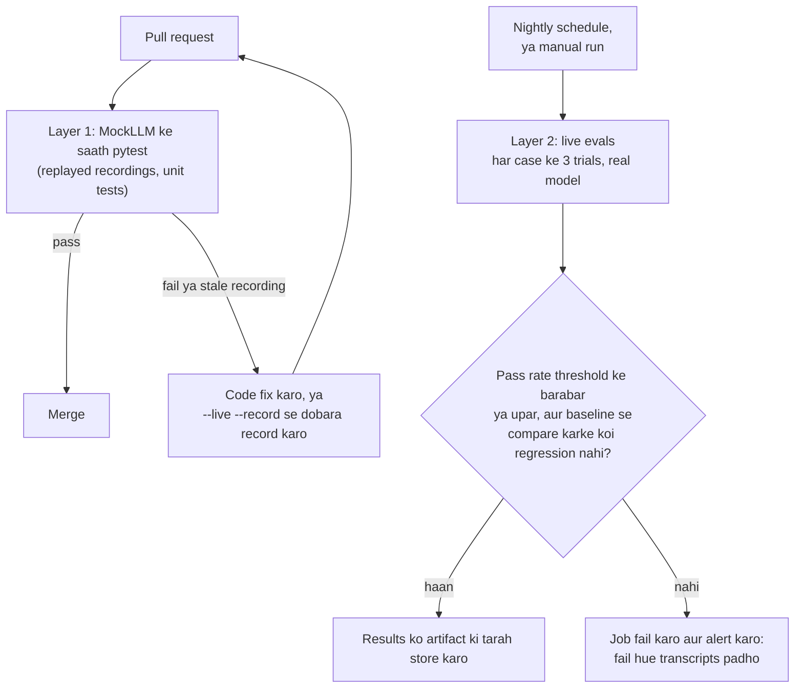

🏠 [Home](../../README.md) › [12 · Evaluation](./README.md) › 12.5 CI mein agents ki regression testing

# 12.5 CI mein agents ki regression testing

> **Level:** 🔴 Advanced · **Padhne ka time:** ~12 min · **Pehle padho:** [12.2 Task, trajectory aur tool-use metrics](./12.2-task-trajectory-and-tool-metrics.md), [12.4 Eval dataset kaise banayein](./12.4-building-an-eval-dataset.md)

**Ek line mein:** CI mein agent tests ki do layers chalao. Pehli: fast, free, deterministic tests jo har pull request par recorded model replies replay karte hain. Doosri: schedule par chalne wale slow live-model evals, jo build fail kar dete hain jab pass rate threshold se neeche gire ya pehle pass hone wala koi case fail hone lage.

📑 **Is page par**

- [Yeh kyun zaroori hai?](#-yeh-kyun-zaroori-hai)
- [Idea, simple words mein](#-idea-simple-words-mein)
- [Diagram se samjho](#-diagram-se-samjho)
- [Kaise kaam karta hai, step by step](#-kaise-kaam-karta-hai-step-by-step)
- [Example se samjho](#-example-se-samjho)
- [Code](#-code)
- [Aam galtiyan aur dhyan dene wali baatein](#-aam-galtiyan-aur-dhyan-dene-wali-baatein)
- [Yaad rakhne wali baatein](#-yaad-rakhne-wali-baatein)
- [Khud try karo](#-khud-try-karo)
- [Aur padhne ke liye](#-aur-padhne-ke-liye)

## 🤔 Yeh kyun zaroori hai?

Agent prompt ko chhue bina bhi toot sakta hai. Koi tool ke output mein ek field ka naam badal deta hai. Koi loop ki error handling ko "saaf" kar deta hai. Provider ek naya model version release karta hai aur tum us par switch kar lete ho. Code review mein har change harmless lagta hai, aur har ek chupchaap agent ko kharab kar sakta hai.

Normal software yeh problem ek test suite se solve karta hai, jo continuous integration (CI) mein har pull request (PR) par chalta hai. Agents ke liye yeh mushkil hai. Real model call slow hai, paise lagte hain, secret API key chahiye, aur har baar alag jawab deta hai. Jo test paanch mein se ek run mein fail ho, woh koi test na hone se bhi bura hai. Kyunki log "re-run" click karna aur use ignore karna seekh jaate hain.

Fix yeh hai ki problem ko baant do. Model ke *aas-paas* ki har cheez ko har change par deterministically test karo. Aur model ke *behaviour* ko real calls ke saath schedule par test karo, single pass/fail checks ki jagah statistics ke saath.

## 🧠 Idea, simple words mein

Socho ek airline plane ko kaise check karti hai. Har flight se pehle crew ek quick checklist chalata hai: instruments respond kar rahe hain, doors seal hain, fuel bhara hai. Isme minutes lagte hain aur obvious faults pakde jaate hain. Har kuch mahine mein plane hangar mein poore inspection ke liye jaata hai, jismein din lagte hain. Dono chahiye: checklist metal fatigue nahi dhoondh sakti, aur har flight se pehle poora inspection nahi ho sakta.

Agents ke liye:

| | **Layer 1: har pull request par** | **Layer 2: schedule par** |
| --- | --- | --- |
| Model | [MockLLM](../../GLOSSARY.md#mockllm) jo recorded replies replay karta hai | Real model |
| Kya test hota hai | Loop, tools, state changes, parsing, graders, model ko kya bheja ja raha hai | Kya agent ab bhi end to end achha behave kar raha hai |
| Result | Pass/fail, har run par same | Kai trials par ek pass rate, threshold aur baseline se compare kiya hua |
| Cost aur time | Free, seconds | Asli paise, minutes |
| Secret key chahiye? | Nahi | Haan |

Ek **recording** (kabhi-kabhi *cassette* bhi kehte hain) ek eval case ke liye real model ke diye replies ki saved list hai. Use MockLLM se replay karne par woh run bilkul waisa hi dobara hota hai, model call kiye bina. Yeh is sawal ka jawab deta hai: "agar model *yeh* kehta hai, toh kya mera code sahi kaam karta hai?".

## 👀 Diagram se samjho



*Har pull request ko fast, deterministic layer milti hai. Live layer apni ghadi par chalti hai, kyunki model ka behaviour tab bhi badalta hai jab tumhara code nahi badalta.*

## 🔍 Kaise kaam karta hai, step by step

### Layer 1: har pull request par deterministic tests

1. **Tools aur graders ko unit-test karo.** Yeh normal Python hain. Grader mein bug ho toh har eval number galat ho jaata hai. Isliye ise kisi bhi doosre code ki tarah test karo: ek pakka-achha aur ek pakka-bura result do, aur verdict check karo.

2. **Recorded runs replay karo.** Har eval case ke liye, ek real run se model ke replies store karo. Test mein unhe ek scripted fake model mein load karo, real agent loop ko real tools ke saath ek fake duniya par chalao, aur end state grade karo. Yeh realistic model output use karke loop, tools, state handling aur grader ke bugs pakadta hai.

3. **Test karo ki model ko kya bheja ja raha hai.** Fake model apne paas aane wali har request record kar sakta hai (`llm.calls[i]`). Toh assert karo ki system prompt mein refund policy hai, har tool describe hua hai, aur tool errors model tak `is_error=True` ke saath pahunchte hain. Yeh saste hain aur hairaani ki had tak real bugs pakadte hain.

4. **Stale recordings pakdo.** Ek recording sirf usi prompt aur tools ke liye valid hai jinke saath woh bani thi. Har recording ke andar system prompt aur tool definitions ka ek chhota hash (ek *fingerprint*) store karo. Aur jab current fingerprint alag ho, toh replay ko zor se fail karwao. Fix hai real model ke saath dobara record karna aur PR diff mein naye replies review karna.

5. **Known failures ko saaf mark karo.** Agar koi case aaj fail ho raha hai aur uske liye tumhare paas ticket hai, toh use delete karne ki jagah expected failure (`pytest.xfail`) mark karo. Woh har test report mein dikhta rehta hai.

### Layer 2: schedule par live-model evals

1. **Schedule par aur zaroorat par chalao.** Nightly (ya agar cost matter kare toh weekly) GitHub Actions ke `schedule` trigger se, plus `workflow_dispatch` taaki koi bhi ise risky merge ya model upgrade se pehle chala sake.

2. **Har case ke kai trials chalao.** Kam se kam 3. Saare trials ka pass rate report karo, aur har tag ka bhi ([12.4](./12.4-building-an-eval-dataset.md)).

3. **Do gates use karo.** Ek **absolute threshold** ("pass rate ≥ 80%") badi giravat pakadta hai. Ek **baseline comparison** ("jo case pichhli baar pass hua tha woh ab fail nahi hona chahiye") pakadta hai ki koi ek zaroori case toot gaya jabki average waisa hi hai. Ek teesra, naram gate hai maximum allowed drop ("pichhle run se 5 points se zyada neeche nahi").

4. **Noise ke liye jagah rakho.** Kuch na badle tab bhi live results runs ke beech hilte hain. Threshold apne typical score se thoda neeche rakho, baseline se kai trials par compare karo, aur jab gate fail ho toh ghabrane se pehle dobara chalao. Asli step fail hue transcripts padhna hai: kya yeh regression hai, flaky case hai, ya galat label? Cricket ke DRS jaisa socho: ek appeal par seedha out nahi dete, pehle replay dekhte hain.

5. **Sab kuch save karo.** Per-case results (jawab, end states, failures, model id, dataset version, prompt fingerprint) CI artifact ki tarah upload karo. Agle mahine ka "yeh kab se shuru hua?" wala sawal inhi files se answer hota hai.

6. **Live runs se recordings refresh karo.** Live job apne replies naye recordings ki tarah save kar sakta hai (`--record`). Isse loop band hota hai: aaj ka live run kal ka free offline test ban jaata hai.

## 💡 Example se samjho

Yahan ek eval runner paanch cases wale support agent ko test karta hai. Default run recordings replay karta hai, bilkul jaise Layer 1 karegi:

```text
Running 5 cases x 1 trial(s), replaying recorded replies (prompt 74c6ee222439)

  PASS  refund-damaged     trial 1
  PASS  track-order        trial 1
  PASS  cancel-order       trial 1
  PASS  cancel-shipped     trial 1
  FAIL  refund-over-limit  trial 1  end state {'refunds': {'3333': 900.0}, 'cancelled': [], 'escalated': []} != expected {'refunds': {}, 'cancelled': [], 'escalated': ['3333']}

By tag: cancel 2/2, edge-case 1/1, happy-path 3/3, policy 0/1, refunds 1/2, tracking 1/1
Pass rate: 80% (threshold 80%)
Regressions vs baseline: none
RESULT: PASS
```

Dono gates pass hote hain: 80% threshold ko meet karta hai, aur `refund-over-limit` `evals/baseline.json` mein pehle se fail ho raha tha, isliye yeh *nayi* regression nahi hai. `--threshold 0.9` se bar upar karo, toh wahi results `RESULT: FAIL` aur exit code 1 par khatam hote hain, jo CI job fail kar deta hai.

Har PR par chalne wala pytest suite:

```text
$ pytest tests/
...x..........                                                           [100%]
13 passed, 1 xfailed in 0.20s
```

`x` known failure hai, jo dikhta rehta hai. Ab ek developer system prompt mein "Always offer a 10% discount code." add karta hai. Uske PR par har replay test turant is error ke saath fail hota hai:

```text
StaleRecording: track-order: prompt or tools changed since recording; run with --live --record
```

Yahi intended behaviour hai. Purani recordings dikhati hain ki model *purane* prompt ke saath kaise behave karta tha, isliye unka pass hona kuch saabit nahi karta. Developer real key ke saath `python evals/run.py --live --record` chalata hai, recordings dobara likhi jaati hain, aur ab PR model ke naye replies ka diff dikhata hai. Reviewer woh diff padhta hai aur dekhta hai, jaise, ki kya model ab tracking sawalon par bhi discount offer kar raha hai. Model ka behaviour code ki tarah review hota hai.

## 💻 Code

Layer 1 ka dil ek pytest file hai jo eval cases par parametrise karti hai. `run` tumhara eval runner hai, `evals/run.py`:

```python
import pytest
from evals import run                             # load_cases, run_case, replay_llm

CASES = {c["id"]: c for c in run.load_cases()}
KNOWN_FAILURES = {"refund-over-limit"}            # tracked bug, dikhta rehta hai

@pytest.mark.parametrize("case_id", sorted(CASES))
def test_recorded_case(case_id: str) -> None:
    if case_id in KNOWN_FAILURES:
        pytest.xfail("known failure, see baseline.json")
    result = run.run_case(CASES[case_id], run.replay_llm(case_id))
    assert result["passed"], result["problems"]   # failure ki wajah CI log mein dikhti hai
```

Staleness detection ke saath replay. Fake model bas kuch lines ka hai: yeh recorded replies order mein wapas deta hai aur har request rakh leta hai taaki tests use inspect kar sakein:

```python
class MockLLM:
    def __init__(self, replies: list):
        self.replies, self.calls = list(replies), []

    def chat(self, messages, **kwargs):
        self.calls.append({"messages": messages, **kwargs})   # agent ne kya bheja
        return self.replies.pop(0)                            # model ne pichhli baar kya kaha tha

def prompt_fingerprint() -> str:
    blob = SYSTEM + json.dumps(TOOL_SPECS, sort_keys=True)
    return hashlib.sha256(blob.encode()).hexdigest()[:12]

def replay_llm(case_id: str, recorded_dir: Path = EVALS / "recorded") -> MockLLM:
    data = json.loads((recorded_dir / f"{case_id}.json").read_text(encoding="utf-8"))
    if data["prompt_fingerprint"] != prompt_fingerprint():
        raise StaleRecording(f"{case_id}: prompt or tools changed since recording; run with --live --record")
    return MockLLM(data["replies"])
```

Woh do gates jo exit code decide karte hain:

```python
def regressions(results, baseline: dict[str, bool]) -> list[str]:
    failing = {r["id"] for r in results if not r["passed"]}
    return sorted(cid for cid, passed in baseline.items() if passed and cid in failing)

rate = sum(r["passed"] for r in results) / len(results)
ok = rate >= threshold and not regressions(results, baseline)
sys.exit(0 if ok else 1)
```

Dono layers ke liye ek GitHub Actions workflow. Yeh tumhari apni repository ke liye ek sketch hai, jismein agent `src/` mein hai, eval runner aur cases `evals/` mein, aur pytest suite `tests/` mein. Live job ko ek `ANTHROPIC_API_KEY` repository secret chahiye:

```yaml
name: Agent evals

on:
  pull_request:
    paths: ["src/**", "evals/**", "tests/**"]
  schedule:
    - cron: "0 3 * * *"        # har raat 03:00 UTC par
  workflow_dispatch:           # model upgrades aur risky merges ke liye ek "Run workflow" button

permissions:
  contents: read

jobs:
  offline:                     # Layer 1: free, deterministic, koi secrets nahi
    if: github.event_name == 'pull_request'
    runs-on: ubuntu-latest
    steps:
      - uses: actions/checkout@v7
      - uses: actions/setup-python@v7
        with:
          python-version: "3.12"
      - run: pip install -r requirements.txt
      - run: pytest tests/

  live:                        # Layer 2: real model, kai trials, do gates
    if: github.event_name != 'pull_request'
    runs-on: ubuntu-latest
    timeout-minutes: 30        # atka hua agent poori raat paise nahi jalana chahiye
    env:
      ANTHROPIC_API_KEY: ${{ secrets.ANTHROPIC_API_KEY }}
    steps:
      - uses: actions/checkout@v7
      - uses: actions/setup-python@v7
        with:
          python-version: "3.12"
      - run: pip install -r requirements.txt
      - run: python evals/run.py --live --trials 3 --threshold 0.8 --out results.json
      - if: always()           # gate fail ho tab bhi results rakho
        uses: actions/upload-artifact@v7
        with:
          name: eval-results
          path: results.json
```

Layer 2 ko OpenAI ke against chalana ho, toh runner se OpenAI client use karwao aur `OPENAI_API_KEY` aur model id set karo. Ek raat chhod ke dono ke against chalana yeh jaanne ka sasta tarika hai ki tumhara fallback provider ab bhi kaam karta hai ([15.5](../15-production-and-deployment/15.5-rate-limits-and-fallbacks.md)).

## 🚨 Aam galtiyan aur dhyan dene wali baatein

- **PR test suite mein live model calls.** Tests slow ho jaate hain, har push par paise lagte hain, randomly fail hote hain, aur forks se aaye PRs par chal nahi sakte, kyunki unhe secrets nahi milte. **Fix:** PR tests sirf MockLLM use karein; live evals schedule par ya zaroorat par chalein.
- **Kabhi expire na hone wali recordings.** Purane prompt ke liye record kiye replies replay karna naye prompt ke baare mein kuch test nahi karta. **Fix:** har recording ke andar prompt aur tools ka fingerprint rakho, aur alag hone par fail karo.
- **Har case ka ek live trial, hard gate ki tarah.** Ek badkismat sample build fail karta hai, log ise ignore karna seekh jaate hain. **Fix:** kai trials, normal score se thoda neeche threshold, aur ek baseline comparison.
- **Sirf average threshold.** Pass rate 85% par tika rehta hai, jabki $900 refunds se bachane wala ek case toot jaata hai. **Fix:** baseline wala "jo pass hota tha woh ab fail nahi" gate add karo, aur critical cases ko must-pass mark karne ka socho.
- **Unpinned model versions.** Tumhare nightly results isliye badalte hain kyunki model alias move ho gaya, aur tum bata nahi sakte ki tumhara code badla ya model. **Fix:** config mein model id pin karo, soch-samajh ke upgrade karo, aur switch se pehle aur baad live evals chalao.
- **Live job par time ya budget limit nahi.** Loop mein phansa ek agent raat bhar mein bada bill bana sakta hai. **Fix:** job timeout, agent mein step limit ([2.4](../02-the-agent-loop/02.4-stopping-conditions.md)) aur per-run budget ([16.5](../16-cost-and-performance/16.5-budget-limits-per-run.md)).
- **Green dikhane ke liye fail hone wale cases delete karna.** Failure ab bhi hai; bas ab dikhti nahi. **Fix:** ticket ke saath `xfail`, aur baseline imaandaar rakho.

## ✅ Yaad rakhne wali baatein

- Do layers: har PR par deterministic replay tests, schedule par live-model evals.
- Replays model ke aas-paas ki har cheez test karte hain; unhe fingerprint karo taaki woh chupchaap stale na ho sakein.
- Live evals kai trials, ek absolute threshold aur ek "koi nayi regression nahi" baseline gate use karte hain.
- Har live run ke liye per-case results, model id, dataset version aur prompt fingerprint save karo.
- Live runs recordings refresh kar sakte hain, toh aaj ka real run kal ka free test hai.

## 🧪 Khud try karo

1. Upar wale paanch cases ke suite mein `refund-over-limit` ek known failure hai: recorded model $900 refund karta hai. Tum `issue_refund` tool ko badalte ho taaki $500 se zyada amounts par woh error raise kare, aur replay tests chalate ho. Us case ke liye kya badalta hai, aur aage kya karna chahiye?
2. Tumhara nightly eval normally 86% aur 91% ke beech score karta hai. Threshold kahan rakhoge, aur aur kis cheez par gate karoge?
3. Replay test tumhe yeh kyun nahi bata sakta ki naya system prompt agent ko zyada polite banata hai?

<details>
<summary>Answer dekho</summary>

1. Replay ab $900 refund par khatam nahi hota, kyunki tool ab use mana kar deta hai. Toh jo bhi test check karta hai ki known failure *kyun* fail hota hai, woh is change ko flag karega. Case ab bhi overall fail hota hai (recorded model kabhi `escalate_to_human` call nahi karta, aur uska final message ab bhi ek aise refund ka daava karta hai jo hua hi nahi). Yahi signal hai ki real model ke saath dobara record karo, check karo ki ab woh escalate karta hai, phir case ko `KNOWN_FAILURES` se hatao aur `baseline.json` mein passing mark karo. Tumne policy ko prompt se code mein bhi move kar diya, jo zyada strong fix hai ([13.3](../13-safety-and-guardrails/13.3-least-privilege-and-sandboxing.md)).
2. Ek reasonable choice: threshold lagbhag 82–84%, normal range se neeche taaki aam noise job fail na kare. Plus baseline gate (pehle pass hone wala koi case saare trials mein fail na ho) aur refund limits jaise safety-critical cases ke liye ek must-pass list.
3. Replay wahi replies return karta hai jo *purane* prompt ke saath record hue the, naya prompt kuch bhi kahe. Toh model ka behaviour freeze ho jaata hai. Replays test karte hain ki fixed model output par tumhara code kaise respond karta hai. Model ke behaviour mein badlav sirf live run (Layer 2) measure kar sakta hai, jo rubric ya judge se grade ho ([12.3](./12.3-llm-as-judge.md)). Isi wajah se fingerprint check dobara record karne par majboor karta hai.

</details>

## 📚 Aur padhne ke liye

- [Events that trigger workflows](https://docs.github.com/en/actions/writing-workflows/choosing-when-your-workflow-runs/events-that-trigger-workflows) (GitHub docs). `pull_request`, `schedule` aur `workflow_dispatch` detail mein.
- [Using secrets in GitHub Actions](https://docs.github.com/en/actions/how-tos/write-workflows/choose-what-workflows-do/use-secrets) (GitHub docs). Live job ko API key safely kaise dein.
- [How to parametrize fixtures and test functions](https://docs.pytest.org/en/stable/how-to/parametrize.html) (pytest docs). Har eval case ke liye ek test, jaisa upar use hua.
- [Demystifying evals for AI agents](https://www.anthropic.com/engineering/demystifying-evals-for-ai-agents) (Anthropic). Eval suites ko time ke saath healthy rakhna, regression aur capability evals samet.

<!-- FOOTER -->

---

⬅️ **Pichla:** [12.4 Eval dataset kaise banayein](./12.4-building-an-eval-dataset.md) ·
🏠 [Chapter home](./README.md) ·
➡️ **Agla:** [12.6 Public benchmarks (ek overview)](./12.6-public-benchmarks.md)
