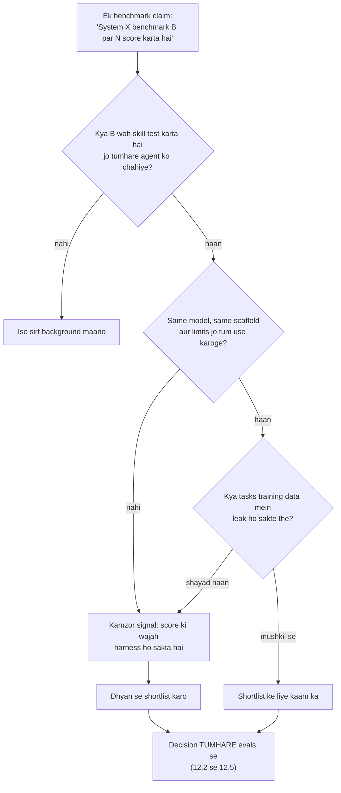

🏠 [Home](../../README.md) › [12 · Evaluation](./README.md) › 12.6 Public benchmarks (ek overview)

# 12.6 Public benchmarks (ek overview)

> **Level:** 🟡 Intermediate · **Padhne ka time:** ~8 min · **Pehle padho:** [12.2 Task, trajectory aur tool-use metrics](./12.2-task-trajectory-and-tool-metrics.md)

**Ek line mein:** SWE-bench, GAIA, τ-bench, WebArena, OSWorld aur BFCL jaise public agent benchmarks har ek, ek controlled setting mein agent ki ek tarah ki skill measure karte hain. Models shortlist karne ke liye yeh kaam ke hain. Lekin contamination, agent setup ke differences aur tumhare apne tasks se doori ki wajah se final decision tumhare apne evals ko hi lena chahiye.

📑 **Is page par**

- [Yeh kyun zaroori hai?](#-yeh-kyun-zaroori-hai)
- [Idea, simple words mein](#-idea-simple-words-mein)
- [Diagram se samjho](#-diagram-se-samjho)
- [Kaise kaam karta hai, step by step](#-kaise-kaam-karta-hai-step-by-step)
- [Example se samjho](#-example-se-samjho)
- [Code](#-code)
- [Aam galtiyan aur dhyan dene wali baatein](#-aam-galtiyan-aur-dhyan-dene-wali-baatein)
- [Yaad rakhne wali baatein](#-yaad-rakhne-wali-baatein)
- [Khud try karo](#-khud-try-karo)
- [Aur padhne ke liye](#-aur-padhne-ke-liye)

## 🤔 Yeh kyun zaroori hai?

Har model launch ke saath [benchmark](../../GLOSSARY.md#benchmark) scores ki ek table aati hai. Aur har agent framework kisi na kisi leaderboard par ek number claim karta hai. Tumse poocha jaayega "kaunsa model use karein?", aur koi un tables ki taraf ishaara karega.

Benchmarks sach mein kaam ke hain. Yeh public hain, repeatable hain, aur tum khud jo bhi banaoge usse kahin bade hain. Lekin ek score sirf yeh batata hai ki ek setup ne ek tarah ke task par kaisa kiya. Agar tum jaante ho ki har benchmark asal mein kya measure karta hai, aur scores kaise gumraah kar sakte hain, toh tum unhe usi cheez ke liye use kar sakte ho jismein woh achhe hain (ek shortlist), bina unse bewakoof bane.

Yeh page jaan-boojhkar koi score quote nahi karta. Scores har kuch hafton mein badalte hain, aur yahan chhapa koi bhi number tumhare padhne tak purana ho jaata. Current results ke liye links follow karo.

## 🧠 Idea, simple words mein

Benchmark ek standardised exam jaisa hai. Kisi student ka maths exam score uske maths ke baare mein kuch sach batata hai. Lekin yeh bahut kam batata hai ki woh *tumhari* job mein achha hoga ya nahi, jismein maths, likhna aur gusse wale customers ko sambhalna sab chahiye. Aur agar student ne exam ke sawal pehle hi dekh liye the (jaise paper leak ho gaya ho), toh score lagbhag kuch nahi batata.

Agent benchmarks bhi aise hi hain, ek extra twist ke saath. Yahan "student" ek model **plus** uske aas-paas ka program hai (*scaffold* ya *harness*: prompts, tools, loop aur limits). Do teams same model ko same benchmark par alag scaffolds ke saath chala ke bahut alag scores la sakti hain. Toh benchmark result asal mein ek *system* ka result hai, sirf model ka nahi. Socho do log same recipe se biryani bana rahe hain, lekin ek ke paas achha bartan aur gas hai aur doosre ke paas nahi. Taste ka farak sirf chawal ka nahi hai.

## 👀 Diagram se samjho



*Har raasta same box par khatam hota hai. Public benchmarks options kam karte hain; winner tumhara apna eval set chunta hai.*

## 🔍 Kaise kaam karta hai, step by step

### Main agent benchmarks

| Benchmark | Agent ko kya karna hai | Success kaise check hota hai | Kis cheez ka achha signal |
| --- | --- | --- | --- |
| **[SWE-bench](https://www.swebench.com)** | Ek real Python repository aur ek GitHub issue diya gaya hai; code edit karke issue resolve karo. Original set mein 12 popular repositories se 2,294 problems hain. | Woh tests chalao jo asli fix ne pass karwaye the, aur check karo ki pehle pass hone wale tests ab bhi pass hote hain | Real codebases mein kaam karne wale coding agents |
| **[GAIA](https://huggingface.co/gaia-benchmark)** | Real-world sawalon ke jawab do jinke liye kai steps ki reasoning, web browsing, images aur files handle karna, aur tool use chahiye; insaanon ke liye simple, AI ke liye mushkil. Teen difficulty levels mein 466 sawal. | Ek chhote jawab ke against quasi-exact match; leaderboard ke liye 300 sawalon ke jawab private rakhe gaye hain | General research assistants |
| **[τ-bench](https://github.com/sierra-research/tau-bench)** | Retail ya airline customer service mein ek simulated user (jise ek model play karta hai) se baat karo, API tools use karke aur ek likhi hui policy follow karke | End mein database ko expected state se compare karo; repeated trials par pass^k report karta hai | Tool use karne wale, rules follow karne wale, customer-facing agents |
| **[WebArena](https://webarena.dev)** | Realistic, self-hosted websites par tasks poore karo: online shop, forum, code hosting, content management | Functional checks ki task sach mein hua ya nahi | Browser agents |
| **[OSWorld](https://os-world.github.io)** | Ek real desktop (Ubuntu, Windows, macOS) par real apps, files aur multi-app workflows mein tasks poore karo. Original set mein 369 tasks. | Har task ki ek custom script machine ki final state inspect karti hai | Computer-use agents ([3.7](../03-tools-and-function-calling/03.7-computer-use-and-browser-agents.md)) |
| **[BFCL](https://gorilla.cs.berkeley.edu/leaderboard.html)** (Berkeley Function Calling Leaderboard) | Sahi function calls banao: single, multiple aur parallel; pehchaano kab *koi* function fit nahi hota; naye versions multi-turn aur agentic tasks add karte hain | Call ke structure ko expected call se compare karo (AST matching), aur jahan ho sake calls execute karo | Khud tool-calling step ([3.3](../03-tools-and-function-calling/03.3-how-function-calling-works.md)) |

Inhe padhne ke liye kuch notes:

- **Benchmarks families mein aate hain.** SWE-bench ke Verified, Lite, Multimodal aur Multilingual variants hain; τ-bench ka ek successor hai, [τ²-bench](https://arxiv.org/abs/2506.07982), jismein user bhi environment par act kar sakta hai. Check karo ki score *kaunse* variant ka hai.
- **Zyada tar end state grade karte hain, text nahi.** "Success kaise check hota hai" column dekho: tests pass hote hain, database match karta hai, desktop sahi state mein hai. Yeh wahi principle hai jo [12.2](./12.2-task-trajectory-and-tool-metrics.md) mein hai, aur isi wajah se yeh benchmarks seriously liye jaate hain.
- **Yeh capability measure karte hain, tumhara product nahi.** Inmein se koi bhi tumhare tools, users ya policies nahi jaanta.

### Scores gumraah kyun karte hain

1. **[Data contamination](../../GLOSSARY.md#data-contamination).** Agar benchmark ke sawal ya unke solutions model ke training data mein aa gaye (jaise GitHub issues aur unke fixes public hain), toh model ne unhe thoda ratta maar liya ho sakta hai. Tab uska score *naye* problems par uski performance ko badha-chadha ke dikhata hai. Benchmark banane wale bachav ke liye private test answers (GAIA), regularly refresh hone wale sawal ([LiveBench](https://arxiv.org/abs/2406.19314)), aur memorisation ke statistical tests ([Oren et al., 2023](https://arxiv.org/abs/2310.17623)) use karte hain. Koi bhi risk ko poori tarah khatam nahi karta.
2. **Scaffold ke differences.** Same model behtar prompt, zyada tools, zyada steps ya zyada retries ke saath zyada score karta hai. Leaderboard ki ek row ek system ka result hai. Dekho kaunsa harness use hua, aur kya limits (steps, time, cost) milti-julti thi.
3. **Kai attempts, ek report hua.** "5 attempts mein se best" (pass@5, [12.2](./12.2-task-trajectory-and-tool-metrics.md) dekho) ek single attempt se bahut alag number hai. Check karo ki tum kaunsa padh rahe ho.
4. **Self-reported results.** Kuch leaderboard entries maintainers verify karte hain; baaki system banane wale log khud submit karte hain. Verified ya reproduce kiye results ko prefer karo.
5. **Cost aur time aksar missing hote hain.** Jo system 10× tokens mein 5% zyada tasks solve karta hai, woh tumhare liye galat choice ho sakta hai ([16.1](../16-cost-and-performance/16.1-token-cost-maths.md)).
6. **Saturation aur noise.** Leaderboard ke top ke paas, ek-do point ke farak aksar run-to-run noise ke andar hote hain, ya kuch aise tasks se aate hain jinke labels par vivaad hai.

### Tumhare apne evals zyada kyun matter karte hain

Tumhare eval set ([12.4](./12.4-building-an-eval-dataset.md)) mein teen cheezein hain jo koi public benchmark nahi rakh sakta: **tumhare tasks**, **tumhare tools aur policies**, aur **tumhare success criteria**. Aur jab tak tum ise publish nahi karte, yeh kisi model ke training data mein nahi ho sakta. Practice mein hum recommend karte hain: public benchmarks se do-teen candidate models chuno. Phir sabko apne eval suite se chalao, har case ke kai trials ke saath, aur usi par decide karo.

## 💡 Example se samjho

Tumhari team [12.5](./12.5-regression-testing-in-ci.md) wale customer support agent ke liye model chun rahi hai. Ek colleague ek leaderboard dikhata hai jahan Model P ek coding benchmark par Model Q se saaf aage hai.

Diagram ke steps follow karo:

1. **Kya benchmark woh skill test karta hai jo tumhe chahiye?** Asal mein nahi. Tumhara agent orders dekhta hai, refund policy follow karta hai aur customers se baat karta hai. τ-bench jaisa tool-use, policy-following benchmark coding benchmark se kahin zyada kareeb hai. BFCL raw tool-calling step ke baare mein batata hai.
2. **Same scaffold?** Jo τ-bench numbers tumhe milte hain, woh benchmark ka apna simple tool-calling agent use karte hain; tumhara bhi milta-julta hai. Theek hai.
3. **Contamination ka risk?** τ-bench ke tasks public hain, toh kuch risk hai; tum ise note kar lete ho.
4. **Shortlist:** P aur Q dono τ-bench par theek-thaak karte hain, aur P per token kaafi zyada mehnga hai.
5. **Apne evals se decide karo.** Tum dono ko [12.5](./12.5-regression-testing-in-ci.md) ke paanch cases wale suite se `--live --trials 3` ke saath chalate ho, plus woh bada private dataset jo tumne [12.4](./12.4-building-an-eval-dataset.md) mein banaya. Tum pass rates *har tag ke hisaab se* compare karte ho (policy cases sabse zyada matter karte hain), pass^3 aur cost per run bhi. Decision in numbers se aata hai, leaderboard se nahi.

Coding leaderboard galat nahi tha. Usne bas ek alag sawal ka jawab diya.

## 💻 Code

Apni shortlist ko apne evals se chalane ke liye koi special tooling nahi chahiye. Agar [12.5](./12.5-regression-testing-in-ci.md) wala tumhara eval runner provider aur model ko settings ki tarah leta hai, toh har candidate ek command hai:

```bash
# Candidate 1
python evals/run.py --provider anthropic --model claude-sonnet-5-5 \
  --live --trials 3 --out results-sonnet.json
# Candidate 2 (OpenAI docs se ek current model id lo)
python evals/run.py --provider openai --model your-candidate-model \
  --live --trials 3 --out results-openai.json
```

(Candidate 2 ke liye OpenAI docs se current model id use karo.) Phir result files ko un metrics par compare karo jo *tumhare* liye matter karte hain:

```python
import json
from collections import defaultdict
from pathlib import Path

def summary(path: str) -> dict[str, float]:
    """Har tag ka pass rate, runner ki results file se."""
    results = json.loads(Path(path).read_text(encoding="utf-8"))
    by_tag: dict[str, list[bool]] = defaultdict(list)
    for r in results:
        for tag in r["tags"]:
            by_tag[tag].append(r["passed"])
    return {tag: sum(v) / len(v) for tag, v in sorted(by_tag.items())}

for f in ["results-sonnet.json", "results-openai.json"]:
    print(f, summary(f))
```

Koi public benchmark khud chalana ho, toh uska official harness use karo (har benchmark ki repository, jiska link upar hai, uska setup document karti hai). Apne scaffold aur limits ke saath khud chalana kisi aur ka number padhne se kahin zyada kaam ki jaankari deta hai.

## 🚨 Aam galtiyan aur dhyan dene wali baatein

- **Sirf leaderboard dekh ke model chunna.** Benchmark ke tasks tumhare tasks nahi hain. **Fix:** benchmarks se shortlist karo, apne evals se decide karo.
- **Alag harnesses ke numbers compare karna.** Bahut engineered scaffold wala score aur minimal loop wala score comparable nahi hain. **Fix:** same harness ke results compare karo, ya khud chalao.
- **Variant ignore karna.** "SWE-bench" ka matlab kai alag subsets ho sakta hai. **Fix:** benchmark ka exact naam aur version check karo.
- **Chhote gaps par bharosa karna.** Ek point ki badhat noise ho sakti hai. **Fix:** chhote differences ko tie maano, jab tak results kai runs par average na hon.
- **Apna private eval set publish karna.** Ek baar public hua toh future training data mein pahunch sakta hai, aur phir clean test nahi rehta. **Fix:** eval data private rakho; tarika share karo, cases nahi.
- **Cost aur latency bhool jaana.** Na-mumkin price par top score koi jeet nahi hai. **Fix:** pass rate ke saath hamesha cost per task aur time per task rakho.

## ✅ Yaad rakhne wali baatein

- SWE-bench (coding), GAIA (general assistants), τ-bench (users aur policies ke saath tool use), WebArena (web), OSWorld (desktop) aur BFCL (function calling) har ek agent ability ka ek hissa measure karta hai.
- Achhe benchmarks end state grade karte hain, aur score poore system (model plus scaffold) ka result hai, sirf model ka nahi.
- Contamination, scaffold differences, best-of-k reporting aur missing cost figures, sab scores ko gumraah karne wala bana sakte hain.
- Shortlist ke liye benchmarks use karo; decide karne ke liye apna private eval set, kai trials ke saath.

## 🧪 Khud try karo

1. Har agent ke liye sabse kareebi public benchmark batao: (a) ek agent jo repository mein fail ho rahe tests fix karta hai; (b) ek agent jo fare rules follow karte hue airline ki API se flights book karta hai; (c) ek agent jo supplier ki site par ek web form bharta hai.
2. Ek vendor kehta hai ki unka agent "benchmark B ka 70% solve karta hai". Teen sawal batao jo tum yeh maanne se pehle poochoge ki yeh tumpar bhi laagu hota hai.

<details>
<summary>Answer dekho</summary>

1. (a) SWE-bench. (b) τ-bench (iska airline domain bahut kareeb hai), plus raw tool-calling step ke liye BFCL. (c) WebArena.
2. Inmein se koi bhi teen: B ka kaunsa variant aur version? Har task par ek attempt, ya kai mein se best (pass@k)? Kaunsa scaffold, tools aur step ya cost limits use hue, aur kya woh hamare jaise hain? Kya result benchmark maintainers ne verify kiya ya self-reported hai? Kya B ke tasks model ke training data mein ho sakte hain? Per task kitna cost aaya? Aur sabse upar: hamare apne eval set par yeh kaisa karta hai?

</details>

## 📚 Aur padhne ke liye

- [SWE-bench: Can Language Models Resolve Real-World GitHub Issues?](https://arxiv.org/abs/2310.06770) (Jimenez et al., 2023). Original SWE-bench paper.
- [GAIA: a benchmark for General AI Assistants](https://arxiv.org/abs/2311.12983) (Mialon et al., 2023). Aise sawal jo logon ke liye aasaan aur AI assistants ke liye mushkil hain.
- [τ-bench: A Benchmark for Tool-Agent-User Interaction in Real-World Domains](https://arxiv.org/abs/2406.12045) (Yao et al., 2024). Simulated users, domain policies, end-state grading aur pass^k.
- [WebArena: A Realistic Web Environment for Building Autonomous Agents](https://arxiv.org/abs/2307.13854) (Zhou et al., 2023). Web agents test karne ke liye self-hosted websites.
- [OSWorld: Benchmarking Multimodal Agents for Open-Ended Tasks in Real Computer Environments](https://arxiv.org/abs/2404.07972) (Xie et al., 2024). Execution-based checks ke saath real desktops.
- [Berkeley Function Calling Leaderboard](https://gorilla.cs.berkeley.edu/leaderboard.html) (Gorilla team, UC Berkeley). Kai models ki function-calling accuracy, methodology blogs ke saath.
- [Proving Test Set Contamination in Black Box Language Models](https://arxiv.org/abs/2310.17623) (Oren et al., 2023). Kaise test karein ki kisi model ne benchmark ratta maar liya hai ya nahi.

<!-- FOOTER -->

---

⬅️ **Pichla:** [12.5 CI mein agents ki regression testing](./12.5-regression-testing-in-ci.md) ·
🏠 [Chapter home](./README.md) ·
➡️ **Agla:** [13 · Safety & Guardrails → 13.1 Agents ke liye threat model](../13-safety-and-guardrails/13.1-threat-model-for-agents.md)
