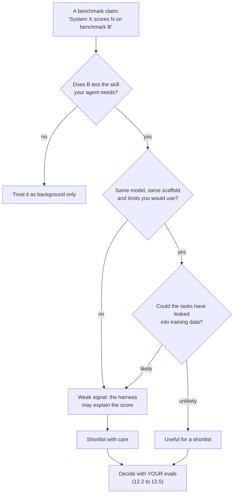

🏠 [Home](../../README.md) › [12 · Evaluation](./README.md) › 12.6 Public benchmarks (overview)

# 12.6 Public benchmarks (overview)

> **Difficulty:** 🟡 Intermediate · **Reading time:** ~8 min · **Prerequisites:** [12.2 Task, trajectory & tool-use metrics](./12.2-task-trajectory-and-tool-metrics.md)

**In one sentence:** Public agent benchmarks such as SWE-bench, GAIA, τ-bench, WebArena, OSWorld and BFCL each measure one kind of agent skill in one controlled setting; they are useful for shortlisting models, but contamination, differences in the agent setup and the gap from your own tasks mean your own evals should make the final decision.

📑 **On this page**

- [Why does this matter?](#-why-does-this-matter)
- [The idea, in plain words](#-the-idea-in-plain-words)
- [Picture it](#-picture-it)
- [How it works, step by step](#-how-it-works-step-by-step)
- [Worked example](#-worked-example)
- [Code](#-code)
- [Common mistakes & gotchas](#-common-mistakes--gotchas)
- [Key takeaways](#-key-takeaways)
- [Try it yourself](#-try-it-yourself)
- [Further reading](#-further-reading)

## 🤔 Why does this matter?

Every model launch comes with a table of [benchmark](../../GLOSSARY.md#benchmark) scores, and every agent framework claims a number on some leaderboard. You will be asked "which model should we use?" and someone will point at those tables.

Benchmarks are genuinely useful: they are public, repeatable, and much bigger than anything you will build yourself. But a score only tells you how one setup did on one kind of task. Knowing what each benchmark actually measures, and how scores can mislead, lets you use them for what they are good at (a shortlist) without being fooled by them.

This page deliberately quotes no scores. They change every few weeks, and any number printed here would be out of date by the time you read it. Follow the links for current results.

## 🧠 The idea, in plain words

A benchmark is like a standardised exam. A student's maths exam score tells you something real about their maths. It tells you much less about whether they will be good at *your* job, which might need maths, writing and dealing with angry customers. And if the student saw the exam questions in advance, the score tells you almost nothing.

Agent benchmarks are the same, with one extra twist: the "student" is a model **plus** the program around it (the *scaffold* or *harness*: the prompts, tools, loop and limits). Two teams can run the same model on the same benchmark with different scaffolds and get very different scores. So a benchmark result is really a result for a *system*, not just a model.

## 👀 Picture it



*Every path ends in the same box. Public benchmarks narrow the field; your own eval set picks the winner.*

## 🔍 How it works, step by step

### The main agent benchmarks

| Benchmark | What the agent must do | How success is checked | Good signal for |
| --- | --- | --- | --- |
| **[SWE-bench](https://www.swebench.com)** | Given a real Python repository and a GitHub issue, edit the code to resolve it. The original set has 2,294 problems from 12 popular repositories. | Run the tests that the real fix made pass, and check that previously passing tests still pass | Coding agents working in real codebases |
| **[GAIA](https://huggingface.co/gaia-benchmark)** | Answer real-world questions that need several steps of reasoning, web browsing, handling of images and files, and tool use; simple for humans, hard for AI. 466 questions in three difficulty levels. | Quasi-exact match against a single short answer; answers for 300 questions are kept private for the leaderboard | General research assistants |
| **[τ-bench](https://github.com/sierra-research/tau-bench)** | Hold a conversation with a simulated user (played by a model) in retail or airline customer service, using API tools and following a written policy | Compare the database at the end with the expected state; reports pass^k over repeated trials | Tool-using, rule-following, customer-facing agents |
| **[WebArena](https://webarena.dev)** | Complete tasks on realistic, self-hosted websites: online shop, forum, code hosting, content management | Functional checks of whether the task was really done | Browser agents |
| **[OSWorld](https://os-world.github.io)** | Complete tasks on a real desktop (Ubuntu, Windows, macOS) across real apps, files and multi-app workflows. 369 tasks in the original set. | A custom script per task inspects the final state of the machine | Computer-use agents ([3.7](../03-tools-and-function-calling/03.7-computer-use-and-browser-agents.md)) |
| **[BFCL](https://gorilla.cs.berkeley.edu/leaderboard.html)** (Berkeley Function Calling Leaderboard) | Produce correct function calls: single, multiple and parallel; know when *no* function fits; newer versions add multi-turn and agentic tasks | Compare the call's structure with the expected call (AST matching), and execute calls where possible | The tool-calling step itself ([3.3](../03-tools-and-function-calling/03.3-how-function-calling-works.md)) |

A few notes on reading them:

- **Benchmarks come in families.** SWE-bench has Verified, Lite, Multimodal and Multilingual variants; τ-bench has a successor, [τ²-bench](https://arxiv.org/abs/2506.07982), in which the user can also act on the environment. Check *which* variant a score refers to.
- **Most grade the end state, not the text.** Look at the "how success is checked" column: tests pass, the database matches, the desktop is in the right state. This is the same principle as [12.2](./12.2-task-trajectory-and-tool-metrics.md), and the reason these benchmarks are taken seriously.
- **They measure capability, not your product.** None of them knows your tools, your users or your policies.

### Why scores mislead

1. **[Data contamination](../../GLOSSARY.md#data-contamination).** If benchmark questions or their solutions appear in a model's training data (GitHub issues and their fixes are public, for example), the model may have partly memorised them. Its score then overstates how it does on *new* problems. Defences used by benchmark makers include private test answers (GAIA), regularly refreshed questions ([LiveBench](https://arxiv.org/abs/2406.19314)), and statistical tests for memorisation ([Oren et al., 2023](https://arxiv.org/abs/2310.17623)). None removes the risk completely.
2. **Scaffold differences.** The same model with a better prompt, more tools, more steps or more retries scores higher. A leaderboard row is a system result. Look for what harness was used, and whether the limits (steps, time, cost) were similar.
3. **Many attempts, one reported.** "Best of 5 attempts" (pass@5, see [12.2](./12.2-task-trajectory-and-tool-metrics.md)) is a very different number from a single attempt. Check which one you are reading.
4. **Self-reported results.** Some leaderboard entries are verified by the maintainers; others are submitted by the people who built the system. Prefer verified or reproduced results.
5. **Cost and time are often missing.** A system that solves 5% more tasks for 10× the tokens may be the wrong choice for you ([16.1](../16-cost-and-performance/16.1-token-cost-maths.md)).
6. **Saturation and noise.** Near the top of a leaderboard, differences of a point or two are often within run-to-run noise, or come from a handful of tasks with disputed labels.

### Why your own evals matter more

Your eval set ([12.4](./12.4-building-an-eval-dataset.md)) has three properties no public benchmark can have: **your tasks**, **your tools and policies**, and **your success criteria**. It also can't be in any model's training data unless you publish it. In practice, we recommend using public benchmarks to pick two or three candidate models, then running all of them through your own eval suite, with several trials per case, and deciding on that.

## 💡 Worked example

Your team is choosing a model for the customer support agent from [12.5](./12.5-regression-testing-in-ci.md). A colleague points to a leaderboard where Model P is clearly ahead of Model Q on a coding benchmark.

Working through the diagram:

1. **Does the benchmark test the skill you need?** Not really. Your agent looks up orders, follows a refund policy and talks to customers. A tool-use, policy-following benchmark like τ-bench is much closer than a coding benchmark. BFCL tells you about the raw tool-calling step.
2. **Same scaffold?** The τ-bench numbers you find use the benchmark's own simple tool-calling agent; yours is similar. Reasonable.
3. **Contamination risk?** τ-bench's tasks are public, so some risk exists; you note it.
4. **Shortlist:** both P and Q do reasonably on τ-bench, and P is much more expensive per token.
5. **Decide with your own evals.** You run both through the five-case suite from [12.5](./12.5-regression-testing-in-ci.md) with `--live --trials 3`, plus the larger private dataset you built in [12.4](./12.4-building-an-eval-dataset.md). You compare the pass rates *per tag* (policy cases matter most), pass^3, and the cost per run. The decision comes from those numbers, not from the leaderboard.

The coding leaderboard was not wrong. It just answered a different question.

## 💻 Code

You don't need special tooling to run your shortlist through your own evals. If your eval runner from [12.5](./12.5-regression-testing-in-ci.md) takes the provider and model as settings, each candidate is one command:

```bash
# Candidate 1
python evals/run.py --provider anthropic --model claude-sonnet-5-5 \
  --live --trials 3 --out results-sonnet.json
# Candidate 2 (use a current model id from the OpenAI docs)
python evals/run.py --provider openai --model your-candidate-model \
  --live --trials 3 --out results-openai.json
```

Then compare the result files on the metrics *you* care about:

```python
import json
from collections import defaultdict
from pathlib import Path

def summary(path: str) -> dict[str, float]:
    """Pass rate per tag, from a runner results file."""
    results = json.loads(Path(path).read_text(encoding="utf-8"))
    by_tag: dict[str, list[bool]] = defaultdict(list)
    for r in results:
        for tag in r["tags"]:
            by_tag[tag].append(r["passed"])
    return {tag: sum(v) / len(v) for tag, v in sorted(by_tag.items())}

for f in ["results-sonnet.json", "results-openai.json"]:
    print(f, summary(f))
```

To run a public benchmark yourself, use its official harness (each benchmark's repository, linked above, documents its setup). Running it yourself, with your own scaffold and limits, is far more informative than reading someone else's number.

## 🚨 Common mistakes & gotchas

- **Picking a model from a leaderboard alone.** The benchmark's tasks are not your tasks. **Fix:** shortlist from benchmarks, decide with your own evals.
- **Comparing numbers from different harnesses.** A score with a heavily engineered scaffold and one with a minimal loop are not comparable. **Fix:** compare results from the same harness, or run it yourself.
- **Ignoring the variant.** "SWE-bench" can mean several different subsets. **Fix:** check the exact name and version of the benchmark.
- **Trusting tiny gaps.** A one-point lead can be noise. **Fix:** treat small differences as ties unless the results are averaged over several runs.
- **Publishing your private eval set.** Once it is public it can end up in future training data, and it stops being a clean test. **Fix:** keep your eval data private; share the method, not the cases.
- **Forgetting cost and latency.** A top score at an impossible price is not a win. **Fix:** always put cost per task and time per task next to the pass rate.

## ✅ Key takeaways

- SWE-bench (coding), GAIA (general assistants), τ-bench (tool use with users and policies), WebArena (web), OSWorld (desktop) and BFCL (function calling) each measure one slice of agent ability.
- The good ones grade the end state, and a score is a result for a whole system (model plus scaffold), not a model alone.
- Contamination, scaffold differences, best-of-k reporting and missing cost figures can all make scores misleading.
- Use benchmarks to shortlist; use your own private eval set, with several trials, to decide.

## 🧪 Try it yourself

1. For each agent, name the closest public benchmark: (a) an agent that fixes failing tests in a repository; (b) an agent that books flights through an airline's API while following fare rules; (c) an agent that fills in a web form on a supplier's site.
2. A vendor says their agent "solves 70% of benchmark B". List three questions you would ask before believing it applies to you.

<details>
<summary>Show answer</summary>

1. (a) SWE-bench. (b) τ-bench (its airline domain is very close), plus BFCL for the raw tool-calling step. (c) WebArena.
2. Any three of: Which variant and version of B? One attempt per task, or best of several (pass@k)? What scaffold, tools and step or cost limits were used, and are they like ours? Was the result verified by the benchmark maintainers or self-reported? Could B's tasks be in the model's training data? What did it cost per task? And above all: how does it do on our own eval set?

</details>

## 📚 Further reading

- [SWE-bench: Can Language Models Resolve Real-World GitHub Issues?](https://arxiv.org/abs/2310.06770) (Jimenez et al., 2023). The original SWE-bench paper.
- [GAIA: a benchmark for General AI Assistants](https://arxiv.org/abs/2311.12983) (Mialon et al., 2023). Questions that are easy for people and hard for AI assistants.
- [τ-bench: A Benchmark for Tool-Agent-User Interaction in Real-World Domains](https://arxiv.org/abs/2406.12045) (Yao et al., 2024). Simulated users, domain policies, end-state grading and pass^k.
- [WebArena: A Realistic Web Environment for Building Autonomous Agents](https://arxiv.org/abs/2307.13854) (Zhou et al., 2023). Self-hosted websites for testing web agents.
- [OSWorld: Benchmarking Multimodal Agents for Open-Ended Tasks in Real Computer Environments](https://arxiv.org/abs/2404.07972) (Xie et al., 2024). Real desktops with execution-based checks.
- [Berkeley Function Calling Leaderboard](https://gorilla.cs.berkeley.edu/leaderboard.html) (Gorilla team, UC Berkeley). Function-calling accuracy across many models, with methodology blogs.
- [Proving Test Set Contamination in Black Box Language Models](https://arxiv.org/abs/2310.17623) (Oren et al., 2023). How to test whether a model has memorised a benchmark.

<!-- FOOTER -->

---

⬅️ **Previous:** [12.5 Regression testing agents in CI](./12.5-regression-testing-in-ci.md) ·
🏠 [Chapter home](./README.md) ·
➡️ **Next:** [13 · Safety & Guardrails → 13.1 Threat model for agents](../13-safety-and-guardrails/13.1-threat-model-for-agents.md)
