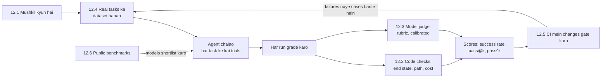

🏠 [Home](../../README.md) › 12 · Evaluation

# 12 · Evaluation

> **Padhne ka time:** ~58 min · **Level:** 🟡 Intermediate · **Pehle padho:** [02 · The Agent Loop](../02-the-agent-loop/README.md), [03 · Tools & Function Calling](../03-tools-and-function-calling/README.md)

Jo agent kal kaam kar raha tha, woh aaj chupchaap kharab ho sakta hai. Ek prompt tweak, ek tool change ya naya model version, itna hi kaafi hai. Yeh chapter dikhata hai ki kaise measure karein ki agent kaam karta hai, aur use kaam karta hua kaise rakhein. Tum seekhoge ki agents ko test karna normal code se mushkil kyun hai, outcomes, paths aur reliability ke liye kaunse metrics use karein, model ko grader kaise banayein bina usse bewakoof bane, eval dataset kaise banayein aur maintain karein, CI mein agent tests kaise chalayein, aur public benchmarks kaise padhein.

## 🎯 Is chapter mein kya seekhoge

- Bahut saare steps, kai sahi raaste, non-determinism, side effects aur cost agent evals ko mushkil kyun banate hain
- Final-state checks, exact aur partial match, strict / in-order / any-order trajectory matching, aur tool-call precision aur recall
- pass@k ("k tries mein kam se kam ek baar succeed") aur pass^k ("har baar succeed") ka farak, aur dono ko estimate kaise karein
- LLM-as-judge: rubrics, pointwise vs pairwise grading, jaane-pehchaane biases, aur human labels ke against calibration
- Eval dataset kaise collect, label, split aur version karein, aur use lagbhag kitna bada hona chahiye
- Do-layer CI setup: har pull request par deterministic replay tests, schedule par live-model evals
- SWE-bench, GAIA, τ-bench, WebArena, OSWorld aur BFCL kya measure karte hain, aur tumhare apne evals zyada kyun matter karte hain

## 📋 Pehle se kya aana chahiye

- [2.1 Observe–think–act loop](../02-the-agent-loop/02.1-the-observe-think-act-loop.md), taaki tum jaano ki agent ka ek run kaisa dikhta hai
- [3.3 Function calling kaise kaam karta hai](../03-tools-and-function-calling/03.3-how-function-calling-works.md), kyunki kai metrics tool calls ko dekhte hain
- [12.5](./12.5-regression-testing-in-ci.md) ke liye basic `pytest` aana madad karega

## 👀 Chapter ek nazar mein

*Evaluation ek loop hai: real tasks andar jaate hain, graded runs bahar aate hain, aur har failure ek naya test case ban jaati hai. Public benchmarks is loop ke bahar hain. Woh yeh chunne mein madad karte hain ki kya test karna hai, yeh nahi batate ki tumhare liye kaam karta hai ya nahi.*

## 📄 Is chapter ke pages

<!-- PAGES:START -->
| # | Page | Level | Time |
| --- | --- | --- | --- |
| 12.1 | [Agents ke evals mushkil kyun hain?](./12.1-why-agent-evals-are-hard.md) — Bahut saare steps, kai sahi raaste, aur har run par alag output. | 🟡 Intermediate | ~8 min |
| 12.2 | [Task, trajectory aur tool-use metrics](./12.2-task-trajectory-and-tool-metrics.md) — Result, raasta aur tool calls, teeno ko measure karo. | 🟡 Intermediate | ~10 min |
| 12.3 | [LLM-as-judge: model se grading karwao](./12.3-llm-as-judge.md) — Outputs grade karne ke liye model use karo, aur grader ko bhi check karo. | 🟡 Intermediate | ~10 min |
| 12.4 | [Eval dataset kaise banayein](./12.4-building-an-eval-dataset.md) — Test cases collect, label aur maintain karo. | 🟡 Intermediate | ~10 min |
| 12.5 | [CI mein agents ki regression testing](./12.5-regression-testing-in-ci.md) — Har pull request par regressions pakdo. | 🔴 Advanced | ~12 min |
| 12.6 | [Public benchmarks (ek overview)](./12.6-public-benchmarks.md) — Jaane-maane agent benchmarks aur unhe kaise padhein. | 🟡 Intermediate | ~8 min |
<!-- PAGES:END -->

<!-- FOOTER -->

---

⬅️ **Pichla chapter:** [11 · Frameworks](../11-frameworks/README.md) ·
▶️ **Padhna shuru karo:** [12.1 Agents ke evals mushkil kyun hain?](./12.1-why-agent-evals-are-hard.md) ·
➡️ **Agla chapter:** [13 · Safety & Guardrails](../13-safety-and-guardrails/README.md)
