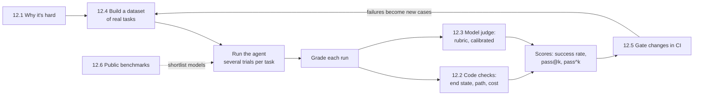

🏠 [Home](../../README.md) › 12 · Evaluation

# 12 · Evaluation

> **Estimated reading time:** ~58 min · **Difficulty:** 🟡 Intermediate · **Prerequisites:** [02 · The Agent Loop](../02-the-agent-loop/README.md), [03 · Tools & Function Calling](../03-tools-and-function-calling/README.md)

An agent that worked yesterday can quietly get worse today: a prompt tweak, a tool change or a new model version is enough. This chapter shows how to measure whether an agent works, and keep it working. You will learn why agents are harder to test than ordinary code, which metrics to use for outcomes, paths and reliability, how to use a model as a grader without being fooled by it, how to build and maintain an eval dataset, how to run agent tests in CI, and how to read public benchmarks.

## 🎯 What you'll learn

- Why many steps, many valid paths, non-determinism, side effects and cost make agent evals hard
- Final-state checks, exact and partial match, strict / in-order / any-order trajectory matching, and tool-call precision and recall
- The difference between pass@k ("succeeds at least once in k tries") and pass^k ("succeeds every time"), and how to estimate both
- LLM-as-judge: rubrics, pointwise vs pairwise grading, known biases, and calibrating against human labels
- How to collect, label, split and version an eval dataset, and roughly how big it needs to be
- A two-layer CI setup: deterministic replay tests on every pull request, live-model evals on a schedule
- What SWE-bench, GAIA, τ-bench, WebArena, OSWorld and BFCL measure, and why your own evals matter more

## 📋 Prerequisites

- [2.1 The observe-think-act loop](../02-the-agent-loop/02.1-the-observe-think-act-loop.md), so you know what a run of an agent looks like
- [3.3 How function calling works](../03-tools-and-function-calling/03.3-how-function-calling-works.md), because many metrics look at tool calls
- Basic `pytest` helps for [12.5](./12.5-regression-testing-in-ci.md)

## 👀 Chapter overview

*Evaluation is a loop: real tasks go in, graded runs come out, and every failure becomes a new test case. Public benchmarks sit outside the loop; they help you choose what to test, not whether it works for you.*

## 📄 Pages in this chapter

<!-- PAGES:START -->
| # | Page | Level | Time |
| --- | --- | --- | --- |
| 12.1 | [Why evals are hard for agents](./12.1-why-agent-evals-are-hard.md) — Many steps, many valid paths, and non-deterministic output. | 🟡 Intermediate | ~8 min |
| 12.2 | [Task, trajectory & tool-use metrics](./12.2-task-trajectory-and-tool-metrics.md) — Measure the result, the path, and the tool calls. | 🟡 Intermediate | ~10 min |
| 12.3 | [LLM-as-judge](./12.3-llm-as-judge.md) — Use a model to grade outputs, and check the grader. | 🟡 Intermediate | ~10 min |
| 12.4 | [Building an eval dataset](./12.4-building-an-eval-dataset.md) — Collect, label and maintain test cases. | 🟡 Intermediate | ~10 min |
| 12.5 | [Regression testing agents in CI](./12.5-regression-testing-in-ci.md) — Catch regressions on every pull request. | 🔴 Advanced | ~12 min |
| 12.6 | [Public benchmarks (overview)](./12.6-public-benchmarks.md) — Well-known agent benchmarks and how to read them. | 🟡 Intermediate | ~8 min |
<!-- PAGES:END -->

<!-- FOOTER -->

---

⬅️ **Previous chapter:** [11 · Frameworks](../11-frameworks/README.md) ·
▶️ **Start reading:** [12.1 Why evals are hard for agents](./12.1-why-agent-evals-are-hard.md) ·
➡️ **Next chapter:** [13 · Safety & Guardrails](../13-safety-and-guardrails/README.md)
