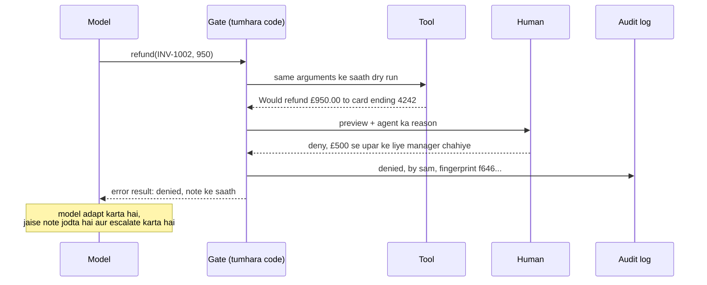

🏠 [Home](../../README.md) › [13 · Safety & Guardrails](./README.md) › 13.5 Risky actions ke liye human approval

# 13.5 Risky actions ke liye human approval

> **Level:** 🟡 Intermediate · **Padhne ka time:** ~8 min · **Pehle padho:** [13.1 Agents ke liye threat model](./13.1-threat-model-for-agents.md), [9.6 Human-in-the-loop](../09-agent-design-patterns/09.6-human-in-the-loop.md)

**Ek line mein:** Har tool ko is hisaab se sort karo ki woh kitna nuksaan kar sakta hai; safe waalon ko aazaadi se chalne do, aur irreversible waalon ko rok ke kisi insaan ko exactly dikhao ki kya hone wala hai, aur har decision log karo.

📑 **Is page par**

- [Yeh kyun zaroori hai?](#-yeh-kyun-zaroori-hai)
- [Idea, simple words mein](#-idea-simple-words-mein)
- [Diagram se samjho](#-diagram-se-samjho)
- [Kaise kaam karta hai, step by step](#-kaise-kaam-karta-hai-step-by-step)
- [Example se samjho](#-example-se-samjho)
- [Code](#-code)
- [Aam galtiyan aur dhyan dene wali baatein](#-aam-galtiyan-aur-dhyan-dene-wali-baatein)
- [Yaad rakhne wali baatein](#-yaad-rakhne-wali-baatein)
- [Khud try karo](#-khud-try-karo)
- [Aur padhne ke liye](#-aur-padhne-ke-liye)

## 🤔 Yeh kyun zaroori hai?

Ek billing agent se kaha jaata hai: *"Ada wants full refunds for INV-1001 and INV-1002."* Matlab Ada ko dono invoices ka poora refund chahiye. Pehla invoice £40 ka hai. Doosra £950 ka hai, aur Ada ka account ek payment plan par hai jiski wajah se full refund galat hai.

Agent yeh jaan nahi sakta. Billing team ka koi insaan do second mein pakad leta.

Kuch actions undo nahi ho sakte: bheja hua paisa, deliver hue emails, delete hue records, deploy hua code. Inke liye sabse sasta safety tarika aksar sabse purana hai: pehle kisi se pooch lo.

Achhe se kiya jaaye toh approval un attacks ko bhi rok deta hai jo baaki har layer se bach nikle ([13.2](./13.2-prompt-injection.md)). Kyunki reviewer asli action dekhta hai, model ka us action ke baare mein diya description nahi.

## 🧠 Idea, simple words mein

Bank ka cashier tumhe bina kisi se pooche £50 de sakta hai. £5,000 ke liye woh manager ko bulata hai. Manager asli withdrawal slip dekhta hai, cashier ka summary nahi, us par sign karta hai, aur bank woh slip rakh leta hai.

Agent ke liye ek [approval gate](../../GLOSSARY.md#approval-gate) yahi copy karta hai:

- **Risk tiers.** Har tool par uske worst case ke hisaab se label lagta hai: *read* (koi side effects nahi), *write* (wapas ho sakne wale changes), *irreversible* (paisa, deletion, bahar jaane wale messages, production changes).
- **Gate.** Tumhara agent loop tool chalane se pehle tier check karta hai. Reads chal jaate hain. Writes chalte hain aur log hote hain. Irreversible actions ruk ke kisi insaan ka intezaar karte hain.
- **Preview.** Insaan ko exactly dikhta hai ki kya hoga. Best yeh hai ki yeh preview usi tool ke, usi arguments ke saath, *dry run* se bane.
- **[Audit log](../../GLOSSARY.md#audit-log).** Har request, decision, approver aur result ek append-only record mein likha jaata hai.

Approval chahiye ya nahi, yeh model kabhi decide nahi karta. Tumhara code karta hai, tool ke tier se.

## 👀 Diagram se samjho



*Insaan ko dry-run preview dikhta hai, model ki apni paraphrase nahi. Denial model ke paas ek error tool result ki tarah wapas jaata hai, taaki woh samajhdaari se aage badh sake. Aur log record karta hai ki kisne kya decide kiya.*

## 🔍 Kaise kaam karta hai, step by step

1. **Har tool ko risk tier do**, jab tum use define karte ho, uske schema ke bagal mein. Shak ho toh upar wala tier chuno. Tool ka tier uske arguments par bhi depend kar sakta hai: £10 se kam ka refund *write* ho sakta hai, £10 se upar ka *irreversible*.

2. **Risky tools mein dry run banao.** Ek `dry_run` flag jodo jo har check chalaye (kya invoice exist karta hai? kya amount valid hai?) aur bataye ki kya *hoga*, bina kuch kiye. Agar dry run fail ho, toh error model ko wapas bhej do, insaan ko pareshaan kiye bina.

3. **Kaam ka preview dikhao.** Exact arguments, plain words mein effect, agent ka bataya hua reason, aur judge karne ke liye kaafi context (invoice, recipient, diff) daalo. Chhota rakho; reviewers sirf nazar maarte hain.

4. **Approval ko exact action se baandho.** Tool name aur arguments ko hash karke ek fingerprint banao. Exactly wahi chalao jo approve hua; agar model baad mein kuch alag maange, toh usko naya approval chahiye.

5. **Default mein deny.** Agar reviewer time par jawab na de, ya jawab saaf "haan" ke alawa kuch bhi ho, toh use "nahi" maano.

6. **Decision model ko wapas bhejo.** Denial reviewer ke note ke saath ek error [tool result](../03-tools-and-function-calling/03.3-how-function-calling-works.md) ban jaata hai. Tab agent andha-dhundh retry karne ki jagah adapt kar sakta hai (escalate kare, user se pooche, chhota action try kare).

7. **Sab kuch log karo, append-only.** Timestamp, tool, arguments (jahan zaroori ho redacted, [13.6](./13.6-secrets-and-pii.md)), fingerprint, decision, approver, result. Jab kuch galat ho, yahi tumhara saboot hai ([14.2](../14-observability-and-debugging/14.2-logging-tool-calls.md)).

8. **Lambe intezaar ke liye, persist aur resume karo.** Asli approval mein ghante lag sakte hain. Run ka state save karo, request khatam karo, aur jab decision aaye tab resume karo ([15.4](../15-production-and-deployment/15.4-state-persistence-and-resumability.md)). Frameworks yeh dete hain: LangGraph ka `interrupt()` graph ko tab tak pause rakhta hai jab tak tum `Command(resume=...)` se resume na karo. OpenAI Agents SDK mein tool `needs_approval` set kar sakta hai (ek boolean ya ek function jo har call ke liye decide kare), jo run ko tab tak rok deta hai jab tak tum approve ya reject na karo.

**Approval fatigue se bacho.** Agar logon se sab kuch approve karwaoge, toh woh padhna band karke yes click karne lagenge. Socho society ka watchman jo har aane-jaane wale ke liye tumhe intercom kare; do din mein tum bina sune "haan bhej do" bolne lagoge.

Practice mein hum aisa rakhte hain ki approvals itne kam hon ki un par sach mein dhyan jaaye. Reads aur reversible writes ko jaane do, per-user limits lagao ("£10 se kam ke refunds auto-approve"), aur jo sandbox ho sake use sandbox karo ([13.3](./13.3-least-privilege-and-sandboxing.md)), taaki kam actions ko insaan chahiye. Anthropic report karta hai ki Claude Code mein sandboxing ne unke internal use mein permission prompts ko safely 84% kam kiya. Idea wahi hai: kam, lekin zyada matlab wale prompts.

## 💡 Example se samjho

Yeh raha billing scenario, ek scripted reviewer ke saath jo £40 wala refund approve karta hai aur £950 wala deny.

```text
Goal: Ada wants full refunds for INV-1001 and INV-1002. Please sort it out.

  [approval 986d40f0e6e2] Would refund £40.00 to Ada's card ending 4242 for INV-1001. -> APPROVED by sam@billing
  [approval f646186caaf1] Would refund £950.00 to Ada's card ending 4242 for INV-1002. -> DENIED by sam@billing

Answer: I refunded £40.00 for INV-1001. The £950.00 refund for INV-1002 was denied by a reviewer, so I added a note and it has been escalated.

Audit log:
  executed  get_invoice {"invoice_id": "INV-1001"}  risk=read
  executed  get_invoice {"invoice_id": "INV-1002"}  risk=read
  approved  refund      {"invoice_id": "INV-1001", "amount_gbp": 40.0}  by sam@billing
  executed  refund      {"invoice_id": "INV-1001", "amount_gbp": 40.0}  risk=irreversible
  denied    refund      {"invoice_id": "INV-1002", "amount_gbp": 950.0}  by sam@billing
  executed  add_note    {"invoice_id": "INV-1002", "text": "Full refund denied by reviewer; escalated."}  risk=write

Refunds actually made: [{'invoice_id': 'INV-1001', 'amount_gbp': 40.0}]
```

Dhyan dene wali baatein:

- Do `get_invoice` reads aur `add_note` write kabhi insaan tak nahi pahunche. Sirf do refunds pahunche.
- Har preview `refund(..., dry_run=True)` se aaya, yaani usi code se bana jo refund karta.
- Denial ke baad model ko error result ki tarah `Denied by a human reviewer. Over £500: needs a manager.` mila, aur usne retry karne ki jagah note jodna chuna.

## 💻 Code

Gate, thoda simplified:

```python
class Risk(str, Enum):
    READ = "read"                    # turant chalao
    WRITE = "write"                  # chalao aur log karo
    IRREVERSIBLE = "irreversible"    # pehle insaan se poocho


@dataclass
class Gate:
    billing: Billing
    approver: Callable[[ApprovalRequest], Decision]
    audit: AuditLog

    def run(self, name: str, args: dict, reason: str) -> tuple[str, bool]:
        risk = TOOLS[name][0]
        fn = getattr(self.billing, name)
        if risk is Risk.IRREVERSIBLE:
            preview = fn(**args, dry_run=True)                  # wahi checks, koi side effects nahi
            if not preview.startswith("Would "):
                return preview, True                            # invalid: kisi se poochne ki zaroorat nahi
            req = ApprovalRequest(name, dict(args), preview, reason)
            decision = self.approver(req)
            self.audit.write("approved" if decision.approved else "denied",
                             tool=name, arguments=args, fingerprint=req.fingerprint,
                             approver=decision.approver, note=decision.note)
            if not decision.approved:
                return f"Denied by a human reviewer. {decision.note}".strip(), True
            args = req.arguments                                # exactly wahi chalao jo approve hua
        result = fn(**args)
        self.audit.write("executed", tool=name, risk=risk.value, arguments=args, result=result)
        return result, False
```

Agent loop mein result `tool_result(call.id, result, is_error=is_error)` ban jaata hai. Approver koi bhi callable ho sakta hai. Ek simple approver terminal mein poochta hai aur `y` ke alawa har cheez ko "nahi" maanta hai. Production mein yeh ek chat channel ya review queue mein post karega, aur run tab tak ruka rahega jab tak koi jawab na de.

## 🚨 Aam galtiyan aur dhyan dene wali baatein

- **Model ko decide karne dena ki kis cheez ko approval chahiye.** Prompt mein "Ask the user before doing anything risky" likhna control nahi hai. Gate code mein hona chahiye, tool ke hisaab se.
- **Model ke likhe previews.** Agar reviewer ko model ka summary dikhta hai ("refunding a small amount"), toh injected ya confused model unhe gumraah kar sakta hai. Asli arguments aur tool ka khud ka preview dikhao.
- **Approve ek cheez, chale doosri.** Approval ko exact arguments se baandhe bina, model approval ke baad amount badal sakta hai. Call ka fingerprint banao.
- **Sab kuch approve karwana.** Ghante mein pachaas prompts logon ko yes click karna sikha dete hain. Apne tools ko tiers mein baanto aur sirf wahi gate karo jo matter karta hai.
- **Chupchaap denials.** Agar model ko pata hi na chale ki deny hua, toh woh wahi call retry kar sakta hai ya user ko bol sakta hai ki kaam ho gaya. Reason ke saath ek error result return karo.
- **Aise logs jo edit ho sakein.** Jo audit log agent (ya koi bhi) dobara likh sake, woh audit log hai hi nahi. Append-only storage rakho, agent ke tools se alag.

## ✅ Yaad rakhne wali baatein

- Har tool par risk tier ka label lagao; sirf irreversible waale (aur high-value writes) gate karo.
- Insaan ko exact action ka dry-run preview dikhao, aur exactly wahi chalao jo unhone approve kiya.
- Default mein deny karo, aur denials ko error results ki tarah model ko wapas bhejo.
- Har request, decision aur result ek append-only audit log mein likho.
- Approvals itne kam rakho ki log unhe sach mein padhein.

## 🧪 Khud try karo

1. Upar wale `Gate` ko aisa badlo ki £10 ya usse kam ke refunds bina approval ke chalein (lekin log phir bhi hon). Ek test likho ki £5 ka refund approver ko call nahi karta aur £40 wala karta hai.
2. Ek deployment agent production par `deploy(service, version)` chala sakta hai. Uska preview design karo: ek minute se kam mein achha decision lene ke liye reviewer ko kya dikhna chahiye?

<details>
<summary>Answer dekho</summary>

1. `Gate.run` mein har call ke liye tier compute karo: `if name == "refund" and args["amount_gbp"] <= 10: risk = Risk.WRITE`. Test mein ek approver use karo jo ek list mein append kare, `gate.run("refund", {"invoice_id": "INV-1001", "amount_gbp": 5.0}, reason="")` call karo, assert karo ki list khaali hai aur refund ho gaya; phir £40 karo aur assert karo ki ek request record hui. Threshold ko code mein rakhne (prompt mein nahi) ka matlab hai ki model baaton se use paar nahi kar sakta.
2. Jaise: service aur environment; current aur naya version; dono ke beech ke changes ka link (ya summary); tests aur checks pass hue ya nahi; deploy kisne ya kis cheez ne maanga aur kyun; rollback plan; aur time window. Preview tumhare deploy tool ke dry run se aana chahiye (jaise planned changes), agent ke apne description se nahi.

</details>

## 📚 Aur padhne ke liye

- [Interrupts](https://docs.langchain.com/oss/python/langgraph/interrupts) (LangGraph docs). Human input ke liye graph ko pause karna aur resume karna.
- [Human-in-the-loop](https://openai.github.io/openai-agents-python/human_in_the_loop/) (OpenAI Agents SDK docs). `needs_approval` ke saath tool approvals.
- [Configure permissions](https://code.claude.com/docs/en/permissions) (Claude Code docs). Ek production agent ke allow, ask aur deny rules; pehle deny check hota hai, phir ask, phir allow.
- [Beyond permission prompts: making Claude Code more secure and autonomous](https://www.anthropic.com/engineering/claude-code-sandboxing) (Anthropic, 2025). Sandboxing ne approvals ki zaroorat kaise kam ki.
- [OWASP Top 10 for Agentic Applications for 2026](https://genai.owasp.org/resource/owasp-top-10-for-agentic-applications-for-2026/). ASI09 Human-Agent Trust Exploitation dekho, un attacks ke baare mein jo human reviewer ko gumraah karte hain.

<!-- FOOTER -->

---

⬅️ **Pichla:** [13.4 Input aur output guardrails](./13.4-input-and-output-guardrails.md) ·
🏠 [Chapter home](./README.md) ·
➡️ **Agla:** [13.6 Secrets aur PII handling](./13.6-secrets-and-pii.md)
